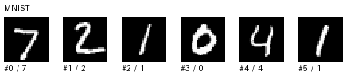

# Önem haritaları için sağlama testleri

Adebayo ve arkadaşlarının (NeurIPS 2018) MNIST CNN deneylerinin ders uygulaması. Açıklamalar, çıktı tabloları ve şekiller [makale.html](makale.html) dosyasındadır.

## Seçilen Ödev Seçeneği: Seçenek 1 — Zafiyet/Manipülasyon

Parametrelerin yeniden başlatılması ve eğitim etiketlerinin permütasyonu, açıklamaların kontrollü müdahalelere ne kadar duyarlı olduğunu sınar. Rapor, her müdahalenin ortaya çıkardığı sınırlılığı mevcut MNIST sonuçlarıyla açıklar.

## Makalenin Orijinal Veri Seti

Bu bölümde makalenin CNN rastgeleleştirme deneylerinde kullanılan **MNIST** el yazısı rakam arşivleri kullanılır.

Görüntüler ve kaynak etiketleri yayımlanmış özgün arşivlerden gelir. Proje sentetik veya bağımsız üretilmiş bir veri kümesi kullanmaz. Etiket permütasyonu deney sırasında eğitim etiketlerine uygulanır. Kaynak arşivler korunur.

| Veri seti | Kaynak | Proje içindeki konum |
| --- | --- | --- |
| MNIST | [Yann LeCun ve çalışma arkadaşları](https://yann.lecun.com/exdb/mnist/); CVDF arşiv aynası | `data/raw/MNIST/` |

### Doğrudan indirme bağlantıları

| Arşiv | MNIST |
| --- | --- |
| Eğitim görüntüleri | [İndir](https://storage.googleapis.com/cvdf-datasets/mnist/train-images-idx3-ubyte.gz) |
| Eğitim etiketleri | [İndir](https://storage.googleapis.com/cvdf-datasets/mnist/train-labels-idx1-ubyte.gz) |
| Test görüntüleri | [İndir](https://storage.googleapis.com/cvdf-datasets/mnist/t10k-images-idx3-ubyte.gz) |
| Test etiketleri | [İndir](https://storage.googleapis.com/cvdf-datasets/mnist/t10k-labels-idx1-ubyte.gz) |

### Defter veriyi nasıl yükler?

Proje klasöründen [analiz.ipynb](analiz.ipynb) çalıştırıldığında, `load_dataset()` yukarıdaki klasörleri oluşturur ve dört gzip IDX arşivini arar. MD5 değeri eşleşen yerel dosyayı kullanır. Eksik veya sağlama toplamı uyuşmayan dosyayı Python’un `urllib.request.urlopen` işleviyle tablodaki adresten indirir. İndirilen dosyayı yazmadan önce MD5 değerini doğrular. Ardından arşivi bellekte açıp IDX başlığını kontrol eder.

El ile indirmek için dört dosyayı adlarını değiştirmeden ve açmadan ilgili klasöre koyun. PowerShell komutları [data/README.md](data/README.md) dosyasındadır. Ham arşivler Git dışında tutulur.

### Özgün test görüntülerinden önizleme

Aşağıda her veri kümesinin test arşivindeki ilk altı görüntü ve yayımlanan etiketleri görülür. Görüntüler okunabilirlik için büyütülmüştür.



## Çalıştırma

Python 3.13 ile bu dizinde:

```powershell
python -m pip install -r requirements.txt
python verify_project.py --execute
python verify_project.py
```

Defter gerçek IDX arşivlerini indirir ve doğrular. İndirme konumu ve kaynaklar [data/README.md](data/README.md) dosyasındadır. Yürütme CPU’da iki model eğitir. Ağırlık dosyası üretilmez. Son komut, kaydedilmiş defter çıktısını iki raporla karşılaştırır ve şekilleri doğrular.

- [Makale ve ekleri](https://arxiv.org/html/1810.03292v3)
- [Yazarların resmî kodu](https://github.com/adebayoj/sanity_checks_saliency)
