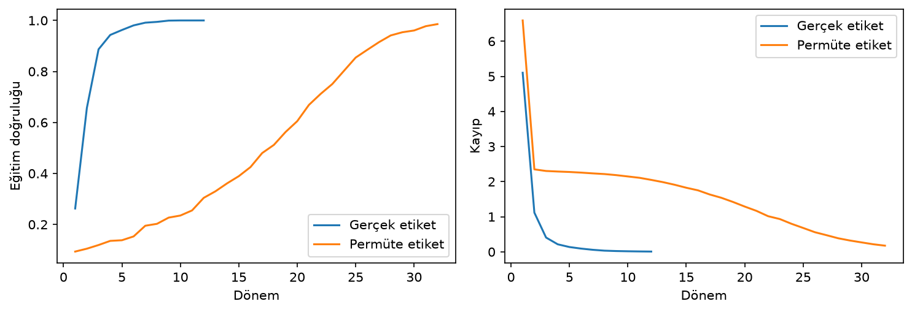
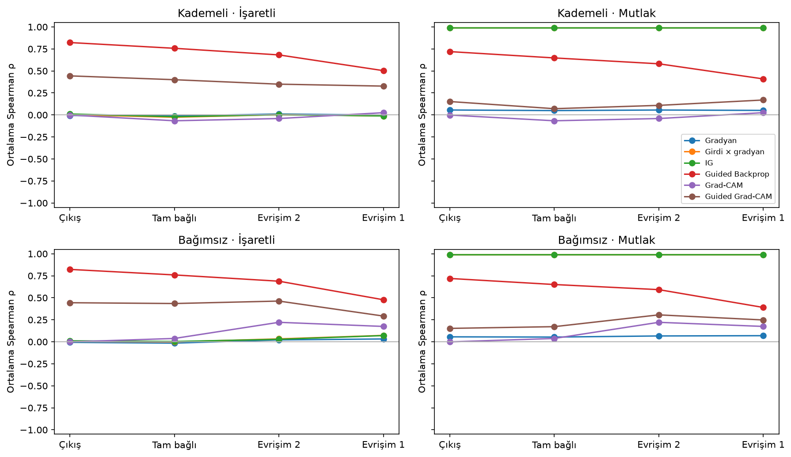
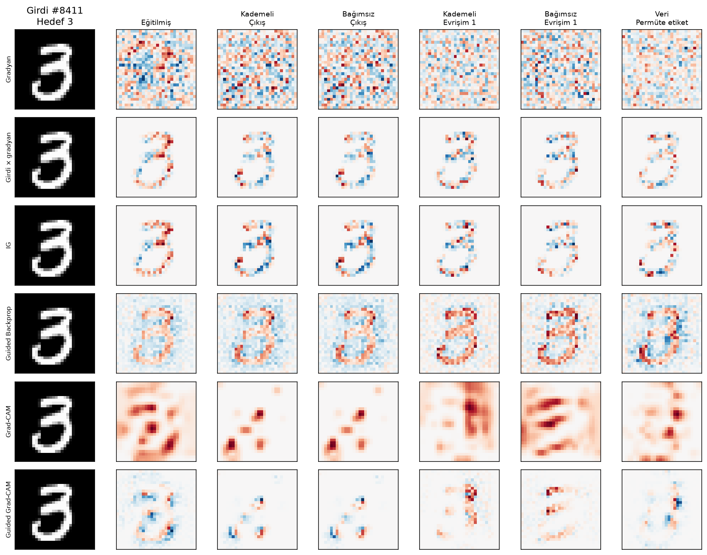
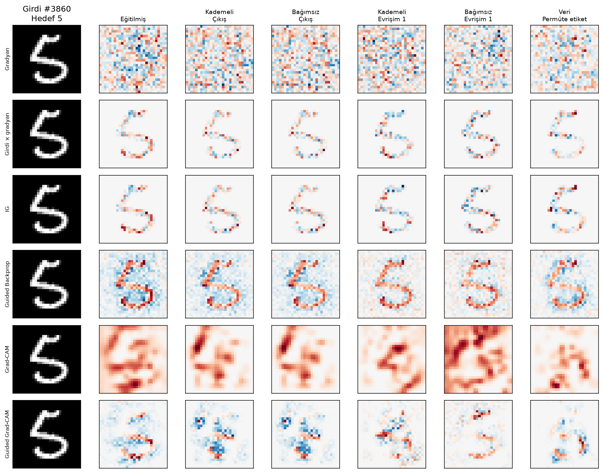
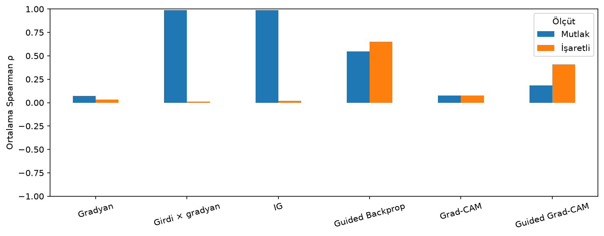

# Önem haritaları için sağlama testleri

**Bölüm 2 · Yorumlanabilirlik · Özgün MNIST verisiyle deneysel yeniden üretim**

## 1. Araştırma amacı

Adebayo ve arkadaşlarının (NeurIPS 2018) iki sağlama testi, piksel atıflarının öğrenilen parametrelere ve görüntü–etiket ilişkisine duyarlılığını sınar. Bu uygulama Bölüm 3–4 ile Ek B–C'deki MNIST CNN deneylerini izler. [Makale ve ekleri](https://arxiv.org/html/1810.03292v3) · [Yazarların kodu](https://github.com/adebayoj/sanity_checks_saliency)

## Seçilen Ödev Seçeneği: Seçenek 1 — Zafiyet/Manipülasyon

**Parametre müdahalesi.** MNIST görüntüsü ve hedef logit sabitken CNN katmanları kademeli veya bağımsız biçimde yeniden başlatılır. Çıkış katmanı değiştirildiğinde ortalama işaretli Spearman korelasyonu Gradyan için −0,006, Guided Backprop için 0,822’dir. Bu fark, Guided Backprop’un bu koşulda çıkış katmanındaki değişimi ayırt etmede sınırlı kaldığını gösterir.

**Eğitim etiketi müdahalesi.** Eğitim görüntüleri sabit tutulur, etiketler permüte edilir ve aynı mimari yeniden eğitilir. Permüte etiketli ağın özgün test doğruluğu %10,25’e düşerken Girdi × gradyan ve IG haritalarının mutlak sıra korelasyonu 0,989’dur. Ortak sıfır pikselleri ve rakam silueti bu benzerliğe katkıda bulunabilir. Yüksek harita benzerliği, modelin özgün görüntü–etiket ilişkisini öğrendiğini doğrulamak için yetersizdir.

Ödevdeki manipülasyon, açıklamaların duyarlılığını sınamak için yapılan kontrollü deneysel müdahaleleri ifade eder. [Adebayo ve ark., §3–4](https://arxiv.org/html/1810.03292v3)

## 2. Özgün veri ve uygulama

MNIST, 60.000 eğitim ve 10.000 test görüntüsünden oluşur. Defter dört özgün gzip IDX arşivinin MD5 değerlerini ve IDX başlıklarını doğrular. 28×28 pikseller 255'e bölünür. Her iki ağ eğitimin aynı 1.600 özgün örneğini kullanır. Eğitim örnekleri tohum 41 ile seçildi. Doğruluk özgün test bölümünün tamamında ölçüldü. Açıklama karşılaştırması için aynı test bölümünden 96 görüntü seçildi. [MNIST](https://yann.lecun.com/exdb/mnist/) · [İndirilen IDX arşivinin aynası](https://storage.googleapis.com/cvdf-datasets/mnist/train-images-idx3-ubyte.gz)

CNN, yazarların betiğindeki 5×5 evrişimli 32 ve 64 kanalı, 2×2 maksimum havuzlamaları, 1.024 birimli tam bağlı katmanı ve 10 logiti kullanır. Ağırlıklar kesilmiş normal dağılımla, sapmalar 0,1 ile başlatılır. Katman müdahalelerinde aynı başlangıç dağılımı kullanılır. Deney ortamı Python 3.13.15, PyTorch 2.15.0+cpu, CPU. [Yazarların eğitim betiği](https://github.com/adebayoj/sanity_checks_saliency/blob/master/src/train_cnn_models.py)

## 3. Deney düzeni

- **Parametre testi.** Kademeli müdahale çıkıştan girişe doğru birikir. Bağımsız müdahale her seferinde yalnız bir katmana uygulanır. Müdahale sonrasında ağ yeniden eğitilmez.
- **Veri testi.** Görüntüler ve etiket frekansları sabittir. Eğitim etiketleri bir kez karıştırılır. Etiketlerin 89.7% kadarı değişti. İki model aynı ilk ağırlıklardan başlar.
- **Açıklamalar.** Altı yöntem aynı görüntü ve eğitilmiş ağın seçtiği aynı hedef logit üzerinde hesaplanır. IG siyah referansla 24 aralıklı trapez integrali kullanır. Grad-CAM son evrişimde pozitif kanal bileşimini 28×28'e büyütür. Guided Backpropagation ReLU'da negatif geri sinyali kapılar.
- **Ölçüm.** Spearman sıra korelasyonu ham işaretli piksellerde ve mutlak değerlerinde ayrı hesaplanır. Sabit haritalarda tanımsız eşleşmeler ortalama dışında tutulur ve geçerli çift sayısı tabloda verilir.

## 4. Deneysel sonuçlar

| Koşul          |   Dönem |   Eğitim doğruluğu |   Özgün test doğruluğu |
|:---------------|--------:|-------------------:|-----------------------:|
| Gerçek etiket  |      12 |             1.0000 |                 0.9499 |
| Permüte etiket |      32 |             0.9856 |                 0.1025 |

Permüte etiketli ağ, verilen etiketlerde 98.6% eğitim doğruluğu ve özgün test etiketlerinde 10.2% doğruluk elde etti. Özgün test doğruluğu, on sınıflı görevdeki yaklaşık %10 şans düzeyiyle birlikte okunmalıdır. Kademeli testin ilk adımında işaretli ortalama korelasyon Gradyan için -0.006, Guided Backprop için 0.822 oldu. Son adımda aynı değerler sırasıyla -0.001 ve 0.503 olarak ölçüldü.

Görsellerde her harita için simetrik renk ölçeği kullanıldı. Paneller desen ve işaret karşılaştırmasına uygundur. Renk şiddeti paneller arasında mutlak büyüklük karşılaştırması için kullanılmaz.

### Permüte etiket müdahalesinde benzerlik

| Yöntem          | Ölçüt    |   Ortalama ρ |   Geçerli çift |
|:----------------|:---------|-------------:|---------------:|
| Girdi × gradyan | Mutlak   |        0.989 |             96 |
| Girdi × gradyan | İşaretli |        0.011 |             96 |
| Grad-CAM        | Mutlak   |        0.077 |             96 |
| Grad-CAM        | İşaretli |        0.077 |             96 |
| Gradyan         | Mutlak   |        0.073 |             96 |
| Gradyan         | İşaretli |        0.031 |             96 |
| Guided Backprop | Mutlak   |        0.547 |             96 |
| Guided Backprop | İşaretli |        0.650 |             96 |
| Guided Grad-CAM | Mutlak   |        0.186 |             96 |
| Guided Grad-CAM | İşaretli |        0.409 |             96 |
| IG              | Mutlak   |        0.989 |             96 |
| IG              | İşaretli |        0.021 |             96 |

## 5. Makaleyle karşılaştırma ve sınırlılıklar

Makalede üst katmanlarda Guided Backprop haritalarının görece yüksek benzerlik gösterebildiği, alt katmanların da rastgeleleştirilmesiyle bozulabildiği bildirilir. Yukarıdaki ilk ve son adım ölçümleri bu ayrımı aynı MNIST görüntülerinde sınar. Girdi ile çarpılan yöntemlerde ortak sıfır pikselleri ve rakam silueti mutlak sıra korelasyonunu etkileyebilir. Atıf benzerliği modelin doğruluğundan ayrı değerlendirilir.

Bu çalışma TensorFlow yerine PyTorch kullanır. Eğitim altkümesi, Adam öğrenme hızı (0,001), 128'lik yığın, temiz model için 12 dönem ve permüte model için %98 çevrimiçi eğitim doğruluğunda erken durdurma veya en fazla 100 dönem yerel tercihlerdir. L2 cezası uygulanmadı. Özgün betikte doğrulama bölmesi ve 50'lik yığın vardır. Burada tek çalışma tohumu, altı atıf yöntemi ve iki Spearman ölçümü kullanıldı. HOG, SSIM, SmoothGrad ve VarGrad kapsam dışındadır. Bulgular bu CNN ve örneklemle sınırlıdır.
