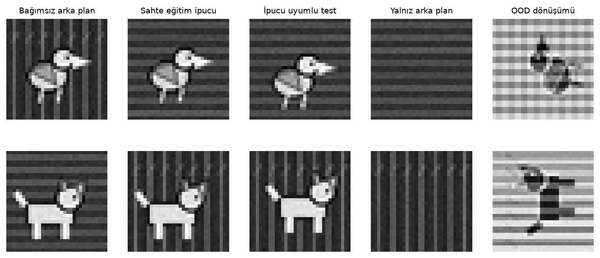
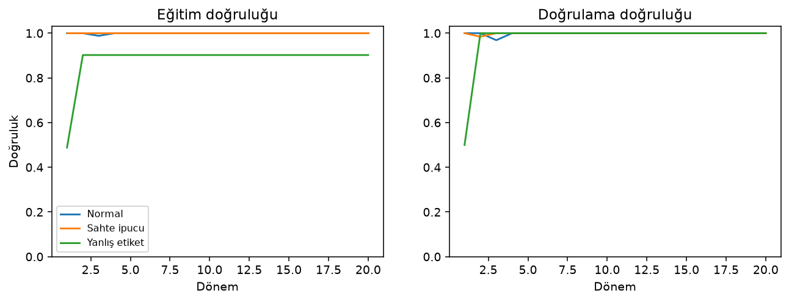
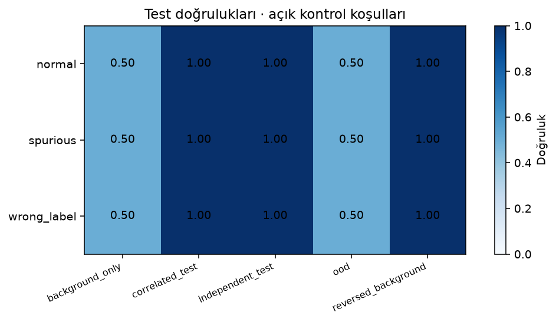
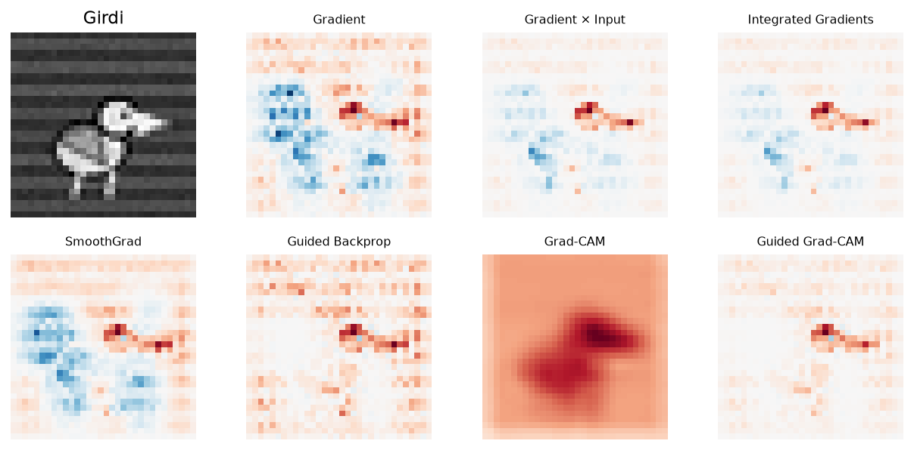
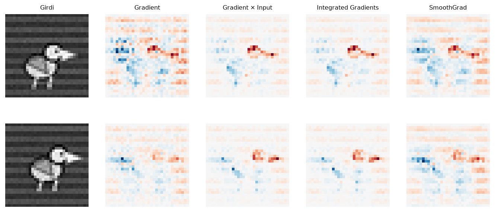
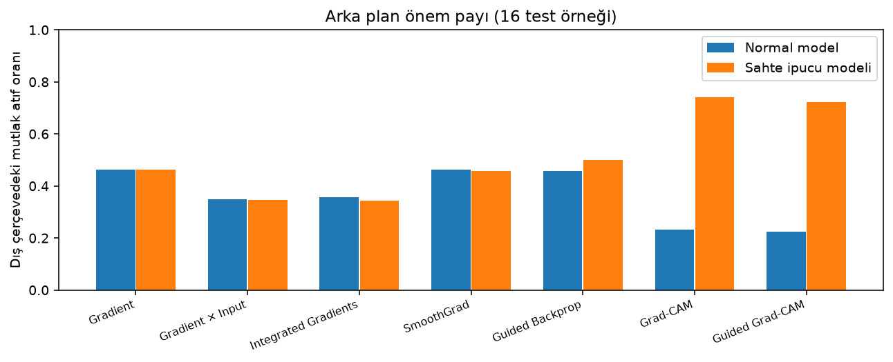
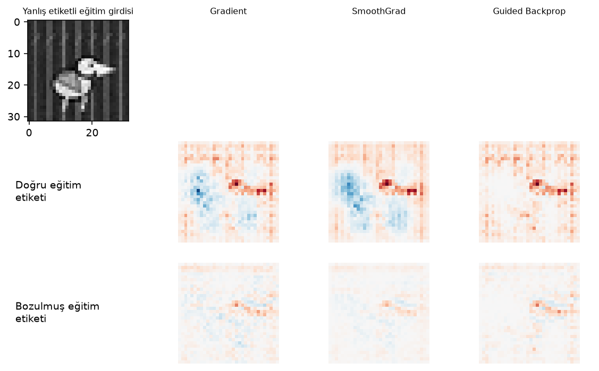
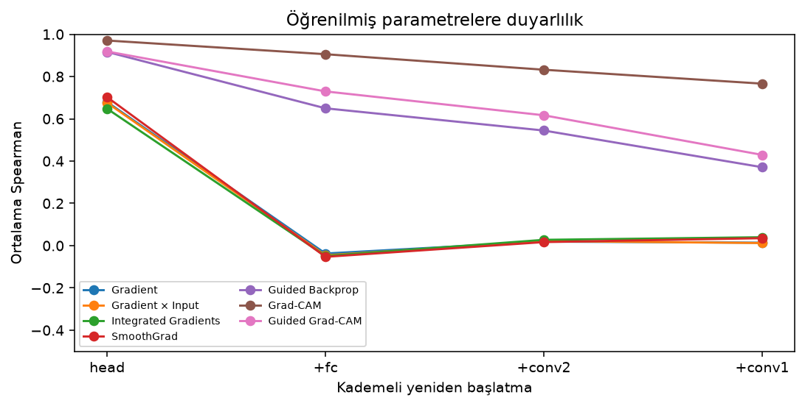
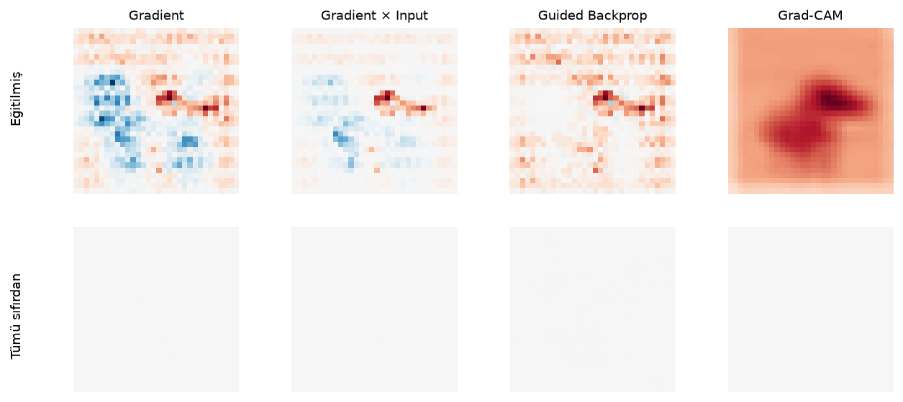
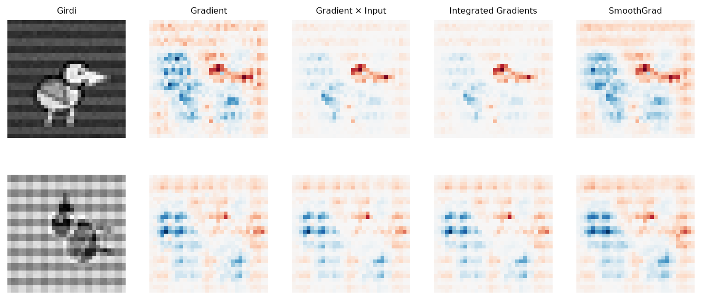

# Model Açıklamaları İçin Hata Ayıklama Testleri — Makale Yeniden Üretimi

**Tania El Hawari — 20259258043**  
**Özgün yayın:** Julius Adebayo, Michael Muelly, Ilaria Liccardi ve Been Kim, *Debugging Tests for Model Explanations*, NeurIPS 2020, [arXiv:2011.05429v1](https://arxiv.org/pdf/2011.05429v1).

> **Kapsam notu:** Bu çalışma, makaledeki üç bozulma kategorisindeki dört hata örneğine yönelik **küçük ve sentetik** bir kavramsal yeniden uygulamadır. Makalenin özgün veri setleri, mimarileri, istatistikleri veya 54 kişilik insan çalışması burada yeniden üretilmemiştir. Yapay zekâ destekli kodlama ve raporlama araçları kullanılmıştır.

## Seçenek 1 — Zafiyet/Manipülasyon Analizi

Bu ödev için **Seçenek 1 — Zafiyet/Manipülasyon Analizi** seçilmiştir. *Debugging Tests for Model Explanations*, veri, model veya test girdisi bozulduğunda özellik atıflarının hatayı ortaya çıkarıp çıkaramadığını sınadığı için bu seçeneğe uygundur. Görsel olarak ikna edici bir açıklamanın modeldeki kusuru gizleyebilmesi, incelenen zafiyettir.

Dört sentetik deney bu soruyu farklı açılardan ele alır. **Sahte arka plan** deneyi sınıfla ilişkilendirilen ipucunun tahminlere ve atıflara etkisini, **yanlış etiket** deneyi bozulmuş eğitim etiketlerinin atıflardan ayırt edilip edilemediğini inceler. **Kademeli ağırlık yeniden başlatma**, atıfların öğrenilmiş parametrelere duyarlılığını, **dağılım dışı girdi vekili** ise görüntü dönüşümlerinin atıflara etkisini değerlendirir. Bunlar özgün makalenin kavramsal uyarlamalarıdır. Örneğin ters arka plan testinde doğruluk düşmedi. Her müdahale, modelin kandırıldığını veya açıklamanın çöktüğünü göstermez.

## 1. Araştırma amacı ve hipotezler

H1: sınıfa bağlı arka plan bir sahte ilişki oluşturabilir. H2: yanlış etiketli eğitim örneklerinin haritaları benzer kalabilir. H3: rastgeleleştirilmiş ağırlıklar her açıklama yöntemini aynı şekilde etkilemez. H4: dağılım dışı görünüşe sahip girdi değişiminde harita benzerliği güvenilir OOD tanısı değildir.

## 2. Kullanılan kütüphaneler

Python, NumPy, pandas, Pillow, PyTorch, SciPy ve Matplotlib kullanıldı. Veriler ve ağırlıklar hazır XAI paketi kullanmadan oluşturuldu. Aynı kod `analiz.ipynb` içinde tekrar çalıştırılabilir.

## 3. Matematiksel yöntem

İki sınıflı bir CNN için $f_\theta(x)$ logitleri incelendi. Girdi gradyanı $\nabla_x s_c(x)$, Gradient × Input $x\odot\nabla_xs_c(x)$, Integrated Gradients, SmoothGrad, Guided Backprop, Grad-CAM ve Guided Grad-CAM hesaplandı. Sıralama korelasyonu Spearman ve görsel benzerlik SSIM ile ölçüldü. IG 16 trapez aralığı; SmoothGrad 8 gürültü örneği ve $\sigma=0{,}08$ kullandı. Aynı test girdisi için gerçek hedef sınıf logiti sabit kaldı.

## 4. Veri üretimi ve kökeni

Kuş ve köpek fotoğrafı yerine, merkezi şekilleri farklı **simge çizimleri** kullanıldı; arka plan yatay veya dikey dokulu olarak üretildi. Sınıf başına aynı sayıda örnek vardır. Bağımsız veri 256 eğitim, 64 doğrulama ve 96 test örneğinden oluşur. Sahte-ipuçlu eğitim kümesi ve test müdahaleleri ayrı dosyalarda saklanır. Toplam **1056 PNG** için `veri.csv` içindeki SHA-256 karması doğrulandı. Tohum: 20261122.

## 5. Model mimarisi ve eğitim

32×32×1 → Conv(12) → ReLU/Havuz → Conv(20) → ReLU/Havuz → Dense(48) → Dense(2). Adam optimizasyonu, mini yığın boyutu 32, sabit tohum, eğitim üst sınırı 20 dönem. Normal, sahte ipuçlu ve %9,77 yanlış eğitim etiketli modellerin en iyi doğrulama kaybına sahip durumları kullanıldı.

## 6. Deney koşulları ve model doğrulukları

| Model       | Test koşulu         |   Doğruluk |   Çapraz entropi |
|:------------|:--------------------|-----------:|-----------------:|
| normal      | independent_test    |      1,000 |            0,000 |
| normal      | correlated_test     |      1,000 |            0,000 |
| normal      | reversed_background |      1,000 |            0,000 |
| normal      | background_only     |      0,500 |            3,653 |
| normal      | ood                 |      0,500 |            3,795 |
| spurious    | independent_test    |      1,000 |            0,001 |
| spurious    | correlated_test     |      1,000 |            0,000 |
| spurious    | reversed_background |      1,000 |            0,002 |
| spurious    | background_only     |      0,500 |            1,774 |
| spurious    | ood                 |      0,500 |            4,568 |
| wrong_label | independent_test    |      1,000 |            0,083 |
| wrong_label | correlated_test     |      1,000 |            0,059 |
| wrong_label | reversed_background |      1,000 |            0,105 |
| wrong_label | background_only     |      0,500 |            0,813 |
| wrong_label | ood                 |      0,500 |            1,545 |

## 7. Atıf yöntemleri

Gradient, Gradient × Input, Integrated Gradients, SmoothGrad, Guided Backprop, Grad-CAM ve Guided Grad-CAM. Pozitif ve negatif katkı işaretleri görselde korunur; sabit haritalar için korelasyon tanımsız olabilir. Yalnız görsel netlik, yöntemin modele sadakatini kanıtlamaz.

## 8. Deney A · Sahte arka plan ilişkisi

Sahte ilişkili eğitim modeli: uyumlu arka plan testi doğruluğu **1,000**, ters arka plan testi **1,000**, yalnız arka plan testi **0,500**. Bu sayılar dışarıdan sağlanmış sonuçlar değil defterin hesapladığı ölçümlerdir. Dış çerçevedeki mutlak atıf payı, sadece betimleyici bir kontrol ölçütüdür.

**Kontrol yorumu:** Uyumlu ve ters arka plan doğruluklarının farkı **0,000**. Ters arka plan doğruluğu düşmedi. Bu koşu sınıf kararlarında baskın arka plan bağımlılığı göstermiyor. Yalnız arka plan testi de kendi doğruluk değeriyle birlikte değerlendirilmelidir. Ortalama çapraz entropi, uyumlu arka planda **0,0000288**, ters arka planda **0,0021649** oldu. Eşit doğruluk, sınıf skorlarının da aynı kaldığı anlamına gelmez. Model kontrol noktası bağımsız arka planlı doğrulama kümesindeki kayba göre seçildi. Dış çerçeve yaklaşık bir bölgedir ve özgün çalışmadaki GT-1/GT-2 maskeleriyle eşdeğer değildir.

## 9. Deney B · Yanlış eğitim etiketleri

25 eğitim etiketinin yeri bozuldu; yanlış etiketli eğitim örneklerinden önceden belirlenen 16 tanesi açıklama karşılaştırmasında kullanıldı. Aşağıdaki betimleyici benzerlik ortalamaları doğru/bozulmuş etiket koşullarında aynı girdi ve gerçek sınıf için hesaplanmıştır. Bu sonuçlar hatalı etiketleri kesin olarak tespit etmez.

Yanlış etiketli ağın **bozulmuş eğitim etiketlerine** doğruluğu 0,902; aynı görüntülerin **gerçek etiketlerine** doğruluğu 1,000. Dolayısıyla bu modelin yanlış etiketleri mutlaka ezberlediği varsayılmamıştır. Kaynak makalenin yanlış etiket bulgusuyla doğrudan sayısal karşılaştırma yapılamaz.

| Yöntem               |   Spearman |   SSIM |
|:---------------------|-----------:|-------:|
| Grad-CAM             |      0,627 |  0,440 |
| Gradient             |      0,461 |  0,557 |
| Gradient × Input     |      0,484 |  0,765 |
| Guided Backprop      |      0,613 |  0,765 |
| Guided Grad-CAM      |      0,604 |  0,736 |
| Integrated Gradients |      0,424 |  0,747 |
| SmoothGrad           |      0,542 |  0,600 |

## 10. Deney C · Kademeli parametre yeniden başlatma

Modelde sırasıyla `head`, `fc`, `conv2`, `conv1` katmanları kademeli sıfırlandı. 16 test örneği üzerinde her aşama karşılaştırıldı. Gözlemler ağın bu özel sürümüne aittir, özgün VGG-16 sonucunu tekrarlamaz.

| Son sıfırlanan katman   | Yöntem               |   Spearman |   SSIM |
|:------------------------|:---------------------|-----------:|-------:|
| conv1                   | Grad-CAM             |      0,766 |  0,459 |
| conv1                   | Gradient             |      0,014 |  0,381 |
| conv1                   | Gradient × Input     |      0,012 |  0,632 |
| conv1                   | Guided Backprop      |      0,371 |  0,534 |
| conv1                   | Guided Grad-CAM      |      0,429 |  0,383 |
| conv1                   | Integrated Gradients |      0,040 |  0,642 |
| conv1                   | SmoothGrad           |      0,035 |  0,410 |
| conv2                   | Grad-CAM             |      0,832 |  0,481 |
| conv2                   | Gradient             |      0,019 |  0,381 |
| conv2                   | Gradient × Input     |      0,022 |  0,632 |
| conv2                   | Guided Backprop      |      0,545 |  0,547 |
| conv2                   | Guided Grad-CAM      |      0,617 |  0,555 |
| conv2                   | Integrated Gradients |      0,028 |  0,643 |
| conv2                   | SmoothGrad           |      0,017 |  0,411 |
| fc                      | Grad-CAM             |      0,905 |  0,505 |
| fc                      | Gradient             |     -0,037 |  0,378 |
| fc                      | Gradient × Input     |     -0,046 |  0,629 |
| fc                      | Guided Backprop      |      0,650 |  0,623 |
| fc                      | Guided Grad-CAM      |      0,730 |  0,486 |
| fc                      | Integrated Gradients |     -0,049 |  0,640 |
| fc                      | SmoothGrad           |     -0,053 |  0,406 |
| head                    | Grad-CAM             |      0,970 |  0,685 |
| head                    | Gradient             |      0,679 |  0,595 |
| head                    | Gradient × Input     |      0,676 |  0,755 |
| head                    | Guided Backprop      |      0,916 |  0,810 |
| head                    | Guided Grad-CAM      |      0,918 |  0,776 |
| head                    | Integrated Gradients |      0,648 |  0,777 |
| head                    | SmoothGrad           |      0,702 |  0,595 |

## 11. Deney D · OOD vekil testi

Test görüntülerinin renkleri tersine çevrildi, 90° döndürüldü ve bantlı doku eklendi. Bu, orijinal makaledeki Fashion-MNIST / MNIST / ImageNet çapraz-model deneyinin aynısı değildir. Aynı modelle özgün ve bozulmuş görüntüler kıyaslandığından girdi değişikliği karşılaştırmayı etkiler. Haritalar ters döndürmeyle hizalanmadığı için ölçümler konumsal değişimi de içerir.

| Yöntem               |   Spearman |   SSIM |
|:---------------------|-----------:|-------:|
| Grad-CAM             |      0,448 |  0,826 |
| Gradient             |      0,638 |  0,424 |
| Gradient × Input     |      0,611 |  0,441 |
| Guided Backprop      |      0,290 |  0,444 |
| Guided Grad-CAM      |      0,204 |  0,692 |
| Integrated Gradients |      0,605 |  0,442 |
| SmoothGrad           |      0,758 |  0,525 |

## 12. Özgün makale ile karşılaştırma ve sınırlar

Kaynak çalışma; sahte arka plan ve yanlış etiketli veri, VGG-16 parametre yeniden başlatma ve çeşitli alan dışı veri setleri üzerinde atıfları test eder; ayrıca 54 katılımcılı insan deneyi raporlar. Bu uygulama özgün fotoğrafları, tam atıf yöntemi kümesini, GT-1/GT-2 maske değerlendirmesini, çapraz veri kümesi ve model karşılaştırmalarını veya 54 katılımcılı insan deneyini yeniden üretmez. Tek eğitim tohumu ve tek yanlış etiket örneklemi kullanılmıştır. Şekillerin istatistiksel belirsizliği için güven aralığı verilmemiştir. Bu defterin sonuçları yalnızca bu deney koşullarında geçerlidir.

## 13. Tekrar üretilebilirlik, AI katkısı ve sınırlama

Veri yolu, tohum, sınıf, koşul ve SHA-256 bilgileri `veri.csv` içindedir. Sayısal sonuçlar `model_scores.csv`, `background_attribution.csv`, `benzerlik_sonuclari.csv` dosyalarında tutulur. Defterin son hücresi bu metin ve HTML dosyasını oluşturur. Yapay zekâ destekli araçlar kod, anlatım ve teknik kontrollerin hazırlanmasında kullanıldı. Kullanıcı kendi çalıştırmasını ve yorumlarını akademik gereklilikler çerçevesinde değerlendirmelidir. Makaleden alınmış sonuçların bu projede yeniden ölçüldüğü iddia edilmez.

## 14. Tüm benzerlik ölçümleri (betimleyici özet)

Aşağıdaki her satır bir deney, aşama, yöntem ve ölçüt içindir. NaN değerleri ortalama/standart sapma hesabına alınmadı; **tanımlı** ve **toplam** çift sayısı birlikte raporlanır. Çoklu yöntemler ve aynı görüntü tekrarları bağımsız örneklem gibi yorumlanmamalıdır.

| Deney                 | Aşama   | Yöntem               | Ölçüt        |   Ortalama |   Örnek ss |   Tanımlı çift |   Toplam çift |
|:----------------------|:--------|:---------------------|:-------------|-----------:|-----------:|---------------:|--------------:|
| ood_proxy             | —       | Grad-CAM             | spearman     |      0,448 |      0,058 |              8 |            16 |
| ood_proxy             | —       | Grad-CAM             | spearman_abs |      0,448 |      0,058 |              8 |            16 |
| ood_proxy             | —       | Grad-CAM             | ssim         |      0,826 |      0,181 |             16 |            16 |
| ood_proxy             | —       | Gradient             | spearman     |      0,638 |      0,023 |             16 |            16 |
| ood_proxy             | —       | Gradient             | spearman_abs |      0,276 |      0,048 |             16 |            16 |
| ood_proxy             | —       | Gradient             | ssim         |      0,424 |      0,075 |             16 |            16 |
| ood_proxy             | —       | Gradient × Input     | spearman     |      0,611 |      0,021 |             16 |            16 |
| ood_proxy             | —       | Gradient × Input     | spearman_abs |      0,152 |      0,036 |             16 |            16 |
| ood_proxy             | —       | Gradient × Input     | ssim         |      0,441 |      0,090 |             16 |            16 |
| ood_proxy             | —       | Guided Backprop      | spearman     |      0,290 |      0,098 |             16 |            16 |
| ood_proxy             | —       | Guided Backprop      | spearman_abs |      0,453 |      0,172 |             16 |            16 |
| ood_proxy             | —       | Guided Backprop      | ssim         |      0,444 |      0,185 |             16 |            16 |
| ood_proxy             | —       | Guided Grad-CAM      | spearman     |      0,204 |      0,047 |              8 |            16 |
| ood_proxy             | —       | Guided Grad-CAM      | spearman_abs |      0,290 |      0,055 |              8 |            16 |
| ood_proxy             | —       | Guided Grad-CAM      | ssim         |      0,692 |      0,323 |             16 |            16 |
| ood_proxy             | —       | Integrated Gradients | spearman     |      0,605 |      0,022 |             16 |            16 |
| ood_proxy             | —       | Integrated Gradients | spearman_abs |      0,140 |      0,042 |             16 |            16 |
| ood_proxy             | —       | Integrated Gradients | ssim         |      0,442 |      0,093 |             16 |            16 |
| ood_proxy             | —       | SmoothGrad           | spearman     |      0,758 |      0,029 |             16 |            16 |
| ood_proxy             | —       | SmoothGrad           | spearman_abs |      0,411 |      0,077 |             16 |            16 |
| ood_proxy             | —       | SmoothGrad           | ssim         |      0,525 |      0,091 |             16 |            16 |
| reinitialized_weights | conv1   | Grad-CAM             | spearman     |      0,766 |      0,060 |              8 |            16 |
| reinitialized_weights | conv1   | Grad-CAM             | spearman_abs |      0,766 |      0,060 |              8 |            16 |
| reinitialized_weights | conv1   | Grad-CAM             | ssim         |      0,459 |      0,113 |             16 |            16 |
| reinitialized_weights | conv2   | Grad-CAM             | spearman     |      0,832 |      0,047 |              8 |            16 |
| reinitialized_weights | conv2   | Grad-CAM             | spearman_abs |      0,832 |      0,047 |              8 |            16 |
| reinitialized_weights | conv2   | Grad-CAM             | ssim         |      0,481 |      0,111 |             16 |            16 |
| reinitialized_weights | fc      | Grad-CAM             | spearman     |      0,905 |      0,024 |              8 |            16 |
| reinitialized_weights | fc      | Grad-CAM             | spearman_abs |      0,905 |      0,024 |              8 |            16 |
| reinitialized_weights | fc      | Grad-CAM             | ssim         |      0,505 |      0,077 |             16 |            16 |
| reinitialized_weights | head    | Grad-CAM             | spearman     |      0,970 |      0,041 |              8 |            16 |
| reinitialized_weights | head    | Grad-CAM             | spearman_abs |      0,970 |      0,041 |              8 |            16 |
| reinitialized_weights | head    | Grad-CAM             | ssim         |      0,685 |      0,277 |             16 |            16 |
| reinitialized_weights | conv1   | Gradient             | spearman     |      0,014 |      0,024 |             16 |            16 |
| reinitialized_weights | conv1   | Gradient             | spearman_abs |      0,045 |      0,033 |             16 |            16 |
| reinitialized_weights | conv1   | Gradient             | ssim         |      0,381 |      0,106 |             16 |            16 |
| reinitialized_weights | conv2   | Gradient             | spearman     |      0,019 |      0,062 |             16 |            16 |
| reinitialized_weights | conv2   | Gradient             | spearman_abs |      0,148 |      0,038 |             16 |            16 |
| reinitialized_weights | conv2   | Gradient             | ssim         |      0,381 |      0,105 |             16 |            16 |
| reinitialized_weights | fc      | Gradient             | spearman     |     -0,037 |      0,060 |             16 |            16 |
| reinitialized_weights | fc      | Gradient             | spearman_abs |      0,310 |      0,044 |             16 |            16 |
| reinitialized_weights | fc      | Gradient             | ssim         |      0,378 |      0,102 |             16 |            16 |
| reinitialized_weights | head    | Gradient             | spearman     |      0,679 |      0,309 |             16 |            16 |
| reinitialized_weights | head    | Gradient             | spearman_abs |      0,645 |      0,288 |             16 |            16 |
| reinitialized_weights | head    | Gradient             | ssim         |      0,595 |      0,131 |             16 |            16 |
| reinitialized_weights | conv1   | Gradient × Input     | spearman     |      0,012 |      0,034 |             16 |            16 |
| reinitialized_weights | conv1   | Gradient × Input     | spearman_abs |      0,373 |      0,050 |             16 |            16 |
| reinitialized_weights | conv1   | Gradient × Input     | ssim         |      0,632 |      0,082 |             16 |            16 |
| reinitialized_weights | conv2   | Gradient × Input     | spearman     |      0,022 |      0,073 |             16 |            16 |
| reinitialized_weights | conv2   | Gradient × Input     | spearman_abs |      0,447 |      0,039 |             16 |            16 |
| reinitialized_weights | conv2   | Gradient × Input     | ssim         |      0,632 |      0,082 |             16 |            16 |
| reinitialized_weights | fc      | Gradient × Input     | spearman     |     -0,046 |      0,079 |             16 |            16 |
| reinitialized_weights | fc      | Gradient × Input     | spearman_abs |      0,551 |      0,035 |             16 |            16 |
| reinitialized_weights | fc      | Gradient × Input     | ssim         |      0,629 |      0,080 |             16 |            16 |
| reinitialized_weights | head    | Gradient × Input     | spearman     |      0,676 |      0,302 |             16 |            16 |
| reinitialized_weights | head    | Gradient × Input     | spearman_abs |      0,766 |      0,173 |             16 |            16 |
| reinitialized_weights | head    | Gradient × Input     | ssim         |      0,755 |      0,076 |             16 |            16 |
| reinitialized_weights | conv1   | Guided Backprop      | spearman     |      0,371 |      0,066 |             16 |            16 |
| reinitialized_weights | conv1   | Guided Backprop      | spearman_abs |      0,136 |      0,021 |             16 |            16 |
| reinitialized_weights | conv1   | Guided Backprop      | ssim         |      0,534 |      0,159 |             16 |            16 |
| reinitialized_weights | conv2   | Guided Backprop      | spearman     |      0,545 |      0,097 |             16 |            16 |
| reinitialized_weights | conv2   | Guided Backprop      | spearman_abs |      0,407 |      0,115 |             16 |            16 |
| reinitialized_weights | conv2   | Guided Backprop      | ssim         |      0,547 |      0,148 |             16 |            16 |
| reinitialized_weights | fc      | Guided Backprop      | spearman     |      0,650 |      0,087 |             16 |            16 |
| reinitialized_weights | fc      | Guided Backprop      | spearman_abs |      0,558 |      0,123 |             16 |            16 |
| reinitialized_weights | fc      | Guided Backprop      | ssim         |      0,623 |      0,101 |             16 |            16 |
| reinitialized_weights | head    | Guided Backprop      | spearman     |      0,916 |      0,061 |             16 |            16 |
| reinitialized_weights | head    | Guided Backprop      | spearman_abs |      0,879 |      0,077 |             16 |            16 |
| reinitialized_weights | head    | Guided Backprop      | ssim         |      0,810 |      0,070 |             16 |            16 |
| reinitialized_weights | conv1   | Guided Grad-CAM      | spearman     |      0,429 |      0,013 |              8 |            16 |
| reinitialized_weights | conv1   | Guided Grad-CAM      | spearman_abs |      0,215 |      0,027 |              8 |            16 |
| reinitialized_weights | conv1   | Guided Grad-CAM      | ssim         |      0,383 |      0,205 |             16 |            16 |
| reinitialized_weights | conv2   | Guided Grad-CAM      | spearman     |      0,617 |      0,017 |              8 |            16 |
| reinitialized_weights | conv2   | Guided Grad-CAM      | spearman_abs |      0,498 |      0,013 |              8 |            16 |
| reinitialized_weights | conv2   | Guided Grad-CAM      | ssim         |      0,555 |      0,089 |             16 |            16 |
| reinitialized_weights | fc      | Guided Grad-CAM      | spearman     |      0,730 |      0,014 |              8 |            16 |
| reinitialized_weights | fc      | Guided Grad-CAM      | spearman_abs |      0,674 |      0,015 |              8 |            16 |
| reinitialized_weights | fc      | Guided Grad-CAM      | ssim         |      0,486 |      0,106 |             16 |            16 |
| reinitialized_weights | head    | Guided Grad-CAM      | spearman     |      0,918 |      0,090 |              8 |            16 |
| reinitialized_weights | head    | Guided Grad-CAM      | spearman_abs |      0,897 |      0,109 |              8 |            16 |
| reinitialized_weights | head    | Guided Grad-CAM      | ssim         |      0,776 |      0,059 |             16 |            16 |
| reinitialized_weights | conv1   | Integrated Gradients | spearman     |      0,040 |      0,020 |             16 |            16 |
| reinitialized_weights | conv1   | Integrated Gradients | spearman_abs |      0,366 |      0,050 |             16 |            16 |
| reinitialized_weights | conv1   | Integrated Gradients | ssim         |      0,642 |      0,080 |             16 |            16 |
| reinitialized_weights | conv2   | Integrated Gradients | spearman     |      0,028 |      0,069 |             16 |            16 |
| reinitialized_weights | conv2   | Integrated Gradients | spearman_abs |      0,461 |      0,035 |             16 |            16 |
| reinitialized_weights | conv2   | Integrated Gradients | ssim         |      0,643 |      0,080 |             16 |            16 |
| reinitialized_weights | fc      | Integrated Gradients | spearman     |     -0,049 |      0,066 |             16 |            16 |
| reinitialized_weights | fc      | Integrated Gradients | spearman_abs |      0,561 |      0,033 |             16 |            16 |
| reinitialized_weights | fc      | Integrated Gradients | ssim         |      0,640 |      0,077 |             16 |            16 |
| reinitialized_weights | head    | Integrated Gradients | spearman     |      0,648 |      0,331 |             16 |            16 |
| reinitialized_weights | head    | Integrated Gradients | spearman_abs |      0,768 |      0,170 |             16 |            16 |
| reinitialized_weights | head    | Integrated Gradients | ssim         |      0,777 |      0,082 |             16 |            16 |
| reinitialized_weights | conv1   | SmoothGrad           | spearman     |      0,035 |      0,026 |             16 |            16 |
| reinitialized_weights | conv1   | SmoothGrad           | spearman_abs |      0,058 |      0,036 |             16 |            16 |
| reinitialized_weights | conv1   | SmoothGrad           | ssim         |      0,410 |      0,129 |             16 |            16 |
| reinitialized_weights | conv2   | SmoothGrad           | spearman     |      0,017 |      0,086 |             16 |            16 |
| reinitialized_weights | conv2   | SmoothGrad           | spearman_abs |      0,157 |      0,030 |             16 |            16 |
| reinitialized_weights | conv2   | SmoothGrad           | ssim         |      0,411 |      0,127 |             16 |            16 |
| reinitialized_weights | fc      | SmoothGrad           | spearman     |     -0,053 |      0,051 |             16 |            16 |
| reinitialized_weights | fc      | SmoothGrad           | spearman_abs |      0,309 |      0,041 |             16 |            16 |
| reinitialized_weights | fc      | SmoothGrad           | ssim         |      0,406 |      0,123 |             16 |            16 |
| reinitialized_weights | head    | SmoothGrad           | spearman     |      0,702 |      0,289 |             16 |            16 |
| reinitialized_weights | head    | SmoothGrad           | spearman_abs |      0,630 |      0,282 |             16 |            16 |
| reinitialized_weights | head    | SmoothGrad           | ssim         |      0,595 |      0,067 |             16 |            16 |
| wrong_label           | —       | Grad-CAM             | spearman     |      0,627 |      0,024 |              7 |            16 |
| wrong_label           | —       | Grad-CAM             | spearman_abs |      0,627 |      0,024 |              7 |            16 |
| wrong_label           | —       | Grad-CAM             | ssim         |      0,440 |      0,193 |             16 |            16 |
| wrong_label           | —       | Gradient             | spearman     |      0,461 |      0,058 |             16 |            16 |
| wrong_label           | —       | Gradient             | spearman_abs |      0,352 |      0,056 |             16 |            16 |
| wrong_label           | —       | Gradient             | ssim         |      0,557 |      0,102 |             16 |            16 |
| wrong_label           | —       | Gradient × Input     | spearman     |      0,484 |      0,072 |             16 |            16 |
| wrong_label           | —       | Gradient × Input     | spearman_abs |      0,567 |      0,047 |             16 |            16 |
| wrong_label           | —       | Gradient × Input     | ssim         |      0,765 |      0,070 |             16 |            16 |
| wrong_label           | —       | Guided Backprop      | spearman     |      0,613 |      0,044 |             16 |            16 |
| wrong_label           | —       | Guided Backprop      | spearman_abs |      0,584 |      0,059 |             16 |            16 |
| wrong_label           | —       | Guided Backprop      | ssim         |      0,765 |      0,064 |             16 |            16 |
| wrong_label           | —       | Guided Grad-CAM      | spearman     |      0,604 |      0,044 |              7 |            16 |
| wrong_label           | —       | Guided Grad-CAM      | spearman_abs |      0,514 |      0,027 |              7 |            16 |
| wrong_label           | —       | Guided Grad-CAM      | ssim         |      0,736 |      0,104 |             16 |            16 |
| wrong_label           | —       | Integrated Gradients | spearman     |      0,424 |      0,073 |             16 |            16 |
| wrong_label           | —       | Integrated Gradients | spearman_abs |      0,545 |      0,055 |             16 |            16 |
| wrong_label           | —       | Integrated Gradients | ssim         |      0,747 |      0,063 |             16 |            16 |
| wrong_label           | —       | SmoothGrad           | spearman     |      0,542 |      0,033 |             16 |            16 |
| wrong_label           | —       | SmoothGrad           | spearman_abs |      0,411 |      0,070 |             16 |            16 |
| wrong_label           | —       | SmoothGrad           | ssim         |      0,600 |      0,110 |             16 |            16 |

