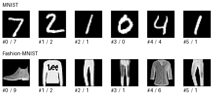

# Model açıklamaları için hata ayıklama testleri

Adebayo ve arkadaşlarının (2020) Bölüm 5'teki test zamanı alan kayması deneyinin özgün MNIST ve Fashion-MNIST verileriyle kısmi yeniden üretimi. Deney çıktıları, makaleyle ayar karşılaştırması ve Birds-vs-Dogs kaynak incelemesi [makale.html](makale.html) dosyasındadır.

## Seçilen Ödev Seçeneği: Seçenek 1 — Zafiyet/Manipülasyon

Özgün MNIST ve Fashion-MNIST görüntüleriyle yapılan dağılım kayması deneyi, modelin eğitim alanı dışındaki girdilerdeki güvenilirliğini inceler. Rapor, benzer atıf haritalarının alan kaymasını teşhis etmedeki sınırını açıklar.

## Makalenin Orijinal Veri Seti

Bu bölümde makalenin test zamanı dağılım kayması deneyinde kullanılan **MNIST** (el yazısı rakamları) ve **Fashion-MNIST** (Zalando ürün görüntüleri) arşivleri kullanılır.

Görüntüler ve kaynak etiketleri yayımlanmış özgün arşivlerden gelir. Proje sentetik veya bağımsız üretilmiş bir veri kümesi kullanmaz.

| Veri seti | Kaynak | Proje içindeki konum |
| --- | --- | --- |
| MNIST | [Yann LeCun ve çalışma arkadaşları](https://yann.lecun.com/exdb/mnist/); CVDF arşiv aynası | `data/raw/MNIST/` |
| Fashion-MNIST | [Zalando Research](https://github.com/zalandoresearch/fashion-mnist#get-the-data) | `data/raw/Fashion-MNIST/` |

### Doğrudan indirme bağlantıları

| Arşiv | MNIST | Fashion-MNIST |
| --- | --- | --- |
| Eğitim görüntüleri | [İndir](https://storage.googleapis.com/cvdf-datasets/mnist/train-images-idx3-ubyte.gz) | [İndir](https://raw.githubusercontent.com/zalandoresearch/fashion-mnist/master/data/fashion/train-images-idx3-ubyte.gz) |
| Eğitim etiketleri | [İndir](https://storage.googleapis.com/cvdf-datasets/mnist/train-labels-idx1-ubyte.gz) | [İndir](https://raw.githubusercontent.com/zalandoresearch/fashion-mnist/master/data/fashion/train-labels-idx1-ubyte.gz) |
| Test görüntüleri | [İndir](https://storage.googleapis.com/cvdf-datasets/mnist/t10k-images-idx3-ubyte.gz) | [İndir](https://raw.githubusercontent.com/zalandoresearch/fashion-mnist/master/data/fashion/t10k-images-idx3-ubyte.gz) |
| Test etiketleri | [İndir](https://storage.googleapis.com/cvdf-datasets/mnist/t10k-labels-idx1-ubyte.gz) | [İndir](https://raw.githubusercontent.com/zalandoresearch/fashion-mnist/master/data/fashion/t10k-labels-idx1-ubyte.gz) |

### Defter veriyi nasıl yükler?

Proje klasöründen [analiz.ipynb](analiz.ipynb) çalıştırıldığında, `load_dataset()` yukarıdaki klasörleri oluşturur ve dört gzip IDX arşivini arar. MD5 değeri eşleşen yerel dosyayı kullanır. Eksik veya sağlama toplamı uyuşmayan dosyayı Python’un `urllib.request.urlopen` işleviyle tablodaki adresten indirir. İndirilen dosyayı yazmadan önce MD5 değerini doğrular. Ardından arşivi bellekte açıp IDX başlığını kontrol eder.

El ile indirmek için dört dosyayı adlarını değiştirmeden ve açmadan ilgili klasöre koyun. PowerShell komutları [data/README.md](data/README.md) dosyasındadır. Ham arşivler Git dışında tutulur.

### Özgün test görüntülerinden önizleme

Aşağıda her veri kümesinin test arşivindeki ilk altı görüntü ve yayımlanan etiketleri görülür. Görüntüler okunabilirlik için büyütülmüştür.



## Çalıştırma

Python 3.13 ile bu dizinde aşağıdaki PowerShell komutlarını çalıştırın.

```powershell
python -m venv .venv
.venv/Scripts/python.exe -m pip install -r requirements.txt
.venv/Scripts/python.exe verify_project.py --execute
.venv/Scripts/python.exe verify_project.py
```

Defter ilk çalıştırmada iki veri kümesinin özgün arşivlerini indirir ve sağlama toplamlarını kontrol eder. Çevrimdışı hazırlık için indirme komutları [data/README.md](data/README.md) dosyasındadır. Deney CPU'da iki model eğitir ve dört PNG şekli üretir. Ham arşivler Git dışındadır ve model ağırlığı kaydedilmez. Son komut defter çıktısından üretilen iki raporun ve dört şeklin doğrulamasını tekrarlar.

- [Makale ve ekleri (PDF)](https://arxiv.org/pdf/2011.05429v1)
- [Resmî araştırma kodu](https://github.com/adebayoj/explaindebug)
