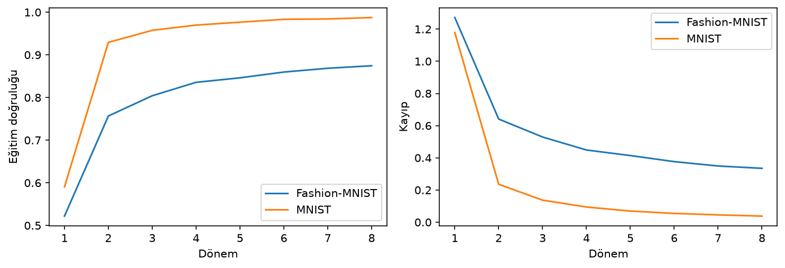
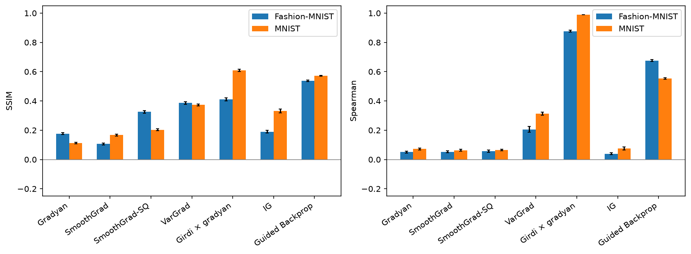
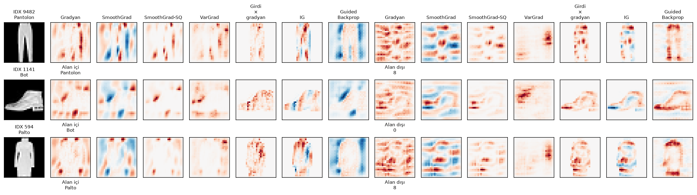
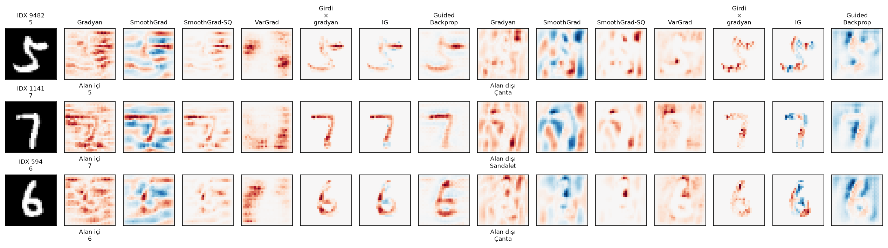

# Model açıklamaları için hata ayıklama testleri

**Bölüm 3 · Yorumlanabilirliğin amaçları · Özgün MNIST ve Fashion-MNIST**

## 1. Araştırma amacı

Adebayo, Muelly, Liccardi ve Kim (2020), dağılım dışı girdilerde atıf haritalarının model hatalarını ortaya çıkarıp çıkaramadığını inceler. Burada Bölüm 5, Tablo 3'ün Fashion-MNIST → MNIST karşılaştırması ve Ek I’de gösterilen ters yön uygulanır. [Makale ve ekleri](https://arxiv.org/html/2011.05429v1) · [Yazarların kodu](https://github.com/adebayoj/explaindebug)

## Seçilen Ödev Seçeneği: Seçenek 1 — Zafiyet/Manipülasyon

**Test zamanında dağılım kayması.** Aynı özgün Fashion-MNIST görüntüsü hem giysi hem MNIST rakam sınıflandırıcısına verilir. Piksel değerleri korunur ve her model kendi tahminini açıklar. Rakam modeli giysi görüntüsüne kendi sınıf uzayından bir rakam etiketi atar. Bu, modelin eğitim alanı dışındaki girdilere de tahmin üretmesinden kaynaklanan bir güvenilirlik zafiyetidir.

**Açıklamanın sınırı.** Fashion-MNIST girdilerinde iki modelin Guided Backprop haritaları arasındaki ortalama Spearman korelasyonu 0,676, Gradyan haritaları arasındaki korelasyon ise 0,051’dir. Guided Backprop haritası, modelin eğitim alanı değiştiğinde bile benzer piksel sıraları verebilir. Harita benzerliği, girdinin eğitim alanına uygunluğunu veya tahminin güvenilirliğini doğrulamak için yetersizdir.

Bu çalışma Seçenek 1’in zafiyet boyutuna, değiştirilmemiş test görüntüleriyle yapılan kontrollü dağılım kayması deneyi üzerinden karşılık gelir. [Adebayo ve ark., §5](https://arxiv.org/html/2011.05429v1#S5)

## 2. Veri ve uygulama

İki kaynağın özgün 60.000 eğitim ve 10.000 test görüntüsünü içeren dört gzip IDX arşivi ayrı ayrı indirilir ve doğrulanır. Görüntüler 28×28, tek kanallı ve [0, 1] ölçeğindedir. Tohum 41 ile her eğitim bölümünden 12.000 örnek seçilir. Her model kendi kaynağında 8 dönem Adam ile eğitilir ve alan içi doğruluk 10.000 test görüntüsünde ölçülür. Ortam Python 3.13.15, PyTorch 2.15.0+cpu, CPU. [MNIST ve IDX kaynağı](https://storage.googleapis.com/cvdf-datasets/mnist/train-images-idx3-ubyte.gz) · [Fashion-MNIST veri kaynağı](https://github.com/zalandoresearch/fashion-mnist#get-the-data)

| Modelin eğitim alanı   |   Özgün eğitim |   Kullanılan eğitim |   Özgün test |   Alan içi test doğruluğu |
|:-----------------------|---------------:|--------------------:|-------------:|--------------------------:|
| Fashion-MNIST          |          60000 |               12000 |        10000 |                    0.8539 |
| MNIST                  |          60000 |               12000 |        10000 |                    0.9760 |

## 3. Test zamanı müdahalesi ve ölçümler

Her yönde testten tohum 73 ile 190 görüntü seçilir. Bir görüntü iki modele de aynı piksel değerleriyle verilir. Her atıf, ilgili modelin kendi en yüksek logitini açıklar. Alan dışında tahmin edilmesi gereken ortak bir sınıf yoktur.

Yedi yöntem hesaplanır. Ek B uyarınca Gradyan, hedef logitin türevinin mutlak değeridir. Girdi × gradyan bu mutlak türevi piksel değeriyle çarpar. SmoothGrad, 50 gürültülü girdide hesaplanan işaretli gradyanın ortalamasıdır. SmoothGrad-SQ bu ortalamanın eleman bazında karesidir. VarGrad aynı 50 gradyanın piksel bazında popülasyon varyansıdır. Her görüntü için sıfır ortalamalı Gauss gürültüsünün standart sapması, Ek B'deki gibi, o görüntünün en büyük ve en küçük piksel değerleri farkının 0,15 katıdır. Aynı gürültü dizisi iki modelde tekrar kullanılır. IG, Ek B'deki en düşük değerli siyah referansı ve bu çalışmada seçilen 24 trapez aralığını kullanır. [Makale §2.2 ve Ek B](https://arxiv.org/html/2011.05429v1#A2)

SSIM öncesinde her harita kendi en yüksek mutlak değerine bölünür ve [0, 1] aralığına taşınır. Yerel ortalama, varyans ve kovaryans için standart sapması 1,5 ve yarıçapı tam 5 piksel olan 11×11 Gauss penceresi kullanılır. Son ortalamaya yalnızca pencerenin bütünüyle görüntü içinde kaldığı 18×18 konum girer. Önceki uygulamada SciPy'nin varsayılan yarıçapı 6 piksel olduğu için 13×13 filtre ile 5 piksellik kırpma kullanılıyordu. Spearman, her yöntemin ölçekleme öncesindeki atıf değerlerinin sırasını karşılaştırır. SH, görüntüler üzerinden ortalamanın standart hatasıdır.

## 4. Deneysel sonuçlar

| Girdi         | Yöntem          |   SSIM |   SSIM_SH |   Spearman |   Spearman_SH |   Geçerli |
|:--------------|:----------------|-------:|----------:|-----------:|--------------:|----------:|
| Fashion-MNIST | Girdi × gradyan |  0.411 |     0.010 |      0.876 |         0.006 |       190 |
| Fashion-MNIST | Gradyan         |  0.177 |     0.006 |      0.051 |         0.007 |       190 |
| Fashion-MNIST | Guided Backprop |  0.538 |     0.006 |      0.676 |         0.007 |       190 |
| Fashion-MNIST | IG              |  0.190 |     0.010 |      0.039 |         0.007 |       190 |
| Fashion-MNIST | SmoothGrad      |  0.107 |     0.007 |      0.053 |         0.007 |       190 |
| Fashion-MNIST | SmoothGrad-SQ   |  0.325 |     0.009 |      0.056 |         0.008 |       190 |
| Fashion-MNIST | VarGrad         |  0.387 |     0.009 |      0.206 |         0.019 |       190 |
| MNIST         | Girdi × gradyan |  0.610 |     0.008 |      0.989 |         0.001 |       190 |
| MNIST         | Gradyan         |  0.113 |     0.005 |      0.072 |         0.006 |       190 |
| MNIST         | Guided Backprop |  0.572 |     0.004 |      0.554 |         0.005 |       190 |
| MNIST         | IG              |  0.332 |     0.013 |      0.076 |         0.011 |       190 |
| MNIST         | SmoothGrad      |  0.167 |     0.007 |      0.063 |         0.006 |       190 |
| MNIST         | SmoothGrad-SQ   |  0.203 |     0.007 |      0.064 |         0.005 |       190 |
| MNIST         | VarGrad         |  0.373 |     0.007 |      0.313 |         0.010 |       190 |

Fashion-MNIST girdilerinde Gradyan için SSIM 0.177 ve Spearman 0.051 ölçüldü. Guided Backprop için aynı değerler 0.538 ve 0.676 oldu. Düzeltilen SmoothGrad-SQ için SSIM 0.325 ve Spearman 0.056 oldu. Yapısal benzerlik ile piksel sıra uyumu yöntemlere göre ayrışabilir.

Her gösterim satırında iki modelin tahmini, ilgili atıf grubunun ilk panelinin altında bulunur. Mavi negatif ve kırmızı pozitif atıftır. Her harita kendi mutlak tepe değeri ile ölçeklenir.

| Girdi         | Modelin eğitim alanı   |   Ortalama en yüksek olasılık |
|:--------------|:-----------------------|------------------------------:|
| Fashion-MNIST | Fashion-MNIST          |                         0.836 |
| Fashion-MNIST | MNIST                  |                         0.799 |
| MNIST         | Fashion-MNIST          |                         0.823 |
| MNIST         | MNIST                  |                         0.975 |

En yüksek softmax olasılığı betimleyici bir ölçümdür. Alan dışı doğruluk ya da kalibre edilmiş hata olasılığı olarak yorumlanmaz.

## 5. Makaleyle karşılaştırma ve sınırlılıklar

Yazarlar görsel benzerlik ile sıra benzerliğinin ayrışabildiğini raporlar. Tablo 3'te Fashion-MNIST → MNIST için Gradyan ve SmoothGrad sıra korelasyonları sıfıra yakındır, VarGrad ve Guided Backprop ise daha yüksek korelasyon gösterir. Yerel tabloda aynı yöntemlerin sıralaması ve iki ölçütün ayrışması görülebilir. Karşılaştırma yöntem örüntüleri düzeyindedir. [Bölüm 5, Tablo 3](https://arxiv.org/html/2011.05429v1#S5)

| Deney ayarı | Makale | Bu uygulama |
|---|---|---|
| Eğitim verisi | §5, MNIST ve Fashion-MNIST üzerine eğitilmiş BVD-CNN modellerini belirtir. Bu iki model için kullanılan eğitim örneği sayısı ve kimlikleri §5 ve Ek C'de verilmez. | Her özgün 60.000 görüntülük eğitim bölümünden tohum 41 ile seçilen 12.000 görüntü. Alan içi doğruluk özgün 10.000 örneklik test bölümünün tamamında ölçülür. |
| Mimari ve eğitim | Ek C, ikili BVD-CNN için beş evrişim, üç tam bağlı katman, ReLU ve son katmanda sigmoid belirtir. Adam, öğrenme hızı 0,001 ve 40 dönem ikili görev için verilir. | Beş 3×3 evrişim (16, 16, 32, 32, 48 kanal), iki 2×2 maksimum havuzlama ve 128, 64, 10 birimli üç tam bağlı katman. Adam 0,001, yığın 128, çapraz entropi ve 8 dönem. On sınıflı açıklamalar logit üzerinden hesaplanır. |
| Test kapsamı | Tablo 3’te 190 Fashion-MNIST görüntüsü ve üç alan dışı model vardır. Ek I’de ters yön için görsel örnek verilir. Ek C’de üç kanallı dönüşüm VGG-16 ile ilişkilendirilir. | Her yönde 190 test görüntüsü, tohum 73. İki tek kanallı CNN karşılaştırılır. Her model kendi en yüksek logitini açıklar. Yazarların örnek kimlikleri ve ağırlıkları elde edilemedi. |
| Atıf | Tablo 3’te 15 yöntem. Ek B, SmoothGrad varyantları ve VarGrad için 50 gürültülü örnek ve görüntü aralığının 0,15 katını belirtir. | Yedi yöntem ve aynı gürültü ayarları. PyTorch autograd, iki modelde ortak gürültü ve IG için 24 trapez aralığı kullanılır. |
| Benzerlik | Tablo 3’te SSIM, Spearman ve standart hata verilir. §5’te Gauss pencere parametreleri ile harita ölçekleme ayrıntıları belirtilmez. | Aynı ölçütler raporlanır. Tepeye göre ölçekleme ve 11×11 Gauss penceresi bu çalışmanın açıkça tanımlanmış seçimleridir. |

Tek eğitim tohumu kullanıldığı için standart hatalar görüntüler arasındaki değişkenliği yansıtır. Sonuçlar Bölüm 5’in kısmi deneysel yeniden üretimidir. [Makale §5 ve Ek B–C](https://arxiv.org/html/2011.05429v1#S5)

## 6. Kaynak denetimi

### Birds-vs-Dogs veri kökeni

| Bileşen | Doğrulanan bilgi |
|---|---|
| Kuş görüntüleri | Makalenin Ek C.1 bölümü Caltech-UCSD Birds-200-2011'i adlandırır. Resmî görüntüler ve ayrı piksel segmentasyonu arşivi mevcuttur. |
| Köpek görüntüleri | Ek C.1, Parkhi ve arkadaşlarının Cats and Dogs çalışmasını adlandırır. Oxford-IIIT Pet görüntüleri ve piksel düzeyinde trimap arşivi yayımlanır. Stanford Dogs, makalede ayrı kullanıcı çalışmasıyla ilişkilendirilir. |
| Arka plan | Bölüm 3.1 Places gökyüzünü kuşlarla, bambu ormanını köpeklerle eşler. Resmî deponun kullanıcı çalışması klasöründe beş gökyüzü ve beş bambu PNG'si bulunur. Bunların ikili deneydeki Places dosyalarıyla birebir eşlemesi ve her örnekte seçilen görsel doğrulanamadı. |
| Bölmeler | Ek C.1 sınıf başına 4.300 eğitim ve kalanın eşit doğrulama/test bölünmesini tarif eder. Resmî deponun yayımladığı altı dosya listesinde her sınıf için 4.300 eğitim, 500 doğrulama ve 190 test girdisi sayıldı. Sınıf başına 4.990 dosya adı benzersizdi. |
| Hazırlama ve maskeler | Kullanıcı çalışmasının ayrı kodu Oxford trimap 1 değerini ön plan olarak seçer. İkili deney için dosya–maske eşleştirmesi, arka plan seçim manifestosu ve birleştirme betiği yayımlanan dosyalardan doğrulanamadı. |

Bu nedenle Birds-vs-Dogs bu defterde uygulanmadı. Ayrıca Bölüm 5'teki ImageNet/VGG-16 kolu bu uygulamanın kapsamı dışında tutuldu.

- [Makale §3.1 ve Ek C–D](https://arxiv.org/html/2011.05429v1)
- [CUB-200-2011 görüntüleri](https://www.vision.caltech.edu/datasets/cub_200_2011/) · [CUB segmentasyon arşivi](https://data.caltech.edu/records/w9d68-gec53) · [Oxford-IIIT Pet görüntü ve trimap arşivleri](https://www.robots.ox.ac.uk/~vgg/data/pets/)
- [Places veri kaynağı](https://places2.csail.mit.edu/download.html) · [Yazarların ikili deney bölmeleri](https://github.com/adebayoj/explaindebug/tree/98f3b211c97c1bbbaec4d12cc8c102ecbbc1afe7/debuggingtests/data/datapartion) · [Ayrı kullanıcı çalışması kodu ve görselleri](https://github.com/adebayoj/explaindebug/tree/98f3b211c97c1bbbaec4d12cc8c102ecbbc1afe7/userstudy)
