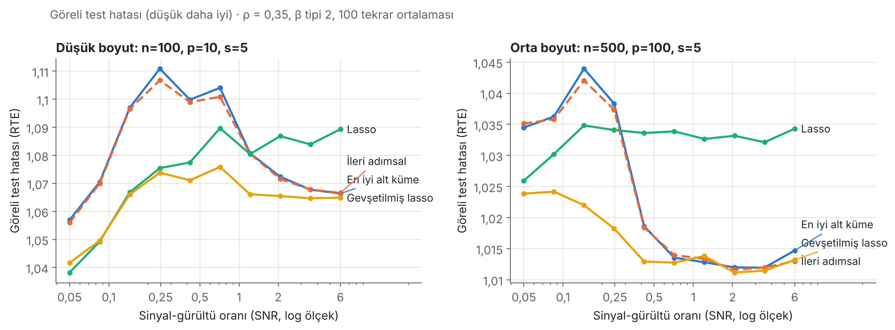
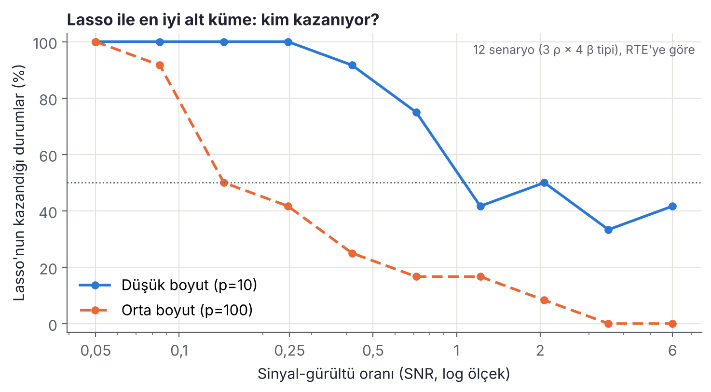
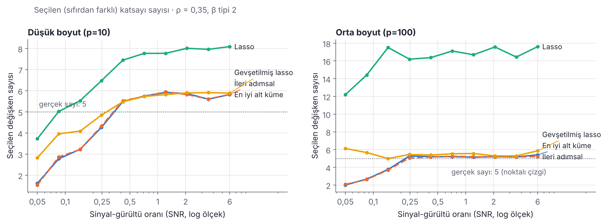
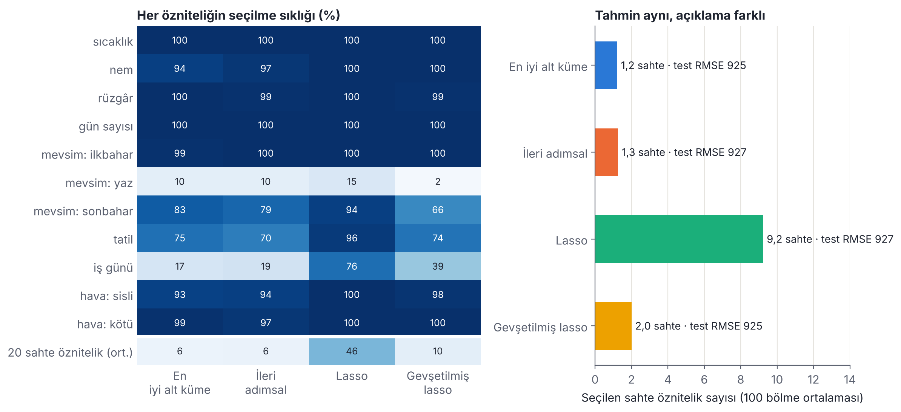

# Makale Yeniden Üretimi: Hastie, Tibshirani ve Tibshirani (2020)

**Öğrenci:** Ahmet Batuhan Kaya (20269348005)
**İlgili bölüm:** Molnar, *Interpretable Machine Learning*, Bölüm 6: Doğrusal Regresyon (seyrek doğrusal modeller)
**İzlencedeki tür:** Seçenek 2: Kıyaslama (Benchmarking)

## Makale

Hastie, T., Tibshirani, R. ve Tibshirani, R. J. (2020). Best Subset, Forward Stepwise or Lasso? Analysis and Recommendations Based on Extensive Comparisons. *Statistical Science*, 35(4), 579–592. Ön baskı: <https://arxiv.org/abs/1707.08692>

Molnar'ın 6. bölümü, öznitelik sayısı arttığında doğrusal modeli yorumlanabilir tutmak için seyrek modelleri önerir: lasso ve adımsal seçim. Bu makale, aynı yöntemleri ve en iyi alt küme seçimini geniş bir simülasyonla karşılaştırır. Sorusu şudur: Hangi yöntem ne zaman daha iyi?

## Dosyalar

| Dosya | İçerik |
|---|---|
| `analiz.ipynb` | Yeniden üretimin tamamı: kod, tablolar, şekiller, yorumlar |
| `secim-arenasi.html` | Makaleye bağlı etkileşimli uygulama (tarayıcıda açılır, kurulum gerekmez) |
| `secim.py` | Veri üretimi, dört yöntem ve ölçüler |
| `bisiklet.py` | Gerçek veri uzantısı (bisiklet verisi + sahte öznitelikler) |
| `calistir.py`, `calistir_odak.py` | Tam simülasyon ızgarası ve odak senaryo |
| `figurler.py` | Şekiller |
| `sonuclar/` | Hazır simülasyon sonuçları (CSV) |
| `sekiller/` | Şekiller (PNG) |

Kurulum: `pip install numpy pandas scikit-learn abess pyreadr matplotlib joblib`. Bisiklet verisi 6. bölümün `ceviri/data/bike.RData` dosyasından okunur.

## Simülasyon düzeni

- **Ayarlar:** düşük (n=100, p=10, s=5) ve orta (n=500, p=100, s=5).
- **Öznitelikler:** $x \sim N_p(0,\Sigma)$, $\Sigma_{ij}=\rho^{|i-j|}$, $\rho \in \{0;\ 0{,}35;\ 0{,}7\}$.
- **Katsayılar:** makaledeki β tipi 1, 2, 3 ve 5.
- **Gürültü:** $\sigma^2=\beta_0^T\Sigma\beta_0/\text{SNR}$. SNR, 0,05 ile 6 arasında log ölçekte 10 değer alır.
- **Ayarlama:** Her yöntem, eğitimle aynı boyutta ayrı bir doğrulama kümesinde ayarlanır.
- **Tekrar:** Senaryo başına 20 tekrar. Şekil 1 ve 2'deki odak senaryoda (ρ=0,35, β tipi 2) 100 tekrar.
- **Ölçüler:** göreli test hatası $RTE=\big[(\hat\beta-\beta_0)^T\Sigma(\hat\beta-\beta_0)+\sigma^2\big]/\sigma^2$, açıklanan varyans oranı (PVE) ve seçilen değişken sayısı.

**Makaleden farklarımız:**

- Makale en iyi alt kümeyi Gurobi ile çözer. Düşük ayarda biz 1024 alt kümenin hepsini taradık, yani çözümümüz kesin.
- Orta ayarda tam tarama imkânsız (2¹⁰⁰ alt küme). Burada açık kaynaklı yaklaşık çözücü **abess** kullandık.
- Yüksek boyutlu ayarları (p=1000) çalıştırmadık.

## Sonuçlar

**İddia 1: Düşük SNR'de lasso, yüksek SNR'de en iyi alt küme kazanır.** ✔
Düşük ayarda eğriler SNR ≈ 1,22'de kesişiyor; makalenin raporladığı değer de bu. Orta ayarda kesişme daha erken, SNR 0,25 ile 0,4 arasında. 12 senaryonun hepsinde, en düşük SNR'de lasso her zaman kazanıyor. Orta ayarda en yüksek iki SNR değerinde ise hiç kazanamıyor (Şekil 3).

**İddia 2: En iyi alt küme ile ileri adımsal seçim neredeyse aynıdır.** ✔
Tüm ızgarada ortalama RTE farkı 0,0017, en büyük fark 0,015.

**İddia 3: Gevşetilmiş lasso genel olarak en iyisidir.** ✔
120 senaryonun 72'sinde (düşük ayar) ve 79'unda (orta ayar) en düşük hatayı aldı. Senaryoların %97'sinde (düşük) ve %100'ünde (orta) en iyiye %1 yakın.

**İddia 4: Lasso çok daha yoğun çözümler verir.** ✔
Gerçekte 5 değişken önemli. Odak senaryoda lasso ortalama 6,8 (düşük) ve 16,2 (orta) değişken seçiyor. Diğer üç yöntem 4,5 ile 5,5 arasında kalıyor.

**İddia 5: PVE farkları mutlak olarak küçüktür.** ✔
Ortalama PVE, yöntemler arasında en fazla 0,011 fark gösteriyor.

## Uzantı: bisiklet verisi ve 20 sahte öznitelik

Gerçek veride hangi değişkenin gerçekten önemli olduğunu bilmeyiz. Bu yüzden kitabın 6. bölümündeki bisiklet verisini ve aynı öznitelikleri aldık. Bunlara hedefle hiçbir ilişkisi olmayan 20 rastgele "sahte" öznitelik ekledik. Ardından 100 rastgele bölme yaptık: %50 eğitim, %25 doğrulama, %25 test.

| Yöntem | Test RMSE | Seçilen değişken | Seçilen sahte öznitelik |
|---|---|---|---|
| En iyi alt küme | 924,8 | 9,9 | 1,2 |
| İleri adımsal | 926,6 | 9,9 | 1,3 |
| Lasso | 926,6 | 19,0 | **9,2** |
| Gevşetilmiş lasso | 925,4 | 10,8 | 2,0 |

Dört modelin tahmin hatası neredeyse aynı. Ama lasso modeli, 20 sahte öznitelikten ortalama 9'unu katsayı tablosuna sokuyor. Bu, Molnar'ın uyarısının somut bir örneği: Tahmin performansı aynı olan modeller çok farklı açıklamalar verebilir. Yorum amaçlı bir doğrusal model kuruyorsak, yöntem seçimi doğrudan açıklamanın doğruluğunu etkiler.

## Uygulama: Seçim Arenası

`secim-arenasi.html`, makalenin düşük boyutlu deneyini tarayıcıda canlı çalıştırır. Bütün hesaplar sayfanın içinde yapılır.

- **SNR kaydırıcısı, korelasyon ve β tipi:** Veri üretim ayarlarını değiştirir.
- **"Kim neyi seçti?" tahtası:** Dört yöntemin aynı veri setinde her değişken için tahmin ettiği katsayıyı gösterir. Taralı hücre, gerçekte sıfır olan bir değişkenin seçildiğini belirtir.
- **Turnuva:** Aynı ayarlarla 50 yeni veri seti üretir; ortalama hatayı ve kazanma sayısını gösterir.
- **SNR taraması:** Makalenin Şekil 1'ini seçili ayarlarla yeniden çizer.

Çevrimiçi: [secim-arenasi.html](https://mesutpolatgil.github.io/xai-dersi-2026/2026-guz/06_linear-regression/makale-yeniden-uretim/ahmetbatuhankaya-20269348005/secim-arenasi.html)

## Sonuç

Makalenin beş ana iddiası, düşük ve orta boyutlu ayarlarda yeniden üretildi. Yorumlanabilirlik açısından pratik çıkarım şu: Seyrek ve doğru bir açıklama isteniyorsa gevşetilmiş lasso iyi bir varsayılan seçim. Hem lasso kadar hızlı hem de en iyi alt küme kadar az değişken seçiyor.

**Sınırlılıklar:** p=1000 ayarları çalıştırılmadı. Orta ayarda en iyi alt küme yaklaşık bir çözücüyle bulundu. Uzantıdaki sahte öznitelikler bağımsız normal gürültüdür; gerçek verideki korelasyonlu "sahte" sinyaller daha zor olabilir.
