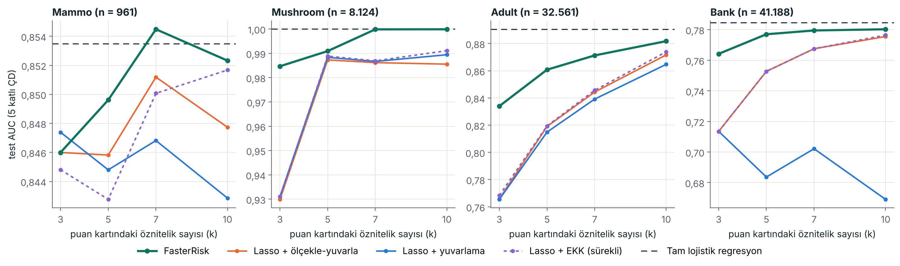
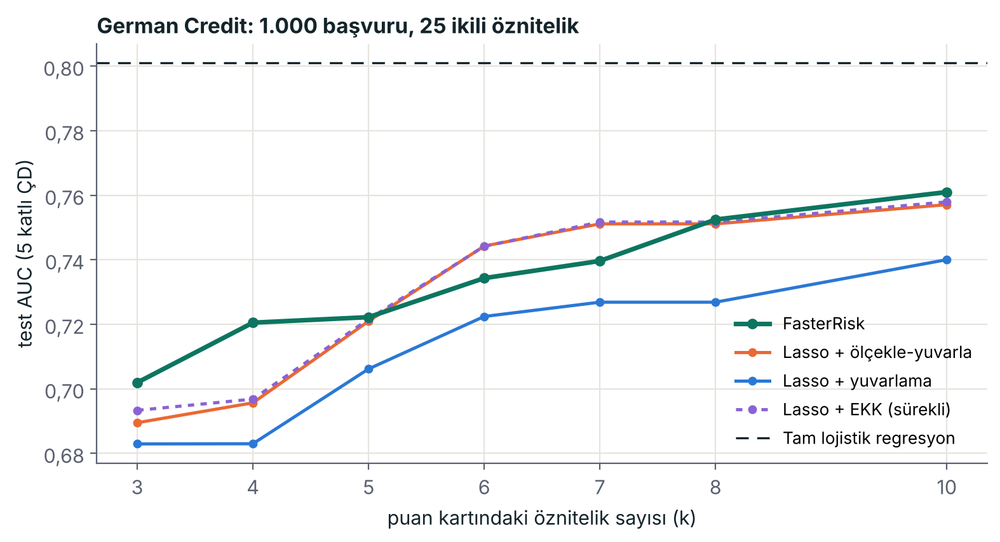

# Makale Yeniden Üretimi: FasterRisk (Liu ve ark., 2022)

**Öğrenci:** Ahmet Batuhan Kaya (20269348005)
**İlgili bölüm:** Molnar, *Interpretable Machine Learning*, Bölüm 7: Lojistik Regresyon
**İzlencedeki tür:** Seçenek 3: Geliştirme/Modifikasyon

## Makale

Liu, J., Zhong, C., Li, B., Seltzer, M. ve Rudin, C. (2022). FasterRisk: Fast and Accurate Interpretable Risk Scores. *Advances in Neural Information Processing Systems 35 (NeurIPS 2022)*, 17760–17773. Kod: <https://github.com/jiachangliu/FasterRisk>

7. bölümde lojistik regresyonun katsayılarını log-odds ve odds oranı olarak yorumluyoruz. **Risk puanı** aynı modelin en sade hâlidir: az sayıda ikili öznitelik ve −5 ile 5 arasında tam sayı puanlar. Uzman puanları kâğıt üzerinde toplar, riski tablodan okur. FasterRisk bu kartları üç adımda öğrenir:

1. **Seyrek ışın araması:** öznitelikler birer birer eklenir, her adımda en iyi 10 aday tutulur.
2. **Çeşitli havuz:** birer öznitelik değiştirilerek kaybı en iyiye yakın başka modeller toplanır.
3. **Yıldız ışını araması ve sıralı yuvarlama:** katsayılar farklı çarpanlarla ölçeklenir ve tek tek tam sayıya yuvarlanır.

Risk = 1 / (1 + e^−(kesişim + toplam puan) / çarpan).

## Dosyalar

| Dosya | İçerik |
|---|---|
| `analiz.ipynb` | Yeniden üretimin tamamı: kod, tablolar, şekiller, yorumlar |
| `puan-karti-atolyesi.html` | Makaleye bağlı etkileşimli uygulama (tarayıcıda açılır) |
| `puan.py` | FasterRisk ve rakip yöntemlerin kurulumu, değerlendirme |
| `kredi.py` | German Credit verisinin ikili özniteliklere çevrilmesi, kart tablosu |
| `calistir.py`, `calistir_kredi.py` | Dört veri setinde kıyaslama (~11 dk) ve kredi deneyi (~2 dk) |
| `figurler.py` | Şekiller |
| `fasterrisk/` | FasterRisk kaynak kodu (BSD-3), numpy 2 için iki satırlık yamayla; ayrıntı `fasterrisk/README.md` |
| `veri/` | mammo, mushroom, adult, bank (RiskSLIM deposundan, BSD-3) ve German Credit |
| `sonuclar/`, `sekiller/` | Hazır sonuçlar ve şekiller |

Kurulum: `pip install numpy pandas scikit-learn matplotlib requests pillow joblib`. PyPI'daki `fasterrisk` paketi eski sürümlere sabitlendiği için güncel Python'da kurulmuyor; bu yüzden kaynak kodu klasöre konuldu.

## Düzen

- **Veriler:** mammo (961), mushroom (8.124), adult (32.561), bank (41.188). Makaledeki 6 veri setinden herkese açık olan 4'ü; ikili öznitelikler RiskSLIM deposundan.
- **Kart boyutu:** k = 3, 5, 7, 10. **Değerlendirme:** 5 katlı çapraz doğrulama, test AUC.
- **Rakipler:** lasso ile k öznitelik seçip katsayıları (a) en büyüğü 5 olacak biçimde ölçekleyip yuvarlamak, (b) doğrudan yuvarlamak, (c) yuvarlamadan sürekli bırakmak. Üst referans: tüm öznitelikleri kullanan sürekli lojistik regresyon.
- **Makaleden farklarımız:** Ana rakip RiskSLIM ticari CPLEX çözücüsü gerektirdiği için çalıştırılamadı. COMPAS ve FICO verileri kullanılmadı. Rakip yuvarlama yöntemleri makaledeki "pooled" yöntemlerin sadeleştirilmiş hâlidir.

## Sonuçlar

**Makalenin örnek kartı yeniden üretildi.** Mammo verisinde 5 öznitelikli kart: düzensiz şekil +2, düzgün sınırlı kenar −3, dikenli kenar +1, yaş ≥ 30 +3, yaş ≥ 60 +2. Eğitim AUC'si 0,855; makaledeki kart 0,854.

**İddia 1: Aynı boyutta en yüksek AUC.** ✔ 16 karşılaştırmanın 14'ünde FasterRisk açıkça birinci. Mammo'daki ikisinde fark 0,001 veya daha az. Fark küçük kartlarda büyük: adult, k = 3 için 0,834'e karşı 0,766. FasterRisk yuvarlanmamış lasso modelini bile geçiyor; üstünlük daha iyi öznitelik seçiminden de geliyor. Doğrudan yuvarlama ise bank verisinde k arttıkça çöküyor (k = 10'da 0,669).

**İddia 2: Dakikalar içinde biter.** ✔ Bir katın süresi (saniye):

| Veri | k = 3 | k = 5 | k = 7 | k = 10 |
|---|---|---|---|---|
| mammo | 0,2 | 0,7 | 1,2 | 1,7 |
| mushroom | 0,8 | 2,5 | 8,7 | 13,7 |
| adult | 1,9 | 9,3 | 15,6 | 32,5 |
| bank | 7,3 | 18,7 | 37,3 | 79,4 |

**İddia 3: Aynı kalitede birden çok model.** ✔ Mammo'da havuzun ilk üç kartı 0,855; 0,855 ve 0,854 AUC'ye sahip, ama farklı öznitelikler kullanıyor.

## Uzantı: German Credit için kredi riski puan kartı

7. bölüm uygulamasındaki German Credit verisi (1.000 başvuru, %30 temerrüt) 25 ikili özniteliğe çevrildi. Cinsiyet, medeni durum ve yabancı işçi bilgisi ayrımcılık riski nedeniyle modele alınmadı.

- Küçük veride üstünlük testte kısmen kayboluyor: FasterRisk k = 3, 4, 8 ve 10'da önde, k = 6 ve 7'de sürekli lasso modelinin ~0,01 gerisinde. Eğitim AUC'sinde her k için önde.
- Yorumlanabilirliğin bedeli: 25 öznitelikli tam lojistik regresyon 0,801; 10 puanlık kart 0,761.
- 5 öznitelikli kart: hesap bakiyesi eksi +4, 0-200 DM +3, tutar ≥ 4.000 DM +2, **geçmiş: kritik hesap −2**, amaç: ikinci el araba −3. Kritik kredi geçmişinin riski düşürmesi sezgiye aykırı; 7. bölüm uygulamasındaki lojistik regresyonda da aynı işaret çıkmıştı. Bu, seçilim yanlılığına veya veri setindeki belgelenmiş kodlama hatalarına (Grömping, 2019) işaret ediyor. Kart sorunu tek satırda görünür kılıyor.

## Uygulama: Puan Kartı Atölyesi

`puan-karti-atolyesi.html`, kredi verisinden FasterRisk ile önceden kurulan kartları tarayıcıda kullandırır.

- Kart boyutu (k = 3–8) ve aynı k için havuzdaki 4 alternatif kart seçilebilir.
- Başvuru sahibinin 25 özelliği işaretlenir; kartın riski ile tam lojistik regresyonun tahmini yan yana görünür.
- Alttaki grafik, kart boyutuna göre çapraz doğrulama AUC'sini rakiplerle karşılaştırır.

Çevrimiçi: [puan-karti-atolyesi.html](https://mesutpolatgil.github.io/xai-dersi-2026/2026-guz/07_logistic-regression/makale-yeniden-uretim/ahmetbatuhankaya-20269348005/puan-karti-atolyesi.html)

## Sonuç

Makalenin üç iddiası, herkese açık dört veri setinde yeniden üretildi. Kendi verimizde FasterRisk'in eğitimdeki üstünlüğü teste her zaman yansımadı. Buna karşılık puan kartı, verideki tuhaf bir ilişkiyi kâğıt üzerinde herkesin göreceği biçimde ortaya koydu. Yorumlanabilir modelin asıl faydası bu.

**Sınırlılıklar:** RiskSLIM ile karşılaştırma yapılamadı. COMPAS ve FICO yok. Kredi kartları tüm veride eğitildi; raporlanan AUC'ler çapraz doğrulamadan geliyor.

## Kaynaklar

- Grömping, U. (2019). South German Credit Data: Correcting a Widely Used Data Set. *Reports in Mathematics, Physics and Chemistry*, Beuth University of Applied Sciences Berlin.
- Liu, J., Zhong, C., Li, B., Seltzer, M. ve Rudin, C. (2022). FasterRisk: Fast and Accurate Interpretable Risk Scores. *NeurIPS 35*.
- Ustun, B. ve Rudin, C. (2019). Learning Optimized Risk Scores. *Journal of Machine Learning Research*, 20(150), 1–75. (Veri setlerinin kaynağı: RiskSLIM deposu.)
