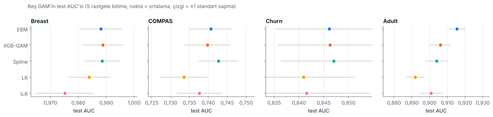
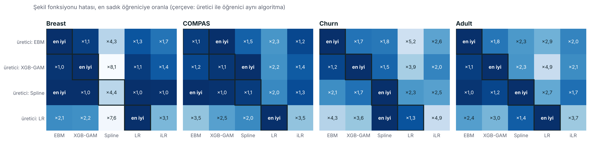
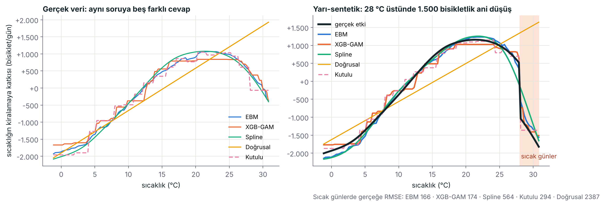

# Makale Yeniden Üretimi: Chang ve ark. (2021)

**Öğrenci:** Ahmet Batuhan Kaya (20269348005)
**İlgili bölüm:** Molnar, *Interpretable Machine Learning*, Bölüm 8: GLM, GAM ve Ötesi
**İzlencedeki tür:** Seçenek 2: Kıyaslama (Benchmarking)

## Makale

Chang, C.-H., Tan, S., Lengerich, B., Goldenberg, A. ve Caruana, R. (2021). How Interpretable and Trustworthy are GAMs? *Proceedings of the 27th ACM SIGKDD Conference on Knowledge Discovery & Data Mining (KDD '21)*, 95–105. Ön baskı: <https://arxiv.org/abs/2006.06466>

8. bölüm, doğrusal olmayan etkiler için GAM'leri öneriyor ve bisiklet verisinde sıcaklığın etkisini spline'larla çiziyor. Ama GAM tek bir algoritma değil. Makale, farklı GAM algoritmalarının **aynı doğrulukta farklı şekil fonksiyonları**, yani farklı açıklamalar verdiğini; ağaç tabanlı GAM'lerin seyreklik, sadakat ve doğruluk arasında en iyi dengeyi kurduğunu gösteriyor. Bu çalışma, 8. bölüm için önceki kısa notta kullandığım Caruana ve ark. (2015) makalesinin aynı ekipten devamıdır.

## Dosyalar

| Dosya | İçerik |
|---|---|
| `analiz.ipynb` | Yeniden üretimin tamamı: kod, tablolar, şekiller, yorumlar |
| `sekil-avcisi.html` | Makaleye bağlı etkileşimli uygulama (tarayıcıda açılır) |
| `gam.py` | Beş GAM (EBM, XGB-GAM, Spline, LR, iLR) ve şekil hatası ölçüsü |
| `veriler.py` | Breast, COMPAS, Churn, Adult |
| `bisiklet.py`, `calistir_bisiklet.py` | Bisiklet uzantısı |
| `calistir.py` | Doğruluk ve yarı-sentetik sadakat deneyleri (~5 dk) |
| `figurler.py`, `sonuclar/`, `sekiller/` | Şekiller ve hazır sonuçlar |
| `veri/` | COMPAS (ProPublica), Telco Churn (IBM), Adult (UCI kopyası); Breast scikit-learn içinde |

Kurulum: `pip install numpy pandas scikit-learn matplotlib joblib interpret xgboost pygam pyreadr`. Bisiklet verisi 8. bölümün `ceviri/data/bike.RData` dosyasından okunur.

## Düzen

| Model | Tür |
|---|---|
| EBM (`interpret`) | Ağaç tabanlı, yoğun: her turda her özniteliğe küçük bir ağaç |
| XGB-GAM (`xgboost`, derinlik 1) | Ağaç tabanlı: tek bölmeli kütükler |
| Spline (`pygam`) | Kübik spline + ceza |
| LR | Doğrusal |
| iLR | Her öznitelik 32 kantil kutusu, kutular ayrı kodlanır |

- **Doğruluk:** 4 veri × 5 rastgele bölme (%80/%20), test AUC.
- **Sadakat (yarı-sentetik):** Her veri setine EBM, XGB-GAM, Spline veya LR'den biri **üretici** olarak uydurulur; etiketler onun olasılıklarından yeniden çekilir. Her GAM bu etiketlerle eğitilir ve şekil fonksiyonları (merkezlenmiş) üreticininkilerle karşılaştırılır: şekil hatası = Σⱼ ortalama |f̂ⱼ − fⱼ|.
- **Makaleden farklarımız:** 10 yerine herkese açık 4 veri seti; FLAM ve EBM-BF yok; Adult'tan 12.000 gözlemlik örneklem; her üretici için tek tekrar; yanlılık-varyans ayrıştırması ve alt grup adaleti analizi yok.

## Sonuçlar

**İddia 1: Birçok GAM benzer doğrulukta.** ✔ Breast, COMPAS ve Churn'de EBM, XGB-GAM ve Spline arasındaki farklar 0,003'ün altında. Adult'ta EBM öne çıkıyor (0,916); doğrusal LR her veride biraz geride.

**İddia 2: Her öğrenicinin önyargısı şekle yansır.** ✔ 16 üretici-veri çiftinin 11'inde en sadık öğrenici, üreticiyle aynı algoritma.

**İddia 3: Spline doğru ama sadakatsiz olabilir.** ✔ Breast'te Spline'ın AUC'si en iyilerle aynı (0,989), ama şekil hatası EBM ürettiğinde ×4,3, XGB-GAM ürettiğinde ×8,1.

**İddia 4: Ağaç tabanlı GAM'ler en dengeli.** ✔ En kötü durum sadakati (veri başına 0–100 ölçek, düşük daha iyi): XGB-GAM 55, Spline 58, EBM 64, LR 78, iLR 83. Makale de XGB'yi (FLAM'la birlikte) en iyi buluyor.

## Uzantı: kitabın bisiklet verisi ve "sıcak hava eşiği"

- **Gerçek veri:** Beş GAM sıcaklık etkisini farklı çiziyor. Ağaç tabanlılar basamaklı, spline pürüzsüz, doğrusal model ise sıcaklık arttıkça kiralamanın hep arttığını söylüyor.
- **Yarı-sentetik eşik:** Gerçek sıcaklık etkisine 28 °C üstünde 1.500 bisikletlik ani düşüş eklendi. EBM, XGB-GAM ve Spline'ın test RMSE'si neredeyse aynı (753, 748, 760). Ama yalnız sıcak günlerde gerçeğe uzaklık EBM 166, XGB-GAM 174, **Spline 564**. Spline ani düşüşü yumuşatıp 25 °C'ye doğru yayıyor; ona bakan biri yanlış bir eşik okur.

## Uygulama: Şekil Avcısı

`sekil-avcisi.html`, tek bir öznitelik (sıcaklık) üzerinde gerçek şekli kullanıcının seçtiği bir oyun alanı. Seçenekler: yumuşak tepe, sıcak hava eşiği, çentik ve doğrusal. Gözlem sayısı ve gürültü değiştirilebilir. Dört model tarayıcıda eğitilir ve aynı grafikte gerçek şekille karşılaştırılır:

- cezalı spline,
- ağaç tabanlı (tek bölmeli ağaçlarla gradyan artırma),
- kutulu,
- doğrusal.

Skor tablosu test hatasını ve şekil hatasını yan yana gösterir.

Çevrimiçi: [sekil-avcisi.html](https://mesutpolatgil.github.io/xai-dersi-2026/2026-guz/08_glm-gam-and-more/makale-yeniden-uretim/ahmetbatuhankaya-20269348005/sekil-avcisi.html)

## Sonuç

Makalenin dört ana iddiası, herkese açık dört veri setinde yeniden üretildi. 8. bölüm açısından çıkarım şu: GAM seçerken yalnız doğruluğa bakmak yetmez. Spline GAM, kitabın kullandığı yöntem; pürüzsüz ilişkilerde çok iyi ama ani sıçramaları ve eşikleri yumuşatabiliyor. Açıklamada eşik önemliyse ağaç tabanlı bir GAM'le karşılaştırmak gerekir.

## Kaynaklar

- Caruana, R., Lou, Y., Gehrke, J., Koch, P., Sturm, M. ve Elhadad, N. (2015). Intelligible Models for HealthCare. *KDD '15*, 1721–1730.
- Chang, C.-H., Tan, S., Lengerich, B., Goldenberg, A. ve Caruana, R. (2021). How Interpretable and Trustworthy are GAMs? *KDD '21*, 95–105.
- Nori, H., Jenkins, S., Koch, P. ve Caruana, R. (2019). InterpretML: A Unified Framework for Machine Learning Interpretability. arXiv:1909.09223.
