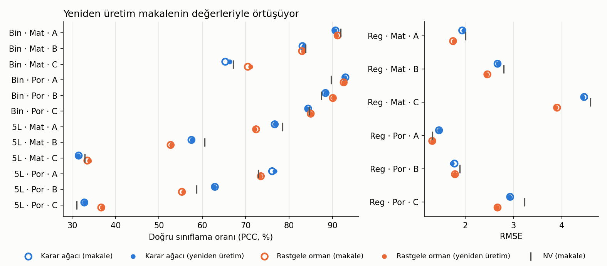
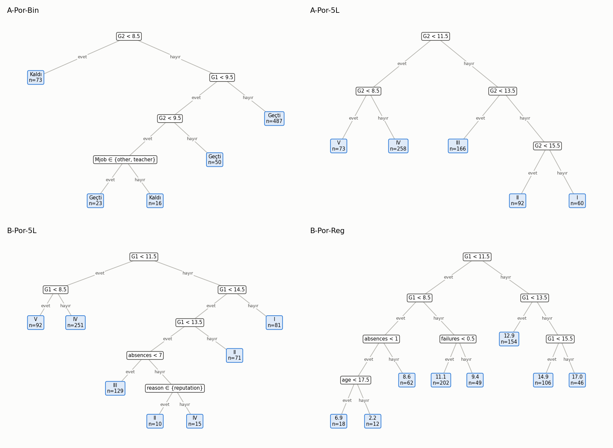
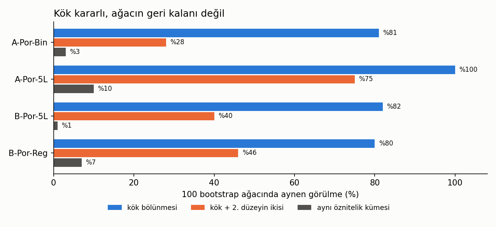
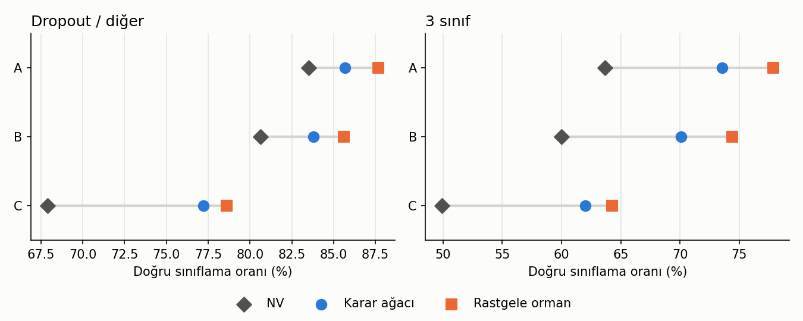

# Makale Yeniden Üretimi: Cortez ve Silva (2008)

**Öğrenci:** Ahmet Nail Arslan (20269348010)
**İlgili bölüm:** Molnar, *Interpretable Machine Learning*, Bölüm 9: Karar Ağacı
**İzlencedeki tür:** Seçenek 2: Kıyaslama (Benchmarking)

## Makale

Cortez, P. ve Silva, A. (2008). Using Data Mining to Predict Secondary School Student Performance. *5th FUture BUsiness TEChnology Conference (FUBUTEC 2008)*. <https://repositorium.uminho.pt/handle/1822/8024>

Makale, Portekiz'deki iki lisede öğrencilerin yıl sonu notunu (G3) tahmin eder. Karar ağacı (DT), rastgele orman (RF), sinir ağı (NN), destek vektör makinesi (SVM) ve bir naif tahminci (NV) karşılaştırılır. Sonunda en iyi karar ağaçları çizilip kural olarak okunur; 9. bölümdeki yorumlama tam olarak budur.

## Dosyalar

| Dosya | İçerik |
|---|---|
| `analiz.ipynb` | Yeniden üretimin tamamı: kod, tablolar, şekiller, yorumlar |
| `agac.py` | Veri, sıfırdan yazılmış karar ağacı (R `rpart` kurallarıyla), RF, NV |
| `calistir.py` | Tablo 3–5 deneyi (32 çekirdekle ~3 dk) |
| `veri697.py`, `kararsizlik.py`, `calistir_697.py` | Kendi verim ve bootstrap kararsızlığı (~3 dk) |
| `figurler.py` | Makale tabloları, karşılaştırma, şekiller |
| `sonuclar/`, `sekiller/` | Hazır sonuçlar ve şekiller |
| `veri/` | UCI Student Performance (320) ve UCI 697 (yoksa otomatik iner) |

Kurulum: `pip install -r requirements.txt`. Notebook'ta `YENIDEN_CALISTIR = True` deneyi baştan çalıştırır.

## Düzen

- **Veri:** Matematik (395) ve Portekizce (649) öğrencileri, 32 öznitelik; makaledeki boyutlarla aynı.
- **Görevler:** geçti/kaldı (Bin, G3 ≥ 10), 5 düzey (5L, Tablo 2), notun kendisi (Reg).
- **Kurulumlar:** A (tüm öznitelikler), B (G2 yok), C (G1 ve G2 yok).
- **Değerlendirme:** 20 tekrar × 10 katlı çapraz doğrulama. Sınıflamada doğru sınıflama oranı (PCC), regresyonda RMSE; ± t dağılımına göre %95 güven aralığı.
- **NV:** A'da G2, B'de G1, C'de en sık sınıf ya da ortalama.
- **Karar ağacı:** Gini / kareler toplamı, kategorik özniteliklerde alt küme bölünmesi, minsplit = 20, minbucket = 7, cp = 0,01 ile budama.

**Makaleden farklarımız:**

- Makale R (RMiner: `rpart`, `randomForest`) kullanır; biz Python. Makale ağaç ayarlarını yazmadığı için `rpart` varsayılanları alındı.
- NN ve SVM çalıştırılmadı (bölüm konusu değil). RF scikit-learn'dendir ve kategorikleri tam sayı koduyla alır.
- Katlar rastgele; makalenin katları bilinmiyor. Tablo 6 (RF öznitelik önemi) yeniden üretilmedi.

## Sonuçlar

M: makale, YÜ: yeniden üretim.

**Tablo 3 — Geçti/kaldı (PCC, %)**

| | NV M | NV YÜ | DT M | DT YÜ | RF M | RF YÜ |
|---|---|---|---|---|---|---|
| Mat A | 91,9 | 91,9 | 90,7 | 90,4 ±0,3 | 91,2 | 90,9 ±0,2 |
| Mat B | 83,8 | 83,8 | 83,1 | 83,3 ±0,6 | 83,0 | 83,3 ±0,4 |
| Mat C | 67,1 | 67,1 | 65,3 | 66,3 ±0,7 | 70,5 | 71,1 ±0,4 |
| Por A | 89,7 | 89,7 | 93,0 | 92,8 ±0,2 | 92,6 | 92,6 ±0,1 |
| Por B | 87,5 | 87,5 | 88,4 | 88,5 ±0,4 | 90,1 | 90,2 ±0,2 |
| Por C | 84,6 | 84,6 | 84,4 | 84,1 ±0,4 | 85,0 | 85,0 ±0,2 |

**Tablo 4 — 5 düzey (PCC, %)**

| | NV M | NV YÜ | DT M | DT YÜ | RF M | RF YÜ |
|---|---|---|---|---|---|---|
| Mat A | 78,5 | 78,5 | 76,7 | 76,8 ±0,3 | 72,4 | 72,1 ±0,6 |
| Mat B | 60,5 | 60,5 | 57,5 | 57,6 ±0,6 | 52,7 | 52,9 ±0,7 |
| Mat C | 32,9 | 32,9 | 31,5 | 31,4 ±0,9 | 33,5 | 33,9 ±0,6 |
| Por A | 72,9 | 72,9 | 76,1 | 76,7 ±0,1 | 73,5 | 73,3 ±0,3 |
| Por B | 58,7 | 58,7 | 62,9 | 62,8 ±0,2 | 55,3 | 55,6 ±0,4 |
| Por C | 31,0 | 31,0 | 32,8 | 32,8 ±0,8 | 36,7 | 36,9 ±0,4 |

**Tablo 5 — Regresyon (RMSE)**

| | NV M | NV YÜ | DT M | DT YÜ | RF M | RF YÜ |
|---|---|---|---|---|---|---|
| Mat A | 2,01 | 2,01 | 1,94 | 1,97 ±0,03 | 1,75 | 1,77 ±0,01 |
| Mat B | 2,80 | 2,80 | 2,67 | 2,68 ±0,04 | 2,46 | 2,44 ±0,01 |
| Mat C | 4,59 | 4,59 | 4,46 | 4,43 ±0,04 | 3,90 | 3,87 ±0,01 |
| Por A | 1,32 | 1,32 | 1,46 | 1,47 ±0,02 | 1,32 | 1,33 ±0,01 |
| Por B | 1,89 | 1,89 | 1,78 | 1,73 ±0,02 | 1,79 | 1,78 ±0,00 |
| Por C | 3,23 | 3,23 | 2,93 | 2,92 ±0,02 | 2,67 | 2,66 ±0,01 |

**Farklar:** NV 18/18 hücrede birebir. DT'de en büyük fark 1,0 puan (Mat C, geçti/kaldı) ve 0,05 RMSE (Por B); RF'de 0,6 puan ve 0,03 RMSE. Küçük farkların beklenen kaynağı rastgele katlardır; bazı hücrelerde (ör. DT: Mat C geçti/kaldı, Por A 5 düzey, Por B regresyon) fark bizim güven aralığımızdan büyük, orada uygulama ya da sürüm farkı da olabilir.

**İddia 1: Önceki dönem notları bilindikçe tahmin iyileşir (A > B > C).** ✔ Üç yöntemde, iki derste ve üç görevde sıralama hep A, B, C.

**İddia 2: Matematik sınıflamasında A'da en iyisi son notu aynen kullanmaktır (NV).** ✔ 91,9 ve 78,5 ile NV, DT ve RF'nin önünde. Öteki öznitelikler orada katkı vermiyor.

**İddia 3: Kalan durumlarda ağaç tabanlı yöntemler öndedir.** ✔ (kısmen sınandı) NV, DT ve RF arasında 18 satırın 17'sinde kazanan makaledekiyle aynı; kalan satırda (Por A, Reg) makalede NV ile RF eşit, bizde NV 0,01 önde. Bizde RF 9, NV 5, DT 4 satırda birinci. NN ve SVM çalıştırılmadığı için iddianın onlara dair kısmı sınanmadı.

**İddia 4: En iyi ağaçların kökünde notlar vardır ve az öznitelik kullanılır (Şekil 4).** ✔ (kısmen)

| Ağaç | Makaledeki Şekil 4 ile karşılaştırma |
|---|---|
| A-Por-Bin | Aynı yapı; `Mjob ∈ {teacher, other}` bölünmesi dahil. Şekilde kök `G2<8`, bizde `G2<9`; makalenin kendi kuralı ("G1<10 ∧ G2=9") bizimkiyle uyumlu |
| A-Por-5L | Dört G2 bölünmesi aynı. Makaledeki `goout>1` bölünmesi bizde yok |
| B-Por-5L | Tamamen aynı (`absences` ve `reason = reputation` dahil) |
| B-Por-Reg | G1'deki 11, 8, 13 eşikleri ve `failures<1` aynı; `G1>16` yerine 15,5; `absences<7`, `Fjob`, `Fedu` yok, onların yerine `absences<1` ve `age` var |

`B-Por-Reg`'in alt dallarındaki ve `A-Por-5L`'deki `goout` farkının hangi ayardan ya da sürümden geldiği bilinmiyor: makale ağaç ayarlarını vermiyor, cp'yi 0,004'e kadar düşürmek de `goout` bölünmesini getirmedi. Aşağıdaki bölüm bu farkın neden önemli olduğunu gösteriyor.

## Sınır bulgusu: ağaç kararsızlığı

Molnar'ın 9. bölümündeki uyarı: eğitim verisindeki küçük bir değişiklik bambaşka bir ağaç verebilir. Şekil 4'teki dört ağaç 100 bootstrap örneğinde yeniden kuruldu; tüm veriyle kurulan (bizim) ağacın bölünmelerinin kaç bootstrap ağacında **aynı yerde ve aynı eşikle** çıktığı sayıldı.

| Ağaç | Kök bölünmesi | 2. düzey (evet) | 2. düzey (hayır) | Üçü birden | Aynı öznitelik kümesi | Yaprak: tam / bootstrap medyan (min–maks) |
|---|---|---|---|---|---|---|
| A-Por-Bin | `G2<8,5` %81 | yaprak %67 | `G1<9,5` %35 | %28 | %3 | 5 / 6 (3–13) |
| A-Por-5L | `G2<11,5` %100 | `G2<8,5` %92 | `G2<13,5` %81 | %75 | %10 | 5 / 8 (5–15) |
| B-Por-5L | `G1<11,5` %82 | `G1<8,5` %95 | `G1<14,5` %45 | %40 | %1 | 7 / 12 (5–22) |
| B-Por-Reg | `G1<11,5` %80 | `G1<8,5` %84 | `G1<13,5` %63 | %46 | %7 | 8 / 8 (6–12) |

- **Kök kararlı:** kök özniteliği (not) A-Por-Bin'de %88, öteki üçünde %100 aynı.
- **Alt dallar kararsız:** notlar dışındaki öznitelikler ağaçtan ağaca değişiyor. Makalenin yorumladığı `Mjob` A-Por-Bin ağaçlarının %43'ünde, `reason` B-Por-5L'nin %38'inde, `goout` A-Por-5L'nin yalnızca %10'unda kullanılıyor.
- **`goout` bölünmesi** veride bir öğrencilik doğruluk kazancına dayanıyor (12 ≤ G2 < 14 ve `goout = 1`: 8 öğrenci II, 7 öğrenci III). Bootstrap ağaçlarının %10'unda görüldüğü için bir **bulgu gibi yorumlanmamalı**. Makalenin ağacında neden çıktığı ise ayrı bir soru: aynı veri ve aynı ayarlarla ağaç deterministiktir, bootstrap bunu açıklamaz.

## Kendi verim: üniversitede okul terki (UCI 697)

4.424 öğrenci, 36 öznitelik, eksik değer yok (UCI, *Predict Students' Dropout and Academic Success*). Makaledeki kurulumların karşılığı: A = bütün öznitelikler, B = 2. dönemin 6 sütunu yok, C = iki dönemin 12 sütunu da yok. Görevler: Dropout / diğer (ikili) ve Dropout / Enrolled / Graduate. 20 tekrar × 10 kat, ± %95 güven aralığı.

**NV:** tek dönemin geçilen / alınan ders oranı (A'da 2., B'de 1. dönem). İkilide oran < 0,5 ise Dropout; 3 sınıfta < 0,5 Dropout, 1'in altı Enrolled, 1 ise Graduate. C'de en sık sınıf. Eşikler sonucu en iyileyecek biçimde aranmadı, ama dağılım önceden görüldü.

| Doğruluk (%) | NV | DT | RF |
|---|---|---|---|
| Dropout / diğer — A | 83,5 ±0,0 | 85,7 ±0,1 | **87,7** ±0,1 |
| Dropout / diğer — B | 80,6 ±0,0 | 83,8 ±0,1 | **85,6** ±0,1 |
| Dropout / diğer — C | 67,9 ±0,0 | 77,2 ±0,1 | **78,6** ±0,1 |
| 3 sınıf — A | 63,7 ±0,0 | 73,5 ±0,2 | **77,8** ±0,1 |
| 3 sınıf — B | 60,0 ±0,0 | 70,1 ±0,1 | **74,4** ±0,1 |
| 3 sınıf — C | 49,9 ±0,0 | 62,0 ±0,1 | **64,3** ±0,1 |

| İddia | Makalenin verisi | Kendi verim |
|---|---|---|
| 1: A > B > C | ✔ 18/18 | ✔ 6/6 |
| 2: A'da en iyisi NV | ✔ matematik sınıflaması | **✘** 0/2; DT 2,2 ve 9,9 puan önde |
| 3: Ağaç tabanlılar önde (NN/SVM yok) | ✔ kısmen | ✔ 6/6, hepsinde RF; DT hiçbirinde birinci değil |
| 4: Kökte not bilgisi, az öznitelik | ✔ kısmen | ✔ A ve B'de kök o dönemin **geçilen ders sayısı**; 3–5 öznitelik |

- **İddia 2 neden tutmadı?** Makalede G2 ile G3 aynı ölçekte (korelasyon matematikte 0,91); NV hedefin kendisine çok yakın. Burada tek dönemin başarısı üç ayrı sonucu ayırmaya yetmiyor; ağaç harç durumu, yaş ve bölümü de kullanıyor.
- **Veri kusuru:** 171 numaralı bölümde 180 öğrencinin iki dönemdeki bütün ders sütunları 0, ama 75'i mezun. NV bunları Dropout sayar. Bu öğrenciler test ölçümünden çıkarılınca A'da NV/DT/RF: ikili 85,2 / 86,7 / 88,5; 3 sınıf 64,5 / 74,8 / 78,8. **Sonuç değişmiyor.**
- **Kategorik öznitelikler (sızıntı yok):** Sıralama, `Agac.fit` içinde `_buyut` → `_sirala(x, Y)` (agac.py:95 ve 136) ile yalnızca o düğümdeki eğitim örneklerinden hesaplanır; `fit` her katta yalnızca `X[tr], y[tr]` alır. Sınama: test katının bütün etiketleri bozulduğunda tahminlerin hiçbiri değişmedi (notebook'ta).
- **Kategorik öznitelikler (yöntem):** Dokuz sütunda 46'ya varan düzey var; tüm alt kümeler taranamaz. 8'den çok düzeyde kategoriler sınıf oranlarına göre sıralanıp bölündü (ikilide kesin, 3 sınıfta yaklaşık). Öğrenci verisinin sonuçları bu ekten etkilenmedi (36 tekrar yeniden çalıştırıldı, fark 0).

### Sızıntı ölçümü: "hiç sınava girmeyen" öğrenciler

"Alınan ders = 0" olan satırların tümü 171. bölümün 180 kayıtsız öğrencisidir; onlar dışında **0 satır** kalır. Sızıntı, alınan ders değil, o dönem hiç değerlendirmeye girmeme (evaluations = 0) durumunda:

| Dönem, koşul (180 öğrenci hariç) | Satır | Dropout | Enrolled | Graduate |
|---|---|---|---|---|
| 1. dönem, alınan ders = 0 | 0 | 0 | 0 | 0 |
| 1. dönem, değerlendirme = 0 | 169 | **169** | 0 | 0 |
| 1. dönem, geçilen ders = 0 | 538 | 493 | 43 | 2 |
| 2. dönem, alınan ders = 0 | 0 | 0 | 0 | 0 |
| 2. dönem, değerlendirme = 0 | 221 | **220** | 1 | 0 |
| 2. dönem, geçilen ders = 0 | 690 | 650 | 40 | 0 |

A 2. dönemin, B 1. dönemin satırları çıkarılarak yeniden çalıştırıldı (20 × 10 kat, %95 GA; n azaldığı için çoğunluk sınıfı oranı da verilir). Çıkarılanlar: *kayit* = 180 öğrenci; *sınav* = ayrıca değerlendirme = 0; *geçen* = ayrıca geçilen ders = 0.

| Görev, kurulum | Çıkarılan | n | Çoğunluk | NV | DT | RF | Ağacın kökü |
|---|---|---|---|---|---|---|---|
| Bin A | eski | 4424 | 67,9 | 83,5 | 85,7 | 87,7 | 2. dönem geçilen < 3,5 |
| | kayit | 4244 | 68,3 | 85,2 | 86,6 | 88,5 | 2. dönem geçilen < 2,5 |
| | sınav | 4023 | 72,1 | 84,5 | 85,9 | 87,9 | 2. dönem geçilen < 2,5 |
| | geçen | 3554 | 80,5 | 83,5 | 85,5 | 87,1 | 2. dönem geçilen < 3,5 |
| Bin B | eski | 4424 | 67,9 | 80,6 | 83,8 | 85,6 | 1. dönem geçilen < 3,5 |
| | kayit | 4244 | 68,3 | 82,2 | 84,6 | 86,4 | 1. dönem geçilen < 3,5 |
| | sınav | 4075 | 71,2 | 81,5 | 84,0 | 85,8 | 1. dönem geçilen < 3,5 |
| | geçen | 3706 | 77,0 | 80,9 | 83,4 | 85,4 | **harç durumu** |
| 3S A | eski | 4424 | 49,9 | 63,7 | 73,5 | 77,8 | 2. dönem geçilen < 3,5 |
| | kayit | 4244 | 50,3 | 64,5 | 75,4 | 78,8 | 2. dönem geçilen < 3,5 |
| | sınav | 4023 | 53,0 | 62,6 | 74,8 | 77,7 | 2. dönem geçilen < 4,5 |
| | geçen | 3554 | 60,0 | 58,8 | 72,6 | 75,7 | 2. dönem geçilen < 4,5 |
| 3S B | eski | 4424 | 49,9 | 60,0 | 70,1 | 74,4 | 1. dönem geçilen < 4,5 |
| | kayit | 4244 | 50,3 | 60,7 | 71,4 | 75,3 | 1. dönem geçilen < 4,5 |
| | sınav | 4075 | 52,4 | 59,1 | 70,4 | 74,2 | 1. dönem geçilen < 4,5 |
| | geçen | 3706 | 57,5 | 56,2 | 69,7 | 72,8 | 1. dönem geçilen < 4,5 |

**Yorum:** Veri sızıntıyı ölçmeye izin veriyor. 2. dönemde hiç sınava girmeyen 221 öğrencinin 220'si bırakmış; bu satırlarda A, hedefi fiilen görüyor. Ama bulgular bunlara dayanmıyor: sınava girmeyenler çıkarılınca (kayit → sınav) RF'nin doğruluğu en çok 1,1 puan azalıyor (hiç ders geçmeyenler de çıkarılınca en çok 3,1), yöntem sıralaması (NV < DT < RF) ve iddia 2'nin ✘ sonucu değişmiyor. Kök özniteliği 12 karşılaştırmanın 11'inde aynı (eşik değişebiliyor); yalnızca Bin B'de hiç ders geçmemişler de çıkarılınca kök "harç durumu" oluyor. Aynı satırlarda C ile karşılaştırınca dönem bilgisinin RF'ye katkısı ikilide 6,7 puan (87,9'a karşı 81,2; eski veride 9,1), 3 sınıfta 11,8 puan (77,7'ye karşı 65,9; eski veride 13,5). Yani A'nın C'ye üstünlüğünün bir kısmı bu satırlardan geliyor, büyük kısmı gelmiyor. Doğruluklar, çoğunluk sınıfı değiştiği için satırlar arasında doğrudan karşılaştırılmamalı.

## Sonuç

**Seçenek 2 (kıyaslama):** Karar ağacı bu kıyaslamanın kazananı değil. NV, DT ve RF arasında DT 18 satırın yalnızca **4'ünde** birinci; RF 9, NV 5 satırda. Matematik sınıflamasında A ve B'de (4 satır) tek satırlık "son notu tekrarla" kuralı ağacı geçiyor (ör. A'da 91,9'a karşı 90,4; 5 düzeyde 78,5'e karşı 76,8). Matematik regresyonunda ve Portekizce sınıflamasında ise (A ve B) ağaç NV'den iyi. Basit bir taban çizgisi olmadan ağacın başarısı yorumlanamaz.

**Yeni veri:** Aynı düzen UCI 697'de kurulunca NV'nin üstünlüğü kayboluyor: ağaç iki görevde de NV'yi geçiyor, ama altı satırın hepsinde RF'nin gerisinde. Bu sonuç, hiç sınava girmemiş (neredeyse tamamı bırakmış) öğrenciler çıkarılınca da sürüyor. Makalenin NV bulgusu genel bir kural değil, hedefle aynı ölçekte bir önceki ölçümün varlığına bağlı.

**Kararsızlık:** Ağacın okunabilir görüntüsü yanıltıcı olabilir. Kök ve üst not bölünmeleri kararlı, alt dallar değil; "anne mesleği" ya da "dışarı çıkma" gibi en ilgi çekici kurallar en az güvenilir olanlar.

**GOSDT neden değil?** Önce GOSDT (Lin ve ark., 2020) düşünüldü; sonuçları tabloda değil grafikte verildiği ve değerler yaklaşık okunacağı için sayısal tabloları olan bu makale seçildi.

**Sınırlılıklar:** NN, SVM ve Tablo 6 yok. Makalenin verisi iki okul, 2005–2006. Bootstrap oranları 100 örneğe dayanır ve eşik değerinde tam eşleşme arar; "yakın eşik" ayrı sayılır. UCI 697'de rastgele katlar kullanıldı.

## Savunma soruları

**1. Ağacı neden hazır kütüphaneden almadınız?** scikit-learn kategorik öznitelikte alt küme bölünmesi yapmaz ve `rpart`'ın cp budamasını uygulamaz. `Mjob ∈ {teacher, other}` kuralı ancak alt küme bölünmesiyle bulunabilir.

**2. cp = 0,01 ne demek?** Budama R(T) + α|T| değerini en küçük yapar; α = cp × kökün riski. Sınıflamada risk yanlış sınıflanan örnek sayısı, regresyonda kareler toplamıdır. Bir bölünme riski kök riskinin en az %1'i kadar azaltmıyorsa tutulmaz.

**3. Bölünmede Gini, budamada yanlış sınıflama neden?** Gini, sınıfı değiştirmeyen ama saflığı artıran bölünmeleri de görür ve sonraki bölünmelere yol açar. Budama ise asıl hedefe, hataya bakar. `rpart` varsayılanı da budur.

**4. NV nasıl ağacı geçebiliyor?** G2, G3'ün çok iyi bir tahmini. Ağaç az veride bu ilişkiyi basamaklarla yaklaşık öğrenir; NV ise ilişkiyi doğrudan kullanır.

**5. Sonuçlar neden birebir değil?** Katlar rastgele ve makalenin ayarları tam yazılmamış. Rastgelelik içermeyen NV'nin 18/18 tutması verinin ve görev tanımlarının doğru olduğunu gösterir.

**6. Kendi verinizde iddialar tuttu mu?** Dördün üçü tuttu, biri tutmadı. A > B > C 6/6; ağaç tabanlılar 6/6 (hepsinde RF); kökte dönem başarısı var ve 3–5 öznitelik yetiyor. İddia 2 tutmadı: NV ikilide 83,5'e karşı DT 85,7; 3 sınıfta 63,7'ye karşı 73,5. Kayıt kusuru olan 180 öğrenci çıkarılınca da böyle.

**7. Ağaç kararsızsa Şekil 4'teki kuralları yorumlamak ne kadar güvenli?** Üstteki not bölünmeleri için güvenli: kök bölünmesi %80–100 aynı. Alttaki kurallar için değil: `Mjob` %43, `reason` %38, `goout` %10 bootstrap ağacında kullanılıyor ve aynı öznitelik kümesi en çok %10 tekrarlanıyor. Bu kurallar hipotez olarak okunmalı, nedensel sonuç olarak değil.
