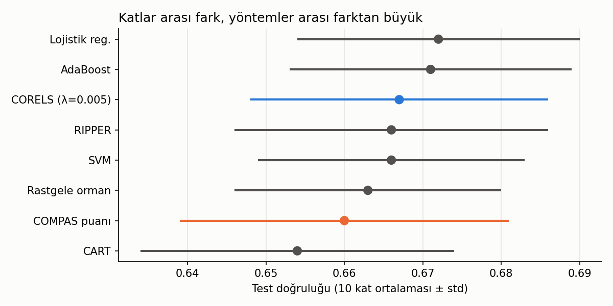
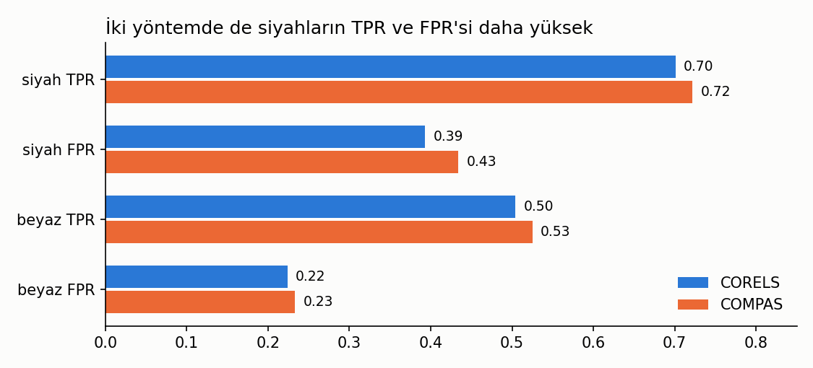
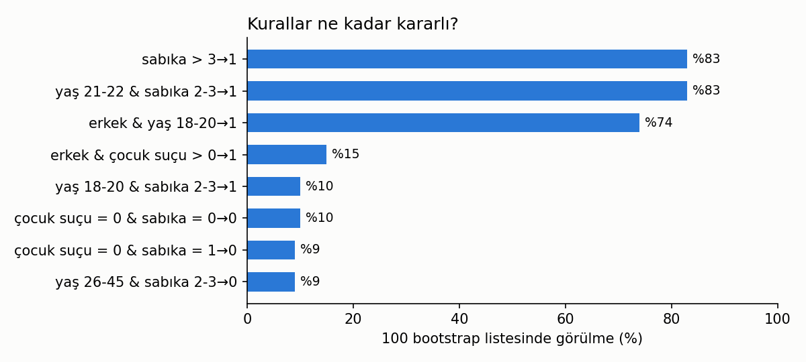

# Makale Yeniden Üretimi: Angelino ve ark. (2018), CORELS

**Öğrenci:** Ahmet Nail Arslan (20269348010)
**İlgili bölüm:** Molnar, *Interpretable Machine Learning*, Bölüm 10: Karar Kuralları
**İzlencedeki tür:** Seçenek 2: Kıyaslama (Benchmarking)

## Makale

Angelino, E., Larus-Stone, N., Alabi, D., Seltzer, M. ve Rudin, C. (2018). Learning Certifiably Optimal Rule Lists for Categorical Data. *Journal of Machine Learning Research*, 18, 1–78. <http://jmlr.org/papers/v18/17-716.html>

10. bölümdeki karar listeleri çoğunlukla açgözlü ya da olasılıksal yöntemlerle öğrenilir. CORELS, verilen öncüller arasından **kanıtlı en iyi** kural listesini bulur: hata + λ × kural sayısı en küçük. Makale bunu ABD'de suç tekrarını tahmin eden COMPAS puanıyla kıyaslar.

## Dosyalar

| Dosya | İçerik |
|---|---|
| `analiz.ipynb` | Kod, tablolar, şekiller, yorumlar (hazır sonuçları okur) |
| `corels_py.py` | Sıfırdan yazılmış kesin dal-sınır çözücüsü |
| `veriler.py`, `veri/` | COMPAS (ad ve doğum tarihi saklanmadan) ve UCI 697 |
| `calistir.py` | Bütün deneyler |
| `figurler.py`, `sekiller/`, `sonuclar/` | Tablolar, şekiller, hazır sonuçlar |

Kurulum: `pip install -r requirements.txt`. `corels` paketi **gerekmez** (PyPI sürümü güncel Python'da derlenmiyor; ayrıca kendi öncüllerini kazdığı için makaledeki öncül kümesini vermiyor).

## Düzen

- **Veri:** ProPublica'nın 7.214 kaydından eksik verisi olmayan 6.907'si (§6.2). Makaledeki N ve pozitif oranla (0,46) aynı.
- **Öznitelikler:** Tablo 7: 6 öznitelik, 17 değer; tek ve iki koşullu öncüller, desteği 0,005–0,995 dışında kalanlar elenir. Özellik Seti B ırkı da ekler.
- **Değerlendirme:** 10 katlı çapraz doğrulama; ± katlar arası standart sapma (makaledeki gibi). COMPAS puanı ≥ 5 "evet" sayılır.

**Makaleden farklarımız:** katlar rastgele; yaş tanımı makalede yok (aşağıda iki tanım); C4.5 ve SBRL çalıştırılmadı; CART, SVM, AdaBoost ve RF scikit-learn, RIPPER `wittgenstein`; NYPD/NYCLU verileri kullanılmadı.

## Sonuçlar

| | Makale | Yeniden üretim (tarama yaşı) |
|---|---|---|
| N, pozitif oran (Tablo 1) | 6.907; 0,46 | 6.907; 0,463 |
| Öncül sayısı M (Ek E.1) | 121–123 | 123–124 |
| CORELS test doğruluğu, λ = 0,005 (§6.4) | 0,665 ± 0,018 | **0,667 ± 0,019** |
| COMPAS doğruluğu (§6.4) | 0,660 ± 0,019 | **0,660 ± 0,021** |

**İddia 1: CORELS, COMPAS kadar doğru (§6.4).** ✔ Fark 0,007; katlar arası sapma 0,02.

**İddia 2: Listeler kısa; kurallar "evet", varsayılan "hayır"; ırk seçilmiyor (Şekil 3–4).** ✔ (ırk kısmı kanıtsız) λ = 0,005'te 10 katın hepsinde aynı üç kural: *erkek & yaş 18–20*, *yaş 21–22 & sabıka 2–3*, *sabıka > 3*. Makalenin Şekil 4'teki 3 kurallı listesiyle (sıra dışında) aynı; makalede bazı katlarda dördüncü kural (*23–25 & 2–3*) var, bizde yok. Özellik Seti B'de (M = 190–191) 10 katın hepsinde yine aynı üç kural bulundu, ırk hiç seçilmedi; ama arama 240 saniyede bitmediği için bu listelerin en iyi olduğu **bizde kanıtlanmadı**.

**İddia 3: λ büyüdükçe liste kısalır (Şekil 19–20).** ✔ kısmen

| λ | Makale | Tarama yaşı | Ham yaş |
|---|---|---|---|
| 0,02 | 10/10 kat: *sabıka > 3* | 5 kat 1 kural, 5 kat 2 kural | 10/10 *sabıka > 3* |
| 0,01 | 2–3 kural (kat kat değişir) | 10/10: 2 kural | 2–4 kural |
| 0,005 | 3–4 kural | 10/10: 3 kural (makaledeki) | 10/10: 4 kural (**makalede yok**) |

**İddia 4: Algoritmalar arasında anlamlı fark yok (Şekil 9; değerler grafikte, sayısal karşılaştırma yapılmadı).** ✔ Test doğruluğu: lojistik regresyon 0,672; AdaBoost 0,671; CORELS 0,667; RIPPER 0,666; SVM 0,666; RF 0,663; COMPAS 0,660; CART 0,654. Aralık 0,018, katlar arası sapma da ≈ 0,02.

**İddia 5: CORELS ve COMPAS ırklar arasında benzer fark gösterir (Şekil 7, grafik).** ✔

| | CORELS | COMPAS |
|---|---|---|
| Siyah TPR / FPR | 0,70 / 0,39 | 0,72 / 0,43 |
| Beyaz TPR / FPR | 0,50 / 0,22 | 0,53 / 0,23 |

Irk modele girmediği hâlde fark sürüyor: sabıka ortalaması siyahlarda 4,5, beyazlarda 2,6 (makale 4,4 ve 2,6).

## Sınırlar ve zafiyetler

**1. "Kanıtlı en iyi", yalnızca verilen veri için en iyidir: yaş tanımı.** Makale yaşın nasıl hesaplandığını yazmıyor. ProPublica'nın hazır `age` sütunu (ham yaş) veri toplama anınındır; tarama anındaki yaş `compas_screening_date − dob`.

| λ = 0,005 | Test doğruluğu | Liste |
|---|---|---|
| Tarama yaşı | 0,667 ± 0,019 | makaledeki üç kural |
| Ham yaş | 0,677 ± 0,020 | *18–20*; *sabıka > 3*; *erkek & 21–22*; *23–25 & 2–3* |

İki liste de kanıtlı en iyi, ama farklı. **Hiçbir tanım makaleyi bütünüyle tutmuyor:** tarama yaşı λ = 0,005'i, ham yaş λ = 0,02'yi ve Tablo 7'deki 18–96 aralığını veriyor (tarama yaşında 22 kişi 18'in altında). Yazarların hangi tanımı kullandığı bilinmiyor. Ham yaş sonuçtan sonra ölçüldüğü için tahminde kullanılması ayrıca sorunludur.

**2. Kararlılık.** On katın aynı listeyi vermesi kararlılık demek değildir; katlar verinin %80'inden fazlasını paylaşır. 100 bootstrap örneğinde aynı kural kümesi **%60**, 21 farklı küme. *Sabıka > 3* %83, *21–22 & 2–3* %83, *erkek & 18–20* %74.

**3. Öncül kümesi.** En iyilik yalnızca önceden kazılmış öncüller içindir; yaş ve sabıka kutuları elle seçilmiştir.

**4. Ölçek.** COMPAS'ta 17 ikili öznitelik 127 benzersiz hücre bırakır; λ = 0,02'de 0,02 sn, 0,005'te ~10 sn. Irk eklenince (M = 190) 240 saniyede kanıt tamamlanmadı. Kendi verimizde λ = 0,02'de **hiçbir katta kanıt tamamlanmadı** (bkz. aşağı).

**5. Doğruluk adalet değildir** (İddia 5).

## Kendi verim: okul terki (UCI 697)

Dropout / diğer, yalnızca 1. dönem bilgisi (Bölüm 9'daki B kurulumu). Bölüm 9'da bulunan 180 kayıtsız ve 1. dönem hiç sınava girmemiş 169 öğrenci çıkarıldı (n = 4.075). 8 öznitelik; çeyreklik eşikler yalnızca eğitim katından.

| Yöntem | Doğruluk | TPR | FPR | Kural |
|---|---|---|---|---|
| Lojistik regresyon | 0,840 ± 0,019 | 0,63 | 0,07 | – |
| RIPPER | 0,825 ± 0,021 | 0,58 | 0,07 | – |
| CART | 0,824 ± 0,019 | 0,67 | 0,11 | – |
| RF | 0,820 ± 0,018 | 0,62 | 0,10 | – |
| CORELS λ = 0,02 (kanıtsız) | 0,818 ± 0,018 | 0,57 | 0,08 | 2,0 |
| CORELS λ = 0,03 (kanıtlı) | 0,802 ± 0,030 | 0,55 | 0,09 | 1,7 |
| Çoğunluk | 0,712 ± 0,020 | 0 | 0 | 0 |

- **İddia 1 ve 4 benzeri kısmen tutuyor:** iki kurallı liste RF ve CART'a 0,2–0,6 puan, lojistik regresyona 2,2 puan uzak.
- **Kanıt ölçeklenmiyor:** λ = 0,02'de arama, 400.000 önek sınırında ya da 240 saniyede durdu; liste bulundu ama en iyi olduğu kanıtlanmadı. Bizim Python çözücümüz yazarların C++ kodundan yavaştır; bu yüzden sonuç algoritmanın değil, uygulamamızın sınırı da olabilir.
- **Kararsızlık:** tipik liste "1. dönem geçilen ≤ 4 & not ≤ 11,4" ve "harç güncel değil", ama katlar arasında ikinci koşul (not / yaş / burs) değişiyor.

## Sonuç

Makalenin ana sayıları (CORELS 0,665 ve COMPAS 0,660) yeniden üretildi; birkaç kurallı bir liste kara kutu puanla aynı doğruluğu veriyor. Kıyaslamada CORELS kazanan değil, **eşit doğrulukta en kısa** modeldir. En önemli bulgu, en iyilik kanıtının veriyi tanımlama kararlarını (yaş, kutular, λ) kapsamaması ve bootstrap altında listenin %40'ının değişmesidir.

**Sınırlılıklar:** C4.5, SBRL ve NYPD/NYCLU yok. Tek kat bölmesi (makaledeki gibi). Yaş tanımı çıkarımdır. Öncül kutularının etkisi ayrıca ölçülmedi.

## Savunma soruları

**1. CORELS neden "kanıtlı en iyi"?** Arama, alt sınırı bugünkü en iyiden kötü olan bütün önekleri güvenle eler; kalan önek bitince en iyisi kanıtlanmış olur.

**2. Hangi sınırlar kullanıldı?** Hiyerarşik alt sınır ve ileri bakış, öncül desteği (≥ λ), eşdeğer noktalar ve permütasyon. Eşdeğer noktalar: aynı öznitelikli ama farklı etiketli kişiler hiçbir listeyle ayrılamaz.

**3. λ ne demek?** Her ek kural hatayı en az λ kadar azaltmalı. λ = 0,005 ve N = 6.217'de yaklaşık 31 kişi.

**4. Irk modelde yokken neden FPR farkı var?** Sabıka ve yaş ırkla ilişkili. Özniteliği çıkarmak eşit hata oranı sağlamaz.

**5. Sonucunuz makaleyle neden tam aynı değil?** Katlar rastgele ve yaş tanımı yazılmamış. Tarama yaşı λ = 0,005'i tutuyor, ham yaş λ = 0,02'yi; ikisini de raporladım.

**6. Kendi verinizde ne oldu?** İki kural 0,818; en iyi model 0,840. Ama λ = 0,02'de en iyilik kanıtlanamadı.

**7. Liste kararlı mı?** Üç ana kural bootstrap'ta %74–83 görülüyor, ama listenin tamamı yalnızca %60 aynı. Kuralları tek tek yorumlamak, listeyi "gerçek" saymaktan güvenli.
