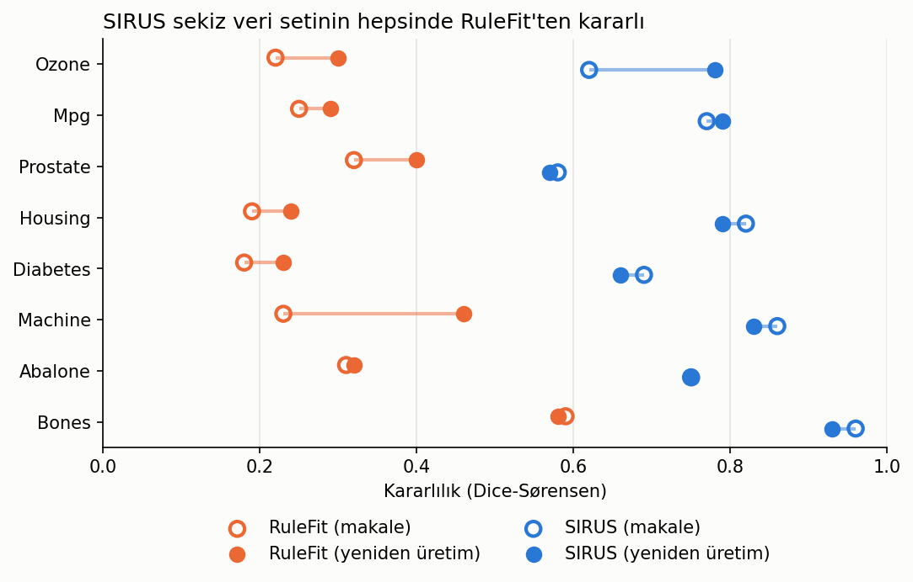
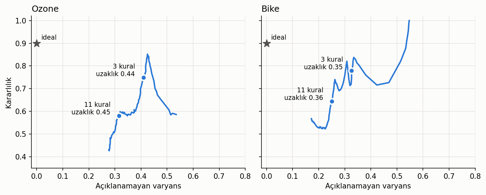

# Makale Yeniden Üretimi: Bénard ve ark. (2021), SIRUS

**Öğrenci:** Ahmet Nail Arslan (20269348010)
**Makale:** Bénard, Biau, Da Veiga, Scornet, *Interpretable Random Forests via Rule Extraction*, AISTATS 2021

**İzlencedeki tür:** Seçenek 2 (Kıyaslama) + Seçenek 3 (Geliştirme/Modifikasyon)

> **Hata = 1 − R² (test katları).** Bütün "hata" sütunları, test katlarındaki tahminlerin toplam kare hatasının, çıktının toplam kare sapmasına oranıdır (makaledeki "unexplained variance"). Küçük olması iyidir; 1, ortalamayı tahmin etmekle aynıdır. Bike zaman deneyinde test kümesi son %20'dir.

## Amaç

**Seçenek 2:** RuleFit, CART ve RF ile SIRUS kıyaslanır. **Seçenek 3:** SIRUS Python'da yeniden yazıldı; Bike verisine, zaman sıralı bölmeye ve sınır deneylerine taşındı.

Makalenin iddiası: RuleFit'in kural listesi kararsızdır (veri biraz değişince kurallar değişir); SIRUS kısa ve kararlı bir kural listesini rakiplerine yakın doğrulukla verir. Bu çalışmada SIRUS Python'da sıfırdan yazıldı, makalenin bulgusu 8 veri setinde yeniden üretildi, Bike Sharing verisinde tekrarlandı ve algoritmanın kırıldığı yerler arandı.

## Dosyalar

| Dosya | İçerik |
|---|---|
| `analiz.ipynb` | Ders anlatımı (baştan sona yaklaşık 35 sn) |
| `calistir.py` | Tam deney ve sınır deneyleri |
| `figurler.py`, `sekiller/` | Karşılaştırma tabloları ve şekiller |
| `sirus_py.py` | SIRUS: kutulama, orman, kural sıklığı, son işlem, kısıtlı ridge, p0 seçimi |
| `rulefit_pre.R` | Makaledeki RuleFit (`pre` R paketi) |
| `veri_yukle.py`, `veri/` | Veri setleri |
| `sonuclar/` | Kayıtlı deney sonuçları |

## Veri

| Veri | n × öznitelik | Kaynak |
|---|---|---|
| Ozone, Prostate, Bones | 330×9, 97×8, 485×3 | *Elements of Statistical Learning* sitesi |
| Mpg, Housing, Machine, Abalone | 398×7, 506×13, 209×6, 4177×8 | UCI |
| Diabetes | 442×10 | scikit-learn |
| **Bike Sharing** (kendi verim) | 729×9 | UCI, `day.csv` |

Bike'ta `cnt_2d_bfr`, kitaptaki gibi iki gün önceki kiralama sayısıdır; ilk iki gün bu yüzden düştü.

## Çalıştırma

Python 3.11 ile:

```
pip install -r requirements.txt
jupyter nbconvert --to notebook --execute --inplace analiz.ipynb
```

`python calistir.py` bütün deneyi yeniden hesaplar (28 süreçle yaklaşık 40 dakika). `pre` karşılaştırması için R ve `install.packages("pre")` gerekir (kullanılan: R 4.6.2, pre 1.1.1); R yoksa bu satırlar atlanır. Notebook R gerektirmez.

## Yöntem ve varsayımlar

SIRUS adımları makalenin 2. Bölümü ile Ek Bölüm 2, 4 ve 7'sinden alındı: 10 kantil, derinlik 2, bootstrap, mtry = max(2, ⌊p/3⌋), ε < 0.05 durdurma ölçütü (üst sınır 20.000 ağaç), β ≥ 0 kısıtlı ridge, p0 için (hata 0, kararlılık 0.9) noktasına uzaklık. **`pre` ayarları:** R `pre` 1.1.1 varsayılanları; `type = "rules"`, 500 ağaç (`ctree`), derinlik 3, `learnrate = 0.01`, `sampfrac = 0.5`, `winsfrac = 0.025`, `normalize = TRUE`, `removecomplements = TRUE`, `removeduplicates = TRUE`. Son model Lasso'dur (`glmnet` 5.2; 10 katlı CV); **λ = `lambda.1se`** (`coef.pre` ve `predict.pre` varsayılanı). `ad.penalty = "lambda.min"` yalnızca uyarlamalı Lasso içindir, `ad.alpha = NA` olduğu için devrede değil. Makale λ'yı yazmıyor. `lambda.min` alınsaydı kural sayısı artardı (Abalone'da tek denemede 129 yerine 179).

CRAN'dan kaldırılan resmî `sirus` 0.3.3 derlenmedi; kural kimliği ve p0 ayrıntılarını netleştirmek için kaynak koduna bakıldı.

Makalede açık olmayan ya da farklı yapılan noktalar:

- **Tekrar:** 10 tekrar × 10 kat; Abalone'da iki RuleFit için süre nedeniyle 3 tekrar, sınır deneylerinde 5 tekrar.
- **Kural kimliği:** kesimin değeri değil kantil sırası karşılaştırılır (katlar arasında kantil değerleri kayar). Ağırlığı 0 olan kural listeye sayılmaz.
- **Ağaç sonu:** düğüm bölme için en az 5 örnek.
- **RuleFit kararlılığı:** veri, kat ayırmadan önce 10 kantile kutulandı; tek koşullu tümleyen kurallar aynı sayıldı. Kutular önce [a,b), sonra (a,b] alındı (bkz. 2b).
- **p0:** seçildiği katlarla aynı katlarda raporlanır; hata bir miktar iyimserdir.
- **Veri:** Mpg'de 6 eksik `horsepower` medyanla dolduruldu. Bones'ta `idnum` sayısal alındı (makale 2 kategorik diyor). Ozone'da çıktı ham değer: makale metni "log" dese de Tablo 1'deki ortalama 12 ham değerle uyuşuyor.
- **CART / RF:** scikit-learn; ayarlar makaledekilerle birebir değil.

## Bulgular

### 1. Uygulamanın doğrulanması
- **Tablo 1 (Ozone):** 11 kuralın tamamı aynı; sıklık farkı en fazla 0.005.
- **Tablo 6 (Machine):** 9 kuralın tamamı aynı, İSE/DEĞİLSE değerleri aynı. Makaledeki 14. kuralın yönü (`MMAX < 32000`) veriyle çelişiyor; 554 değerini `MMAX >= 32000` veriyor. Olası dizgi hatası.

### 2. Kararlılık (Tablo 2b) — makale / yeniden üretim



| Veri | RuleFit makale | RuleFit `pre` | SIRUS makale | SIRUS (otomatik p0) | SIRUS (eşli) |
|---|---|---|---|---|---|
| Ozone | 0.22 | 0.30 | 0.62 | **0.78** | 0.58 |
| Mpg | 0.25 | 0.29 | 0.77 | 0.79 | 0.78 |
| Prostate | 0.32 | 0.40 | 0.58 | 0.57 | 0.58 |
| Housing | 0.19 | 0.24 | 0.82 | 0.79 | 0.80 |
| Diabetes | 0.18 | 0.23 | 0.69 | 0.66 | 0.65 |
| Machine | 0.23 | **0.46** | 0.86 | 0.83 | 0.87 |
| Abalone | 0.31 | 0.32 | 0.75 | 0.75 | 0.71 |
| Bones | 0.59 | 0.58 | 0.96 | 0.93 | 0.93 |

**Ozone, SIRUS — iki liste ayrı ayrı** (10 tekrarın p0 seçimi iki gruba ayrılıyor; her grubun medyan p0'ı bütün tekrarlarda ölçüldü):

| Liste | Seçilen tekrar | p0 | Hata | Kararlılık | Kural |
|---|---|---|---|---|---|
| Kısa | 6 | 0.104 | 0.42 | 0.83 | 2.4 |
| Uzun | 4 | 0.036 | 0.33 | 0.60 | 9.5 |
| Makale | – | – | 0.32 | 0.62 | 11 |

Makalenin sonucu uzun listeyle uyumlu; tablodaki tek satırlık 0.78, medyan p0'ın iki liste arasında bir noktaya düşmesinden gelir.

### 2b. RuleFit (`pre`): kutulama etkisi

Kutulamasız kural kimliği: değişken + yön + ham eşik. Tek koşullu tümleyenleri birleştirmek hiçbir veride sonucu değiştirmedi (`pre` zaten tümleyenleri eler). Abalone'da 3, öteki verilerde 10 tekrar.

| Veri | Makale | Kutulu, [a,b) (önceki) | Kutulu, (a,b] | Kutulamasız | Kural: makale / `pre` / kutulamasız |
|---|---|---|---|---|---|
| Ozone | 0.22 | 0.30 | 0.29 | 0.07 | 21 / 29.5 / 28.5 |
| Mpg | 0.25 | 0.29 | 0.31 | 0.10 | 40 / 54.5 / 55.3 |
| Prostate | 0.32 | 0.40 | 0.36 | 0.23 | 14 / 15.8 / 15.5 |
| Housing | 0.19 | 0.24 | 0.23 | 0.04 | 54 / 83.1 / 84.0 |
| Diabetes | 0.18 | 0.23 | 0.23 | 0.06 | 25 / 30.5 / 31.0 |
| Machine | 0.23 | **0.46** | **0.25** | 0.21 | 44 / 43.0 / 43.7 |
| Abalone | 0.31 | 0.32 | 0.35 | 0.05 | 58 / 125.0 / 122.8 |
| Bones | 0.59 | 0.58 | 0.56 | 0.31 | 5 / 14.4 / 14.4 |
| Bike | – | 0.26 | 0.28 | 0.04 | – / 81.1 / 82.1 |

- **Machine farkı açıklandı:** kutuların hangi ucu kapalı olduğu. Bizim ilk kutulamamız [a,b) idi; Machine'in öznitelikleri çok sayıda eşit değer içerir; olası mekanizma, eşit değerlerin kantil sınırında hangi kutuya düştüğüdür (mekanizma ayrıca sınanmadı, etki ölçüldü). Sağdan kapalı kutularla (a,b] (R'daki `cut()` varsayılanı) Machine 0.46'dan 0.25'e iniyor (makale 0.23). Öteki verilerde fark en çok 0.04. Machine dışında iki seçim makaleye eşit uzaklıkta (ortalama mutlak fark 0.046 ve 0.048); 8 verinin tümünde (a,b] daha yakın: 0.044'e karşı 0.069.
- **Kutulamasız ölçüm makalenin değeri değil:** Machine'de 0.21 ile makaleye yakın görünmesi rastlantı; diğer 7 veride makalenin çok altında (ortalama fark 0.15). Yakın ama eşit olmayan eşikler farklı kural sayıldığı için kararlılık düşük çıkıyor; makale de kararlılık için veriyi 10 kantille kutuluyor.
- **Kural sayısı** kutulamadan etkilenmiyor (ham veriyle kurulan modelden sayılır; küçük farklar rastgelelik). Abalone ve Bones'taki farkın nedeni hâlâ bilinmiyor; makale λ'yı yazmıyor.

"Eşli": p0, kural sayısı makaledekine denk gelecek şekilde ayarlandı; bağımsız doğrulama değildir.

Kural sayısı (Tablo 2a) ve açıklanamayan varyans (Tablo 3):

| Veri | Kural: RuleFit M / `pre` | Kural: SIRUS M / YÜ | Hata: RuleFit M / `pre` | Hata: SIRUS M / YÜ |
|---|---|---|---|---|
| Ozone | 21 / 29.5 | 11 / 2.7 | 0.27 / 0.27 | 0.32 / 0.42 |
| Mpg | 40 / 54.5 | 10 / 10.3 | 0.15 / 0.14 | 0.20 / 0.19 |
| Prostate | 14 / 15.8 | 9 / 9.9 | 0.53 / 0.53 | 0.55 / 0.56 |
| Housing | 54 / 83.1 | 6 / 6.1 | 0.16 / 0.16 | 0.30 / 0.31 |
| Diabetes | 25 / 30.5 | 12 / 10.9 | 0.55 / 0.56 | 0.56 / 0.56 |
| Machine | 44 / 43.0 | 9 / 10.0 | 0.26 / 0.25 | 0.29 / 0.30 |
| Abalone | 58 / 125.0 | 8 / 7.1 | 0.46 / 0.46 | 0.66 / 0.66 |
| Bones | 5 / 14.4 | 1 / 1.1 | 0.70 / 0.67 | 0.73 / 0.73 |

**Farkların açıklaması**
- **Ozone, SIRUS:** kısa (≈3) ve uzun (≈11) listenin ideal noktaya uzaklığı neredeyse eşit; 10 tekrarın 6'sında kısa liste seçildi.



- **RuleFit:** `pre` çoğu veri setinde daha çok kural ve biraz daha yüksek kararlılık veriyor (bkz. 2b). Machine'deki büyük fark kutu sınırından geliyordu.
- **imodels RuleFit** (`max_rules=500`): kararlılık 0.05–0.15, 62–179 kural; Prostate, Diabetes ve Bones'ta aşırı uyum. `pre`'nin yerine geçmediği için ana karşılaştırmada yok.

### 3. Kendi verim: Bike Sharing

| Yöntem | Hata | Kararlılık | Kural (CART: yaprak) |
|---|---|---|---|
| SIRUS | 0.26 | **0.74** | **7.7** |
| RuleFit (`pre`) | **0.11** | 0.26 | 81 |
| RuleFit (imodels) | 0.16 | 0.12 | 137 |
| CART | 0.21 | – | 61 |
| RF | 0.12 | – | – |

SIRUS kararlı ve kısa, ama rastgele katlarda hatası RuleFit'in iki katından fazla ve CART'tan da yüksek. Katlar rastgele ayrıldı.

**Zaman sıralı bölme** (ilk %80 = 583 gün eğitim, son %20 = 146 gün test; `days_since_2011` testte eğitim aralığının dışında; SIRUS, `pre`, RF 10 tohum):

| Yöntem | Hata, rastgele kat | Hata, zaman sıralı (min–maks) | Kural / yaprak |
|---|---|---|---|
| SIRUS | 0.26 | 0.49 (0.41–0.55) | 8.9 (3–15) |
| `pre` | 0.11 | **0.29** (0.27–0.31) | 87 |
| CART | 0.21 | 0.71 | 24 |
| RF | 0.12 | 0.38 (0.37–0.40) | – |

Dört yöntemin hatası da yaklaşık 2 ile 3,5 katına çıkıyor: rastgele katlar iyimserdi. **Rastgele katta CART'a yenilen SIRUS, zaman sıralı bölmede CART'ı geçiyor** (0.49'a karşı 0.71); RuleFit yine en iyisi, RF ikinci. CART tek çalıştırmadır ve budama katsayısı eğitim döneminde bitişik katlarla seçildi. SIRUS'un p0'ı eğitim içinde seçildi ve kural sayısı tohuma göre 3 ile 15 arasında değişti: burada da p0 kararsız.

### 4. Sınırlar ve zafiyetler

| Deney | SIRUS hata / kararlılık | `pre` hata / kararlılık | CART hata |
|---|---|---|---|
| `esik`: gerçek eşik 0.97, ızgara 0.90'da bitiyor | **0.76** / 0.92 | 0.12 / 0.94 | 0.09 |
| `xor`: yalnızca etkileşim var | **0.58** / 0.40 | 0.39 / 0.13 | 0.47 |
| `kopya`: Bike + güçlü ilişkili kopyalar | 0.31 / 0.76 | 0.12 / 0.20 | 0.21 |

- **Kantil kısıtı iki yüzlü:** kararlılığın kaynağı, aynı zamanda *esik* deneyindeki çöküşün nedeni. 0.92 kararlılıkla yanlış eşikli kural seçiliyor: **kararlı olmak doğru olmak değildir.**
- **Etkileşim:** tek başına bilgi taşımayan özniteliklerde açgözlü bölünme ve derinlik 2 yetmiyor. (Çok sayıda kural kullanan imodels 0.10'a iniyor.)
- **İlişkili öznitelik:** kararlılığın düşmesini bekliyordum, düşmedi (0.73 → 0.76); hata arttı (0.26 → 0.31).
- **q:** Bike'ta q 4 → 100 olurken kararlılık 0.78 → 0.65.
- **p0 seçimi** Ozone'daki gibi iki uca bölünebilir.
- **Kapsam:** yalnızca regresyon yazıldı; makaledeki Node harvest ve "SIRUS sparse" sütunları yeniden üretilmedi.

## Savunma soruları

**1. RuleFit neden kararsız?**
Ağaçlardan çıkan kurallar birbiriyle güçlü ilişkilidir. Lasso, ilişkili kurallardan birini seçip ötekileri sıfırlar; hangisinin seçileceği küçük veri değişimlerine bağlıdır. Makale de kararsızlığın ana nedeni olarak bunu gösterir (Bölüm 2).

**2. SIRUS kararlılığı nereden alıyor?**
İki yerden: kesimlerin 10 kantille sınırlanması aynı kuralın farklı ağaçlarda tekrar görülmesini sağlar; kurallar Lasso ile değil görülme sıklığıyla (p̂ > p0) seçilir. Ridge yalnızca ağırlık verir, ama β ≥ 0 kısıtı bazı ağırlıkları sıfırlayabilir.

**3. Son işlem neden gerekli?**
Bir kökün iki çocuğu, DEĞİLSE kısmıyla birlikte aynı kuraldır; derinlik 2 kuralları da doğrusal bağımlı olur. Atılmazlarsa doğrusal birleştirme tanımsızlaşır. Tablo 6'da 17 ham kural 9'a iner; kodumuz aynı 9'u buluyor.

**4. Kararlılık 0.92 ise model güvenilir midir?**
Hayır. *esik* deneyinde SIRUS 0.92 kararlı ama hatası 0.76. Kararlılık "aynı cevabı veriyor" demektir, "doğru cevabı veriyor" demek değildir. Hata ile birlikte raporlanmalı.

**5. Sonuçlarınız neden makaleyle birebir aynı değil ve sizinkine neden güvenelim?**
Katlar, orman ve λ seçimi rastgele; bazı ayrıntılar makalede yok. Güven, Tablo 1 ve Tablo 6'daki kural listelerinin aynen çıkmasından geliyor. Otomatik p0 ile SIRUS kararlılığı 8 veri setinin 7'sinde makaleye 0.04 içinde; Ozone'daki sapma p0'ın iki uca bölünmesinden. RuleFit'in Machine'deki farkı (0.46'ya karşı 0.23) ise kutu sınırından geliyordu: sağdan kapalı kutularla 0.25.
