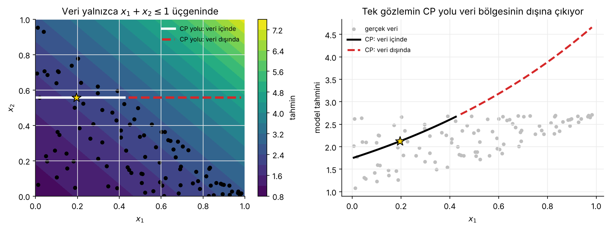
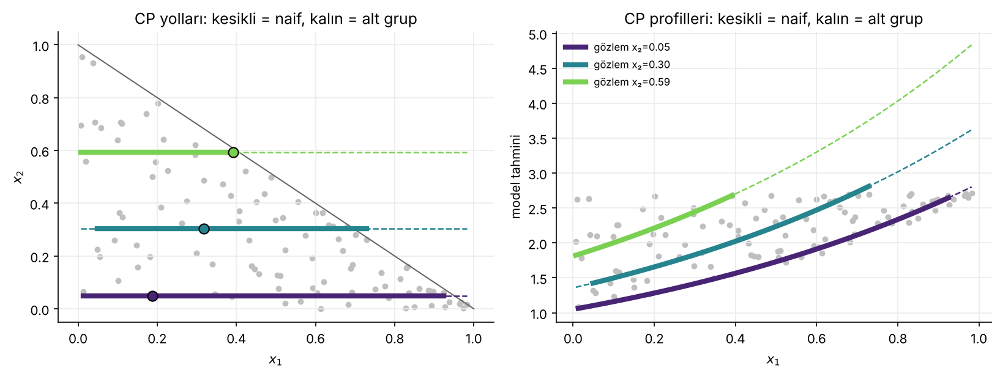
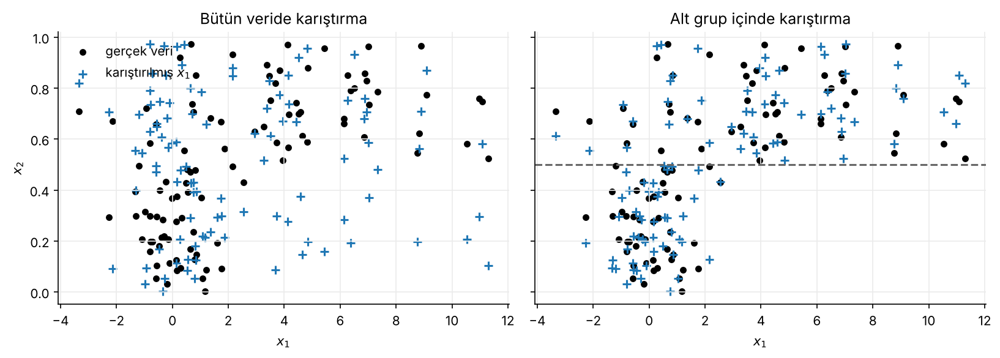
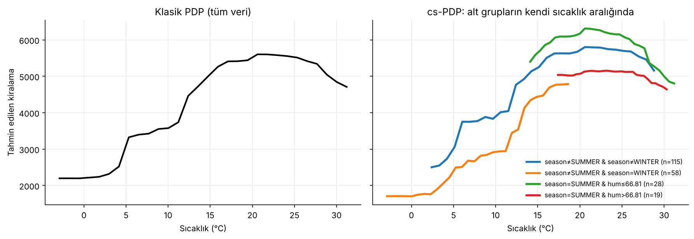
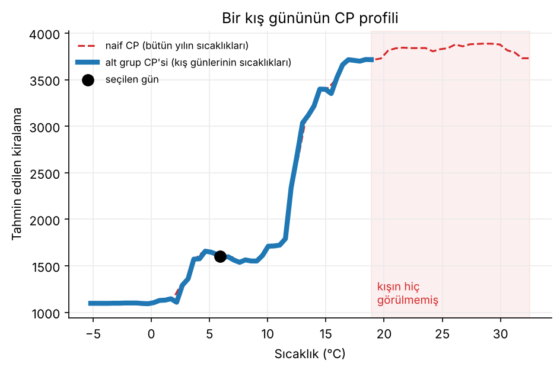
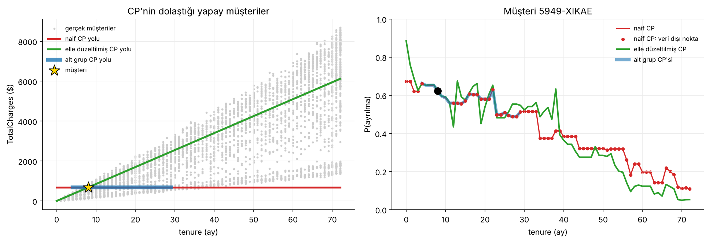
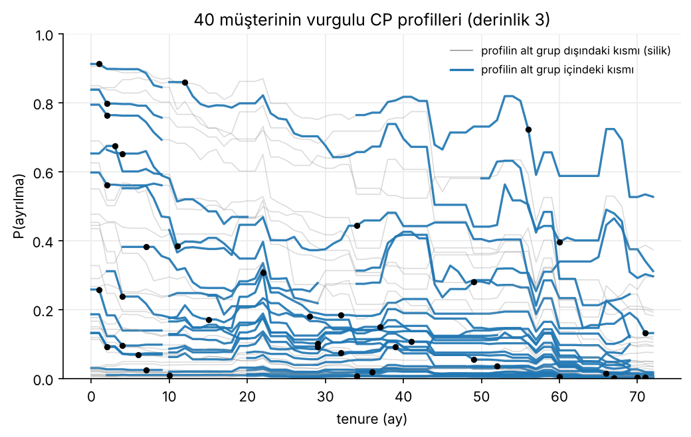
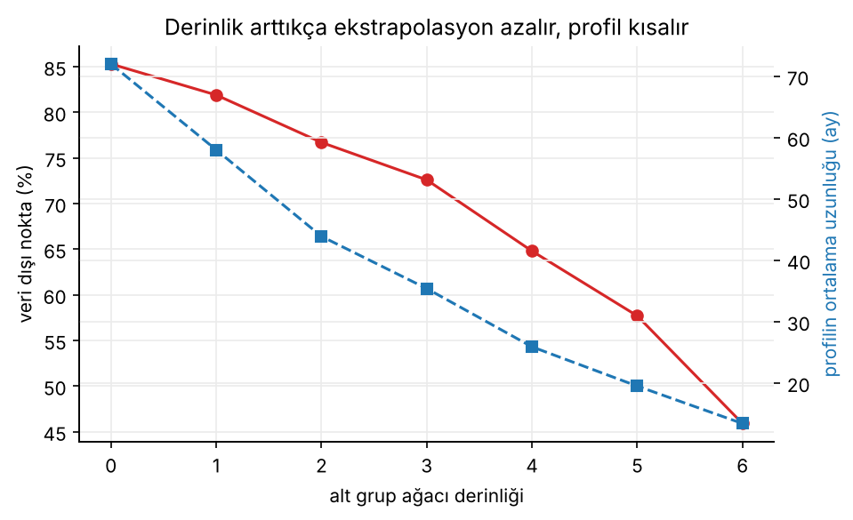

# Makale Yeniden Üretimi: Koşullu Alt Gruplarla Ceteris Paribus

**Öğrenci:** Serap Şahin (20269348009)  
**İlgili bölüm:** Molnar, *Interpretable Machine Learning*, [Bölüm 12 – Ceteris Paribus Plots](https://christophm.github.io/interpretable-ml-book/ceteris-paribus.html)  
**İzlencedeki tür:** Seçenek 2: Kıyaslama (standart CP ile alt grup CP'si). Makale yeni bir varyant önerdiği için Seçenek 3 ile de ilişkili; ancak katkısı hız veya stabilite değil, veri bölgesinin dışına düşen sorguları azaltmak.

## Makale

Molnar, C., König, G., Bischl, B. ve Casalicchio, G. (2024). *Model-agnostic Feature Importance and Effects with Dependent Features: A Conditional Subgroup Approach.* Data Mining and Knowledge Discovery, 38(5), 2903–2941. https://doi.org/10.1007/s10618-022-00901-9 · arXiv: [2006.04628](https://arxiv.org/abs/2006.04628)

Yazarların kodu (R): [github.com/christophM/paper_conditional_subgroups](https://github.com/christophM/paper_conditional_subgroups)

## 1. Neden bu makale?

Ceteris paribus (CP) profili tek bir gözlem için şu soruyu sorar: *"Diğer her şey sabitken bu öznitelik değişseydi model ne tahmin ederdi?"* Öznitelikler birbirine bağlıysa "diğer her şey sabit" varsayımı gerçekte olmayan veri noktaları üretir. Model bu noktalarda eğitim verisi görmemiştir; buradaki tahminler veriyle desteklenmez ve doğru olup olmadıklarını veriden kontrol edemeyiz.

Bölüm 12 uygulamamda bunu Telco verisinde ölçtüm: `5949-XIKAE` müşterisinin `tenure` profilinde noktaların **%90**'ı en yakın gerçek müşteriden uzak düşüyordu, çünkü `TotalCharges ≈ tenure × MonthlyCharges`. Uygulamada sorunu ilişkiyi **elle** yazarak düzeltmiştim. Bu makale aynı sorunu **ilişkiyi bilmeden, veriden öğrenerek** azaltmayı öneriyor. Bu yüzden Bölüm 12'nin doğal devamı.

Kitabın yazarı makalenin de ilk yazarı. Hooker, Mentch ve Zhou (2021) aynı ekstrapolasyon sorununu ICE eğrilerinde gösteriyor (Şekil 6); o makaleyi PR 36'da Bölüm 23–24 için başka bir öğrenci yeniden üretti. Bu çalışma sorunu göstermekle kalmayıp onu azaltmayı amaçlayan bir yöntemi yeniden üretiyor.

## 2. Yöntem

**Adım 1 – Alt gruplar.** İlgilenilen öznitelik $x_j$, diğer öznitelikler $x_{-j}$ kullanılarak bir karar ağacıyla tahmin edilir. Ağacın her yaprağı bir alt gruptur $\mathcal{G}_k$. Ağaç, yaprak içinde $x_j$'nin dağılımını daraltmayı hedefler; böylece $x_j$'nin diğer özniteliklere bağımlılığı azalır. Bu, yaprak içinde bağımsızlığın garantisi değildir.

**Adım 2 – Alt grup içinde değiştirme.** Gözlem $x^{(i)}$'nin düştüğü yaprak $k(i)$ ise, profil yalnızca o yapraktaki gerçek $x_j$ değerleri üzerinde hesaplanır:

$$\text{CP}^{cs}_{i,j}(z) = \hat f\big(z, x^{(i)}_{-j}\big), \qquad z \in \big[\min_{l \in \mathcal{G}_{k(i)}} x^{(l)}_j,\ \max_{l \in \mathcal{G}_{k(i)}} x^{(l)}_j\big]$$

Alt grup PDP'si (cs-PDP) bunun yaprak içindeki ortalamasıdır. Makale aynı fikri permütasyon önemine (cs-PFI) de uyguluyor; bu çalışma etki/profil tarafına odaklanıyor.

**Makale PDP üzerinden anlatıyor; bu çalışma neden CP düzeyinde?** Makale yöntemi PDP ve PFI için sunuyor. Ancak PDP, CP profillerinin ortalamasıdır ($\text{PDP}_j(z) = \frac{1}{n}\sum_i \text{CP}_{i,j}(z)$) ve ekstrapolasyon her bir profilde ortaya çıkar. Yöntemde alt grup zaten **her gözlem için ayrı** belirlenir; cs-PDP, gözlemlerin alt grup CP profillerinin ortalamasıdır. Yazarların kodunda da tek gözlemli profilleri alt grup modeline göre vurgulayan bir fonksiyon var (`R/highlighted_ice.R`). Bu çalışma yöntemi ortalama almadan, tek gözlem (CP) düzeyinde uyguluyor. PDP yalnızca makalenin bisiklet şeklini yeniden ürettiğim yerde (Bölüm 3.3) geçiyor.

**Makaleden farkım.** Makale ağaç olarak *transformation tree* (`trtf` paketi) kullanıyor; bu ağaç $x_j$'nin bütün koşullu dağılımına göre böler. Python'da hazır bir karşılığı olmadığı için CART kullandım. Yazarların kodu da CART seçeneğini destekliyor (`fit_conditionals(type = "cart")`). En küçük yaprak büyüklüğü makaledeki gibi 30.

## 3. Yeniden üretilen sonuçlar

Kod: [`analiz.ipynb`](analiz.ipynb). Sayılar Bölüm 7'deki paket sürümleriyle yapılan çalıştırmaya aittir. Dosyalar ve çalıştırma için Bölüm 7'ye bakınız.

### 3.1 Motivasyon örneği (`experiments/examples-motivation.R`)

$x_1 \sim U(0,1)$, $x_2 \sim U(0, 1-x_1)$, $f = e^{x_1+x_2}$, $n = 100$. Veri $x_1 + x_2 \le 1$ üçgeninde. Makale bu örneği PDP ile gösteriyor; ben tek gözlemin CP profiliyle gösterdim:

- $x_2 = 0{,}56$ olan bir gözlemin CP yolunun **%56**'sı üçgenin dışında; profilin bu kısmı veri bölgesinin dışındaki sorgulardan oluşuyor. Bu örnekte öğrenilmiş bir model yerine gerçek fonksiyon ($e^{x_1+x_2}$) kullanıldığı için tahmin hatası yoktur; gösterilen şey yalnızca sorguların veri dışına çıkmasıdır. Öğrenilmiş bir modelde bu bölgedeki tahminler veriyle desteklenmez.
- Alt grup ağacı (derinlik 2) üçgeni $x_2$'ye göre dört dilime bölüyor. 100 gözlemin CP profillerinde üçgenin dışına düşen noktalar **naif CP'de %27, alt grup CP'sinde %10**.





### 3.2 Alt grup çizimi (`experiments/example-subgroups.R`)

$x_2 < 0{,}5$ ise $x_1 \sim N(0,1)$, değilse $N(4,4)$. $x_1$ bütün veride karıştırıldığında yeni noktalar boş bölgelere düşüyor; $x_2 = 0{,}5$'te bölünüp alt grup içinde karıştırıldığında verinin üstüne düşüyor. Makaledeki şeklin aynısı elde edildi.



### 3.3 Bisiklet uygulaması (`experiments/bike-application.R`)

Aynı veri dosyası ve aynı ön işleme.

**Tahmin edici bağımlılık** (her öznitelik diğerlerinden rastgele ormanla tahmin edildiğinde açıklanan kayıp, iki katlı):

| | season | yr | holiday | weekday | temp | hum | work | weather | wind |
|---|---|---|---|---|---|---|---|---|---|
| Makale (%) | 45 | 8 | 29 | 14 | 66 | 43 | 100 | 46 | 12 |
| Yeniden üretim (%) | 45 | 2 | 72 | 17 | 67 | 38 | 100 | 38 | 6 |

`season`, `temp`, `hum`, `work` ve `weekday` makaleye çok yakın. En büyük fark `holiday`'de: tatil günü "hafta içi olup iş günü olmayan gün" olarak `weekday` ve `work`'ten neredeyse kesin çıkarılabiliyor. Python'daki rastgele orman (one-hot kodlama ile) bunu yakalıyor; makaledeki R `randomForest` daha az yakalamış olabilir. `yr`, `wind` ve `weather`'daki farklar 731 günlük veride beklenebilecek düzeyde.

**Diğer değerler:** corr(temp, hum) = 0,13 (makale: 0,13). Rastgele orman test MAE = 541,5 (makale: 522,2; farklı orman uygulaması ve bölme).

**Makalenin şekli, sıcaklık için cs-PDP (derinlik 2):** Ağaç sıcaklığı önce mevsime göre bölüyor (yaz / kış / ilkbahar-sonbahar, yazda ayrıca neme göre). Klasik PDP kışın 30 °C gibi görülmemiş günleri de ortalamaya katıyor; cs-PDP her alt grupta yalnızca o grupta görülen sıcaklıklar için etki gösteriyor.

**CP düzeyine uyarlama, tek bir kış günü:** Test kümesinden tipik bir kış günü (5,9 °C, çarşamba, kötü hava). Naif CP sıcaklığı 32,5 °C'ye kadar değiştiriyor; oysa eğitim verisinde kışın görülen en yüksek sıcaklık 18,9 °C. Alt grup CP'si (`season = WINTER`) yalnızca −5,2 ile 18,9 °C arasında çiziliyor. Naif profilin 19–32 °C kısmı, modelin hiç görmediği "sıcak kış günleri" için verdiği tahminler.





## 4. Kendi verim: Telco müşterisi `5949-XIKAE`

Bölüm 12 uygulamasındaki model (gradient boosting, test ROC-AUC 0,840) ve gerçekçilik testi: üç sayısal öznitelik (`tenure`, `MonthlyCharges`, `TotalCharges`) standartlaştırılıyor; eğitim verisindeki en yakın komşu uzaklıklarının %99 kantili eşik. Eşiği aşan nokta "veri dışı".

Alt grup ağacı (derinlik 3) `tenure`'u neredeyse yalnızca `TotalCharges` ve `MonthlyCharges` ile bölüyor; ilişkiyi kimse söylemeden veriden buluyor. Müşterinin alt grubu: `TotalCharges ∈ (387,3; 970,7]` ve `MonthlyCharges > 30,8` (436 müşteri).

| Profil | `tenure` aralığı | Veri dışı nokta | Bilgi kaynağı |
|---|---|---|---|
| Naif CP (kitap) | 0–72 ay | %90,4 | Yok |
| Elle düzeltilmiş CP (uygulamam) | 0–72 ay | %0,0 | Alan bilgisi |
| **Alt grup CP'si (makale)** | **4–29 ay** | **%73,1** | **Veriden öğrenildi** |



**İki önemli ayrım:**

- **Alt grup CP'si tahminleri düzeltmez.** Ortak `tenure` değerlerinde naif CP ile birebir aynı tahmini verir (defterde kontrol ediliyor; en büyük fark 0,0). Yaptığı şey, profili müşterinin alt grubunda gözlenen aralığa daraltmaktır. Bu, bütün sorguların gerçekçi olduğunu garanti etmez: bu müşteride daraltılmış aralıktaki noktaların hâlâ %73,1'i uzaklık eşiğini aşıyor.
- **Elle düzeltilmiş CP farklı bir soruyu cevaplar.** `tenure` ile birlikte `TotalCharges` da değişir ("süre ve toplam ödeme birlikte değişirse?"). Standart CP ile aynı niceliği ölçmez; bu yüzden tablodaki %0, onu "en doğru CP" yapmaz.

**Vurgulu CP profilleri (yazarların `highlighted_ice` fikrinin karşılığı):** Rastgele seçilen 40 test müşterisinin `tenure` profili çizildi; profilin müşterinin kendi alt grubundaki aralığa düşen kısmı koyu, dışı silik gösterildi. Bu profillerde noktaların **%51**'i alt grup aralığında; yani naif CP profillerinin yaklaşık yarısı, müşterinin kendi alt grubunda görülmeyen `tenure` değerlerinden oluşuyor.



**Derinliğe göre, bütün test müşterilerinin CP profilleri:**

| Derinlik | 0 (naif) | 1 | 2 | 3 | 4 | 5 | 6 |
|---|---|---|---|---|---|---|---|
| Veri dışı nokta (%) | 85,3 | 81,9 | 76,7 | 72,6 | 64,8 | 57,7 | 45,9 |
| Profilin ortalama uzunluğu (ay) | 72,0 | 58,0 | 43,9 | 35,4 | 25,9 | 19,5 | 13,4 |



**Yorum.** Derinlik arttıkça uzaklık eşiğini aşan sorguların oranı düzenli olarak azalıyor. Ama iki bedeli var:

1. **Profil kısalıyor.** Derinlik 6'da ekstrapolasyon yarıya iniyor ama profil ortalama 13 ayı kapsıyor. Bu, ekstrapolasyon ile açıklamanın kapsamı arasındaki ödünleşim.
2. **Oransal ilişkide sınırlı.** Elle düzeltilmiş CP'nin %0'ına ulaşamıyor. Yaprak `TotalCharges` için bir aralık tanımlıyor; müşterinin `TotalCharges`'ı (680 $) sabitken `tenure` 4 ay olursa aylık ödeme ~170 $, 29 ay olursa ~23 $ demek. İkisi de gerçekçi değil. Oransal bir ilişkiyi eksen paralel bölünmeler ancak basamaklarla yakalayabiliyor.

## 5. Yeniden üretilmeyenler

- **Veri sadakati deneyi** (OpenML-CC18, MMD ile): Çok sayıda veri seti ve yoğun hesaplama gerektiriyor.
- **Model sadakati ve cs-PFI karşılaştırmaları** (knockoff, ALE ile): Bu çalışma profil tarafına odaklandı.
- **Transformation tree:** Python karşılığı olmadığı için CART kullanıldı.

## 6. Sınırlamalar ve tartışma

1. **Aralığı daraltmak tahmini düzeltmez.** Alt grup CP'si modeli değiştirmez; profili müşterinin alt grubunda gözlenen aralıkta gösterir. Bu aralıktaki sorguların gerçekçi olduğunu garanti etmez.
2. **Kısa profil dürüst bir cevaptır.** Alt grup CP'si "bu müşteri 72 ay kalsa?" sorusuna cevap vermez, çünkü veride böyle bir müşteri yok.
3. **Derinlik bir ayar parametresi.** Makalenin bisiklet uygulamasında derinlik 1–5 arasında deneniyor. Sığ ağaç ekstrapolasyonu azaltmaz, derin ağaç profili çok kısaltır.
4. **CART ortalamaya göre böler.** Varyansı değişen ama ortalaması değişmeyen bağımlılıkları kaçırabilir; makalenin transformation tree tercihinin nedeni bu.
5. **Veri dışı ölçütü benim seçimim.** En yakın komşu uzaklığının %99 kantili makalenin ölçütü değil; sayılar eşiğe bağlı.
6. **Alan bilgisi varsa onu kullanmak daha iyi.** Telco'da ilişki biliniyor; yöntemin asıl değeri ilişkinin bilinmediği durumlarda.
7. **Nedensellik değil.** Alt grup CP'si de modelin davranışını açıklar, gerçek dünyada ne olacağını değil.

## 7. Dosyalar ve çalıştırma

| Dosya | İçerik |
|---|---|
| `makale.md` | Bu rapor |
| `analiz.ipynb` | Bütün kod, açıklamalar ve çalıştırılmış çıktılar (8 grafik) |
| `veri.csv` | IBM Telco Customer Churn (7.043 müşteri); Bölüm 4'teki kendi veri analizim |

Sunumda kolaylık için ek dosyalar:

| Dosya | İçerik |
|---|---|
| `veri_bisiklet.csv` | Makalenin deposundaki bisiklet verisi (Bölüm 3.3); defterin internetsiz çalışması için |
| `sekiller/` | Defterin ürettiği 8 grafik (PNG); slaytlarda kullanmak için. Defter çalıştırıldığında yeniden oluşur |
| `requirements.txt` | Paket sürümleri |

Python 3.13 ile:

```bash
python -m pip install -r requirements.txt
```

Ardından `analiz.ipynb` dosyasını Jupyter, VS Code veya Colab'da açıp hücreleri sırayla çalıştırın. Veriler klasörde olduğu için internet gerekmez; bir dosya bulunamazsa defter aynı sabit sürümü GitHub'dan indirir. Paket sürümleri Bölüm 12 uygulamamla aynıdır; bu yüzden müşterinin tahmini (0,62) uygulamamdaki değerle tutarlıdır. Bütün rastgelelik sabit tohumlarla kontrol edilir.

## Kaynaklar

- Molnar, C., König, G., Bischl, B. ve Casalicchio, G. (2024). Model-agnostic feature importance and effects with dependent features: a conditional subgroup approach. *Data Mining and Knowledge Discovery*, 38(5), 2903–2941.
- Hooker, G., Mentch, L. ve Zhou, S. (2021). Unrestricted permutation forces extrapolation: variable importance requires at least one more model, or there is no free variable importance. *Statistics and Computing*, 31, 82.
- Molnar, C. *Interpretable Machine Learning*, Bölüm 12: Ceteris Paribus Plots.
- IBM Telco Customer Churn veri seti: https://github.com/IBM/telco-customer-churn-on-icp4d
- Fanaee-T, H. (2013). Bike Sharing [Dataset]. UCI Machine Learning Repository. https://doi.org/10.24432/C5W894 (makalenin deposundaki sürüm).
