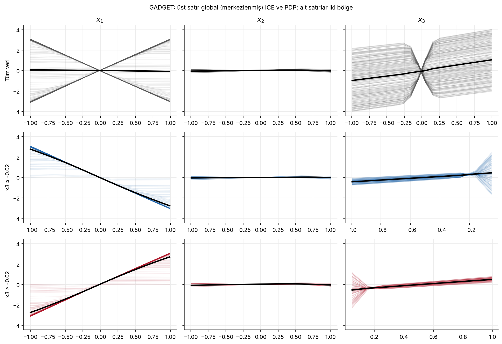
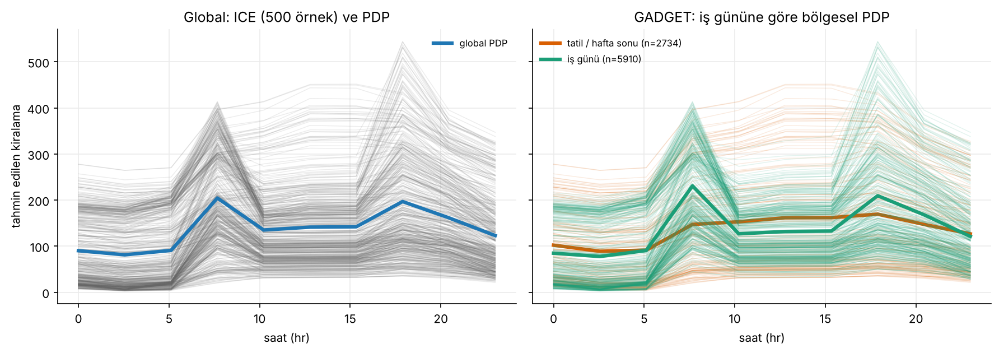
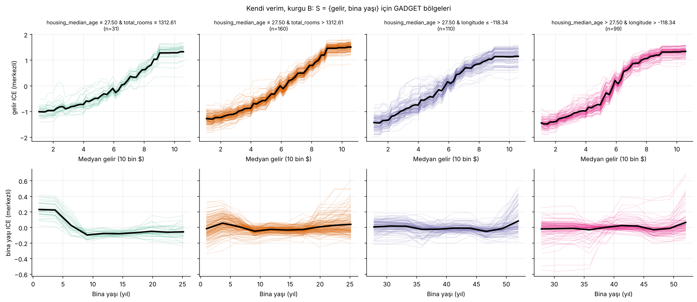

# Makale Yeniden Üretimi: GADGET ile Bölgesel Etki Grafikleri

**Öğrenci:** Serap Şahin (20269348009)  
**İlgili bölüm:** Molnar, *Interpretable Machine Learning*, [Bölüm 13 – Individual Conditional Expectation (ICE)](https://christophm.github.io/interpretable-ml-book/ice.html)  
**İzlencedeki tür:** Seçenek 2: Kıyaslama. Global PDP/ICE ile GADGET'in bölgesel etkilerinin; tek öznitelikli ve çok öznitelikli bölmenin karşılaştırılması.

## Makale

Herbinger, J., Wright, M. N., Nagler, T., Bischl, B. ve Casalicchio, G. (2024). *Decomposing Global Feature Effects Based on Feature Interactions.* **Journal of Machine Learning Research**, 25(381), 1–65. https://jmlr.org/papers/v25/23-0699.html

Yazarların kodu (R): [github.com/JuliaHerbinger/gadget](https://github.com/JuliaHerbinger/gadget)

Makale, aynı ekibin REPID bildirisinin (Herbinger, Bischl ve Casalicchio, AISTATS 2022) genelleştirilmiş, hakemli dergi sürümüdür.

## 1. Neden bu makale?

ICE, her gözlem için bir eğri çizer; PDP bu eğrilerin ortalamasıdır. Bölüm 13'ün ana mesajı, bir öznitelik başka özniteliklerle etkileşim içindeyse ICE eğrilerinin farklı şekillerde gittiği ve PDP'nin bu farkı gizlediğidir. Ama yüzlerce eğriye bakıp hangi özniteliğin bu farkı yarattığını gözle bulmak zordur.

GADGET bu sorunu çözüyor: ICE eğrilerini bir karar ağacıyla, benzer şekilli eğrilerin bir arada olduğu bölgelere ayırıyor. Her bölgenin kendi PDP'si oluyor ve ağacın hangi özniteliğe böldüğü, etkileşimin hangi öznitelikle olduğunu gösteriyor. Yöntemin PD sürümünün girdisi doğrudan ICE eğrileri olduğu için Bölüm 13'e doğrudan bağlı.

Bölüm 13 uygulamamda California Housing verisinde medyan gelirin c-ICE eğrilerini k-ortalamalarla kümelemiş, kümelerin sonradan bina yaşıyla ilişkili olduğunu bulmuştum. GADGET aynı işi yorumlanabilir kurallarla, üstelik birden çok öznitelik için aynı anda yapıyor.

## 2. Yöntem

Yazarların koduna (`R/tree_splitting.R`, `R/helper_tree_splitting.R`, `SS_L2_pd`) göre, PD/ICE sürümü:

1. **Merkezleme.** İlgilenilen her öznitelik $j \in S$ için ICE eğrileri kendi ortalamalarına göre merkezlenir: $\tilde f_j^{(i)}(z_k) = \hat f_j^{(i)}(z_k) - \frac{1}{K}\sum_{k'} \hat f_j^{(i)}(z_{k'})$. Seviye farkları silinir, şekil farkları kalır.
2. **Çok öznitelikli heterojenlik.** Bir bölgenin heterojenliği, $S$'deki bütün özniteliklerin eğrilerinin bölgesel PDP'lerine kare uzaklıklarının toplamıdır:
$$\mathcal{R}(\mathcal{N}) = \sum_{j \in S} \sum_{i \in \mathcal{N}} \sum_{k} \big(\tilde f_j^{(i)}(z_k) - \bar{\tilde f}_{j,\mathcal{N}}(z_k)\big)^2$$
3. **Izgara kısıtlama.** Bölünen öznitelik $S$'nin içindeyse, o özniteliğin ızgarası her çocukta kendi tarafıyla sınırlanır ve eğriler kalan noktalar üzerinden yeniden merkezlenir.
4. **Durma kuralı.** Kazanç = (düğüm − sol − sağ) / kök heterojenliği. İlk bölünme kazanç ≥ `esik` ise; sonrakiler bir önceki kazancın `esik` katından büyükse yapılır.

$S$ tek öznitelikse ve bölünme o öznitelikte değilse GADGET'in PD sürümü REPID'e eşittir. Kendi verimde bunu kontrol olarak kullandım (Bölüm 4, kurgu A).

**Uygulamam:** Algoritmayı Python'da sıfırdan yazdım. Bölme adayları yazarlar gibi en fazla 100 kantil noktası; simülasyonda yazarlar gibi bütün değerler.

**Makaleden farklarım:** Sinir ağı için `nnet` yerine `MLPRegressor`; rastgele orman için `ranger` yerine scikit-learn. Bu yüzden eşikler ve eğimler birebir aynı değil.

## 3. Yeniden üretilen sonuçlar

Kod: [`analiz.ipynb`](analiz.ipynb). Sayılar Bölüm 7'deki paket sürümleriyle yapılan çalıştırmaya aittir.

### 3.1 Simülasyon (makale Bölüm 4; `create_plots_sec_3_and_4.R`)

$n = 500$, $x_1, x_2, x_3 \sim U(-1,1)$ ve $y = 3x_1 + x_3$ ($x_3 > 0$), $y = -3x_1 + x_3$ ($x_3 \le 0$), gürültü $N(0, 0{,}3^2)$. $x_1$'in etkisi $x_3$'ün işaretine bağlı; global PDP'de iki eğim birbirini götürür. $x_2$'nin etkisi yok. Sinir ağı (test R² 0,930), bütün öznitelikler için 20 noktalı ICE, $S = Z = \{x_1, x_2, x_3\}$, bir bölünme.

| | Makale | Yeniden üretim |
|---|---|---|
| Bölünme | $x_3 \approx 0$ | $x_3 \le -0{,}02$ (kazanç %96,8) |
| $x_1$ eğimi, $x_3 \le 0$ | ≈ −2,9 | −2,86 |
| $x_1$ eğimi, $x_3 > 0$ | ≈ +2,9 | +2,80 |
| $x_3$ eğimi, sol / sağ | ≈ 1,05 / 1,07 | 0,92 / 1,07 |

(Makale değerleri yazarların şekil açıklamalarındaki $\Delta \hat f / \Delta x$ oranlarından: −3,04/1,05; 3,08/1,05; 0,99/0,94; 0,89/0,83.)

Öznitelik başına heterojenlik azalması: $x_1$ %95,5, $x_3$ %98,2 ($x_3$ hem incelenen hem bölünen öznitelik, ızgarası her bölgede kendi yarısına daralıyor), $x_2$'nin eğrileri zaten düz.

**20 farklı tohumla tekrar:** Bölünen öznitelik 20/20 $x_3$; eşik ortalaması −0,003 (−0,04 ile 0,03 arası); $x_1$'in eğimi solda ortalama −2,79, sağda +2,79.



### 3.2 Saatlik bisiklet verisi (makale Bölüm 1; `bike.R`)

Yazarların verisi (ISLR2 `Bikeshare`, 8.644 saat; tek "heavy rain/snow" gözlemi çıkarıldı) ve öznitelikleri. Rastgele orman: ayrılmış test kümesinde R² 0,915 (makale, 5 katlı çapraz doğrulama: 0,940); yazarlar gibi bütün veriyle eğitildi. Saat (`hr`) için 10 noktalı ICE, bölme adayı `workingday`, `esik = 0,1`, `min_dugum = 50`.

- GADGET makaledeki gibi **iş gününe** bölüyor (kazanç %27,4).
- Global PDP'deki sabah ve akşam tepeleri aslında iş günlerine ait (verinin %68'i). Tatil günlerinde öğle saatlerinde geniş, tek bir yükselme var; bu örüntü global PDP'de görünmüyor.
- **Genişletme:** Bütün öznitelikler bölme adayı olduğunda da ilk bölünme yine iş günü; ayrım veriden kendiliğinden çıkıyor.



## 4. Kendi verim: Bölüm 13 uygulamamdaki model

Aynı bölme ve model (gradient boosting, test R² 0,838), aynı 400 test bölgesi. Gelir için 50, bina yaşı için 20 noktalı ICE. `derinlik = 2`, `esik = 0,1`, `min_dugum = 30`. GADGET'in sonucu, ilgilenilen öznitelikler $S$ ve bölme adayları $Z$ seçimine bağlı olduğu için dört kurguyu karşılaştırdım:

| Kurgu | $S$ | $Z$ | İlk bölünme | Kazanç | Gelir heterojenliği | Bina yaşı heterojenliği |
|---|---|---|---|---|---|---|
| A · Tek öznitelik (REPID'e eşdeğer) | gelir | gelir dışı | bina yaşı ≤ 27,5 | %16,4 | −%29,1 | – |
| **B · Birlikte** | gelir, bina yaşı | gelir dışı | **bina yaşı ≤ 27,5** | %27,4 | −%29,1 | −%84,4 |
| C · Birlikte | gelir, bina yaşı | hepsi | gelir ≤ 5,02 | %68,5 | −%90,1 | −%28,8 |
| D · Birlikte | gelir, bina yaşı | $S$ dışı | bölünme yok | – | – | – |

*Kazanç* sütunu ilk bölünmeye aittir. *Gelir* ve *bina yaşı* sütunları, ağacın son yapraklarındaki toplam heterojenlik azalmasıdır (öznitelik başına, her bölgenin kendi ızgarasında).

- **A**, Bölüm 13 REPID analizimdeki sonucun aynısını veriyor; kendi GADGET uygulamam için bir kontrol.
- **B**'de gelirin heterojenliği %29 azalıyor: bu etkileşim. Bina yaşınınki çok daha fazla azalıyor, ama bunun büyük kısmı yaşın hem bölünen hem incelenen öznitelik olmasından, yani her bölgede ızgaranın kendi yarısına daralmasından geliyor.
- **C** geliri gelire göre bölüyor. Makale, incelenen özniteliğin aynı zamanda bölme özniteliği olmasına izin veriyor; bu yüzden bu bölünme kendi başına hata değil. Ama yüksek kazanç ızgaranın daralmasını da içeriyor: gelirin heterojenlik azalması daraltılmış ızgarada %90,1, tam ızgara korunarak hesaplandığında yalnızca %2,9. Bina yaşı eğrilerindeki %28,8'lik azalma ise iki hesapta da aynı. Bu yüzden C'nin yüksek kazancı, doğrudan daha güçlü bir etkileşim bulunduğu şeklinde yorumlanmamalı.
- **D** hiç bölmüyor: iki özniteliğin ortak heterojenliğinin %10'unu tek başına açıklayan başka bir öznitelik yok.
- **Sağlamlık:** İncelenen altı örneklemde (beş farklı 400'lük, bir 2.000'lik) A ve B kurgularının ilk bölünmesi bina yaşı oldu (eşik 26,5–27,5 yıl); bu deneyde sonuç örneklem değişimine karşı tutarlı göründü.

**Ders:** GADGET'in sonucu $S$ ve $Z$ seçimine çok duyarlı. Bölünen öznitelik $S$'nin içindeyse kazancı yorumlarken ızgara kısıtlamasını ayırmak gerekiyor; öznitelik başına heterojenlik tablosu bunu sağlıyor. Bu yüzdeler tahmin doğruluğu değil, ICE eğrileri arasındaki şekil farkının açıklanan payıdır.



## 5. Yeniden üretilmeyenler

- GADGET'in **ALE ve SHAP** sürümleri (bu çalışma Bölüm 13'e uygun olarak PD/ICE sürümüne odaklandı).
- Etkileşimli öznitelikleri seçmek için önerilen **permütasyon testi (PINT)**.
- Korelasyon ve yüksek dereceli etkileşim simülasyonları (Bölüm 6–7) ve **COMPAS, spam** örnekleri.

## 6. Sınırlamalar ve tartışma

**Bölgesel PDP ve ICE:** Bölgesel PDP çizmek ICE'den uzaklaşmak demek değil; bölgeler ICE eğrilerinin şekil farklılıklarından oluşturuluyor ve her bölgede eğriler de çiziliyor.

1. **Açgözlü ağaç.** Her adımda en iyi tek bölünme seçilir; bölünmeler eksenlere paraleldir.
2. **Izgara kısıtlama.** Bölünen öznitelik $S$'deyse kazanç ızgaranın daralmasını da içerir (kurgu C: gelir için daraltılmış ızgarada %90,1, tam ızgarada %2,9). Kazancı öznitelik başına ve tam ızgarayla karşılaştırarak yorumlamak gerekir.
3. **$S$ ve $Z$ seçimi.** Aynı veride dört kurgu dört farklı sonuç verdi. Makale $S$'yi seçmek için PINT testini öneriyor; bunu yeniden üretmedim.
4. **Korelasyonlu öznitelikler.** İki öznitelik çok bağlıysa ağaç birini seçer; gerçek etkileşim ortağını ayıramaz. ICE eğrileri de bu durumda veri dışı noktalar içerebilir (Bölüm 12 makale çalışmamın konusu).
5. **Model farkları.** Sinir ağı ve rastgele orman uygulamaları makaledekilerden farklı; eşikler ve eğimler birebir aynı çıkmıyor, ama bölünen öznitelikler ve yönler aynı.
6. **Nedensellik değil.** Bulunan etkileşimler modelin etkileşimleridir.

## 7. Dosyalar ve çalıştırma

| Dosya | İçerik |
|---|---|
| `makale.md`, `makale.html` | Bu rapor |
| `analiz.ipynb` | Bütün kod, açıklamalar ve çalıştırılmış çıktılar (3 grafik) |
| `veri.csv` | California Housing (20.640 bölge); Bölüm 13 uygulamamdaki dosya |
| `veri_bisiklet.csv` | Makalenin saatlik bisiklet verisi (ISLR2/ISLP `Bikeshare`, 8.645 saat) |
| `sekiller/` | Defterin ürettiği grafikler (PNG) |
| `requirements.txt` | Paket sürümleri |

Python 3.13 ile:

```bash
python -m pip install -r requirements.txt
```

Ardından `analiz.ipynb` dosyasını Jupyter, VS Code veya Colab'da açıp hücreleri sırayla çalıştırın. Veriler klasörde olduğu için internet gerekmez. Bütün rastgelelik sabit tohumlarla kontrol edilir.

## Kaynaklar

- Herbinger, J., Wright, M. N., Nagler, T., Bischl, B. ve Casalicchio, G. (2024). Decomposing global feature effects based on feature interactions. *Journal of Machine Learning Research*, 25(381), 1–65.
- Herbinger, J., Bischl, B. ve Casalicchio, G. (2022). REPID: Regional effect plots with implicit interaction detection. *Proceedings of the 25th International Conference on Artificial Intelligence and Statistics*, PMLR 151, 10209–10233.
- Goldstein, A., Kapelner, A., Bleich, J. ve Pitkin, E. (2015). Peeking inside the black box: Visualizing statistical learning with plots of individual conditional expectation. *Journal of Computational and Graphical Statistics*, 24(1), 44–65.
- Molnar, C. *Interpretable Machine Learning*, Bölüm 13: Individual Conditional Expectation (ICE).
- James, G., Witten, D., Hastie, T., Tibshirani, R. ve Taylor, J. ISLR2/ISLP `Bikeshare` verisi (UCI Bike Sharing'den türetilmiş).
- Pace, R. K. ve Barry, R. (1997). Sparse spatial autoregressions. *Statistics & Probability Letters*, 33(3), 291–297 (California Housing verisi).
