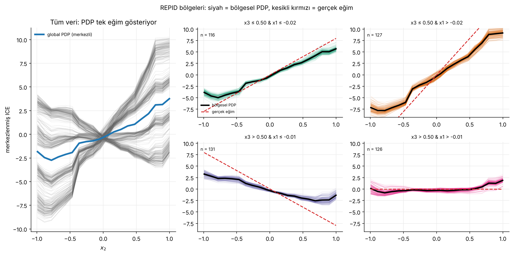
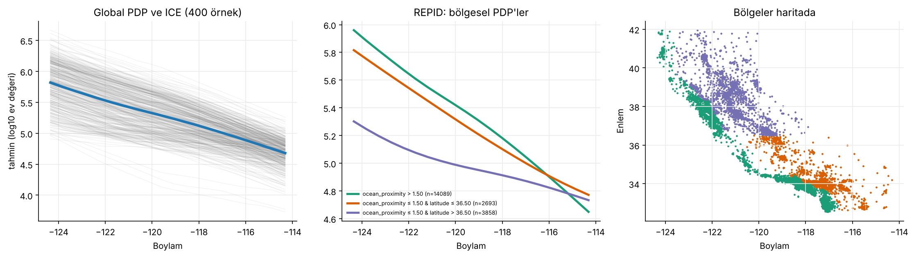
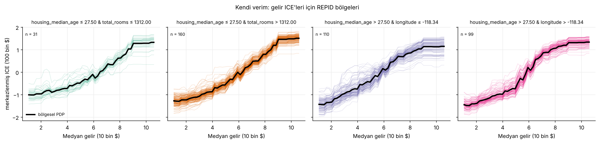

# Makale Yeniden Üretimi: REPID ile Bölgesel Etki Grafikleri

**Öğrenci:** Serap Şahin (20269348009)  
**İlgili bölüm:** Molnar, *Interpretable Machine Learning*, [Bölüm 13 – Individual Conditional Expectation (ICE)](https://christophm.github.io/interpretable-ml-book/ice.html)  
**İzlencedeki tür:** Seçenek 2: Kıyaslama. ICE eğrilerini gruplamada REPID ile k-ortalamaların, grup içi benzerlik ve yorumlanabilirlik açısından karşılaştırılması.

## Makale

Herbinger, J., Bischl, B. ve Casalicchio, G. (2022). *REPID: Regional Effect Plots with implicit Interaction Detection.* Proceedings of the 25th International Conference on Artificial Intelligence and Statistics (AISTATS), PMLR 151, 10209–10233. https://proceedings.mlr.press/v151/herbinger22a.html · arXiv: [2202.07254](https://arxiv.org/abs/2202.07254)

Yazarların kodu (R): [github.com/JuliaHerbinger/repid](https://github.com/JuliaHerbinger/repid)

## 1. Neden bu makale?

ICE, her gözlem için bir eğri çizer; PDP bu eğrilerin ortalamasıdır. Bölüm 13'ün ana mesajı, bir öznitelik başka özniteliklerle etkileşim içindeyse ICE eğrilerinin farklı şekillerde gittiği ve PDP'nin bu farkı gizlediğidir. Ama yüzlerce eğriye bakıp hangi özniteliğin bu farkı yarattığını gözle bulmak zordur.

REPID tam bu sorunu çözüyor: ICE eğrilerini bir karar ağacıyla, benzer şekilli eğrilerin bir arada olduğu bölgelere ayırıyor. Her bölgenin kendi PDP'si oluyor ve ağacın hangi özniteliğe böldüğü, etkileşimin hangi öznitelikle olduğunu gösteriyor. Yöntemin girdisi doğrudan ICE eğrileri olduğu için Bölüm 13'e doğrudan bağlı.

Bölüm 13 uygulamamda California Housing verisinde medyan gelirin c-ICE eğrilerini k-ortalamalarla kümelemiş, kümelerin sonradan bina yaşıyla ilişkili olduğunu bulmuştum. Kümeler bir kurala karşılık gelmiyordu. REPID aynı işi yorumlanabilir kurallarla yapıyor. Makalenin gerçek veri örneklerinden biri de aynı California Housing verisi.

## 2. Yöntem

Yazarların koduna (`R/tree_splitting.R`, `R/helper_general.R`) göre:

1. **Merkezleme.** Her ICE eğrisi kendi ortalamasına göre merkezlenir: $\tilde f^{(i)}(z_k) = \hat f^{(i)}(z_k) - \frac{1}{K}\sum_{k'} \hat f^{(i)}(z_{k'})$. Seviye farkları silinir, sadece şekil farkları kalır.
2. **Heterojenlik.** Bir bölgedeki eğrilerin bölgesel PDP'den kare uzaklıklarının toplamı:
$$\mathcal{R}(\mathcal{N}) = \sum_{i \in \mathcal{N}} \sum_{k=1}^{K} \big(\tilde f^{(i)}(z_k) - \bar{\tilde f}_{\mathcal{N}}(z_k)\big)^2$$
3. **En iyi bölünme.** İlgilenilen öznitelik dışındaki her öznitelik ve eşik için düğüm ikiye bölünür; iki çocuğun heterojenlik toplamını en küçük yapan bölünme seçilir.
4. **Durma kuralı.** Kazanç, kökteki toplam heterojenliğe göre ölçülür: $(\mathcal{R}_{\text{düğüm}} - \mathcal{R}_{\text{sol}} - \mathcal{R}_{\text{sağ}}) / \mathcal{R}_{\text{kök}}$. İlk bölünme kazanç ≥ `esik` ise, sonrakiler bir önceki kazancın `esik` katından büyükse yapılır.

**Etkileşim ölçüsü:** Bir özniteliğe yapılan bölünmelerin kazanç toplamı, ICE heterojenliğinin o öznitelikle açıklanan payı (yazarların kodundaki `intImp`).

**Uygulamam:** Algoritmayı Python'da sıfırdan yazdım. Defterde iki sürümü var: tanıma birebir uyan yavaş sürüm (canlı kodlama için) ve aynı sonucu kümülatif toplamlarla bulan hızlı sürüm (20.640 eğri için). İkisinin aynı bölünmeyi bulduğu defterde kontrol ediliyor.

**Makaleden farklarım:**
- Yazarlar bölünme adaylarını en fazla 100 kantil noktasıyla sınırlıyor; ben değerin değiştiği her noktayı deniyorum (aynı ya da daha iyi bölünme bulur).
- Rastgele orman için `ranger` yerine scikit-learn; sinir ağı için `nnet` yerine `MLPRegressor` (aynı mimari: 20 nöron, ağırlık azaltma 0,1).

## 3. Yeniden üretilen sonuçlar

Kod: [`analiz.ipynb`](analiz.ipynb). Sayılar Bölüm 7'deki paket sürümleriyle yapılan çalıştırmaya aittir.

### 3.1 Simülasyon (makale Bölüm 3; `analysis_sim_vine_vs_repid.R`)

$n = 500$, $x_1, x_2 \sim U(-1,1)$, $x_3 \sim \text{Bernoulli}(0{,}5)$, $x_4 \sim \text{Bernoulli}(0{,}3)$, gürültü öznitelikleri $x_5, x_6$ ve

$$y = 0{,}2\,x_1 - 8\,x_2 + 16\,x_2\,\mathbb{1}(x_3 = 0) + 8\,x_2\,\mathbb{1}(x_1 > \bar{x}_1) + \varepsilon$$

$x_2$'nin etkisi dört bölgede farklı (eğimler −8, 0, +8, +16); PDP'nin eğimi bunların ortalaması. Yazarlar gibi iki seviye bölündü (`derinlik = 2`, `esik = 0`).

| Bölge | n | Bölgesel PDP eğimi | Gerçek eğim |
|---|---|---|---|
| $x_3 = 0$, $x_1 \le -0{,}02$ | 116 | 5,72 | 8 |
| $x_3 = 0$, $x_1 > -0{,}02$ | 127 | 9,54 | 16 |
| $x_3 = 1$, $x_1 \le -0{,}01$ | 131 | −3,08 | −8 |
| $x_3 = 1$, $x_1 > -0{,}01$ | 126 | 0,83 | 0 |
| Global PDP | 500 | 3,15 | 3,82 |

- REPID makaledeki gibi önce $x_3$'e (kazanç %82), sonra iki tarafta da $x_1 \approx 0$'a bölüyor. Gürültü özniteliklerine bölünmüyor.
- **20 farklı tohumla tekrar:** İlk bölünme 20/20 $x_3$; bölünen öznitelikler 20/20 tam olarak $\{x_1, x_3\}$; gürültüye bölünme 0/20; $x_1$ eşiğinin ortalaması 0,010.
- Bölgesel eğimlerin sırası ve işaretleri doğru, ama büyüklükleri gerçek değerlerden küçük. Rastgele orman tahminleri komşu gözlemlerin ortalaması olduğu için eğimleri ortalamaya doğru çekiyor. REPID modeli açıklar, gerçek fonksiyonu değil.



### 3.2 California Housing (makale Şekil 6; `california_housing.R`)

Yazarların ön işlemesi (log dönüşümler, `ocean_proximity` sıralı tamsayı), tek gizli katmanlı sinir ağı (bütün veriyle; ayrılmış test kümesinde R² = 0,755), boylam için 20 noktalı ICE, `derinlik = 3`, `esik = 0,25`, `min_dugum = 30`.

- **Makale:** enlem > 34,5; enlem ≤ 34,5 ve iç bölge; kıyıda enlem ≤ 33,5 ve 33,5 < enlem ≤ 34,5.
- **Yeniden üretim (tohum 123):** önce okyanusa yakınlık (iç bölge / kıyı, kazanç %57,6), sonra iç bölgede enlem ≤ 36,5 (kazanç %21,1).
- **Üç farklı tohum:** bölünmeler her seferinde yalnızca **enlem ve okyanusa yakınlık** üzerinden; başka hiçbir özniteliğe bölünmüyor. İlk bölünme iki tohumda okyanusa yakınlık, birinde enlem (35,3).

Makalenin asıl bulgusu yeniden üretiliyor: boylamın etkisi enlem ve okyanusa yakınlıkla etkileşiyor. Bölünmelerin sırası ve eşikleri ise sinir ağının eğitimine bağlı.



## 4. Kendi verim: Bölüm 13 uygulamamdaki model

Aynı bölme ve model (gradient boosting, test R² 0,838), aynı 400 test bölgesi ve medyan gelir için 50 noktalı ICE. REPID ayarları: yazarların kodundaki varsayılan `esik = 0,1`, `derinlik = 2`, `min_dugum = 30`.

| Derinlik | Bölünme | Kazanç |
|---|---|---|
| 1 | **bina yaşı ≤ 27,5** | %16,4 |
| 2 | (bina yaşı > 27,5) boylam ≤ −118,34 | %8,3 |
| 2 | (bina yaşı ≤ 27,5) toplam oda ≤ 1.312 | %4,4 |

- **REPID'in ilk bölünmesi bina yaşı.** Uygulamamda bu etkileşimi k-ortalamalarla kümeleyip sonradan bina yaşıyla karşılaştırarak bulmuştum; REPID kimse söylemeden ve bir kural olarak buluyor.
- **Sağlamlık:** İncelenen altı örneklemde (beş farklı 400'lük, bir 2.000'lik) ilk bölünme bina yaşı oldu (eşik 26,5–27,5 yıl, kazanç %16–17); bu deneyde sonuç örneklem değişimine karşı tutarlı göründü.
- **REPID ve k-ortalamalar (benim ek deneyim; makalede böyle bir karşılaştırma yok):** Aynı sayıda (4) grupla heterojenliğin açıklanan payı REPID'de **%29,1**, k-ortalamalarda **%57,9**. k-ortalamalar grupları serbestçe seçtiği için daha homojen gruplar buluyor; REPID ise her grubu açık bir bölünme kuralıyla ("bina yaşı ≤ 27,5" gibi) tanımlıyor. Bu fark, yorumlanabilirliğin bedeli.
- **Bu yüzdeler tahmin doğruluğu değildir.** ICE eğrileri arasındaki şekil farklılığının (heterojenliğin) gruplarla açıklanan payıdır. REPID'in daha düşük oranı bir başarısızlık değil, kurallara bağlı kalmanın sonucu.



## 5. Yeniden üretilmeyenler

- **Bölüm 4.1:** REPID'in etkileşim ölçüsünün H-istatistiği ve SHAP etkileşim değerleriyle karşılaştırılması.
- **Bölüm 4.2 ve Ek B:** `batchtools` ile çok sayıda ayarda yapılan simülasyon deneyleri.
- **VINE karşılaştırması** (makale Bölüm 3) ve Titanic, Pima örnekleri.

## 6. Sınırlamalar ve tartışma

**Bölgesel PDP ve ICE:** Bölgesel PDP çizmek ICE'den uzaklaşmak demek değil; bölgeler, ICE eğrilerinin şekil farklılıklarından oluşturuluyor ve her bölgede eğriler de çiziliyor.

1. **Açgözlü ağaç.** Her adımda en iyi tek bölünme seçilir; bölünmeler eksenlere paraleldir.
2. **Korelasyonlu öznitelikler.** İki öznitelik çok bağlıysa ağaç birini seçer; hangisinin gerçek etkileşim ortağı olduğunu ayıramaz.
3. **Ayar seçimi.** Bölge sayısı `esik`, `derinlik` ve `min_dugum` ile değişiyor. Simülasyonda `esik = 0`, California'da 0,25, kendi verimde 0,1 kullanıldı.
4. **Model açıklaması.** California'da aynı mimarinin farklı eğitimleri farklı bölünme sıraları verdi. REPID modelin etkileşimlerini bulur; nedensel yorumlanamaz.
5. **ICE'nin kendi sınırları.** ICE eğrileri korelasyonlu özniteliklerde veri dışı noktalar içerebilir (Bölüm 12 makale çalışmamın konusu). REPID bu noktaları da ortalamaya katar.
6. **Merkezleme bilinçli bir seçim.** Seviye farkları bölünmeyi etkilemez; amaç şekil farkını, yani etkileşimi bulmak.

## 7. Dosyalar ve çalıştırma

| Dosya | İçerik |
|---|---|
| `makale.md` | Bu rapor |
| `analiz.ipynb` | Bütün kod, açıklamalar ve çalıştırılmış çıktılar |
| `veri.csv` | California Housing (20.640 bölge); Bölüm 13 uygulamamdaki ve makalenin deposundaki dosyayla aynı |

Sunumda kolaylık için ek dosyalar:

| Dosya | İçerik |
|---|---|
| `sekiller/` | Defterin ürettiği 3 grafik (PNG); slaytlarda kullanmak için. Defter çalıştırıldığında yeniden oluşur |
| `requirements.txt` | Paket sürümleri |

Python 3.13 ile:

```bash
python -m pip install -r requirements.txt
```

Ardından `analiz.ipynb` dosyasını Jupyter, VS Code veya Colab'da açıp hücreleri sırayla çalıştırın. Veri klasörde olduğu için internet gerekmez; dosya bulunamazsa defter aynı sürümü GitHub'dan indirir. Bütün rastgelelik sabit tohumlarla kontrol edilir.

## Kaynaklar

- Herbinger, J., Bischl, B. ve Casalicchio, G. (2022). REPID: Regional effect plots with implicit interaction detection. *Proceedings of the 25th International Conference on Artificial Intelligence and Statistics*, PMLR 151, 10209–10233.
- Goldstein, A., Kapelner, A., Bleich, J. ve Pitkin, E. (2015). Peeking inside the black box: Visualizing statistical learning with plots of individual conditional expectation. *Journal of Computational and Graphical Statistics*, 24(1), 44–65.
- Molnar, C. *Interpretable Machine Learning*, Bölüm 13: Individual Conditional Expectation (ICE).
- Pace, R. K. ve Barry, R. (1997). Sparse spatial autoregressions. *Statistics & Probability Letters*, 33(3), 291–297 (California Housing verisi).
