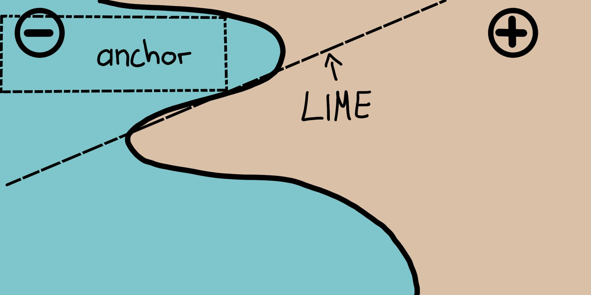
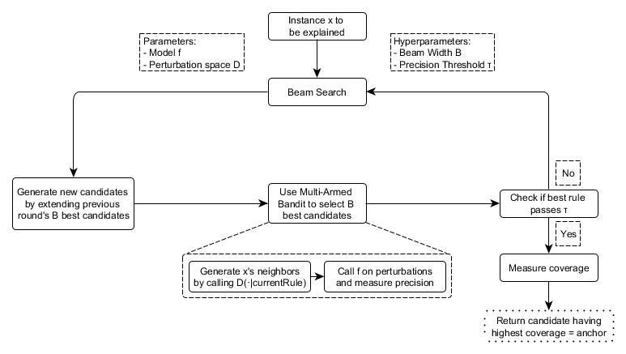

> **Çeviri kaynağı:** Christoph Molnar, *Interpretable Machine Learning*, 3. baskı (2025), [Bölüm 16: Scoped Rules (Anchors)](https://christophm.github.io/interpretable-ml-book/anchors.html). Özgün eser CC BY-NC-SA 4.0 lisanslıdır. Teknik terimler, gerekli olduğu yerlerde İngilizce karşılıklarıyla birlikte verilmiştir. Özgün bölümdeki R kodlarının ürettiği şekiller, kitabın yayımlanmış sürümünden alınmıştır.

*Yazarlar: Tobias Goerke & Magdalena Lang (Christoph Molnar'ın sonraki düzenlemeleriyle)*

Anchors yöntemi, herhangi bir kara kutu (*black box*) sınıflandırma modelinin tekil tahminlerini, tahmini yeterince "sabitleyen" (*anchor*) bir karar kuralı bularak açıklar.
Bir kural, diğer öznitelik değerlerindeki değişiklikler tahmini etkilemiyorsa o tahmini sabitler.
Anchors, model çağrılarının sayısını (ve dolayısıyla gereken çalışma süresini) en aza indirirken yerel optimumlardan (*local optima*) kurtulabilmek için pekiştirmeli öğrenme (*reinforcement learning*) tekniklerini bir graf arama algoritmasıyla birlikte kullanır.
Anchors algoritmasını, [LIME](https://christophm.github.io/interpretable-ml-book/lime.html) algoritmasını da ortaya koyan araştırmacılar olan @ribeiro2018anchors önermiştir.

Selefi gibi anchors yaklaşımı da kara kutu makine öğrenmesi modellerinin tahminlerine *yerel* (*local*) açıklamalar üretmek için *pertürbasyon tabanlı* (*perturbation-based*) bir strateji kullanır.
Ancak LIME'ın kullandığı vekil modeller (*surrogate models*) yerine, ortaya çıkan açıklamalar *anchor* adı verilen, anlaşılması kolay *EĞER-İSE* (*IF-THEN*) kurallarıyla ifade edilir.
Bu kurallar *kapsamı belirli* (*scoped*) olduğu için yeniden kullanılabilir:
anchor'lar kapsam (*coverage*) kavramını içerir ve başka hangi, muhtemelen daha önce görülmemiş örneklere uygulanabileceklerini tam olarak belirtir.
Anchor bulmak, kökeni pekiştirmeli öğrenme disiplinine dayanan bir keşif (*exploration*) ya da çok kollu haydut (*multi-armed bandit*) problemini içerir.
Bu amaçla, açıklanan her örnek için komşular, yani pertürbasyonlar (*perturbations*) oluşturulur ve değerlendirilir.
Böylece yaklaşım, kara kutunun yapısını ve iç parametrelerini göz ardı edebilir; bunlar hem gözlemlenmeden hem de değiştirilmeden kalabilir.
Dolayısıyla algoritma *modelden bağımsızdır* (*model-agnostic*), yani **herhangi bir** model sınıfına uygulanabilir.

Yazarlar makalelerinde iki algoritmalarını karşılaştırır ve sonuç üretmek için bir örneğin komşuluğuna ne kadar farklı biçimlerde başvurduklarını görselleştirir.
Bunun için @fig-lime-vs-anchors, karmaşık bir ikili sınıflandırıcıyı (ya $-$ ya da $+$ tahmin eder) iki örnek üzerinden yerel olarak açıklayan LIME ve anchors yöntemlerini birlikte gösterir.
LIME'ın sonuçları ne kadar sadık (*faithful*) olduklarını göstermez; çünkü LIME, verilen bir pertürbasyon uzayı $\mathcal{D}$ için modeli en iyi yaklaşıklayan doğrusal bir karar sınırını öğrenmekle yetinir.
Aynı pertürbasyon uzayı verildiğinde anchors yaklaşımı, kapsamı modelin davranışına göre uyarlanmış açıklamalar oluşturur ve bu açıklamaların sınırlarını açıkça ifade eder.
Böylece açıklamalar tasarım gereği sadıktır ve tam olarak hangi örnekler için geçerli olduklarını belirtir.
Bu özellik anchor'ları özellikle sezgisel ve kolay anlaşılır kılar.

{#fig-lime-vs-anchors width=75%}

Daha önce belirtildiği gibi, algoritmanın sonuçları ya da açıklamaları anchor adı verilen kurallar biçiminde gelir.
Aşağıdaki basit örnek böyle bir anchor'ı göstermektedir.
Örneğin, bir yolcunun Titanik faciasından kurtulup kurtulmadığını tahmin eden iki değişkenli (*bivariate*) bir kara kutu modelimiz olduğunu varsayalım.
Şimdi modelin belirli bir kişi için (bkz. @tbl-anchors-explain) *neden* hayatta kaldığını tahmin ettiğini öğrenmek istiyoruz.
Anchors algoritması aşağıda gösterilene benzer bir açıklama sunar.

| Öznitelik       | Değer         |
| --------------- |---------------|
| Yaş             | 20            |
| Cinsiyet        | kadın         |
| Sınıf           | birinci       |
| Bilet fiyatı    | 300\$         |
| Diğer öznitelikler | ...        |
| Hayatta kaldı   | evet          |

: Açıklanacak örnek {#tbl-anchors-explain}

Buna karşılık gelen anchors açıklaması şöyledir:

EĞER `SEX = female` VE `Class = first` İSE `Survived = true` TAHMİN ET; KESİNLİK (*precision*) %97 VE KAPSAM (*coverage*) %15

Örnek, anchor'ların bir modelin tahmini ve bu tahminin altında yatan akıl yürütme hakkında nasıl temel içgörüler sağlayabileceğini göstermektedir.
Sonuç, model tarafından hangi niteliklerin dikkate alındığını gösterir; bu örnekte bunlar kadın olmak ve birinci sınıfta seyahat etmektir.
Doğruluğun belirlenmesinde belirleyici rol oynayan insanlar, bu kuralı modelin davranışını doğrulamak için kullanabilir.
Anchor ayrıca bize pertürbasyon uzayındaki örneklerin %15'ine uygulandığını da söyler.
Bu durumlarda açıklama %97 oranında doğrudur; yani gösterilen yüklemler (*predicates*) tahmin edilen sonuçtan neredeyse tek başına sorumludur.

Bir anchor $A$ biçimsel olarak şöyle tanımlanır:

$$ \mathbb{E}_{\mathcal{D}_\mathbf{x}(\mathbf{z}|A)}[1_{\hat{f}(\mathbf{x})=\hat{f}(\mathbf{z})}] \geq \tau; A(\mathbf{x})=1 $$

Burada:

- $\mathbf{x}$, açıklanan örneği temsil eder (örneğin tablo biçimindeki bir veri kümesinde bir satır).
- $A$, bir yüklemler kümesidir, yani ortaya çıkan kural ya da anchor'dır; $A$ tarafından tanımlanan tüm öznitelik yüklemleri $\mathbf{x}$'in öznitelik değerleriyle örtüştüğünde $A(\mathbf{x})=1$ olur.
- $\hat{f}$, açıklanacak sınıflandırma modelini ifade eder (örneğin bir yapay sinir ağı modeli). Bu modele $\mathbf{x}$ ve onun pertürbasyonları için etiket tahmin ettirilebilir.
- $\mathcal{D}_{\mathbf{x}} (\cdot|A)$, $\mathbf{x}$'in $A$ ile eşleşen komşularının dağılımını gösterir.
- $0 \leq \tau \leq 1$, bir kesinlik eşiği (*precision threshold*) belirtir. Yalnızca en az $\tau$ düzeyinde yerel sadakate (*local fidelity*) ulaşan kurallar geçerli bir sonuç olarak kabul edilir.

Biçimsel tanım göz korkutucu görünebilir, ama sözle de ifade edilebilir:

> Açıklanacak bir $\mathbf{x}$ örneği verildiğinde, $\mathbf{x}$'e uygulanan ve $A$'nın uygulanabildiği komşuların en az $\tau$ oranında bir kısmı için $\mathbf{x}$ ile aynı sınıfın tahmin edilmesini sağlayan bir kural ya da anchor $A$ bulunmalıdır.
Bir kuralın kesinliği, komşuların ya da pertürbasyonların ($\mathcal{D}_\mathbf{x} (\mathbf{z}|A)$'yı izleyerek) verilen makine öğrenmesi modeli kullanılarak değerlendirilmesiyle elde edilir (bu, $1_{\hat{f}(\mathbf{x}) = \hat{f}(\mathbf{z})}$ gösterge fonksiyonu (*indicator function*) ile ifade edilir).

::: {.callout-tip}

# Kesinliği dikkatle belirleyin

Kesinlik eşiği $\tau$'yu akıllıca seçin: Daha yüksek bir $\tau$ daha güçlü kurallar sağlar, ancak kapsamı azaltabilir.
Kesinlik ile kapsam arasında denge kurmak için farklı değerlerle deneme yapın.

:::

## Anchor Bulma

Anchor'ların matematiksel tanımı açık ve anlaşılır görünse de belirli kuralları bu tanımla doğrudan oluşturmak uygulanabilir değildir.
Bunun için tüm $\mathbf{z} \in \mathcal{D}_\mathbf{x}(\cdot|A)$ için $1_{\hat{f}(\mathbf{x}) = \hat{f}(\mathbf{z})}$ ifadesini değerlendirmek gerekirdi; bu da sürekli ya da büyük girdi uzaylarında mümkün değildir.
Bu nedenle yazarlar, olasılıksal bir tanım oluşturmak için $0 \leq \delta \leq 1$ parametresini kullanmayı önerir.
Bu şekilde, kesinlik konusunda istatistiksel güven elde edilene kadar örnekler çekilir.
Olasılıksal tanım şöyledir:

$$\mathbb{P}(prec(A) \geq \tau) \geq 1 - \delta \quad \textrm{with} \quad prec(A) = \mathbb{E}_{\mathcal{D}_\mathbf{x}(\mathbf{z}|A)}[1_{\hat{f}(\mathbf{x}) = \hat{f}(\mathbf{z})}]$$

Önceki iki tanım birleştirilir ve kapsam kavramıyla genişletilir.
Bunun arkasındaki mantık, modelin girdi uzayının tercihen geniş bir bölümüne uygulanan kurallar bulmaktır.
Kapsam biçimsel olarak bir anchor'ın komşularına, yani pertürbasyon uzayına uygulanma olasılığı olarak tanımlanır:

$$cov(A) = \mathbb{E}_{\mathcal{D}_{(\mathbf{x})}}[A(\mathbf{z})]$$

Bu öğenin eklenmesiyle, kapsamın en büyük hâle getirilmesini (*maximization*) de hesaba katan nihai anchor tanımına ulaşılır:

$$\underset{A \:\textrm{s.t.}\;\mathbb{P}(prec(A) \geq \tau) \geq 1 - \delta}{\textrm{max}} cov(A)$$

Dolayısıyla yöntem, uygun olan tüm kurallar (olasılıksal tanıma göre kesinlik eşiğini sağlayan kuralların tümü) arasından en yüksek kapsama sahip kuralı bulmaya çalışır.
Bu kuralların, modelin daha büyük bir bölümünü tanımladıkları için daha önemli olduğu düşünülür.
Daha fazla yüklem içeren kuralların, daha az yüklem içerenlere göre daha yüksek kesinliğe sahip olma eğiliminde olduğuna dikkat edin.
Özellikle, $\mathbf{x}$'in tüm özniteliklerini sabitleyen bir kural, değerlendirilen komşuluğu özdeş örneklere indirger.
Bu durumda model tüm komşuları aynı biçimde sınıflandırır ve kuralın kesinliği $1$ olur.
Öte yandan, çok sayıda özniteliği sabitleyen bir kural aşırı özeldir ve yalnızca az sayıda örneğe uygulanabilir.
Bu nedenle *kesinlik ile kapsam arasında bir ödünleşim* (*trade-off between precision and coverage*) vardır.

Anchors yaklaşımı, açıklamaları bulmak için dört ana bileşen kullanır.

**Aday Üretimi** (*Candidate Generation*): Yeni açıklama adayları üretir.
İlk turda $\mathbf{x}$'in her özniteliği için bir aday oluşturulur ve bu aday, olası pertürbasyonlarda ilgili değeri sabitler.
Sonraki her turda, önceki turun en iyi adayları, henüz içermedikleri bir öznitelik yüklemi eklenerek genişletilir.

**En İyi Adayın Belirlenmesi** (*Best Candidate Identification*): Aday kurallar, hangisinin $\mathbf{x}$'i en iyi açıkladığı bakımından karşılaştırılmalıdır.
Bu amaçla, o anda incelenen kurala uyan pertürbasyonlar oluşturulur ve model çağrılarak değerlendirilir.
Ancak hesaplama yükünü sınırlamak için bu çağrıların en aza indirilmesi gerekir.
Bu nedenle bu bileşenin merkezinde saf keşif odaklı (*pure-exploration*) bir Çok Kollu Haydut (*Multi-Armed Bandit, MAB*) bulunur.
Daha açık söylemek gerekirse bu, @kaufmann2013information tarafından önerilen *KL-LUCB* algoritmasıdır.
MAB'ler, farklı stratejileri (kumar makinelerine benzetilerek kol (*arm*) olarak adlandırılır) ardışık seçim yoluyla verimli biçimde keşfetmek ve bunlardan yararlanmak için kullanılır.
Bu bağlamda her aday kural, çekilebilecek bir kol olarak görülmelidir.
Kol her çekildiğinde ilgili komşular değerlendirilir ve böylece aday kuralın getirisi (*payoff*) hakkında (anchor'lar söz konusu olduğunda bu getiri kesinliktir) daha fazla bilgi edinilir.
Dolayısıyla kesinlik, kuralın açıklanacak örneği ne kadar iyi tanımladığını ifade eder.

**Aday Kesinliğinin Doğrulanması** (*Candidate Precision Validation*): Adayın $\tau$ eşiğini aştığına dair henüz istatistiksel güven yoksa daha fazla örnek alır.

**Değiştirilmiş Işın Araması** (*Modified Beam Search*): Yukarıdaki tüm bileşenler, bir graf arama algoritması ve genişlik öncelikli arama (*breadth-first search*) algoritmasının bir çeşidi olan ışın aramasında (*beam search*) bir araya getirilir.
Işın araması her turun en iyi $B$ adayını bir sonraki tura taşır ($B$'ye *Işın Genişliği* (*Beam Width*) denir).
Bu en iyi $B$ kural daha sonra yeni kurallar oluşturmak için kullanılır.
Her öznitelik bir kurala en fazla bir kez dahil edilebildiğinden ışın araması en fazla $featureCount(\mathbf{x})$ tur gerçekleştirir.
Böylece her $i$ turunda tam olarak $i$ yüklem içeren adaylar üretir ve bunların en iyi $B$ tanesini seçer.
Bu nedenle $B$ yüksek seçildiğinde algoritmanın yerel optimumlardan kaçınma olasılığı artar.
Buna karşılık bu, çok sayıda model çağrısı gerektirir ve dolayısıyla hesaplama yükünü artırır.

Bu dört bileşen @fig-anchors-algo'da gösterilmiştir.

{#fig-anchors-algo}

Bu yaklaşım, herhangi bir sistemin bir örneği neden o şekilde sınıflandırdığına dair istatistiksel olarak sağlam bilgiyi verimli biçimde elde etmek için görünüşte kusursuz bir reçetedir.
Modelin girdisiyle sistematik olarak deneyler yapar ve ilgili çıktıları gözlemleyerek sonuca varır.
Modele yapılan çağrıların sayısını azaltmak için iyi bilinen ve üzerinde çok araştırma yapılmış makine öğrenmesi yöntemlerine (MAB'ler) dayanır.
Bu da algoritmanın çalışma süresini büyük ölçüde azaltır.

## Karmaşıklık ve Çalışma Süresi

Anchors yaklaşımının asimptotik çalışma süresi davranışını bilmek, belirli problemlerde ne kadar iyi performans göstermesinin beklenebileceğini değerlendirmeye yardımcı olur.
$B$ ışın genişliğini, $p$ ise tüm özniteliklerin sayısını göstersin.
Bu durumda anchors algoritmasının karmaşıklığı şöyledir:

$$\mathcal{O}(B \cdot p^2 + p^2 \cdot \mathcal{O}_{\textrm{MAB} [B \cdot p, B]})$$

Bu sınır, istatistiksel güven $\delta$ gibi probleme bağlı olmayan hiperparametreleri (*hyperparameters*) dışarıda bırakır.
Hiperparametrelerin göz ardı edilmesi sınırın karmaşıklığını azaltmaya yardımcı olur (daha fazla bilgi için özgün makaleye bakınız).
MAB her turda $B \cdot p$ aday arasından en iyi $B$ tanesini seçtiğinden, çoğu MAB ve çalışma süreleri $p^2$ çarpanını diğer tüm parametrelerden daha fazla büyütür.

Böylece şu açıkça görülür: Çok sayıda öznitelik bulunduğunda algoritmanın verimliliği düşer.

## Tablo Verisi Örneği

Tablo verisi (*tabular data*), sütunların öznitelikleri, satırların ise örnekleri temsil ettiği tablolarla gösterilen yapılandırılmış veridir.
Örneğin, anchors yaklaşımının seçilen örnekler için makine öğrenmesi tahminlerini açıklama potansiyelini göstermek amacıyla [bisiklet kiralama verisini](https://christophm.github.io/interpretable-ml-book/data.html#bike-data) kullanıyoruz.
Bunun için regresyon problemini bir sınıflandırma problemine dönüştürüyor ve kara kutu modelimiz olarak bir rastgele orman (*random forest*) eğitiyoruz.
Model, kiralanan bisiklet sayısının trend çizgisinin üzerinde mi yoksa altında mı olduğunu sınıflandırmaktadır.
Ayrıca zaman trendi olarak 2011'den bu yana geçen gün sayısı, ay ve haftanın günü gibi ek öznitelikler de kullanıyoruz.

Anchor açıklamaları oluşturmadan önce bir pertürbasyon fonksiyonu tanımlamak gerekir.
Bunu yapmanın kolay bir yolu, tablo verisi açıklamaları için örneğin eğitim verisinden örnekleme yapılarak oluşturulabilen, sezgisel bir varsayılan pertürbasyon uzayı kullanmaktır.
Bir örneğe pertürbasyon uygulanırken bu varsayılan yaklaşım, anchor'ların yüklemlerine konu olan özniteliklerin değerlerini korur; sabitlenmemiş öznitelikleri ise belirli bir olasılıkla, rastgele örneklenmiş başka bir örnekten alınan değerlerle değiştirir.
Bu süreç, açıklanan örneğe benzeyen ancak bazı değerlerini diğer rastgele örneklerden almış yeni örnekler üretir.
Böylece bu örnekler, açıklanan örneğin komşularına benzer.

Sonuçlar (@fig-anchors1) sezgisel olarak yorumlanabilir ve açıklanan her örnek için modelin tahmininde en önemli özniteliklerin hangileri olduğunu gösterir.
Anchor'lar yalnızca birkaç yüklem içerdiğinden ayrıca yüksek kapsama sahiptir ve dolayısıyla başka durumlara da uygulanabilir.
Yukarıda gösterilen kurallar $\tau = 0.9$ ile üretilmiştir.
Yani değerlendirilen pertürbasyonları etiketi en az $\%90$ doğrulukla sadık biçimde destekleyen anchor'lar istiyoruz.
Ayrıca sayısal özniteliklerin ifade gücünü ve uygulanabilirliğini artırmak için ayrıklaştırma (*discretization*) kullanılmıştır.

{#fig-anchors1 width=90%}

Önceki kuralların tümü, modelin birkaç özniteliğe dayanarak emin bir şekilde karar verdiği örnekler için üretilmiştir.
Ancak diğer örnekler, daha fazla öznitelik önem taşıdığı için model tarafından bu kadar belirgin biçimde sınıflandırılmaz.
Bu gibi durumlarda anchor'lar daha özel hâle gelir, daha fazla öznitelik içerir ve daha az örneğe uygulanır; örneğin @fig-anchors2'de olduğu gibi.

{#fig-anchors2 width=90%}

Varsayılan pertürbasyon uzayını seçmek kolay bir tercih olsa da bu seçim algoritma üzerinde büyük bir etkiye sahip olabilir ve dolayısıyla yanlı (*biased*) sonuçlara yol açabilir.
Örneğin eğitim kümesi dengesizse (her sınıftan eşit sayıda örnek yoksa) pertürbasyon uzayı da dengesiz olur.
Bu durum, kural bulmayı ve sonucun kesinliğini de etkiler.
Bu istenmeyen bir durum olabilir ve birçok şekilde ele alınabilir.
Örneğin özel bir pertürbasyon uzayı tanımlanabilir.
Bu özel pertürbasyon farklı biçimde örnekleme yapabilir; örneğin dengesiz bir veri kümesinden ya da bir normal dağılımdan örnekleyebilir.
Ancak bunun bir yan etkisi vardır: Örneklenen komşular temsil edici olmaz ve kapsamın sınırlarını değiştirir.
Alternatif olarak MAB'in güven parametresi $\delta$ ve hata parametresi $\epsilon$ değerlerini değiştirebiliriz.
Bu, MAB'in daha fazla örnek çekmesine yol açar ve sonuçta azınlık sınıfının mutlak sayıda daha sık örneklenmesini sağlar.

::: {.callout-tip}

# Sınıf dengesizliğini kontrol edin

Özel bir pertürbasyon uzayı tanımlarken sınıf dengesizliğini (*class imbalance*) gözeten örnekleme stratejilerini değerlendirin.
Örneğin, azınlık sınıflarının pertürbasyon uzayında uygun biçimde temsil edilmesini sağlamak için tabakalı örnekleme (*stratified sampling*) kullanın.

:::

## Güçlü Yönler

Anchors yaklaşımı LIME'a göre birçok avantaj sunar.
İlk olarak, kurallar (sıradan kullanıcılar için bile) **kolay yorumlanabilir** olduğundan algoritmanın çıktısını anlamak daha kolaydır.

Ayrıca **anchor'lar alt kümelere ayrılabilir** (*subsettable*) ve kapsam kavramını içerdikleri için bir önem ölçüsü bile sunar.
İkinci olarak anchors yaklaşımı, model tahminleri bir örneğin komşuluğunda **doğrusal olmadığında ya da karmaşık olduğunda da işe yarar**.
Yaklaşım vekil modeller uydurmak yerine pekiştirmeli öğrenme teknikleri kullandığından modeli eksik öğrenme (*underfit*) olasılığı daha düşüktür.

Bunun dışında algoritma **modelden bağımsızdır** ve dolayısıyla her modele uygulanabilir.

Anchor'lar, belirli özniteliklerdeki değişikliklere karşı **tahminlerin sağlamlığını** (*robustness*) (ya da sağlam olmadığını) gösterdikleri için tahminleri gerekçelendirmede yararlı olabilir.

Ayrıca toplu örneklemeyi (*batch sampling*) destekleyen MAB'lerden (örneğin BatchSAR) yararlanılarak **paralelleştirilebildiği için oldukça verimlidir**.

## Sınırlılıklar

Algoritma, pertürbasyon tabanlı açıklayıcıların çoğu gibi **çok sayıda ayar gerektiren** (*highly configurable*) ve sonucu güçlü biçimde etkileyen bir kurulumdan muzdariptir.
Anlamlı sonuçlar elde etmek için yalnızca ışın genişliği ya da kesinlik eşiği gibi hiperparametrelerin ayarlanması değil, aynı zamanda pertürbasyon fonksiyonunun da belirli bir alan ya da kullanım senaryosu için açıkça tasarlanması gerekir.
Tablo verisine nasıl pertürbasyon uygulandığını düşünün ve aynı kavramların görüntü verisine nasıl uygulanacağını düşünün (ipucu: uygulanamazlar).
Neyse ki bazı alanlarda (örneğin tablo verisinde) varsayılan yaklaşımlar kullanılabilir; bu da ilk açıklama kurulumunu kolaylaştırır.

Ayrıca **birçok senaryo ayrıklaştırma gerektirir**; aksi takdirde sonuçlar fazla özel olur, kapsamları düşük kalır ve modeli anlamaya katkı sağlamaz.
Ayrıklaştırma yardımcı olabilse de dikkatsizce kullanılırsa karar sınırlarını bulanıklaştırabilir ve tam tersi bir etki yaratabilir.
En iyi ayrıklaştırma tekniği diye bir şey olmadığından, kullanıcıların kötü sonuçlar elde etmemek için veriyi nasıl ayrıklaştıracaklarına karar vermeden önce veriyi iyi tanıması gerekir.

Anchor oluşturmak, tüm pertürbasyon tabanlı açıklayıcılarda olduğu gibi **makine öğrenmesi modeline çok sayıda çağrı yapılmasını** gerektirir.
Algoritma çağrı sayısını en aza indirmek için MAB'ler kullansa da çalışma süresi hâlâ büyük ölçüde modelin performansına bağlıdır ve bu nedenle oldukça değişkendir.

Son olarak **kapsam kavramı bazı alanlarda tanımsızdır**.
Örneğin bir görüntüdeki süper piksellerin (*superpixels*) diğer görüntülerdekilerle nasıl karşılaştırılacağına dair açık ya da evrensel bir tanım yoktur.

## Yazılım ve Alternatifler

Şu anda iki uygulama mevcuttur: [anchor adlı bir Python paketi](https://github.com/marcotcr/anchor) ([Alibi](https://github.com/SeldonIO/alibi) tarafından da entegre edilmiştir) ve bir [Java uygulaması](https://github.com/viadee/javaAnchorExplainer).
Bunlardan ilki anchors algoritmasının yazarlarının referans uygulamasıdır; ikincisi ise bu bölümdeki örnekler için kullanılan, [anchors](https://github.com/viadee/anchorsOnR) adlı bir R arayüzüyle birlikte gelen yüksek performanslı bir uygulamadır.
Şu an itibarıyla anchors uygulaması yalnızca tablo verisini desteklemektedir.
Ancak anchor'lar teorik olarak herhangi bir alan ya da veri türü için oluşturulabilir.
