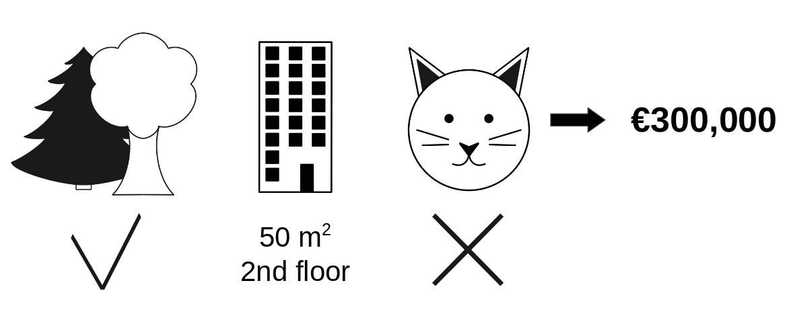
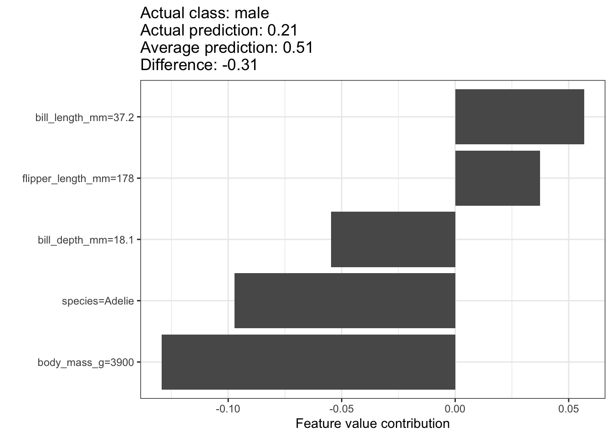
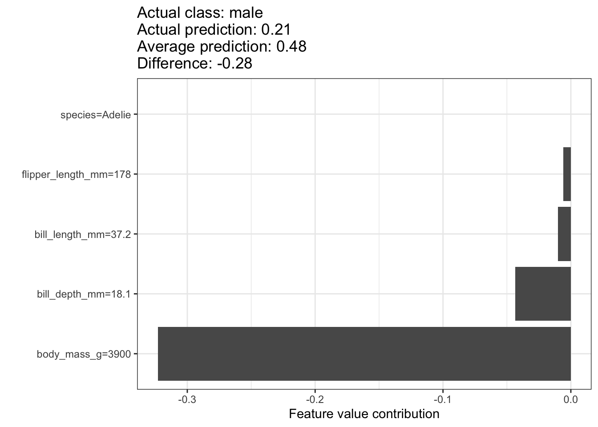
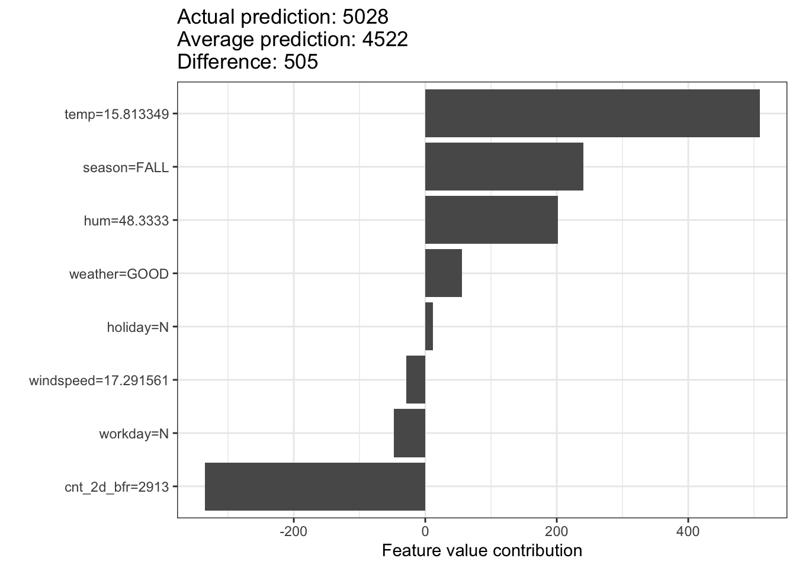

> **Çeviri kaynağı:** Christoph Molnar, *Interpretable Machine Learning*, 3. baskı (2025), [Bölüm 17: Shapley Values](https://christophm.github.io/interpretable-ml-book/shapley.html). Özgün eser CC BY-NC-SA 4.0 lisanslıdır. Teknik terimler, gerekli olduğu yerlerde İngilizce karşılıklarıyla birlikte verilmiştir. Özgün bölümdeki R kodlarının ürettiği şekiller, kitabın yayımlanmış sürümünden alınmıştır.

Bir tahmin, açıklanan örneğe (*instance*) ait her bir öznitelik değerinin (*feature value*), kazancın (*payout*) tahminin kendisi olduğu bir oyunda "oyuncu" olduğu varsayılarak açıklanabilir.
Koalisyonel oyun teorisinden (*coalitional game theory*) gelen bir yöntem olan Shapley değerleri (*Shapley values*), bu "kazancın" öznitelikler arasında nasıl adil biçimde paylaştırılacağını söyler.

## Genel Fikir

Şu senaryoyu düşünelim:
Daire fiyatlarını tahmin etmek için bir makine öğrenmesi modeli eğittiniz.
Model belirli bir daire için 300.000 € tahmin ediyor ve bu tahmini açıklamanız gerekiyor.
@fig-shapley-instance'de gösterildiği gibi daire 50 m$^2$ büyüklüğünde, 2. katta, yakınında bir park var ve dairede kedi beslemek yasak.
Tüm daireler için ortalama tahmin 310.000 €.
Amacımız, bu öznitelik değerlerinin her birinin tahmine nasıl katkıda bulunduğunu açıklamak.
Her bir öznitelik değeri, ortalama tahmine kıyasla tahmine ne kadar katkıda bulundu?

{#fig-shapley-instance width=75%}

Doğrusal regresyon (*linear regression*) modelleri için cevap basittir.
Her bir özniteliğin etkisi, özniteliğin ağırlığı ile öznitelik değerinin çarpımıdır.
Bu yalnızca modelin doğrusallığı sayesinde işe yarar.
Daha karmaşık modeller için farklı bir çözüme ihtiyacımız var.
Örneğin [LIME](https://christophm.github.io/interpretable-ml-book/lime.html), etkileri kestirmek için yerel modeller önerir.
Başka bir çözüm işbirlikçi oyun teorisinden (*cooperative game theory*) gelir:
@shapley1953value tarafından ortaya konan Shapley değeri, oyunculara toplam kazanca yaptıkları katkıya göre kazanç dağıtmanın bir yöntemidir.
Oyuncular bir koalisyon (*coalition*) içinde işbirliği yapar ve bu işbirliğinden belirli bir kâr elde eder.

Oyuncular mı?
Oyun mu?
Kazanç mı?
Bunların makine öğrenmesi tahminleri ve yorumlanabilirlikle ne ilgisi var?
"Oyun", veri kümesindeki tek bir örnek için yapılan tahmin görevidir.
"Kazanç" (*gain*), bu örnek için yapılan gerçek tahmin eksi tüm örnekler için yapılan ortalama tahmindir.
"Oyuncular" ise kazancı elde etmek (yani belirli bir değeri tahmin etmek) için birlikte çalışan, örneğe ait öznitelik değerleridir.
Daire örneğimizde `park-nearby` (yakında park var), `cat-banned` (kedi yasak), `area-50` (50 m$^2$) ve `floor-2nd` (2. kat) öznitelik değerleri, 300.000 €'luk tahmine ulaşmak için birlikte çalıştı.
Amacımız, gerçek tahmin (300.000 €) ile ortalama tahmin (310.000 €) arasındaki farkı, yani -10.000 €'luk farkı açıklamak.

Cevap şöyle olabilir:
`park-nearby` 30.000 € katkıda bulundu; `area-50` 10.000 € katkıda bulundu; `floor-2nd` 0 € katkıda bulundu; `cat-banned` -50.000 € katkıda bulundu.
Katkıların toplamı -10.000 €'ya, yani nihai tahmin eksi ortalama tahmin edilen daire fiyatına eşittir.

**Tek bir öznitelik için Shapley değerini nasıl hesaplarız?**

Shapley değeri, bir öznitelik değerinin tüm olası koalisyonlar üzerindeki ortalama marjinal katkısıdır (*marginal contribution*).
Her şey açık mı?

@fig-shapley-instance-intervened, `cat-banned` öznitelik değeri `park-nearby` ve `area-50`'den oluşan bir koalisyona eklendiğinde bu değerin marjinal katkısının nasıl hesaplandığını gösterir.
Veriden rastgele başka bir daire çekip kat özniteliği için onun değerini kullanarak, koalisyonda yalnızca `park-nearby`, `cat-banned` ve `area-50`'nin bulunduğunu simüle ederiz.
`floor-2nd` değeri, rastgele çekilen `floor-1st` (1. kat) ile değiştirildi.
Ardından dairenin bu kombinasyonla fiyatını tahmin ederiz (310.000 €).
İkinci adımda `cat-banned`'i koalisyondan çıkarırız; bunu, onu rastgele çekilen daireye ait kedi izinli/yasak özniteliğinin değeriyle değiştirerek yaparız.
Örnekte bu değer `cat-allowed` (kedi serbest) oldu, ama yine `cat-banned` da olabilirdi.
`park-nearby` ve `area-50`'den oluşan koalisyon için daire fiyatını tahmin ederiz (320.000 €).
`cat-banned`'in katkısı 310.000 € - 320.000 € = -10.000 € oldu.
Bu kestirim, kedi ve kat öznitelik değerleri için "bağışçı" (*donor*) görevi gören, rastgele çekilmiş dairenin değerlerine bağlıdır.
Bu örnekleme adımını tekrarlayıp katkıların ortalamasını alırsak daha iyi kestirimler elde ederiz.

{#fig-shapley-instance-intervened width=80%}

Bu hesaplamayı tüm olası koalisyonlar için tekrarlarız.
Shapley değeri, tüm olası koalisyonlara yapılan bütün marjinal katkıların ortalamasıdır.
Hesaplama süresi öznitelik sayısıyla birlikte üstel (*exponential*) olarak artar.
Hesaplama süresini yönetilebilir tutmanın bir yolu, katkıları olası koalisyonların yalnızca birkaç örneği için hesaplamaktır.

@fig-shapley-coalitions, `cat-banned` için kesin Shapley değerini belirlemek amacıyla gereken tüm öznitelik değeri koalisyonlarını gösterir.
İlk satır, hiçbir öznitelik değeri içermeyen koalisyonu gösterir.
İkinci, üçüncü ve dördüncü satırlar, koalisyon büyüklüğü giderek artan farklı koalisyonları "|" ile ayrılmış olarak gösterir.
Sonuç olarak olası koalisyonlar şunlardır:

- `{}` (boş koalisyon)
- `{park-nearby}`
- `{area-50}`
- `{floor-2nd}`
- `{park-nearby,area-50}`
- `{park-nearby,floor-2nd}`
- `{area-50,floor-2nd}`
- `{park-nearby,area-50,floor-2nd}`

Bu koalisyonların her biri için, daire fiyatını `cat-banned` öznitelik değeri varken ve yokken tahmin eder, marjinal katkıyı bulmak için aradaki farkı alırız.
Shapley değeri, tüm marjinal katkıların (ağırlıklı) ortalamasıdır.
Makine öğrenmesi modelinden bir tahmin alabilmek için koalisyonda yer almayan özniteliklerin değerlerini, daire veri kümesinden rastgele seçilen öznitelik değerleriyle değiştiririz.
Tüm öznitelik değerleri için Shapley değerlerini kestirirsek, tahminin (ortalama çıkarılmış hâlinin) öznitelik değerleri arasındaki eksiksiz dağılımını elde ederiz.

{#fig-shapley-coalitions width=85%}

## Örnekler ve Yorumlama

$j$ özniteliği için Shapley değerinin yorumu şöyledir:
$j$-inci özniteliğin değeri, veri kümesinin ortalama tahminine kıyasla bu belirli örneğin tahminine $\phi_j$ kadar katkıda bulunmuştur.
Shapley değeri hem sınıflandırma (olasılıklarla çalışıyorsak) hem de regresyon için işe yarar.

Shapley değerini, [penguenlerin cinsiyetini](https://christophm.github.io/interpretable-ml-book/data.html#penguins) tahmin eden bir rastgele orman (*random forest*) modelinin tahminlerini analiz etmek için kullanıyoruz.
@fig-shapley-penguins-plot, erkek bir penguen için Shapley değerlerini gösterir.
Bu penguen için tahmin edilen P(dişi)=0.21 değeri, P(dişi) için ortalama olasılık olan 0.51'in 0.31 altındadır.
Dişi olma olasılığına en çok gaga uzunluğu katkıda bulundu, ancak faktörlerin çoğu (doğru biçimde) erkeği işaret ediyordu.
Katkıların toplamı, gerçek tahmin ile ortalama tahmin arasındaki farkı verir (-0.31).^[Çevirmen notu: Özgün metinde parantez içinde 0.51 yazmaktadır; ancak bu değer ortalama tahmindir. Gerçek tahmin ile ortalama tahmin arasındaki fark, bir önceki cümlede de belirtildiği gibi -0.31'dir (0.21 ve 0.51 yuvarlanmış değerler olduğundan farkları birebir -0.30 çıkmaz).]

{#fig-shapley-penguins-plot width=85%}

Shapley değerleri, eksik takım üyelerinin örnekleneceği bir referans veri kümesine (*reference dataset*) her zaman ihtiyaç duyar.
Bu örnekte tüm veri noktalarını, yani türünden bağımsız olarak tüm penguenleri kullandım.
Mevcut penguen bir Adelie pengueni; Shapley değerlerini yalnızca aynı türden diğer penguenlerle karşılaştırarak da hesaplayabiliriz.
Bu, gerçekçi olmayan değerlerin örneklenip birleştirilmesi sorununu azaltır.
@fig-shapley-penguins-plot-species farklı bir yorumu da ortaya koyar.
Penguenimizi diğer Adelie penguenleriyle karşılaştırdığımızda, dişi olma olasılığının düşük olmasının nedeni vücut ağırlığıdır.

{#fig-shapley-penguins-plot-species width=85%}

::: {.callout-tip}

# Referans veriyi seçin

Shapley değerinin yorumu her zaman, eksik oyuncuların değerlerini yerine koymak için kullanılan veri kümesine göre yapılır.
Anlamlı bir referans veri kümesi seçtiğinizden emin olun.

:::

[Bisiklet kiralama veri kümesi](https://christophm.github.io/interpretable-ml-book/data.html#bike-data) için de hava durumu ve takvim bilgileri verildiğinde bir günde kiralanan bisiklet sayısını tahmin eden bir rastgele orman eğitiyoruz.
Rastgele ormanın belirli bir gün için yaptığı tahmine ilişkin oluşturulan açıklamalar @fig-shapley-bike-plot'de gösterilmiştir.

{#fig-shapley-bike-plot width=85%}

Tahmin edilen 5028 kiralık bisikletle bu gün, 4522 olan ortalama tahminin 505 üzerindedir.^[Çevirmen notu: Özgün metinde "505 below" (505 altında) ifadesi geçmektedir; ancak 5028 > 4522 olduğundan tahmin ortalamanın üzerindedir.]
En büyük pozitif katkıları sıcaklık ve nem yaptı.
En büyük negatif katkıyı iki gün önceki düşük kiralama sayısı yaptı.
Shapley değerlerinin toplamı, gerçek tahmin ile ortalama tahmin arasındaki farkı verir (505).

::: {.callout-warning}

# Shapley değerleri karşı-olgusal açıklama değildir

Shapley değerini doğru yorumlamaya dikkat edin:
Shapley değeri, bir öznitelik değerinin farklı koalisyonlarda tahmine yaptığı ortalama katkıdır.
Shapley değeri, özniteliği modelden çıkardığımızda tahminde oluşan fark DEĞİLDİR.

:::

## Shapley Değeri Teorisi

Bu kısım, meraklı okuyucu için Shapley değerinin tanımına ve hesaplanmasına daha derinlemesine iner.
Teknik ayrıntılarla ilgilenmiyorsanız bu kısmı atlayıp doğrudan "Güçlü Yönler ve Sınırlılıklar" kısmına geçebilirsiniz.

Her bir özniteliğin bir veri noktasının tahminini nasıl etkilediğiyle ilgileniyoruz.
Doğrusal bir modelde bireysel etkileri hesaplamak kolaydır.
Tek bir veri örneği için doğrusal model tahmini şöyle görünür:

$$\hat{f}(\mathbf{x})=\beta_0+\beta_{1}x_{1}+\ldots+\beta_{p}x_{p}$$

Burada $\mathbf{x}$, katkılarını hesaplamak istediğimiz örnektir.
Her $x_j$, $j = 1,\ldots,p$ olmak üzere bir öznitelik değeridir.
$\beta_j$, $j$ özniteliğine karşılık gelen ağırlıktır.

$j$-inci özniteliğin $\hat{f}(\mathbf{x})$ tahminine katkısı $\phi_j$ şöyledir:

$$\phi_j(\hat{f})=\beta_{j}x_j-\beta_{j}\mathbb{E}[X_{j}]$$

Burada $\beta_j \mathbb{E}[X_{j}]$, $j$ özniteliği için ortalama etki kestirimidir.
Katkı, öznitelik etkisi ile ortalama etki arasındaki farktır.
Güzel!
Artık her bir özniteliğin tahmine ne kadar katkıda bulunduğunu biliyoruz.
Tek bir örnek için tüm öznitelik katkılarını toplarsak sonuç şudur:

::: {.content-hidden when-format="epub"}

\begin{align*}
\sum_{j=1}^{p}\phi_j(\hat{f})=&\sum_{j=1}^p(\beta_{j}x_j- \beta_{j} \mathbb{E}[X_{j}]) \\
=&(\beta_0+\sum_{j=1}^p\beta_{j}x_j)-(\beta_0+\sum_{j=1}^p \beta_{j} \mathbb{E}[X_{j}]) \\
=&\hat{f}(\mathbf{x})-\mathbb{E}[\hat{f}(\mathbf{X})]
\end{align*}

:::

::: {.content-visible when-format="epub"}

$$
\sum_{j=1}^{p}\phi_j(\hat{f}) = \sum_{j=1}^p(\beta_{j}x_j- \beta_{j} \mathbb{E}[X_{j}])
$$
$$
= (\beta_0+\sum_{j=1}^p\beta_{j}x_j)-(\beta_0+\sum_{j=1}^p \beta_{j} \mathbb{E}[X_{j}])
$$
$$
= \hat{f}(\mathbf{x})-\mathbb{E}[\hat{f}(\mathbf{X})]
$$

:::

Bu, $\mathbf{x}$ veri noktası için tahmin edilen değer eksi ortalama tahmin edilen değerdir.
Öznitelik katkıları negatif olabilir.

Aynısını her model türü için yapabilir miyiz?
Bunu modelden bağımsız (*model-agnostic*) bir araç olarak kullanabilmek harika olurdu.
Diğer model türlerinde genellikle benzer ağırlıklar bulunmadığından farklı bir çözüme ihtiyacımız var.

Yardım beklenmedik bir yerden, işbirlikçi oyun teorisinden gelir.
Shapley değeri, herhangi bir makine öğrenmesi modelinde tekil tahminler için öznitelik katkılarını hesaplamaya yönelik bir çözümdür.

### Tanım

Shapley değeri, $S$ kümesindeki oyuncuların bir değer fonksiyonu (*value function*) $val$ aracılığıyla tanımlanır.

Bir öznitelik değerinin Shapley değeri, kazanca yaptığı katkının tüm olası öznitelik değeri kombinasyonları üzerinden ağırlıklandırılıp toplanmasıyla elde edilir:

$$\phi_j(val)=\sum_{S\subseteq\{1,\ldots,p\} \setminus \{j\}}\frac{|S|!\left(p-|S|-1\right)!}{p!}\left(val\left(S\cup\{j\}\right)-val(S)\right)$$

Burada $S$ modelde kullanılan özniteliklerin bir alt kümesi, $\mathbf{x}$ açıklanacak örneğin öznitelik değerlerinden oluşan vektör, $p$ ise öznitelik sayısıdır.
$val_{\mathbf{x}}(S)$, $S$ kümesindeki öznitelik değerleri için yapılan ve $S$'de yer almayan tüm öznitelikler olan $X_C$ üzerinden marjinalleştirilmiş (*marginalized*) tahmindir ($S \cap C = \emptyset$ ve $S \cup C = \{1, \ldots, p\}$):

$$val_{\mathbf{x}}(S)=\int\hat{f}(x_{1},\ldots,x_{p})d\mathbb{P}_{X_C}-\mathbb{E}[\hat{f}(\mathbf{X})]$$

Aslında $S$'de bulunmayan her öznitelik için ayrı bir integral alırsınız.
Somut bir örnek:
Makine öğrenmesi modeli $X_1$, $X_2$, $X_3$ ve $X_4$ olmak üzere 4 öznitelikle çalışıyor ve $x_1$ ile $x_3$ öznitelik değerlerinden oluşan $S$ koalisyonu için tahmini değerlendiriyoruz:

$$val_{\mathbf{x}}(S)=val_{\mathbf{x}}(\{1,3\})=\int_{\mathbb{R}}\int_{\mathbb{R}}\hat{f}(x_{1},X_{2},x_{3},X_{4})d\mathbb{P}_{X_2X_4}-\mathbb{E}[\hat{f}(\mathbf{X})]$$

Bu, doğrusal modeldeki öznitelik katkılarına benziyor!

::: {.callout-note}

# "Değer" kelimesinin farklı kullanımlarına takılmayın

Öznitelik değeri (*feature value*), bir özniteliğin bir örnekteki sayısal ya da kategorik değeridir;
Shapley değeri (*Shapley value*), özniteliğin tahmine katkısıdır;
değer fonksiyonu (*value function*) ise oyuncu (öznitelik değeri) koalisyonları için kazanç fonksiyonudur.

:::

Shapley değeri; **Etkinlik** (*Efficiency*), **Simetri** (*Symmetry*), **Kukla** (*Dummy*) ve **Toplanabilirlik** (*Additivity*) özelliklerini sağlayan tek atıf yöntemidir (*attribution method*). Bu özellikler birlikte adil bir kazanç dağılımının tanımı olarak kabul edilebilir.

**Etkinlik**
Öznitelik katkılarının toplamı, $\mathbf{x}$ için yapılan tahmin ile ortalama arasındaki farka eşit olmalıdır.

$$\sum\nolimits_{j=1}^p\phi_j=\hat{f}(\mathbf{x})-\mathbb{E}[\hat{f}(\mathbf{X})]$$

**Simetri**
$j$ ve $k$ öznitelik değerleri tüm olası koalisyonlara eşit katkıda bulunuyorsa, bu iki değerin katkıları aynı olmalıdır.
Eğer

$$val(S \cup \{j\})=val(S\cup\{k\})$$

ifadesi

$$S\subseteq\{1,\ldots, p\} \setminus \{j,k\}$$

koşulunu sağlayan tüm $S$ kümeleri için geçerliyse, o zaman

$$\phi_j=\phi_{k}$$

**Kukla**
Hangi öznitelik değeri koalisyonuna eklenirse eklensin tahmin edilen değeri değiştirmeyen bir $j$ özniteliğinin Shapley değeri 0 olmalıdır.
Eğer

$$val(S\cup\{j\})=val(S)$$

ifadesi

$$S\subseteq\{1,\ldots,p\}$$

koşulunu sağlayan tüm $S$ kümeleri için geçerliyse, o zaman

$$\phi_j=0$$

**Toplanabilirlik**
Kazançları birleştirilmiş $val + val^+$ şeklindeki bir oyun için ilgili Shapley değerleri şöyledir:

$$\phi_j+\phi_j^{+}$$

Bir rastgele orman eğittiğinizi varsayalım; bu, tahminin birçok karar ağacının ortalaması olduğu anlamına gelir.
Toplanabilirlik özelliği, bir öznitelik değeri için Shapley değerini her ağaç için ayrı ayrı hesaplayıp bunların ortalamasını aldığınızda, rastgele orman için o öznitelik değerinin Shapley değerini elde edeceğinizi garanti eder.

::: {.callout-note}

# Shapley değerlerinin sezgisel olarak anlaşılması

Öznitelik değerleri bir odaya rastgele sırayla girer.
Odadaki tüm öznitelik değerleri oyuna katılır (= tahmine katkıda bulunur).
Bir öznitelik değerinin Shapley değeri, o değer odaya katıldığında, odada zaten bulunan koalisyonun elde ettiği tahminde meydana gelen ortalama değişimdir.

:::

## Shapley Değerlerinin Kestirilmesi

Kesin Shapley değerini hesaplamak için öznitelik değerlerinin tüm olası koalisyonlarının (kümelerinin) $j$-inci öznitelik varken ve yokken değerlendirilmesi gerekir.
Öznitelik sayısı birkaçı aştığında, eklenen her öznitelikle olası koalisyon sayısı üstel olarak arttığından bu problemin kesin çözümü sorunlu hâle gelir.
@strumbelj2014explaining, Monte-Carlo örneklemesiyle (*Monte-Carlo sampling*) bir yaklaşık çözüm önermiştir:

$$\hat{\phi}_{j} = \frac{1}{M}\sum_{m=1}^M\left(\hat{f}(\mathbf{x}^{(m)}_{+j}) - \hat{f}(\mathbf{x}^{(m)}_{-j})\right)$$

Burada $\hat{f}(\mathbf{x}^{(m)}_{+j})$, $\mathbf{x}$ için yapılan tahmindir; ancak bu örnekte, $j$ özniteliğinin değeri hariç, rastgele sayıda öznitelik değeri rastgele bir $\mathbf{z}$ veri noktasının öznitelik değerleriyle değiştirilmiştir.
$\mathbf{x}^{(m)}_{-j}$ öznitelik vektörü $\mathbf{x}^{(m)}_{+j}$ ile neredeyse aynıdır, ancak $x^{(m)}_j$ değeri de örneklenen $\mathbf{z}$'den alınır.
Bu $M$ yeni örneğin her biri, iki örnekten birleştirilmiş bir tür "Frankenstein'ın Canavarı"dır.
Aşağıdaki algoritmada özniteliklerin sırasının gerçekte değiştirilmediğine dikkat edin; tahmin fonksiyonuna verilirken her öznitelik vektörde aynı konumda kalır.
Sıra burada yalnızca bir "hile" olarak kullanılır:
Özniteliklere yeni bir sıra vererek "Frankenstein'ın Canavarı"nı bir araya getirmemize yardımcı olan rastgele bir mekanizma elde ederiz.
$X_j$ özniteliğinin solunda kalan öznitelikler için değerleri özgün gözlemden, sağında kalanlar için ise rastgele bir örnekten alırız.

**Tek bir öznitelik değeri için yaklaşık Shapley kestirimi**:

- Çıktı: $j$-inci özniteliğin değeri için Shapley değeri
- Gerekenler: İterasyon sayısı $M$, ilgilenilen örnek $\mathbf{x}$, öznitelik indeksi $j$, veri matrisi $\mathbf{X}$ ve makine öğrenmesi modeli $f$
- Tüm $m = 1,\ldots,M$ için:
  - $\mathbf{X}$ veri matrisinden rastgele bir $\mathbf{z}$ örneği çek
  - Öznitelik değerlerinin rastgele bir $\mathbf{o}$ permütasyonunu seç
  - $\mathbf{x}$ örneğini sırala: $\mathbf{x}_{\mathbf{o}}=(x_{(1)},\ldots,x_{(j)},\ldots,x_{(p)})$
  - $\mathbf{z}$ örneğini sırala: $\mathbf{z}_{\mathbf{o}}=(z_{(1)},\ldots,z_{(j)},\ldots,z_{(p)})$
  - İki yeni örnek oluştur
    - $j$ ile: $\mathbf{x}_{+j}=(x_{(1)},\ldots,x_{(j-1)},x_{(j)},z_{(j+1)},\ldots,z_{(p)})$
    - $j$ olmadan: $\mathbf{x}_{-j}=(x_{(1)},\ldots,x_{(j-1)},z_{(j)},z_{(j+1)},\ldots,z_{(p)})$
  - Marjinal katkıyı hesapla: $\phi_j^{(m)}=\hat{f}(\mathbf{x}_{+j})-\hat{f}(\mathbf{x}_{-j})$
- Shapley değerini ortalama olarak hesapla: $\phi_j(\mathbf{x}) = \frac{1}{M}\sum_{m=1}^M\phi_j^{(m)}$

::: {.callout-tip}

# Hız için örneklem büyüklüğünü azaltın

Shapley değerlerini kestirirken hesaplama süresini kısaltmak için daha küçük bir $M$ örneklem büyüklüğü kullanmayı düşünebilirsiniz; ancak kestirimdeki varyansın artacağını unutmayın.

:::

Tüm Shapley değerlerini elde etmek için bu işlemin her öznitelik için tekrarlanması gerekir.
[SHAP bölümünde](https://christophm.github.io/interpretable-ml-book/shap.html) Shapley değerlerini kestirmenin başka verimli yollarını göreceğiz.

## Güçlü Yönler

Tahmin ile ortalama tahmin arasındaki fark, örneğin öznitelik değerleri arasında **adil biçimde dağıtılır**; bu, Shapley değerlerinin Etkinlik özelliğidir.
Bu özellik, Shapley değerini [LIME](https://christophm.github.io/interpretable-ml-book/lime.html) gibi diğer yöntemlerden ayırır.
LIME, tahminin öznitelikler arasında adil biçimde dağıtıldığını garanti etmez.
Shapley değerleri **eksiksiz bir açıklama** sunar.

Shapley değeri **karşıtsal açıklamalara** (*contrastive explanations*) olanak tanır.
Bir tahmini tüm veri kümesinin ortalama tahminiyle karşılaştırmak yerine, bir alt kümeyle hatta tek bir veri noktasıyla karşılaştırabilirsiniz.
Bu karşıtsallık, LIME gibi yerel modellerde bulunmayan bir özelliktir.

Shapley değeri, **sağlam bir teoriye** sahip tek açıklama yöntemidir.
Etkinlik, simetri, kukla ve toplanabilirlik aksiyomları açıklamaya makul bir temel sağlar.
LIME gibi yöntemler makine öğrenmesi modelinin yerel olarak doğrusal davrandığını varsayar, ancak bunun neden işe yaraması gerektiğine dair bir teori yoktur.

## Sınırlılıklar

Shapley değeri **çok fazla hesaplama süresi** gerektirir.
Gerçek dünya problemlerinin %99,9'unda yalnızca yaklaşık çözüm uygulanabilirdir.
Shapley değerinin kesin hesaplanması işlem açısından pahalıdır; çünkü öznitelik değerlerinin 2^k^ olası koalisyonu vardır ve bir özniteliğin "yokluğunun" rastgele örnekler çekilerek simüle edilmesi gerekir. Bu da Shapley değeri kestiriminin varyansını artırır.
Koalisyonların üstel sayısıyla, koalisyonlar örneklenerek ve iterasyon sayısı M sınırlandırılarak başa çıkılır.
M'yi azaltmak hesaplama süresini kısaltır, ancak Shapley değerinin varyansını artırır.
İterasyon sayısı M için iyi bir pratik kural (*rule of thumb*) yoktur.
M, Shapley değerlerini doğru kestirecek kadar büyük, ancak hesaplamayı makul bir sürede tamamlayacak kadar küçük olmalıdır.
M'yi Chernoff sınırlarına (*Chernoff bounds*) dayanarak seçmek mümkün olmalıdır, ancak makine öğrenmesi tahminlerine yönelik Shapley değerleri için bunu yapan bir makale görmedim.

Shapley değeri **yanlış yorumlanabilir**.
Bir öznitelik değerinin Shapley değeri, özniteliği model eğitiminden çıkardıktan sonra tahmin edilen değerde oluşan fark değildir.
Shapley değerinin yorumu şöyledir:
Mevcut öznitelik değerleri kümesi verildiğinde, bir öznitelik değerinin gerçek tahmin ile ortalama tahmin arasındaki farka katkısı, kestirilen Shapley değeridir.

Shapley değeri açıklamaları **gradyan ya da komşuluk anlamında yerel olarak yorumlanmamalıdır.** [@bilodeau2024impossibility]
Örneğin pozitif bir Shapley değeri, özniteliği artırmanın tahmini artıracağı anlamına gelmez.
Shapley değeri, bunun yerine kestirimde kullanılan referans veri kümesine göre yorumlanmalıdır.
Bu nedenle, tam resmi görebilmeniz için Shapley değerlerini örneğin [ceteris paribus grafikleri](https://christophm.github.io/interpretable-ml-book/ceteris-paribus.html) ya da [ICE grafikleri](https://christophm.github.io/interpretable-ml-book/ice.html) ile birlikte kullanmanızı da öneririm.

::: {.callout-tip}

# Ceteris paribus ve ICE ile birlikte kullanın

Öznitelik değişikliklerine karşı yerel duyarlılık hakkında fikir edinmek için Shapley değerlerini ceteris paribus ya da ICE grafikleriyle birlikte kullanın.

:::

Seyrek açıklamalar (*sparse explanations*), yani az sayıda öznitelik içeren açıklamalar arıyorsanız, Shapley değeri yanlış açıklama yöntemidir.
Shapley değeri yöntemiyle oluşturulan açıklamalar **tüm öznitelikleri kullanır**.
İnsanlar, LIME'ın ürettikleri gibi seçici açıklamaları tercih eder.
Sıradan kullanıcıların (*laypersons*) muhatap olacağı açıklamalar için LIME daha iyi bir seçim olabilir.
Bir başka çözüm de @lundberg2017unified tarafından tanıtılan [SHAP](https://github.com/slundberg/shap)'tır; SHAP, Shapley değerine dayanır ancak az sayıda öznitelik içeren açıklamalar da sunabilir.

Shapley değeri her öznitelik için basit bir değer döndürür, ancak LIME'daki gibi **bir tahmin modeli sunmaz**.
Bu da Shapley değerinin, girdideki değişikliklere karşılık tahminde oluşacak değişiklikler hakkında aşağıdaki gibi çıkarımlar yapmak için kullanılamayacağı anlamına gelir:
"Yılda 300 € daha fazla kazansaydım kredi puanım 5 puan artardı."

Diğer birçok permütasyon tabanlı yorumlama yöntemi gibi Shapley değeri yöntemi de öznitelikler korelasyonlu olduğunda **gerçekçi olmayan veri örneklerinin dahil edilmesi** sorunundan muzdariptir.
Bir öznitelik değerinin koalisyonda bulunmadığını simüle etmek için özniteliği marjinalleştiririz.
Bu, özniteliğin marjinal dağılımından (*marginal distribution*) değerler örneklenerek yapılır.
Öznitelikler bağımsız olduğu sürece bu bir sorun oluşturmaz.
Öznitelikler bağımlı olduğunda ise bu örnek için anlam ifade etmeyen öznitelik değerleri örnekleyebiliriz.
Ama yine de bu değerleri özniteliğin Shapley değerini hesaplamak için kullanırız.
Çözümlerden biri, korelasyonlu öznitelikleri birlikte permüte edip onlar için tek bir ortak Shapley değeri elde etmek olabilir.
Bir başka uyarlama da koşullu örneklemedir (*conditional sampling*): Öznitelikler, takımda hâlihazırda bulunan özniteliklere koşullu olarak örneklenir.
Koşullu örnekleme gerçekçi olmayan veri noktaları sorununu çözse de yeni bir sorun ortaya çıkarır:
@sundararajan2020many tarafından ortaya konduğu ve @janzing2020feature tarafından ayrıca tartışıldığı üzere, elde edilen değerler simetri aksiyomunu ihlal ettiği için artık oyunumuzun Shapley değerleri değildir.

## Yazılım ve Alternatifler

Shapley değerleri, R için hem `iml` hem de [fastshap](https://github.com/bgreenwell/fastshap) paketlerinde uygulanmıştır.
Julia'da [Shapley.jl](https://gitlab.com/ExpandingMan/Shapley.jl) kullanılabilir.

Shapley değerleri için alternatif bir kestirim yöntemi ve ekosistem olan SHAP, [bir sonraki bölümde](https://christophm.github.io/interpretable-ml-book/shap.html) sunulmaktadır.

Bir başka yaklaşım, `breakDown` R paketinde uygulanan breakDown yöntemidir [@staniak2018explanationsa].
BreakDown da her bir özniteliğin tahmine katkısını gösterir, ancak bunları adım adım hesaplar.
Oyun benzetmesini yeniden kullanalım:
Boş bir takımla başlarız, tahmine en çok katkıda bulunacak öznitelik değerini ekleriz ve tüm öznitelik değerleri eklenene kadar bunu tekrarlarız.
Her bir öznitelik değerinin ne kadar katkıda bulunduğu, "takımda" hâlihazırda bulunan öznitelik değerlerine bağlıdır; bu da breakDown yönteminin büyük dezavantajıdır.
Shapley değeri yönteminden daha hızlıdır ve etkileşim içermeyen modeller için sonuçlar aynıdır.

