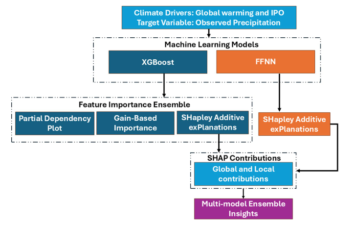
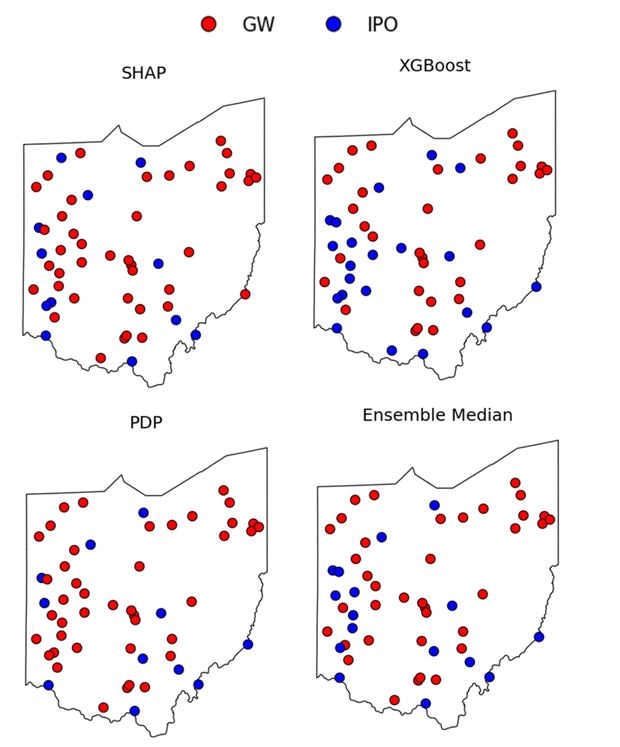
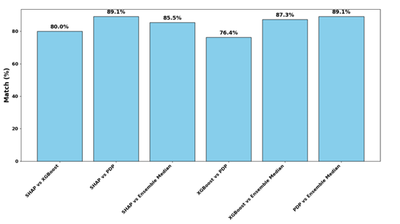
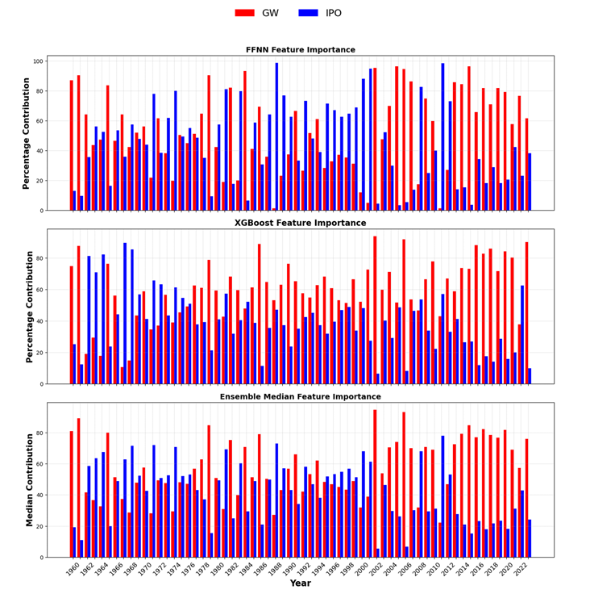
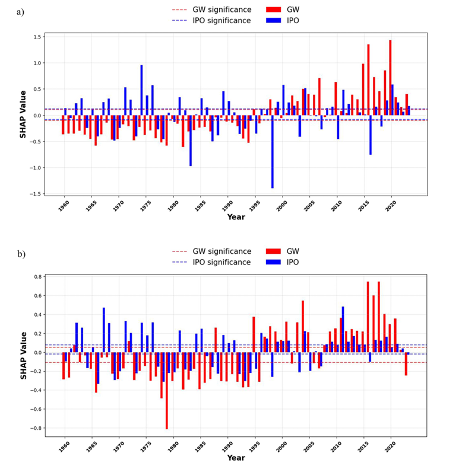
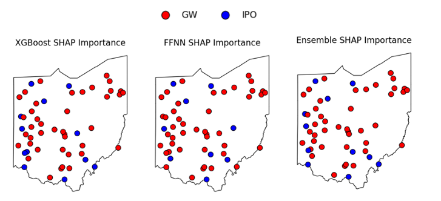
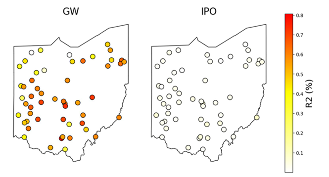
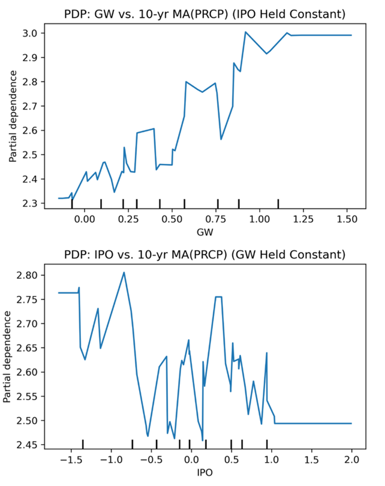

# Makale

<!-- Sayfa 1 -->

Makine Öğrenmesinde Özellik Öneminin Belirsizliği: SHAP, PDP ve Kazanç Tabanlı
Yöntemlerin Karşılaştırmalı Analizi

Karmaşık etkileşimler ve doğrusal olmayan ilişkiler tarafından şekillenen iklim sinyalleri, hava durumu
örüntülerini ve uzun vadeli eğilimleri etkiler. Ancak değişkenler arasındaki çoklu doğrusal bağlantı
(collinearity), iklim değişikliklerine yön veren temel faktörlerin belirlenmesini zorlaştırır.

Bu çalışma, iklim biliminde özellik önemini belirlemek için kullanılan makine öğrenmesi (ML)
yöntemlerinin tutarlılığını ve belirsizliğini incelemektedir. Bu kapsamda SHapley Additive exPlanations
(SHAP), Kısmi Bağımlılık Grafikleri (Partial Dependence Plots – PDP) ve Extreme Gradient Boosting
(XGBoost) algoritmasının kazanç tabanlı özellik önemini karşılaştırmaktadır. Ayrıca SHAP yönteminin
İleri Beslemeli Sinir Ağları (Feed Forward Neural Networks – FFNN) ve XGBoost ile birlikte
kullanılması değerlendirilerek modele bağlı belirsizlikler incelenmektedir.

Örnek olay çalışması olarak ABD'nin Ohio eyaletine ait kış mevsimi yağış verileri kullanılmıştır. Küresel
ısınmanın (Global Warming – GW) ve On Yıllar Arası Pasifik Salınımı'nın (Interdecadal Pacific
Oscillation – IPO) yağış değişimleri üzerindeki göreceli katkıları hesaplanmıştır.

Sonuçlar, tüm yöntemlerde istasyonların en az %60'ında küresel ısınmanın IPO'dan daha yüksek önem
sıralamasına sahip olduğunu göstermektedir. SHAP ve PDP yöntemleri istasyonların %89'unda aynı
sonuçlara ulaşmıştır. FFNN ve XGBoost modellerinden elde edilen genel SHAP önem değerleri ise
istasyonların %82'sinde birbiriyle uyumludur. Ortalama olarak küresel ısınmanın katkısı, IPO'nun
katkısından %15 daha fazladır. Bununla birlikte istasyonların %18'inde görülen farklılıklar, sonuçların
kullanılan modele bağlı olarak değişebileceğini ortaya koymaktadır.

SHAP değerleri kullanılarak gerçekleştirilen zamansal analiz, FFNN ve XGBoost modellerinin özellik
önemleri arasında orta düzeyde bir farklılık olduğunu göstermiştir (Pearson korelasyonu yaklaşık 0,5).
Buna rağmen her iki model de son yıllarda küresel ısınmanın etkisinin giderek arttığı ve bunun daha
yağışlı kışlara katkıda bulunduğu konusunda benzer sonuçlara ulaşmıştır.

Regresyon analizi, Ohio genelinde kış yağışlarındaki çok on yıllık değişkenliğin yaklaşık %70'inin
küresel ısınmayla açıklandığını doğrulamıştır. PDP sonuçları ise ısınma düzeyleri ile yağış artışı arasında
güçlü ve tekdüze bir ilişki bulunduğunu göstermiştir (ρ = 0,94).

PDP yöntemleri değişkenlerin marjinal etkilerini görselleştirmede başarılı olsa da değişkenler arasındaki
etkileşimleri açıklamakta zorlanmaktadır. Kazanç tabanlı yöntemler ise kaybı azaltan etkili bölme noktası
sayısı daha fazla olan özelliklere öncelik verme eğilimindedir. SHAP yöntemi özellikleri sıralama
konusunda güçlü olmakla birlikte sonuçları kullanılan temel modele göre değişebilmektedir.

Bu belirsizlikleri dikkate almak amacıyla bir topluluk (ensemble) çerçevesi önerilmiştir. Çalışma, daha
güvenilir sonuçlar elde etmek ve yorumlanabilirliği artırmak için bu makine öğrenmesi yöntemlerinin
birbirini tamamlayacak şekilde birlikte kullanılmasının önemini ortaya koymaktadır. Ayrıca iklim
modellemesinde güvenilir çıkarımlar yapabilmek için özellik önem sıralamalarındaki yöntemsel
belirsizliklerin dikkate alınması gerektiğini vurgulamaktadır.

---

<!-- Sayfa 2 -->

1. Giriş (Introduction) – Türkçe Çeviri

Aşırı iklim olayları, son birkaç on yılda giderek daha sık meydana gelmiş ve bazı durumlarda daha
şiddetli hâle gelmiştir (Sheridan ve Allen 2015; Rastogi vd. 2020; Fischer vd. 2021; Ibebuchi vd. 2024a).
Bu olaylara neden olan süreçlerin anlaşılması, tahmin ve etkilerin azaltılması açısından büyük önem
taşımaktadır (Huang vd. 2018). Bununla birlikte, iklim sisteminin karmaşık yapısı, birbiriyle örtüşen ve
ilişkili sinyaller içermesi nedeniyle belirli olayların tek tek nedenlere bağlanmasını zorlaştırmaktadır
(Trenberth vd. 2015; Swain vd. 2020).

Dinamik modeller, iklim olaylarının nedenlerini belirlemeye yönelik çalışmalarda kullanılabilmektedir.
Ancak bu modeller genellikle yüksek hesaplama maliyetine sahiptir ve önemli düzeyde uzmanlık
gerektirir. Ayrıca model hataları nedeniyle sınırlılıklar gösterebilirler (Stott vd. 2016; Diffenbaugh vd.
2017; Ibebuchi vd. 2022). Buna karşılık, makine öğrenmesi (ML) algoritmaları, veri yapısı hakkında daha
az varsayımda bulunarak iklim sisteminin doğasında bulunan ilişkileri yakalama konusunda önemli
ölçüde gelişme göstermiştir (Naveau vd. 2020; Mahesh vd. 2021).

Bununla birlikte, makine öğrenmesi çıktıları; aşırı öğrenme (overfitting), veri yanlılıkları veya modele
özgü sınırlılıklar gibi nedenlerle özellik sıralaması ve olayların nedenlerini belirleme çalışmalarında hâlâ
hatalara açık olabilir (Grover 2022; Zhu vd. 2023). Makine öğrenmesinin güçlü yönlerinden etkili
biçimde yararlanmak için uygulanabilecek yaklaşımlardan biri, birden fazla model ve tekniği bir araya
getiren topluluk (ensemble) çerçevesinin kullanılmasıdır (Ganaie vd. 2022; Zhang vd. 2022). Özellik
sıralamasında bu tür çerçeveler, modeller arasındaki görüş birliği ve farklılık alanlarının belirlenmesine
yardımcı olarak iklim olaylarının temel belirleyicilerine ilişkin çıkarımların güvenilirliğini ve
sağlamlığını artırmaktadır.

Birçok çalışma, iklim olaylarının nedenlerini belirlemek amacıyla dinamik modeller kullanmış ve bu
modellerin yararlarını ve sınırlılıklarını ortaya koymuştur (Stone ve Allen 2005; Zhai vd. 2018; Sonali vd.
2020). Hegerl ve Zwiers (2011), iklim değişikliklerinin tespit edilmesi ve nedenlerinin belirlenmesi, iklim
değişikliğinin “parmak izlerinin” tanımlanması ve gözlemlenen değişimlerdeki belirsizliklerin ölçülmesi
açısından iklim modellerinin ne kadar önemli olduğuna dikkat çekmiştir.

Hegerl ve Zwiers (2011), birden fazla model kullanmanın modele bağlı belirsizliklerin hesaba katılmasına
yardımcı olabileceğini belirtmiştir. Ancak yüksek doğal değişkenlik ve aerosoller gibi etkisi tam olarak
açıklanamayan faktörler nedeniyle bölgesel ölçekte nedenlerin belirlenmesi hâlâ zorlayıcıdır. Pasini ve
Mazzocchi (2015), neden belirleme çalışmalarının, yakın dönemdeki küresel ısınmada insan kaynaklı
zorlamaların kritik rolünü ortaya koyan küresel iklim modellerinin ağırlıklı olarak kullanılmasından, veri
odaklı yöntemlerin de kullanılmaya başlanmasına doğru nasıl ilerlediğini açıklamıştır.

Bu değişim, yöntemler arasında daha iyi karşılaştırmalar yapılmasına olanak tanıyarak model
bağımsızlığıyla ilgili sorunları ele alırken bulguların güvenilirliğini de artırmaktadır. Bu gözlemler,
özellik sıralaması ve iklim olaylarının nedenlerinin belirlenmesi gibi karmaşık sorunların ele alınmasında
makine öğrenmesi veya topluluk yaklaşımları gibi alternatif yöntemlere duyulan ihtiyacı ortaya
koymaktadır.

---

<!-- Sayfa 3 -->

Veri odaklı makine öğrenmesi yöntemleri, özellik sıralaması ve iklim olaylarının nedenlerini belirleme
alanlarında potansiyel göstermiş ve maliyet açısından daha verimli yaklaşımlar sunmuştur (Shi vd. 2020;
Bône vd. 2022; Chirigati 2024). Callaghan vd. (2021), iklim değişikliğinin etkilerini haritalandırmak için
makine öğrenmesi kullanmış ve insan etkisinin küresel kara alanlarının %80'inde tespit edilebilir
olduğunu ortaya koymuştur.

Trok vd. (2024), aşırı hava olaylarının nedenlerini hızlı ve düşük maliyetle belirlemek amacıyla evrişimli
sinir ağlarından (Convolutional Neural Networks) yararlanmıştır. Araştırmacılar, 2023 yılında Kuzey
Amerika'nın güney-orta kesiminde meydana gelen sıcak hava olayındaki sıcaklık artışını küresel ısınmaya
bağlamıştır.

Hartigan vd. (2020), sıcaklık ve yağış değişimlerinin nedenlerini belirlemek amacıyla destek vektör
regresyonunu (Support Vector Regression) doğrusal regresyonla karşılaştırmış ve ilk yöntemin daha etkili
olduğunu bulmuştur.

Wegener ve Ibebuchi (2025), Ohio'da gözlemlenen daha yağışlı kışlarda küresel ısınmanın (GW) ve
Pasifik On Yıllık Salınımı'nın negatif evresinin önemli roller oynadığını göstermek için kazanç tabanlı
Extreme Gradient Boosting (XGBoost) yöntemini uygulamıştır.

Brown vd. (2024), iklim etkisi yollarını sıralamak amacıyla Rastgele Orman Regresyonu (Random Forest
Regression) ve SHapley Additive exPlanations (SHAP) değerlerinden yararlanmıştır. Gayle (2020) ise
Batı Nil virüsü salgınlarının ekolojik ve iklimsel belirleyicilerini değerlendirmek için SHAP yöntemini
XGBoost ile birlikte kullanmış ve bu yöntemlerin karmaşık iklim-sağlık etkileşimlerini ayrıştırmadaki
yararını göstermiştir.

Benzer şekilde Ibebuchi vd. (2025), Nevada eyaletinin Clark County bölgesinde güney ev
sivrisineklerinin varlığını etkileyen çevresel faktörleri belirlemek ve sıralamak amacıyla gradyan artırmalı
sınıflandırıcı (gradient boosting classifier) ve SHAP yöntemini uygulamıştır.

Özellik sıralaması ve neden belirleme yöntemlerindeki bu son gelişmelere rağmen (Lundberg vd. 2018;
Delgado-Panadero vd. 2022), iklim analizlerinde kullanılan bu tür makine öğrenmesi yöntemlerinin
belirsizliği büyük ölçüde yeterince araştırılmamıştır.

Bu nedenle çalışma, Ohio'daki istasyon düzeyinde kış yağışı değişimlerinde küresel ısınmanın (GW) ve
On Yıllar Arası Pasifik Salınımı'nın (Interdecadal Pacific Oscillation – IPO) katkılarını inceleyen bir
örnek olay çalışmasından hareketle aşağıdaki amaçları ele almaktadır:

1. SHAP, Kısmi Bağımlılık Grafikleri (Partial Dependence Plots – PDP) ve XGBoost'un kazanç tabanlı
yöntemlerini kullanarak özellik önem analizi içerisindeki belirsizliği değerlendirmek.

2. İleri Beslemeli Sinir Ağları (Feed Forward Neural Networks – FFNN) ve XGBoost dâhil olmak üzere
farklı temel modellerde SHAP genel önem değerlerindeki değişimleri incelemek.

3. Bu teknikleri birbirini tamamlayacak şekilde bir araya getiren çok modelli bir topluluk (ensemble)
çerçevesi önermek.

---

<!-- Sayfa 4 -->

2. Veri ve Yöntem (Data and Methodology)

2.1. Veri (Data)

Bu çalışmada kullanılan veri setleri, Wegener ve Ibebuchi (2025) çalışmasından uyarlanmıştır. Ohio
genelindeki 55 istasyondan elde edilen, 1960–2023 dönemini kapsayan aylık kış mevsimi yağış verileri
(Aralık, Ocak ve Şubat ayları) kullanılmıştır. Bu döneme Aralık 1959 verileri de dâhil edilmiştir. Her
istasyonun kayıtlarının en az %95'i eksiksizdir.

Yağış verileri, NOAA Ulusal Çevresel Bilgi Merkezlerinden (National Centers for Environmental
Information, t.y.) elde edilmiştir:

https://www.ncei.noaa.gov/cdo-web

İklim belirleyicileri, IPO indeksi ve küresel ısınma (GW) göstergesinden oluşmaktadır. Küresel ısınma
göstergesi olarak NOAA Fiziksel Bilimler Laboratuvarından (NOAA Physical Sciences Laboratory, t.y.)
alınan Küresel Ortalama Kara/Okyanus Sıcaklık İndeksi (Global Mean Land/Ocean Temperature Index)
kullanılmıştır:

https://psl.noaa.gov/data/climateindices/

GW, küresel ortalama sıcaklık değişimlerini temsil ederken IPO, iklim değişkenliğinin içsel bir modu
olup (Henley vd. 2015) küresel hava durumu örüntülerini etkilemekte (Dong ve Dai 2015) ve küresel
ısınma hızını düzenlemektedir (Kosaka ve Xie 2016).

Hedef değişken, her istasyondaki ortalama kış yağış miktarıdır. Bu çalışma, farklı makine öğrenmesi
tekniklerinin GW ve IPO'nun yağış örüntülerine göreceli katkılarını belirleme ve sıralama konusundaki
uyumunu değerlendirmeyi amaçlamaktadır. Bu değerlendirme iki açıdan gerçekleştirilmektedir:

●​      Genel önem (Global importance): İstasyon düzeyindeki ortalama katkı.
●​      Yerel önem (Local importance): Yıldan yıla değişimden çok on yıllık değişime kadar uzanan
süreçte, tüm istasyonlardaki ortalama yağışa yapılan katkı.

2.2. Yöntem (Methodology)

Bu çalışma, iki farklı makine öğrenmesi modelinden (XGBoost ve FFNN) elde edilen özellik önem
ölçütlerini kullanarak GW ve IPO'nun kış yağışları üzerindeki etkilerini sıralamayı amaçlamaktadır.

XGBoost, özellik sıralaması açısından önemli olan kazanç tabanlı ölçütü ve iklim çalışmalarında yaygın
olarak kullanılması nedeniyle tercih edilmiştir (ör. Wegener ve Ibebuchi 2025; Gayle 2020). FFNN ise
SHAP ile entegrasyon açısından XGBoost ile karşılaştırılabilir, basit ve yorumlanabilir bir sinir ağı
tekniği olması nedeniyle seçilmiştir. Bu model, tam bağlantılı katmanlardan (fully connected layers)
oluşmaktadır.

Genel özellik önemini belirlemek amacıyla XGBoost'un öğrenme oranı (0,01–0,3), maksimum derinlik
(3–10), tahminleyici sayısı (50–200) ve alt örnekleme oranı (0,5–1,0) gibi hiperparametreleri,

---

<!-- Sayfa 5 -->

Python'daki scikit-learn kütüphanesinin GridSearchCV aracı kullanılarak 5 katlı çapraz doğrulama (5-fold
cross-validation) ile ayarlanmıştır (Pedregosa vd. 2011a, b).

FFNN için ise gizli katman sayısı (1–3), katman başına birim sayısı (16–128), öğrenme oranı
(0,0001–0,01) ve dropout oranı (0,0–0,5) gibi parametreler KerasTuner kullanılarak ayarlanmıştır
(O'Malley vd. 2019).

Veri seti, yağış tahminine yönelik regresyon görevini yansıtacak şekilde, doğrulama kümesindeki
ortalama karesel hatayı (Mean Squared Error – MSE) en aza indirmek amacıyla rastgele olarak %80
eğitim ve %20 doğrulama kümelerine ayrılmıştır.

En düşük MSE değerine göre seçilen en iyi hiperparametreler, özellik sıralaması işlemi için tüm veri
setine uygulanmıştır. Bu aşamada kazanç tabanlı önem (XGBoost), SHAP ve PDP yöntemleri
kullanılmıştır. Farklı yöntemlerin sonuçlarını karşılaştırabilmek amacıyla elde edilen değerler yüzde
cinsinden normalize edilmiştir.

Şekil 1'de gösterildiği üzere, özellik öneminin yorumlanması ve temel model seçimiyle ilişkili
belirsizlikleri azaltmak amacıyla ayrıca bir topluluk (ensemble) yaklaşımı önerilmiştir.

2.2.1. XGBoost ve Kazanç Tabanlı Önem (Gain-Based Importance)

XGBoost, kazanç (gain) temelli bölmeye dayanan, yerleşik bir özellik önem ölçütüne sahip gradyan
artırmalı ağaç tabanlı bir algoritmadır (Chen ve Guestrin 2016; Adler ve Painsky 2022).

Kazanç (Gain), bir özelliğin (yani iklim belirleyicisi olan IPO veya GW'nin) yaptığı bölmenin kayıp
fonksiyonunu ne ölçüde azalttığını değerlendirir. Bu değerlendirme yalnızca bölme sıklığına değil,
kayıpta gerçekleşen gerçek azalmaya odaklanır. Böylece özelliğin modelin açıklama gücüne yaptığı
katkının ölçülmesini sağlar.

Matematiksel olarak, 𝑗 ile gösterilen iklim belirleyicisinin önem değeri 𝐼𝑗, Denklem (1) kullanılarak
hesaplanır:

$$
I_j(\%) = \frac{\displaystyle\sum_{k\in T_j} G_k}{\displaystyle\sum_{k\in T} G_k} \times 100
$$

Burada:

●​     𝑇𝑗, GW veya IPO'nun (yani 𝑗 özelliğinin) kullanıldığı ağaçları temsil eder.
●​     𝐺𝑘, 𝑘 düğümündeki bölmeden elde edilen kazanç değeridir.
●​     𝑇, XGBoost modelindeki tüm ağaçların kümesidir.

Her istasyonda, kış yağışları üzerindeki her bir iklim belirleyicisinin yüzde cinsinden katkısını elde etmek
için 𝐼𝑗 normalize edilir.

---

<!-- Sayfa 6 -->

Kazanç tabanlı özellik önemi, ağaç topluluğunun tamamında özelliklerin bölmeleri nasıl iyileştirdiğini
dikkate aldığı için belirleyiciler arasındaki etkileşimleri doğal olarak içerir. Bu özellik, çoklu doğrusal
bağlantının (collinearity) bazı etkilerinin de hesaba katılmasını sağlar. Çünkü kazanç, genel kaybın
azaltılmasına yapılan katkıya göre özellikler arasında dağıtılır (Yasodhara vd. 2021).

Yorumlanabilirliği artırmak amacıyla XGBoost modelinin çıktıları üzerinde Kısmi Bağımlılık Grafikleri
(Partial Dependence Plots – PDP) uygulanmıştır (Friedman 2001; Liu vd. 2024).

PDP'ler, diğer tüm değişkenlerin etkilerini ortalama hâle getirerek her bir iklim belirleyicisinin tahmin
edilen hedef değişken üzerindeki etkisini ayrı olarak ortaya koyar. Böylece diğer belirleyicilerle olan
etkileşimlerinden bağımsız olarak marjinal etkiler hakkında bilgi sağlar.

Bu yöntem, genel özellik önem analiziyle birlikte kullanılarak iklim belirleyicilerinin yağış miktarını
nasıl etkilediğini daha açık hâle getirir.

Bir iklim belirleyicisinin önemi, 𝑋𝑗 ile gösterilen değişkenin marjinal tahminlerinin varyansı olarak
hesaplanır. Burada 𝑋𝑗, IPO veya GW gibi 𝑗 numaralı belirleyicinin değerlerini temsil eder. Bu ölçüm,
diğer tüm özelliklerin etkileri ortalama hâle getirilirken yalnızca 𝑋𝑗 değişkeninin kendi dağılımı boyunca
değiştirilmesi sonucunda model çıktısında meydana gelen değişkenliği yansıtır.

Bu durum Denklem (2) ile ifade edilir ve Denklem (3) kullanılarak yüzde cinsinden hesaplanır:

$$
\operatorname{PDPImportance}_j = \operatorname{Var}(\operatorname{PDP}(X_j))
$$

Burada \(\operatorname{PDP}(X_j)\), diğer tüm belirleyicilerin marjinal dağılımı üzerinden model
çıktısının ortalaması alınarak elde edilen, 𝑋𝑗'nin her bir değeri için ortalama tahmin edilen yağış miktarını
ifade eder.

$$
\operatorname{PDPImportance}(\%) =
\frac{\operatorname{Var}(\operatorname{PDP}(X_j))}
{\displaystyle\sum_{k=1}^{m} \operatorname{Var}(\operatorname{PDP}(X_k))}
\times 100
$$

---

<!-- Sayfa 7 -->

2.2.2. XGBoost ile SHAP

Özelliklerin öneminin yorumlanmasını daha da geliştirmek amacıyla SHAP, shap.TreeExplainer
kullanılarak XGBoost ile entegre edilmiştir. SHAP, her bir gözlem için her iklim belirleyicisine toplamsal
önem değerleri atayarak bu belirleyicilerin yağış üzerindeki etkilerinin yönü ve büyüklüğü hakkında bilgi
sağlar (Mayer 2022).

Belirli bir gözlem için 𝑗 numaralı belirleyicinin SHAP değeri, Denklem (4)'te gösterilmiştir ve aşağıdaki
şekilde tanımlanmıştır:

$$
\phi_j(x) = \sum_{S\subseteq F\setminus\{j\}}
\frac{|S|!(|F|-|S|-1)!}{|F|!}
\left[f(S\cup\{j\})-f(S)\right]
$$

Burada:

●​      𝐹, tüm özelliklerin kümesidir (yani IPO veya GW).
●​      𝑗, SHAP değeri hesaplanan özelliği veya belirleyiciyi (örneğin IPO) ifade eder.
●​      𝑓(𝑆), 𝑆 alt kümesine dayalı model tahminidir. Başka bir ifadeyle 𝑆, değerlendirilen 𝑗 özelliği
dışındaki iklim belirleyicilerinden oluşan alt kümeyi temsil eder. SHAP, dışarıda bırakılan 𝑗 belirleyicisi
bu alt kümeye yeniden eklendiğinde model tahmininin nasıl değiştiğini hesaplar.

Bu çalışma için |𝐹| = 2 ve |𝑆| = 1 olduğundan, okunabilirliği artırmak ve 𝑗 özelliğinin marjinal
katkısını korumak amacıyla Denklem (4), Denklem (4a) biçimine indirgenir:

$$
\phi_j(x) = \frac{1}{2}\left[f(S\cup\{j\})-f(S)\right]
\tag{4a}
$$

Genel önemi ölçmek amacıyla mutlak SHAP değerlerinin ortalaması alınır. Denklem (5)'te gösterilen bu
işlem, değerler bir araya getirilirken etkinin yönünü (pozitif veya negatif) ortadan kaldırır:

$$
\operatorname{MeanAbsoluteSHAPImportance}_j =
\frac{1}{N}\sum_{i=1}^{N}|\phi_j(x_i)|
\tag{5}
$$

Burada:

●​     ϕ𝑗(𝑥𝑖), 𝑥𝑖 gözleminde 𝑗 numaralı iklim belirleyicisine ait SHAP değeridir.
●​     𝑁, veri setindeki toplam gözlem sayısıdır.

Denklem (5)'te elde edilen 𝑗 numaralı belirleyiciye ait Ortalama Mutlak SHAP Önem Değeri, Denklem
(6)'da pay olarak kullanılır. Bu değer, tüm belirleyicilere ait ortalama mutlak SHAP önem değerlerinin
toplamına bölünerek yüzde cinsinden ifade edilir. ​

---

<!-- Sayfa 8 -->

Değişkenin SHAP Önem Değeri (Yüzde)

$$
\operatorname{SHAPImportance}_j(\%) =
\frac{\operatorname{MeanAbsoluteSHAPImportance}_j}
{\displaystyle\sum_{k=1}^{m}\operatorname{MeanAbsoluteSHAPImportance}_k}
\times 100
\tag{6}
$$

SHAP'in yerel önem analizi, GW ve IPO'nun yağış üzerindeki zamansal katkılarına odaklanarak bu
katkıların büyüklüğünü ve yönünü ölçmektedir.

Zamansal analiz (1960–2023) için her yıl test kümesi olarak ele alınmış, diğer tüm yıllar ise eğitim
kümesi olarak kullanılmıştır. Böylece belirleyicilerin etkilerinin zaman içerisinde nasıl değiştiğine ilişkin
yıllara özgü bilgiler elde edilmiştir (Lundberg vd. 2018). Ayrıca model eğitilmeden önce yağışın 10 yıllık
hareketli ortalaması kullanılarak on yıllık dönemlere ilişkin çıkarımlar yapılmıştır.

Genel önem analizi için tüm özellik önem ölçütleri, yöntemler arasında karşılaştırma yapılabilmesini
sağlamak amacıyla %100 olacak şekilde ölçeklendirilmiştir (Denklem 1, 3 ve 6'da gösterildiği gibi).

2.2.3. SHAP ile FFNN

XGBoost'a ek olarak SHAP, Python'da shap.GradientExplainer fonksiyonu kullanılarak FFNN ile entegre
edilmiştir (Lundberg ve Lee 2017). FFNN, tahmin ediciler arasındaki doğrusal olmayan ilişkileri ve
etkileşimleri yakalayabilen tam bağlantılı bir sinir ağı mimarisidir (Bilski vd. 2023; Ibebuchi vd. 2024b).

Model, Denklem (7)'de aşağıdaki şekilde tanımlanmıştır:

$$
y = \phi_2\left(W_2\,\phi_1(W_1X+b_1)+b_2\right)
\tag{7}
$$
Burada:

●​     𝑋, girdi değişkenlerini (GW ve IPO) ifade eder.
●​     𝑊1 ve 𝑊2, ağırlık matrisleridir.
●​     𝑏1 ve 𝑏2, bias (sapma) vektörleridir.
●​     ϕ1, gizli katman için kullanılan aktivasyon fonksiyonudur (ReLU).
●​     ϕ2, çıktı katmanı için kullanılan doğrusal aktivasyon fonksiyonudur.

FFNN için SHAP değerleri, GW ve IPO'nun her istasyonda ve belirli zamanlarda yağışa yaptığı katkıları
yorumlamak amacıyla hesaplanmıştır.

FFNN, zamansal ve doğrusal olmayan etkileşimleri yakalama konusunda başarılıdır (Zaki vd. 2021) ve
bu yönüyle XGBoost'tan elde edilen bulguları tamamlamaktadır. Ayrıca SHAP, hem FFNN hem de
XGBoost için modele özgü bir yorumlama çerçevesi olarak entegre edilmiştir.

---

<!-- Sayfa 9 -->

KerasTuner ile gerçekleştirilen hiperparametre ayarlamasına göre FFNN model mimarisinde iki gizli
katman kullanılmıştır. İlk katman 32 nörondan, ikinci katman ise 16 nörondan oluşmaktadır. Her iki
katmanda da ReLU aktivasyon fonksiyonu kullanılmıştır (Schmidt-Hieber 2020).

Çıktı katmanı, sürekli yağış değerlerini tahmin etmeye uygun doğrusal aktivasyon fonksiyonuna sahip tek
bir nörondan oluşmaktadır.

Model, 0,01 öğrenme oranına sahip Adam optimizasyon algoritması kullanılarak eğitilmiştir (Bae vd.
2019). Eğitim sürecinde amaç, ortalama karesel hatayı (MSE) en aza indirmektir ve en fazla 100 epoch
kullanılmıştır.

Aşırı öğrenmeyi önlemek amacıyla %20'lik doğrulama kümesinde erken durdurma (early stopping)
uygulanmıştır. Doğrulama kaybı art arda beş epoch boyunca azalmadığında eğitim durdurulmuştur.

2.2.4 Çok Modelli Topluluk Çerçevesi

Şekil 1’de gösterildiği üzere, topluluk çerçevesi, kış yağış modelleri üzerindeki GW ve IPO katkılarının
daha sağlam ve kapsamlı bir şekilde yorumlanmasını sağlamak amacıyla hem XGBoost hem de FFNN
modellerinden elde edilen bulguları bir araya getirmektedir.

XGBoost ile SHAP, özellik önemini vurgulamak için modelin ağaç tabanlı yapısından yararlanarak her
bir iklim belirleyicisinin yağışı nasıl etkilediğine ilişkin bilgiler sunmaktadır. Buna karşılık, SHAP ile
FFNN, karmaşık doğrusal olmayan ilişkileri ve zamansal dinamikleri yakalama konusunda öne çıkarak
özelliklerin genel ve yerel katkılarına ilişkin tamamlayıcı bilgiler sağlamaktadır.

Her iki modelden elde edilen özellik önemi değerlerinin birleştirilmesi ve bu değerlerin medyanının
alınması yoluyla, bu topluluk yaklaşımı belirsizlikleri hesaba katmayı amaçlamaktadır. Dolayısıyla Şekil
1’deki model çerçevesi, GW ve IPO’nun kış yağışlarını mekânsal ve zamansal açıdan nasıl
şekillendirdiğine ilişkin daha güvenilir ve bütüncül bir değerlendirme sunmayı hedeflemektedir.

3. Bulgular

Şekil 2, Eşitlik 1, 3 ve 7'ye dayalı olarak IPO ve GW için genel özellik önemini göstermekte ve Ohio’daki
çeşitli istasyonlarda yağışı en fazla etkileyen iklim belirleyicisinin hangisi olduğu konusunda farklı
makine öğrenmesi (ML) tekniklerinin tutarlılığına ilişkin bilgiler sunmaktadır. Bu analiz, farklı
yorumlama yöntemlerinde bulunan belirsizliklerin ele alınmasına yardımcı olmaktadır. Göl etkisiyle
oluşan kar yağışının görüldüğü Ohio’nun kuzeydoğu bölgesinde, tüm yöntemler analiz dönemi boyunca
GW’nin kış yağışındaki değişimlerle IPO’ya kıyasla daha fazla ilişkili olduğu konusunda hemfikirdir.
Buna karşılık, diğer bölgelerde, özellikle Ohio’nun batısında, istasyonlar arasında farklılıklar
görülmektedir. Bu farklılıklar özellikle XGBoost kazanç tabanlı önem yöntemi ile diğer yöntemler olan
SHAP ve PDP arasında ortaya çıkmaktadır.

Şekil 2’nin analizi, tüm yöntemlerin Ohio’daki istasyonların çoğunda GW’nin IPO’dan daha etkili olduğu
konusunda hemfikir olduğunu göstermektedir. Özellikle, XGBoost’un kazanç tabanlı özellik önem
yöntemi, istasyonların %60’ında GW’yi daha üst sırada göstermektedir. Bu sonuç Wegener ve Ibebuchi

---

<!-- Sayfa 10 -->

(2025) ile tutarlıdır. PDP bu oranı %80, SHAP ise %76 olarak belirlemiştir. Bazı istasyonlarda
gözlemlenen farklılıklar, özellik öneminin yorumlanmasında dikkatli olunması gerektiğini ortaya
koymaktadır. İklim sinyallerinin sıralaması kullanılan tekniğe özgü olabilir ve farklı veri yapılarında
değişiklik gösterebilir.

Tablo 1, her yöntemin özelliklerini ve yeteneklerini göstermektedir. SHAP; iklim belirleyicileri arasındaki
etkileşimleri yakalama, çoklu doğrusal bağlantıyı hesaba katma ve her bir yağış gözlemi için özellik
önemini değerlendirme konusunda öne çıkmaktadır. Bu özelliklerin araştırmanın amacı açısından önemli
olduğu durumlarda SHAP tercih edilen yöntemdir. Buna karşılık, XGBoost’un kazanç tabanlı yöntemi,
özellikleri bakımından SHAP ile PDP arasında yer almaktadır. Korelasyonları kısmen ele alması
nedeniyle, GW ve IPO’nun güçlü bir şekilde ilişkili olduğu bölgelerde yanıltıcı sonuçlara yol açabilir.
Diğer taraftan, çoklu doğrusal bağlantıyı veya etkileşimleri hesaba katmayan PDP, yalnızca marjinal
etkilere odaklanmaktadır. Bu nedenle, tek tek iklim belirleyicilerinin doğrudan etkisini birbirinden
bağımsız olarak incelemeyi amaçlayan çalışmalar için uygundur. Her yaklaşımın güçlü yönlerini bir araya
getiren topluluk medyanı yöntemi, istasyonların yaklaşık %69’unda GW’nin baskın olduğunu
göstermektedir.

İstasyonlardaki genel önem değerlerinin büyüklüğü dikkate alındığında, SHAP, PDP ve XGBoost’un
kazanç tabanlı yöntemleri arasında dikkate değer farklılıklar bulunmaktadır. PDP, IPO ile GW arasındaki
medyan sıralama farkında yaklaşık %39 ile en büyük farkı göstermektedir. Bu oran SHAP için yaklaşık
%14, XGBoost’un kazanç tabanlı yöntemi için ise çok daha düşük bir değer olan %5’tir. Topluluk
medyanı yaklaşımı bu farkı %9’a düşürmektedir.

Şekil 3, istasyonlar genelinde bu yöntemlerin genel özellik önemleri arasındaki yüzde uyumunu
göstermektedir. Şekil 3’e göre SHAP ve XGBoost, istasyonların %80’inde baskın iklim belirleyicisi
konusunda aynı sonuca ulaşmaktadır. SHAP ve PDP arasındaki uyum %89, XGBoost ve PDP arasındaki
uyum ise yaklaşık %76’dır. Yöntemsel farklılıklara rağmen bu yüksek uyum düzeyi umut vericidir. Bu
durum, yöntemlerin istasyonların en az %76’sında iklim belirleyicilerinin ikili sıralaması konusunda
büyük ölçüde hemfikir olduğunu göstermektedir.

Ayrıca, PDP ve XGBoost’tan elde edilen kazanç tabanlı önem değerleri genellikle genel özellik öneminin
sıralanması için uygundur (Tablo 1). Şekil 4’te her yıl için yerel önem değerleri ise yalnızca SHAP
kullanılarak, her seferinde bir yılın dışarıda bırakıldığı (leave-one-year-out) yaklaşımıyla tahmin
edilmiştir. Bu yaklaşım, analiz dönemindeki her yıl için SHAP değerlerinin hesaplanmasını sağlayarak,
55 istasyonun ortalaması alınan kış yağışlarında GW ve IPO’nun yerel katkılarına ilişkin hem uzun
dönemli zamansal örüntülerin hem de belirli yıllara özgü bilgilerin elde edilmesini sağlamaktadır.
SHAP’ın XGBoost ve FFNN gibi farklı modellerle bütünleştirilmesi, bu algoritmaların temelde farklı
tahmin mekanizmalarına (ağaç tabanlı ve gradyan tabanlı) dayandığını ortaya koymaktadır. Bu nedenle,
Şekil 4’teki sonuçlar, FFNN ve XGBoost genelinde GW ve IPO’ya ait zamansal SHAP değerlerinin adil
bir şekilde karşılaştırılmasını sağlamak amacıyla yüzde olarak ifade edilmiştir.

Şekil 4, XGBoost ve FFNN modellerinden elde edilen SHAP değerlerinin, önceki on yıllarda, yani
1960’lar ve 1970’lerde, IPO’nun Ohio’daki kış yağışı örüntülerinde önemli bir rol oynadığı ve bazı
yıllarda GW’den daha baskın olduğu konusunda hemfikir olduğunu göstermektedir. Bununla birlikte, her
iki model de 1980’lerin ve 1990’ların birçok bölümünde özellik sıralaması konusunda farklı sonuçlara

---

<!-- Sayfa 11 -->

ulaşmıştır. FFNN, on yıllık dönem boyunca IPO’nun baskın olduğunu gösterirken XGBoost, bunun
yerine GW’nin baskın olduğunu göstermiştir. 2000’li yılların büyük bölümünden günümüze kadar,
özellikle 2010’ların sonlarından 2020’lere uzanan dönemde, her iki model de GW’nin yıllar boyunca
baskın sinyal olduğu konusunda yeniden aynı sonuca ulaşmıştır. 1980’lerde ve 1990’larda gözlemlenen
farklılıklar, iklim modellemesinin zorluklarını ve iklim değişkenliğini ve değişimini daha iyi anlamak ve
bunlara ilişkin neden-sonuç ilişkilerini belirlemek için çok modelli yaklaşımlara duyulan ihtiyacı ortaya
koymaktadır.

Şekil 2. Analiz edilen istasyonlarda GW ve IPO’nun genel özellik öneminin mekânsal dağılımı (yani baskın sinyale
sahip iklim belirleyicisinin hangisi olduğu). Topluluk medyanı, XGBoost kazanç tabanlı önem, PDP ve SHAP
yöntemlerinden elde edilen genel özellik önem değerleri kullanılarak hesaplanmıştır.

Tablo 1. Genel Topluluk medyanı, her iki modeli de dikkate alarak son yıllarda GW’nin baskınlığını
ortaya koymaktadır (Şekil 4).

 ÖLÇÜT                           SHAP                 KAZANÇ                         PDP
                                                      TABANLI(GAİN
                                                      BASED)

 Etkileşimleri yakalama          Evet                 Evet                           Hayır

 Çoklu doğrusal bağlantıyı       Evet                 Kısmen                         Hayır
 ele alma

 Bireysel gözlemler için         Evet                 Evet                           Hayır
 hesaplanma

 Genel önem için                 Mutlak SHAP          Toplam kazanç değerleri        Marjinal tahminlerin
 toplulaştırma yöntemi           değerlerinin                                        varyansı
                                 ortalaması

---

<!-- Sayfa 12 -->

Şekil 5’te gösterildiği üzere, FFNN ve XGBoost ile elde edilen ham SHAP yerel özellik önem
değerlerinin analizi, SHAP’ın iklim bilimi alanındaki atıf çalışmalarında kullanılma potansiyelini ortaya
koymaktadır. Bu çalışmalar, belirli bir dönemde kış yağışında gözlemlenen değişimlerden hangi iklim
belirleyicisinin (GW veya IPO) daha fazla sorumlu olduğunu belirlemeyi içermektedir.

SHAP değerlerinin yerine koyarak önyüklemeli örnekleme (bootstrapping with replacement) yöntemiyle
yeniden örneklenmesi sonucunda %95’lik genel güven aralıkları elde edilmiş ve yıllık katkıların
istatistiksel olarak anlamlı olup olmadığı belirlenmiştir. Bu süreç, yeniden örnekleme işlemini içeriyord.

Şekil 3. Yöntemler arasında iklim belirleyicilerinin sıralamalarının tutarlı olduğu istasyonların yüzde
uyumu.

Veri kümesi, SHAP değerlerindeki değişkenliği ve belirsizliği tahmin etmek amacıyla 1.000’den fazla
yineleme boyunca yerine koyarak yeniden örneklenmiştir. Bu değerler, 1960–2023 dönemi boyunca her
bir iklim belirleyicisinin (GW ve IPO) katkısını yansıtmaktadır. En az on yıllık ölçekte değişkenlik
gösteren IPO ve GW’nin uzun dönemli sinyalleri göz önünde bulundurularak, önyüklemeli örnekleme
(bootstrapping) için 10 yıllık blok boyutu seçilmiştir. Bu blok boyutu, zamansal otokorelasyonu
korumakta ve bu belirleyicilerin doğasında bulunan on yıllık eğilimleri yakalamaktadır. Güven aralıkları,
önyüklemeli örnekleme sonucunda elde edilen SHAP dağılımlarının 5. ve 95. yüzdelik dilimleri
üzerinden hesaplanmış ve böylece anlamlı katkıların belirlenmesi sağlanmıştır.

SHAP değerlerinin büyüklüğü, her bir belirleyicinin yağış üzerindeki etkisinin gücünü temsil etmektedir.
Aynı zamanda işaret, belirleyicinin temel değere (baseline) kıyasla yağışı artırdığını (pozitif SHAP
değerleri) veya azalttığını (negatif SHAP değerleri) göstermektedir. Şekil 5, hem FFNN hem de XGBoost
modellerinin, GW’nin etkisi altında Ohio’da önceki on yıllardaki potansiyel olarak daha kurak
koşullardan son on yıllardaki daha yağışlı kışlara geçiş konusunda genel olarak hemfikir olduğunu
göstermektedir. Ayrıca, her iki modelin SHAP değerlerinde güçlü anomalilerin görüldüğü dikkat çekici
yıllar bulunmaktadır. IPO için FFNN modelinde 99. yüzdelik dilimde (belirleyicinin anormal bir yağış
artışıyla ilişkili olduğu yıl) 1974, 1. yüzdelik dilimde ise (belirleyicinin anormal bir yağış azalışıyla

---

<!-- Sayfa 13 -->

ilişkili olduğu yıl) 1998 yer almaktadır. GW için bu yıllar sırasıyla 2020 ve 1982’dir. XGBoost modelinde
ise GW için bu yıllar 2016 ve 1979, IPO için 2011 ve 1966 olarak belirlenmiştir.

Her iki modelin ortak bulgularından biri, NOAA kayıtlarına göre 1974 ve 2011 yıllarının en şiddetli ilk
beş La Niña kış olayından bazıları olmasıdır. La Niña olayları genellikle negatif IPO ile ilişkilidir ve bu
durum Ohio’da kış yağışlarında potansiyel bir artışla bağlantılıdır (Dong ve Dai, 2015). Diğer taraftan,
NOAA kayıtlarına göre 1998 ve 1966 yılları, en şiddetli ilk altı El Niño kış olayından bazılarıdır. Bu
olaylar genellikle pozitif IPO ile ilişkilidir ve Ohio’da kış yağışlarında potansiyel bir azalmayla
bağlantılıdır. SHAP modelinin de işaret ettiği üzere, bu yıllardaki atmosferik koşullar, ENSO anomalileri
aracılığıyla IPO modunun yüksek frekanslı biçimde ortaya çıkmasına elverişli olmuş ve Ohio’daki kış
yağışı değişkenliğine katkıda bulunmuş olabilir.

2015/2016 yılı, Orta Batı’da sıcak bir kış olmuştur. Bu durum, daha yüksek nem mevcudiyeti nedeniyle,
özellikle Ohio’nun kuzeydoğusunda göl etkili kar yağışı olmak üzere yağış artışına muhtemelen katkıda
bulunmuştur (NWS, 2016). 2020 yılı da 2016 gibi, özellikle kış sıcaklıklarında hızlanan ısınmanın
görüldüğü son on yıllara karşılık gelmektedir. Bu durum, artan küresel sıcaklıkların, göl sıcaklıklarının
yükselmesi ve buz örtüsünün azalması nedeniyle Ohio’nun kuzeydoğusu gibi bölgelerde göl etkili kar
yağışı olaylarının daha sık görülmesine yol açabileceğini belirten Kunkel ve diğerlerinin (2002)
bulgularıyla örtüşmektedir.

Şekil 6, SHAP yöntemi XGBoost ve FFNN ile bütünleştirildiğinde, tüm istasyonlardaki her bir iklim
belirleyicisinin (GW ve IPO) genel özellik önemini karşılaştırmaktadır. Temel modeller arasındaki
farklılıklara rağmen, yüzde olarak ifade edilen genel SHAP önem değerleri dikkat çekici ölçüde
benzerdir. Hem GW hem de IPO için medyan mutlak fark yalnızca %1,0’dır (Şekil 6). FFNN ve
XGBoost modellerinden elde edilen SHAP katkıları, hangi iklim belirleyicisinin daha yüksek
sıralandığına göre istasyonların %82’sinde aynı sonucu vermiştir. Topluluk medyanı, her iki temel
modelin güçlü yönlerini bir araya getirerek genel önem sıralamalarının güvenilirliğini potansiyel olarak
artırmakta ve modeller arası belirsizliği hesaba katmaktadır. Ortalama olarak topluluk medyanı, GW’nin
kış yağışı eğilimlerine IPO’dan %15 daha fazla katkıda bulunduğunu ve istasyonların %71’inde GW’nin
daha üst sırada yer aldığını göstermektedir (Şekil 6). Yerel önem analizinde (Şekil 4 ve 5) FFNN ve
XGBoost modellerinden elde edilen SHAP sonuçları arasındaki farklılık yüksekken, genel önem
analizinde (Şekil 6) bu farklılık önemli ölçüde azalmaktadır.

---

<!-- Sayfa 14 -->

Şekil 4. FFNN ve XGBoost modellerinden elde edilen SHAP yerel özellik önem değerleri. Analiz dönemi
(1960–2023) boyunca her yıl için GW ve IPO’nun yüzde cinsinden katkılarını göstermektedir.

Şekil 7, doğrusal regresyondan elde edilen açıklanan varyansı göstermekte ve iklim belirleyicileri (GW
ve IPO) ile her istasyondaki yağışın 10 yıllık hareketli ortalaması arasındaki ilişkiyi ortaya koymaktadır.
Hem GW hem de IPO en az on yıllık zaman ölçeklerinde etkili olduğundan, bu analiz, makine öğrenmesi
tekniklerinden elde edilen özellik önemi bulgularını tamamlayarak Ohio’daki uzun dönemli yağış
değişimleriyle aralarındaki ilişkinin daha iyi anlaşılmasını amaçlamaktadır.

İstasyonlar genelinde GW için medyan R² değeri %56 olup, değerler %0 ile %81 arasında değişmektedir.
Bu durum, GW’nin istasyonların çoğunda önemli bir açıklayıcı güce sahip olduğunu göstermektedir.
Buna karşılık, IPO için medyan R² değeri yalnızca %3 olup, 0 ile %9 arasında değişmektedir. Bu da uzun
dönemli ilişkilerin oldukça sınırlı olduğunu ortaya koymaktadır. 55 istasyon genelinde GW...

Şekil 5. 55 istasyon genelindeki ortalama kış yağışı değerleri üzerinde IPO ve GW’nin yıldan yıla
katkılarını gösteren, FFNN (a) ve XGBoost (b) ile bütünleştirilmiş SHAP değerleri. Kırmızı ve mavi
yatay çizgiler, yerine koyarak 1.000 yinelemeyle gerçekleştirilen önyüklemeli örnekleme (bootstrapping)
sonucunda elde edilen istatistiksel anlamlılığın alt ve üst sınırlarını göstermektedir.

GW, vakaların yaklaşık %96’sında IPO’dan daha yüksek R² değerine sahipken, IPO yalnızca %4’ünde
GW’yi geçmektedir. Bu sonuç, hem yıllık hem de on yıllar arası zaman ölçeklerinde, makine öğrenmesi
tabanlı özellik sıralamasıyla ortaya konulan GW’nin tutarlı baskınlığını desteklemektedir (Şekil S1).

---

<!-- Sayfa 15 -->

Son olarak, Ohio genelinde iklim belirleyicileri ile on yıllık yağış değişimleri arasındaki marjinal ilişkileri
incelemek amacıyla makine öğrenmesi tekniklerinden yararlanmak için Şekil 8’de PDP’ler
sunulmaktadır. Şekil 8’deki analiz, bir XGBoost regresyon modelinden yararlanmaktadır…

Şekil 6. FFNN, XGBoost ve her iki modelin topluluk medyanı ile bütünleştirilen, yüzde olarak ifade
edilmiş SHAP değerlerinden elde edilen genel önem. Belirli bir istasyonda daha yüksek önem
sıralamasına sahip olan iklim belirleyicisini göstermektedir.

Şekil 7. Her istasyonda GW ve IPO ile yağışın 10 yıllık hareketli ortalaması arasındaki ilişkiyi gösteren
doğrusal regresyondan elde edilen açıklanan varyans (R²).

GW ve IPO arasındaki ilişkileri, yağışın 10 yıllık hareketli ortalamasıyla incelemek amacıyla
kullanılmıştır. PDP grafikleri, yağış üzerindeki kendi marjinal etkilerini değerlendirmek için GW (IPO
sabit tutulurken) ve IPO (GW sabit tutulurken) değişkenleri açısından oluşturulmuştur. Monotonluk,
Spearman sıra korelasyonu kullanılarak değerlendirilmiş ve 0,8 değeri, güçlü monotonluğu gösteren öznel
bir eşik olarak kabul edilmiştir. GW ile tahmin edilen on yıllık yağış miktarı arasındaki Spearman
korelasyonu 0,94 olup güçlü ve monoton bir artışa işaret etmektedir. Buna karşılık IPO için bu değer
−0,43'tür ve zayıf bir monotonluk göstermektedir (Şekil 8). Bu sonuçlar, önceki bulguları desteklemekte
ve uzun vadede artan küresel ısınma düzeylerinin, Ohio'daki ortalama kış yağışlarının uzun vadeli
artışıyla güçlü bir şekilde ilişkili olduğunu doğrulamaktadır.

---

<!-- Sayfa 16 -->

4 Tartışma ve Sonuçlar

Makine öğrenmesi (ML), iklim sinyallerinin birbirinden ayrıştırılması ve olay atıf çalışmalarının
yürütülmesi açısından giderek daha önemli hâle gelmektedir (Trok vd. 2024; Jiménez-Esteve vd. 2024).
Baño-Medina vd. (2020), makine öğrenmesi modellerinin atıf konusunda dinamik modellerle uyumlu
sonuçlar verdiğini göstermiştir. Özellik önemi algoritmaları ise iklim regresyonlarında tahmin edici
değişkenlerin seçimini geliştirmektedir (Zhong vd. 2021; Xu vd. 2021; Das vd. 2022; Yan vd. 2022).
Bununla birlikte, makine öğrenmesinin sinyallerin birbirinden ayrıştırılmasındaki kullanımı yeterince
araştırılmamıştır. Gayle (2020), karmaşık iklim-sağlık sistemlerinde bu yöntemlerin etkinliğini
vurgulamıştır. Van Oldenborgh vd. (2021) ise atıf çalışmalarının güvenilirliğini artırmak için gözlemlerle
tutarlı, geniş kapsamlı model topluluklarının kullanılmasını önermektedir.

Bu çalışma, makine öğrenmesi modellerinden ve yorumlanabilirlik çerçevelerinden (PDP, SHAP ve
kazanç tabanlı XGBoost) oluşan bir topluluk kullanarak özellik önemindeki belirsizliği azaltmaktadır.
İstasyonların %76'sında, Ohio'nun kış yağışları üzerindeki Küresel Isınma (GW) ve On Yıllar Arası
Pasifik Salınımı (IPO) etkilerinin sıralanması bakımından bu yöntemler (PDP, SHAP ve XGBoost kazanç
tabanlı ölçütleri) arasında uyum gözlemlenmiştir (Şekil 3). Bununla birlikte, özellikle sıralamaların
uyuşmadığı istasyonlarda yorumlama dikkat gerektirmektedir; çünkü veri yapısı ve çalışmanın amaçları
sonuçları etkileyebilir. İklim belirleyicileri arasındaki yüksek çoklu doğrusal bağlantı ve etkileşimler göz
önüne alındığında, SHAP yerine...

Şekil 8. Ohio'daki istasyonlarda yağışın 10 yıllık hareketli ortalaması ile GW ve IPO arasındaki ilişkileri
gösteren, XGBoost regresyon modeli kullanılarak oluşturulmuş kısmi bağımlılık grafikleri.

---

<!-- Sayfa 17 -->

PDP ve kazanç tabanlı XGBoost yöntemlerine kıyasla, bu karmaşıklıkları dikkate alma yeteneği
nedeniyle SHAP tercih edilmektedir (Lundberg vd. 2018). Dunn vd. (2021) de SHAP'ın ilgili özellikleri
ayırt etme konusunda kazanç tabanlı yöntemlerden daha üstün olduğunu belirterek bu görüşü
desteklemektedir. Güçlü çoklu doğrusal bağlantının bulunduğu bölgelerde daha derinlemesine inceleme
yapmak ve güvenilir yorumlama için anlamlı görüş ayrılıklarını belirlemek amacıyla topluluk yaklaşımı
önerilmektedir.

Tablo 1, SHAP'ın oyun teorisi temeline dayandığını vurgulamaktadır (Lundberg vd. 2018; Strumbelj ve
Kononenko 2010). Bu temel, 1960–2023 döneminde GW ve IPO etkilerinin adil bir şekilde
paylaştırılmasını sağlamaktadır. SHAP sonuçları, fiziksel beklentilerle uyumlu olarak Ohio'nun kış
yağışlarında GW'nin IPO üzerindeki giderek artan baskınlığını göstermiştir (Şekil 4). Bu durum, 2000'li
yıllardan bu yana artan küresel ısınma eğilimleriyle tutarlıdır. Dong ve Dai (2015), IPO'nun sıcak
(1924–1944, 1977–1998) ve soğuk (1945–1976, 1999–2015) evrelerini tanımlamıştır. Pozitif evreler ise
ısınmayı güçlendirmektedir (Meehl vd. 2016). XGBoost ve FFNN, GW'nin son dönemdeki baskınlığı
konusunda aynı sonuçlara ulaşmıştır. Ancak her iki modelde de 1970'ler ile 1990'lar arasındaki
farklılıklar, muhtemelen pozitif IPO evrelerinin ve giderek güçlenen GW etkilerinin örtüşmesini
yansıtmaktadır. Bu durum, muhtemelen çoklu doğrusal bağlantı nedeniyle, bireysel sinyallerin birbirinden
ayrılmasını zorlaştırmaktadır (Meehl vd. 2016).

SHAP çıktıları, temel modellere bağlı olarak değişiklik göstermektedir (Aas vd. 2021). Bu çalışmada
yerel önem değerleri arasında dikkat çekici farklılıklar gözlemlenmiştir. Bununla birlikte Şekil 6, FFNN
ve SHAP arasında genel önem bakımından istasyonların %82'sinde uyum bulunduğunu ve büyüklük
farkının %1 olduğunu göstermektedir. Bunun nedeni, ortalama almanın yerel tahmin farklılıklarını en aza
indirmesidir.

Van Oldenborgh vd. (2021) ve Ganaie vd. (2022), makine öğrenmesinin güvenilirliğini artırmak için
topluluk çerçevelerini desteklemektedir. Bu çalışmanın bütünleştirilmiş yaklaşımı da söz konusu
stratejiye örnek oluşturmaktadır (Şekil 1; Zhang vd. 2022).

Sonuç olarak SHAP, özellik önemi ve etkileşimler hakkında değerli bilgiler sunmaktadır (Choi vd. 2024).
Bununla birlikte SHAP'ın çoklu doğrusal bağlantıyı ele alma biçimi keyfî olabilir. Ağaç tabanlı modeller
(ör. XGBoost) tekil özellikleri öne çıkarırken, sinir ağları (ör. FFNN) önem değerlerini dağıtabilir. Bu
durum, etkilerin yanlış özelliklere atfedilmesi riskini doğurmaktadır (Lundberg ve Lee 2017). Yorumlama
için alan bilgisi gereklidir. SHAP'ın farklı modeller ve yöntemlerle (ör. PDP ve kazanç tabanlı önem)
birleştirilmesi, analizin sağlamlığını artırmaktadır.

Ayrıca bu çerçeve (Şekil 1), daha az sayıda parametreye sahip olan ve yorumlanabilirlik sunan Random
Forest veya diğer karar ağaçları gibi başka ağaç tabanlı modellere de uyarlanabilir. Bu uyarlanabilirlik,
farklı algoritmik yapılar arasında özellik önem sıralamalarının çapraz doğrulama yoluyla
karşılaştırılmasına olanak tanır. Böylece, model çıktılarını geliştirmek için alan bilgisinden yararlanılırken
iklim sinyallerinin birbirinden ayrıştırılmasının güvenilirliği de artırılabilir.

Gelecekteki çalışmalar, tahminlerin iklim süreçleriyle neden örtüştüğünü açıklığa kavuşturmak amacıyla
bu topluluk çerçevesini temel alarak nedensel çıkarım tekniklerini incelemelidir. Ayrıca bu metodolojinin
CESM2 büyük topluluk çalışması gibi büyük topluluk küresel iklim modeli çıktılarına uygulanması,

---

<!-- Sayfa 18 -->

sonuçların doğrulanmasını sağlayabilir. Bu doğrulama, sanayi öncesi ve tekil zorlama simülasyonları
aracılığıyla tekil zorlama etkilerinin (ör. GW) ve doğal değişkenliğin (ör. IPO) birbirinden ayrılmasıyla
gerçekleştirilebilir. Tüm zorlamaların uygulandığı topluluklar, model yapılarının (FFNN, XGBoost)
karmaşık etkileşimleri nasıl ele aldığını test edebilir. Bu simülasyonlardan elde edilen tarihsel benzerlerle
yapılacak karşılaştırmalar ise gerçek dünya uygulamalarının gerçek bağımlılıklarla ne ölçüde örtüştüğünü
veya bunlardan ne ölçüde saptığını ortaya koyabilir. Böylece, sınırlı sayıdaki gözlemsel örneklemden
kaynaklanan kısıtlamalar ele alınabilir.

Ek Bilgiler

Çevrim içi sürüm, ek materyaller içermektedir.

Yazar katkıları: Çalışma Chibuike Ibebuchi tarafından tasarlanmış ve yürütülmüştür.

Finansman: Bu çalışma herhangi bir finansman almamıştır.

Veri kullanılabilirliği: Gözlemlenen istasyon yağış verileri (Aylık Küresel Özetler), Ulusal Çevresel Bilgi
Merkezlerinden (Lawrimore vd. 2016) elde edilmiştir. Küresel ısınma göstergesi verileri ise ABD Ulusal
Okyanus ve Atmosfer İdaresi İklim Veri Operasyonları Fiziksel Bilimler Laboratuvarından (NOAA, 2024
yılında erişilmiştir) alınmıştır. Tüm veri setleri kamuya açıktır ve ilgili depolardan ücretsiz olarak
indirilebilir.

Beyanlar

Rekabet eden çıkarlar: Yazar, herhangi bir rekabet eden çıkarının bulunmadığını beyan etmektedir.

Çıkar çatışması: Bu makalede herhangi bir çıkar çatışması bulunmamaktadır.

Açık erişim: Bu makale, Creative Commons Atıf 4.0 Uluslararası Lisansı kapsamında lisanslanmıştır. Bu
lisans; orijinal yazara ve kaynağa uygun şekilde atıfta bulunulması, Creative Commons lisansına bağlantı
verilmesi ve değişiklik yapılıp yapılmadığının belirtilmesi koşuluyla, her türlü ortam veya formatta
kullanıma, paylaşmaya, uyarlamaya ve dağıtıma izin vermektedir. Makalede yer alan görseller veya diğer
üçüncü taraf materyaller, ilgili materyale ait bir açıklamada aksi belirtilmediği sürece Creative Commons
lisansı kapsamındadır. Bir materyal Creative Commons lisansı kapsamında değilse ve kullanım amacınız
yasal düzenlemelerle izin verilen sınırları aşıyorsa doğrudan telif hakkı sahibinden izin almanız gerekir.
Lisansın tam metnine Creative Commons Attribution 4.0 bağlantısından ulaşılabilir.

---

<!-- Sayfa 19 -->

References
Aas K, Jullum M, Løland A (2021) Explaining individual predictions when features are dependent: more
accurate approximations to Shapley values. Artif Intell 298:103502

Abadi M, Agarwal A, Barham P, Brevdo E, Chen Z, Citro C et al (2015) November [Software].
TensorFlow: Large-scale machine learning on heterogeneous systems.
https://doi.org/10.5281/zenodo.4724125

Adler AI, Painsky A (2022) Feature importance in gradient boosting trees with cross-validation feature
selection. Entropy 24(5):687

Bae K, Ryu H, Shin H (2019) Does Adam optimizer keep close to the optimal point? arXiv preprint
arXiv:1911.00289

Baño-Medina J, Manzanas R, Gutiérrez JM (2020) Configuration and intercomparison of deep learning
neural models for statistical downscaling. Geosci Model Dev 13(4):2109–2124

Bilski J, Smoląg J, Kowalczyk B, Grzanek K, Izonin I (2023) Fast computational approach to the
Levenberg-Marquardt algorithm for training feedforward neural networks. Journal of Artificial Intelligence
and Soft Computing Research 13(2):45–61

Bône C, Gastineau G, Thiria S, Gallinari P (2022) Detection and attribution of climate change: a deep
learning and variational approach. Environ Data Sci 1

Brown MG, Peterson M, Tezaur I, Peterson K, Bull D (2024) Random Forest Regression Feature
Importance for Climate Impact Pathway Detection. arXiv preprint arXiv:2409.16609

Callaghan M, Schleussner CF, Nath S, Lejeune Q, Knutson TR, Reichstein M et al (2021)
Machine-learning-based evidence and attribution mapping of 100,000 climate impact studies. Nat Clim
Chang 11(11):966–972

Chen T, Guestrin C (2016) [Software]. XGBoost: A scalable tree boosting system. Proc 22nd ACM
SIGKDD Int Conf Knowl Discovery Data Min 785–794. https://doi.org/10.1145/2939672.2939785

Chirigati F (2024) Heat wave attribution assessment using deep learning. Nat Comput Sci 4(9):654.
https://doi.org/10.1038/s43588-024-00700-w

Choi JH, Choi Y, Lee KS, Ahn KH, Jang WY (2024) Explainable model using shapley additive
explanations approach on wound infection after wide soft tissue sarcoma resection: “Big Data” analysis
based on health insurance review and assessment service hub. Medicina 60(2):327

Das P, Sachindra DA, Chanda K (2022) Machine learning-based rainfall forecasting with multiple
non-linear feature selection algorithms. Water Resour Manage 36(15):6043–6071

Delgado-Panadero Á, Hernández-Lorca B, García-Ordás MT, Benítez Andrades JA (2022) Implementing
local-explainability in gradient boosting trees: feature contribution. Inf Sci 589:199–212

---

<!-- Sayfa 20 -->

Diffenbaugh NS, Singh D, Mankin JS, Horton DE, Swain DL, Touma D et al (2017) Quantifying the
influence of global warming on unprecedented extreme climate events. Proc Natl Acad Sci U S A
114(19):4881–4886

Dong B, Dai A (2015) The influence of the interdecadal Pacific Oscillation on temperature and
precipitation over the globe. Clim Dyn 45:2667–2681

Dunn J, Mingardi L, Zhuo YD (2021) Comparing interpretability and explainability for feature selection.
ArXiv Preprint arXiv:210505328

Fischer EM, Sippel S, Knutti R (2021) Increasing probability of record shattering climate extremes. Nat
Clim Change 11(8):689–695

Friedman JH (2001) Greedy function approximation: a gradient boosting machine. Ann Stat
29(5):1189–1232

Ganaie MA, Hu M, Malik AK, Tanveer M, Suganthan PN (2022) Ensemble deep learning: a review. Eng
Appl Artif Intell 115:105151

Gayle AA (2020) AI for early warning of seasonal infectious disease: Shapely additive explanations
improves prediction of extraordinary West Nile virus events in Europe. medRxiv, 2020-08

Grover A (2022) Rethinking machine learning for climate science: A dataset perspective. In AAAI
Symposium on The Role of AI in Responding to Climate Challenges

Harris CR, van der Millman KJ, Gommers R, Virtanen P, Cournapeau D et al (2020) [Software]. Array
programming with numpy. Nature 585(7825):357–362. https://doi.org/10.1038/s41586-020-2649-2

Hartigan J, MacNamara S, Leslie LM (2020) Application of machine learning to attribution and prediction
of seasonal precipitation and temperature trends in Canberra, Australia. Climate 8(6):76

Hegerl G, Zwiers F (2011) Use of models in detection and attribution of climate change. Wiley Interdiscip
Rev Clim Change 2(4):570–591

Henley BJ, Gergis J, Karoly DJ, Power S, Kennedy J, Folland CK (2015) A tripole index for the
interdecadal Pacific Oscillation. Clim Dyn 45:3077–3090

Huang H, Winter JM, Osterberg EC (2018) Mechanisms of abrupt extreme precipitation change over the
Northeastern United States. J Geophys Res Atmos 123(14):7179–7192

Hunter JD (2007) [Software]. Matplotlib: A 2D graphics environment. Comput Sci Eng 9(3):90–95.
https://doi.org/10.1109/MCSE.2007.55

Ibebuchi CC, Schönbein D, Adakudlu M, Xoplaki E, Paeth H (2022) Comparison of three techniques to
adjust daily precipitation biases from regional climate models over Germany. Water 14(4):600

Ibebuchi CC, Lee CC, Sheridan SC (2024a) Recent trends in extreme temperature events across the
contiguous United States. Int J Climatol. https://doi.org/10.1002/joc.8693

---

<!-- Sayfa 21 -->

Ibebuchi CC, Lee CC, Silva A, Sheridan SC (2024b) Evaluating apparent temperature in the contiguous
United States from four reanalysis products using artificial neural networks. Journal of Geophysical
Research: Machine Learning and Computation 1(2)

Jiménez-Esteve B, Barriopedro D, Johnson JE, Garcia-Herrera R (2024) AI-driven weather forecasts
enable anticipated attribution of extreme events to human-made climate change. ArXiv Preprint
arXiv:240816433

Kosaka Y, Xie SP (2016) The tropical Pacific as a key pacemaker of the variable rates of global warming.
Nat Geosci 9(9):669–673

Kunkel KE, Westcott NE, Kristovich DA (2002) Assessment of potential effects of climate change on
heavy lake-effect snowstorms near Lake Erie. J Great Lakes Res 28(4):521–536

Lawrimore JH, Ray R, Applequist S, Korzeniewski B, Menne MJ (2016) [Dataset]. Global summary of the
month (GSOM), version 1. [indicate subset used]. NOAA Natl Centers Environ Inform.
https://doi.org/10.7289/V5QV3JJ5

Liu J, Steensgaard T, Wright MN, Pfister N, Hiabu M (2024) Fast estimation of partial dependence
functions using trees. arXiv preprint arXiv:2410.13448

Lundberg SM, Lee SI (2017) A unified approach to interpreting model predictions. Adv Neural Inf
Process Syst 30:4765–4774. https://doi.org/10.48550/arXiv.1705.07874

Lundberg SM, Erion GG, Lee SI (2018) Consistent individualized feature attribution for tree ensembles.
ArXiv Preprint arXiv:180203888

Mahesh A, Risser M, Paciorek C, Huang H, Collins WD (2021) Separating climate signals with machine
learning (No. AI4ESP1088). Univ. of California, Berkeley, CA (United States); Lawrence Berkeley
National Lab. (LBNL), Berkeley, CA (United States)

Mayer M (2022) SHAP for additively modeled features in a boosted trees model. ArXiv Preprint
arXiv:220714490

Meehl GA, Hu A, Santer BD, Xie SP (2016) Contribution of the interdecadal Pacific Oscillation to
twentieth-century global surface temperature trends. Nat Clim Change 6:1005–1008

National Centers for Environmental Information. (n.d.). Climate Data Online: Precipitation data. National
Oceanic and Atmospheric Administration. Retrieved June 9 (2025) from
https://www.ncei.noaa.gov/cdo-web/

National Weather Service (NWS) (2016) Winter 2015-16 Review.
https://www.weather.gov/cle/Climate_Snowfall_2015-16. Accessed 16 Dec 2024

Naveau P, Hannart A, Ribes A (2020) Statistical methods for extreme event attribution in climate science.
Annu Rev Stat Its Appl 7(1):89–110

NOAA Physical Sciences Laboratory. (n.d.). Climate indices: IPO index and global mean land/ocean
temperature index. National Oceanic and Atmospheric Administration. Retrieved June 9 (2025) from
https://psl.noaa.gov/data/climateindices/list/

---

<!-- Sayfa 22 -->

NOAA (2024) [Dataset]. Global Mean Land/Ocean Temperature Index.
https://psl.noaa.gov/data/climateindices/list/. Accessed 14 Aug 2024

O’Malley et al (2019): Appropriate for KerasTuner (https://keras.io/keras_tuner/), widely used for neural
network tuning

Pasini A, Mazzocchi F (2015) A multi-approach strategy in climate attribution studies: is it possible to
apply a robustness framework? Environ Sci Policy 50:191–199

Pedregosa et al (2011a): Standard for scikit-learn, which includes GridSearchCV.
https://scikit-learn.org/stable/modules/generated/sklearn.model_selection.GridSearchCV.html

Pedregosa F, Varoquaux G, Gramfort A, Michel V, Thirion B, Grisel O et al (2011b) [Software].
Scikit-learn: machine learning in python. J Mach Learn Res 12:2825–2830. Retrieved from
https://jmlr.org/papers/v12/pedregosa11a.html

Rastogi D, Touma D, Evans KJ, Ashfaq M (2020) Shift toward intense and widespread precipitation
events over the United States by mid-21st century. Geophys Res Lett 47(19)

Salcedo-Sanz S, Pérez-Aracil J, Ascenso G, Del Ser J, Casillas-Pérez D, Kadow C et al (2024) Analysis,
characterization, prediction, and attribution of extreme atmospheric events with machine learning and
deep learning techniques: a review. Theoret Appl Climatol 155(1):1–44

Schmidt-Hieber J (2020) Nonparametric regression using deep neural networks with ReLU activation
function

Sheridan SC, Allen MJ (2015) Changes in the frequency and intensity of extreme temperature events
and human health concerns. Curr Clim Change Rep 1:155–162

Shi Y, Jin N, Ma X, Wu B, He Q, Yue C, Yu Q (2020) Attribution of climate and human activities to
vegetation change in China using machine learning techniques. Agric For Meteorol 294:108146

Sonali P, Nagesh Kumar D (2020) Review of recent advances in climate change detection and attribution
studies: a large-scale hydroclimatological perspective. J Water Clim Change 11(1):1–29

Stone DA, Allen MR (2005) Attribution of global surface warming without dynamical models. Geophys
Res Lett. https://doi.org/10.1029/2005GL023682

Stott PA, Christidis N, Otto FE, Sun Y, Vanderlinden JP, van Oldenborgh GJ et al (2016) Attribution of
extreme weather and climate-related events. Wiley Interdisciplinary Reviews: Clim Change 7(1):23–41

Strumbelj E, Kononenko I (2010) An efficient explanation of individual classifications using game theory.
J Mach Learn Res 11:1–18

Swain DL, Singh D, Touma D, Diffenbaugh NS (2020) Attributing extreme events to climate change: a
new frontier in a warming world. One Earth 2(6):522–527

Trenberth KE, Fasullo JT, Shepherd TG (2015) Attribution of climate extreme events. Nat Clim Change
5(8):725–730

---

<!-- Sayfa 23 -->

Trok JT, Barnes EA, Davenport FV, Diffenbaugh NS (2024) Machine learning–based extreme event
attribution. Sci Adv 10(34)

Van Oldenborgh GJ, Kew S, Philip S, Otto F, Vautard R et al (2021) Pathways and pitfalls in extreme
event attribution. Clim Change 166(1):13

Wegener C, Ibebuchi CC (2025) Application of XGBoost in disentangling the fingerprints of global
warming and decadal climate modes on seasonal precipitation trends in Ohio. Int J Climatol 45.
https://doi.org/10.1002/joc.8829

Xu W, Luo X, Ren Y, Park JH, Yoo S, Nadiga BT (2021) Feature importance in a deep learning climate
emulator. ArXiv Preprint arXiv:210813203

Yan L, Lei Q, Jiang C, Yan P, Ren Z, Liu B, Liu Z (2022) Climate-informed monthly runoff prediction
model using machine learning and feature importance analysis. Front Environ Sci 10:1049840

Yasodhara A, Asgarian A, Huang D, Sobhani P (2021) On the trustworthiness of tree ensemble
explainability methods. In Machine Learning and Knowledge Extraction: 5th IFIP TC 5, TC 12, WG 8.4,
WG 8.9, WG 12.9 International Cross-Domain Conference CD-MAKE (2021), Virtual Event, August
17–20, 2021, Proceedings 5, pp. 293–308. Springer International Publishing

Zaki AM, El-Nagar AM, El-Bardini M, Soliman FAS (2021) Deep learning controller for nonlinear system
based on Lyapunov stability criterion. Neural Comput Appl 33:1515–1531

Zhai P, Zhou B, Chen Y (2018) A review of climate change attribution studies. J Meteorol Res
32(5):671–692

Zhang Y, Liu J, Shen W (2022) A review of ensemble learning algorithms used in remote sensing
applications. Appl Sci 12(17):8654

Zhong S, Zhang K, Bagheri M, Burken JG, Gu A, Li B et al (2021) Machine learning: new ideas and tools
in environmental science and engineering. Environ Sci Technol 55(19):12741–12754

Zhu JJ, Yang M, Ren ZJ (2023) Machine learning in environmental research: common pitfalls and best
practices. Environ Sci Technol 57(46):17671–11768

Publisher’s note: Springer Nature remains neutral with regard to jurisdictional claims in published maps
and institutional affiliations.
