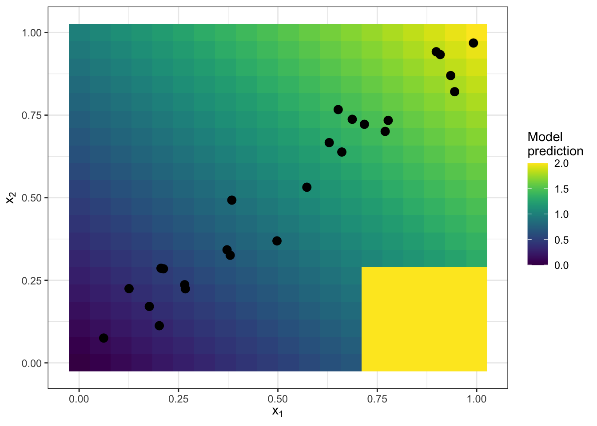
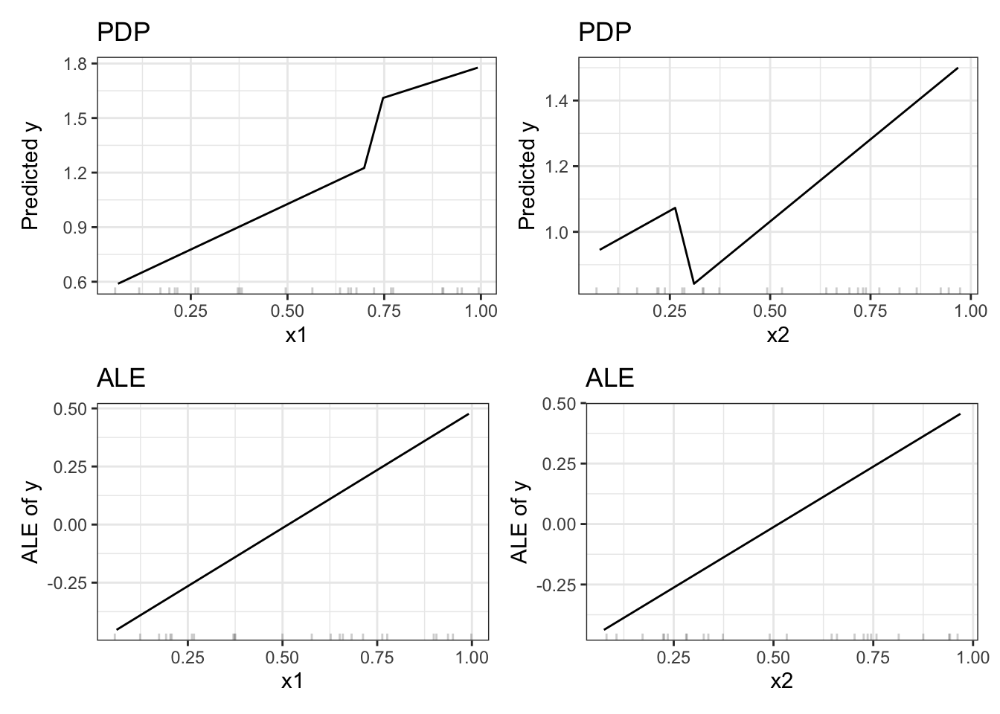
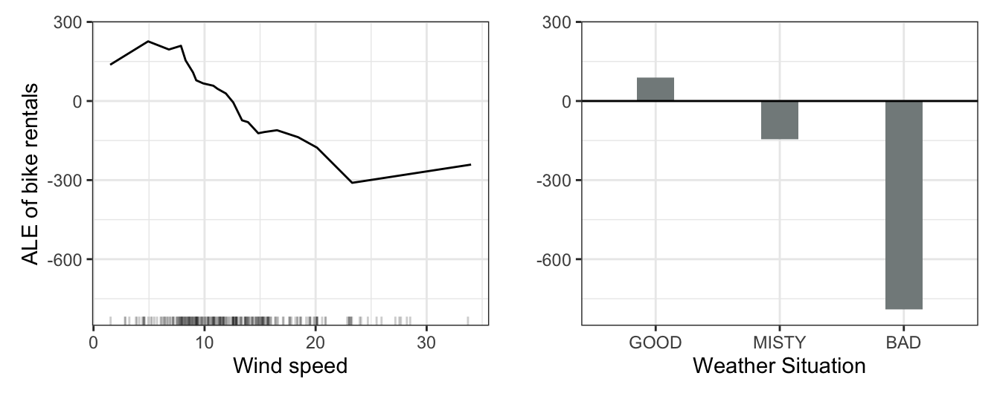
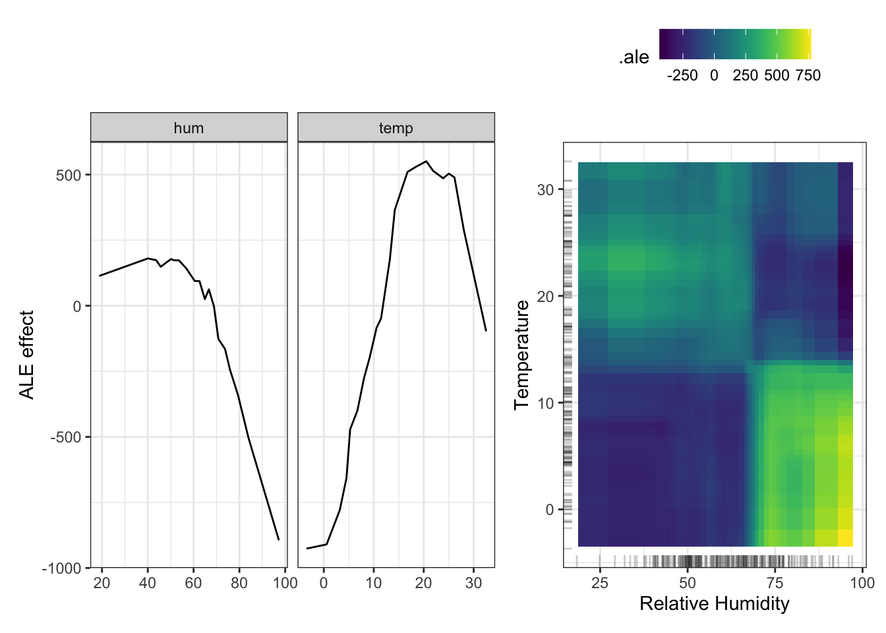
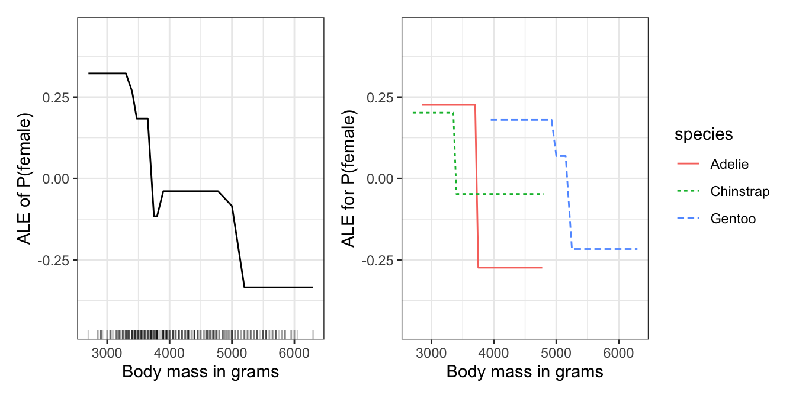

Biriktirilmiş yerel etkiler (*accumulated local effects*, ALE) [@apley2020visualizingeffects], özniteliklerin bir makine öğrenmesi modelinin tahminini ortalamada nasıl etkilediğini betimler.
ALE grafikleri, kısmi bağımlılık grafiklerine (PDP) göre daha hızlı ve yanlılık içermeyen bir alternatiftir.

Önce [kısmi bağımlılık grafikleri bölümünü](../../19_partial-dependence-plot-%28PDP%29/html/pdp.html) okumanızı öneririm; çünkü PDP'leri anlamak daha kolaydır ve iki yöntemin amacı aynıdır:
İkisi de bir özniteliğin tahmini ortalamada nasıl etkilediğini betimler.
Aşağıdaki bölümde sizi, öznitelikler korelasyonlu olduğunda kısmi bağımlılık grafiklerinin ciddi bir sorunu olduğuna ikna etmek istiyorum.

## Motivasyon ve sezgi

Bir makine öğrenmesi modelinin öznitelikleri korelasyonluysa, kısmi bağımlılık grafiğine güvenilemez.
Diğer özniteliklerle güçlü korelasyonu olan bir öznitelik için kısmi bağımlılık grafiği hesaplamak, gerçekte pek olası olmayan yapay veri örneklerinin tahminlerinin ortalamasını almayı içerir.
Bu da tahmin edilen öznitelik etkisini büyük ölçüde yanlı hâle getirebilir.
Bir evin değerini oda sayısına ve yaşam alanının büyüklüğüne göre tahmin eden bir makine öğrenmesi modeli için kısmi bağımlılık grafikleri hesapladığınızı düşünün.
Yaşam alanının tahmin edilen değer üzerindeki etkisiyle ilgileniyoruz.
Hatırlatmak gerekirse kısmi bağımlılık grafiğinin tarifi şöyledir: 1) Özniteliği seç.
2) Izgarayı tanımla.
3) Her ızgara değeri için: a) Özniteliği ızgara değeriyle değiştir ve b) tahminlerin ortalamasını al.
4) Eğriyi çiz.
PDP'nin ilk ızgara değerini, diyelim 30 m^2^'yi hesaplarken **tüm** örneklerde yaşam alanını 30 m^2^ ile değiştiririz; 10 odalı evlerde bile.
Bu bana çok alışılmadık bir ev gibi geliyor.
Kısmi bağımlılık grafiği bu gerçek dışı evleri öznitelik etkisinin tahminine katar ve her şey yolundaymış gibi davranır.
@fig-aleplot-motivation1, iki korelasyonlu özniteliği ve kısmi bağımlılık grafiği yönteminin nasıl olup da olası olmayan örneklerin tahminlerinin ortalamasını aldığını göstermektedir.

{#fig-aleplot-motivation1 width=85%}

Özniteliklerin korelasyonuna saygı gösteren bir öznitelik etkisi tahminini nasıl elde edebiliriz?
Özniteliğin koşullu dağılımı üzerinden ortalama alabiliriz; yani $X_1$'in bir ızgara değerinde, $X_1$ için benzer bir değere sahip örneklerin tahminlerinin ortalamasını alırız.
Koşullu dağılımı kullanarak öznitelik etkilerini hesaplayan çözüme Marjinal Grafikler ya da M-Grafikleri (*M-Plots*) denir (kafa karıştırıcı bir ad; çünkü marjinal değil, koşullu dağılıma dayanırlar).
Durun, size ALE grafiklerinden bahsedeceğime söz vermemiş miydim?
M-Grafikleri aradığımız çözüm değildir.
M-Grafikleri neden sorunumuzu çözmez?
Yaklaşık 30 m^2^ olan tüm evlerin tahminlerinin ortalamasını alırsak, korelasyonları nedeniyle yaşam alanı ile oda sayısının **birleşik** etkisini tahmin etmiş oluruz.
Yaşam alanının evin tahmin edilen değeri üzerinde hiçbir etkisi olmadığını, yalnızca oda sayısının etkisi olduğunu varsayalım.
M-Grafiği yine de yaşam alanının büyüklüğünün tahmin edilen değeri artırdığını gösterirdi; çünkü oda sayısı yaşam alanıyla birlikte artar.
@fig-aleplot-motivation2, iki korelasyonlu öznitelik için M-Grafiklerinin nasıl çalıştığını göstermektedir.

{#fig-aleplot-motivation2 width=85%}

M-Grafikleri olası olmayan veri örneklerinin tahminlerinin ortalamasını almaktan kaçınır, ancak bir özniteliğin etkisini onunla korelasyonlu tüm özniteliklerin etkileriyle karıştırır.
ALE grafikleri bu sorunu, yine özniteliklerin koşullu dağılımına dayanarak, **ortalamalar yerine tahminlerdeki farkları** hesaplayarak çözer.
Yaşam alanının 30 m^2^'deki etkisi için ALE yöntemi, yaklaşık 30 m^2^ olan tüm evleri kullanır; bu evler 31 m^2^ olsaydı modelin vereceği tahminden, 29 m^2^ olsaydı vereceği tahmini çıkarır.
Bu bize yaşam alanının saf etkisini verir ve bu etkiyi korelasyonlu özniteliklerin etkileriyle karıştırmaz.
Farkların kullanılması, diğer özniteliklerin etkisini engeller.
@fig-aleplot-computation, ALE grafiklerinin nasıl hesaplandığına dair bir sezgi sunmaktadır.

{#fig-aleplot-computation width=85%}

Her bir grafik türünün (PDP, M, ALE) bir özniteliğin belirli bir ızgara değeri $v$'deki etkisini nasıl hesapladığını özetlemek gerekirse:

- **Kısmi Bağımlılık Grafikleri**: "Her veri örneği o öznitelik için $v$ değerine sahip olduğunda modelin ortalamada ne tahmin ettiğini size göstereyim. $v$ değerinin tüm veri örnekleri için anlamlı olup olmadığını görmezden geliyorum."
- **M-Grafikleri**: "O öznitelik için $v$'ye yakın değerlere sahip veri örneklerinde modelin ortalamada ne tahmin ettiğini size göstereyim. Etki o öznitelikten kaynaklanıyor olabilir, ama korelasyonlu özniteliklerden de kaynaklanıyor olabilir."
- **ALE grafikleri**: "Özniteliğin $v$ etrafındaki küçük bir 'pencerede', o pencerede bulunan veri örnekleri için model tahminlerinin nasıl değiştiğini size göstereyim."

## Teori

PDP, M-grafiği ve ALE grafiği matematiksel olarak nasıl farklılaşır?
Üç yöntemin ortak noktası, karmaşık tahmin fonksiyonu $\hat{f}$'yi yalnızca bir (ya da iki) özniteliğe bağlı bir fonksiyona indirgemeleridir.
Üç yöntem de fonksiyonu diğer özniteliklerin etkilerinin ortalamasını alarak indirger; ancak tahminlerin mi yoksa **tahminlerdeki farkların** mı ortalamasının alındığı ve ortalamanın marjinal dağılım üzerinden mi yoksa koşullu dağılım üzerinden mi alındığı konusunda ayrışırlar.

Kısmi bağımlılık grafikleri, tahminlerin marjinal dağılım üzerinden ortalamasını alır.

$$
\begin{aligned}
\hat{f}_{S,PDP}(\mathbf{x}_S) &= \mathbb{E}_{X_C}[\hat{f}(\mathbf{x}_S,X_C)] \\
&= \int_{X_C}\hat{f}(\mathbf{x}_S,X_C)d\mathbb{P}(X_C)
\end{aligned}
$$

Bu, tahmin fonksiyonu $f$'nin $\mathbf{x}_S$ öznitelik değer(ler)indeki değerinin, $X_C$'deki tüm öznitelikler (burada rastlantı değişkenleri olarak ele alınmaktadır) üzerinden alınmış ortalamasıdır.
Ortalama almak, $C$ kümesindeki öznitelikler üzerinden marjinal beklenen değer $\mathbb{E}$'yi hesaplamak demektir; bu da tahminlerin olasılık dağılımıyla ağırlıklandırılmış integralidir.
Kulağa süslü geliyor, ancak marjinal dağılım üzerinden beklenen değeri hesaplamak için tüm veri örneklerimizi alır, $S$ kümesindeki öznitelikler için belirli bir ızgara değerine sahip olmaya zorlar ve bu değiştirilmiş veri setinin tahminlerinin ortalamasını alırız.
Bu yöntem, özniteliklerin marjinal dağılımı üzerinden ortalama almamızı sağlar.

M-grafikleri, tahminlerin koşullu dağılım üzerinden ortalamasını alır.

$$
\begin{aligned}
\hat{f}_{S,M}(\mathbf{x}_S) &= \mathbb{E}_{X_C|X_S}\left[\hat{f}(X_S,X_C)|X_S=\mathbf{x}_S\right] \\
&= \int_{X_C}\hat{f}(x_S, X_C)d\mathbb{P}(X_C|X_S = \mathbf{x}_S)
\end{aligned}
$$

PDP'lere kıyasla değişen tek şey, her ızgara değerinde marjinal dağılımı varsaymak yerine, tahminlerin ilgilenilen özniteliğin her ızgara değerine koşullu olarak ortalamasını almamızdır.
Uygulamada bu, bir komşuluk tanımlamamız gerektiği anlamına gelir; örneğin 30 m^2^'nin tahmin edilen ev değeri üzerindeki etkisini hesaplamak için 28 ile 32 m^2^ arasındaki tüm evlerin tahminlerinin ortalamasını alabiliriz.

ALE grafikleri, tahminlerdeki değişimlerin ortalamasını alır ve bunları ızgara boyunca biriktirir (hesaplamaya ilişkin ayrıntılar ileride).

$$
\begin{aligned}
\hat{f}_{S,ALE}(\mathbf{x}_S) = & \int_{\mathbf{z}_{0,S}}^{\mathbf{x}_S} \mathbb{E}_{X_C|X_S = \mathbf{x}_S} \left[\hat{f}^S(X_S,X_C)|X_S = \mathbf{z}_S\right] d \mathbf{z}_S-\text{sabit} \\
=& \int_{\mathbf{z}_{0,S}}^{\mathbf{x}_S}\left(\int_{\mathbf{x}_C}\hat{f}^S(\mathbf{z}_S,X_C)d\mathbb{P}(X_C|X_S = \mathbf{z}_S)\right) d \mathbf{z}_S-\text{sabit}
\end{aligned}
$$

Formül, M-grafiklerine kıyasla üç farkı ortaya koyar.
Birincisi, tahminlerin kendisinin değil, tahminlerdeki değişimlerin ortalamasını alırız.
Değişim, kısmi türev olarak tanımlanır (ancak daha sonra, fiilî hesaplamada, bir aralık üzerindeki tahmin farklarıyla değiştirilir).

$$\hat{f}^S(\mathbf{x}_S,\mathbf{x}_C)=\frac{\partial\hat{f}(\mathbf{x}_S,\mathbf{x}_C)}{\partial \mathbf{x}_S}$$

İkinci fark, $\mathbf{z}$ üzerindeki ek integraldir.
Yerel kısmi türevleri S kümesindeki özniteliklerin aralığı boyunca biriktiririz; bu da bize özniteliğin tahmin üzerindeki etkisini verir.
Fiilî hesaplamada $z$'ler, tahmindeki değişimleri hesapladığımız bir aralıklar ızgarasıyla değiştirilir.
ALE yöntemi, tahminlerin ortalamasını doğrudan almak yerine, tahmin farklarını S özniteliklerine koşullu olarak hesaplar ve etkiyi tahmin etmek için türevin S öznitelikleri üzerinden integralini alır.
Bu kulağa saçma geliyor.
Türev alma ve integral alma genellikle birbirini götürür; önce aynı sayıyı çıkarıp sonra eklemek gibi.
Burada neden anlamlıdır?
Türev (ya da aralık farkı), ilgilenilen özniteliğin etkisini yalıtır ve korelasyonlu özniteliklerin etkisini engeller.

ALE grafiklerinin M-grafiklerinden üçüncü farkı, sonuçlardan bir sabit çıkarmamızdır.
Bu adım ALE grafiğini, veri üzerindeki ortalama etki sıfır olacak şekilde merkezler.

Bir sorun kalıyor: Her model bir gradyanla birlikte gelmez; örneğin rastgele ormanların açık bir gradyanı yoktur.
Ancak göreceğiniz gibi, fiilî hesaplama gradyan olmadan, aralıklar kullanarak çalışır.
Şimdi ALE grafiklerinin tahminine biraz daha derinlemesine bakalım.

## Tahmin

Önce ALE grafiklerinin tek bir sayısal öznitelik için nasıl tahmin edildiğini, ardından iki sayısal öznitelik ve tek bir kategorik öznitelik için nasıl tahmin edildiğini anlatacağım.
Yerel etkileri tahmin etmek için özniteliği çok sayıda aralığa böler ve tahminlerdeki farkları hesaplarız.
Bu yöntem türevlere yaklaşır ve türevi olmayan modellerde de çalışır.

Önce merkezlenmemiş etkiyi tahmin ederiz:

$$\hat{\tilde{f}}_{j,ALE}(\mathbf{x}) = \sum_{k=1}^{k_j(\mathbf{x})} \frac{1}{n_j(k)} \sum_{i: x_j^{(i)} \in N_j(k)} \left[\hat{f}(z_{k,j}, \mathbf{x}^{(i)}_{-j}) - \hat{f}(z_{k-1,j}, \mathbf{x}^{(i)}_{-j})\right]$$

Bu formülü sağ taraftan başlayarak parçalarına ayıralım.
**Biriktirilmiş Yerel Etkiler** (*Accumulated Local Effects*) adı, bu formülün tüm bileşenlerini güzel bir şekilde yansıtır.
ALE yöntemi özünde, ilgilenilen özniteliği $z$ ızgara değerleriyle değiştirerek tahminlerdeki farkları hesaplar.
Tahmindeki fark, özniteliğin belirli bir aralıktaki tek bir örnek için **Etki**sidir (*Effect*).
Sağdaki toplam, bir aralık içindeki tüm örneklerin etkilerini toplar; bu aralık formülde $N_j(k)$ komşuluğu olarak görünür.
Bu toplamı aralıktaki örnek sayısına bölerek o aralık için tahminlerin ortalama farkını elde ederiz.
Aralık içindeki bu ortalama, ALE adındaki **Yerel** (*Local*) terimine karşılık gelir.
Soldaki toplam sembolü, ortalama etkileri tüm aralıklar boyunca biriktirdiğimiz anlamına gelir.
Örneğin üçüncü aralıkta yer alan bir öznitelik değerinin (merkezlenmemiş) ALE'si, birinci, ikinci ve üçüncü aralıkların etkilerinin toplamıdır.
ALE'deki **Biriktirilmiş** (*Accumulated*) sözcüğü bunu yansıtır.

Bu etki, ortalama etki sıfır olacak şekilde merkezlenir.

$$\hat{f}_{j,ALE}(\mathbf{x}) = \hat{\tilde{f}}_{j,ALE}(\mathbf{x}) - \frac{1}{n} \sum_{i=1}^{n} \hat{\tilde{f}}_{j,ALE}(x_j^{(i)})$$

ALE'nin değeri, özniteliğin belirli bir değerdeki ana etkisinin, verinin ortalama tahminiyle karşılaştırılması olarak yorumlanabilir.
Örneğin $x^{(i)}_j = 3$'te -2'lik bir ALE tahmini, $j$. öznitelik 3 değerini aldığında tahminin ortalama tahmine göre 2 daha düşük olduğu anlamına gelir.

Aralıkları tanımlayan ızgara olarak özniteliğin dağılımının yüzdelikleri (kantilleri) kullanılır.
Yüzdeliklerin kullanılması, her aralıkta aynı sayıda veri örneği bulunmasını sağlar.
Yüzdeliklerin dezavantajı, aralıkların uzunluklarının birbirinden çok farklı olabilmesidir.
Bu, ilgilenilen öznitelik çok çarpıksa, örneğin çok sayıda düşük değer ve yalnızca birkaç çok yüksek değer varsa, bazı tuhaf ALE grafiklerine yol açabilir.

**İki özniteliğin etkileşimi için ALE grafikleri**

ALE grafikleri iki özniteliğin etkileşim etkisini de gösterebilir.
Hesaplama ilkeleri tek bir öznitelikteki ile aynıdır; ancak etkileri iki boyutta biriktirmemiz gerektiğinden aralıklar yerine dikdörtgen hücrelerle çalışırız.
Genel ortalama etkiye göre düzeltmeye ek olarak, her iki özniteliğin ana etkilerine göre de düzeltme yaparız.
Bu, iki öznitelik için ALE'nin, özniteliklerin ana etkilerini içermeyen ikinci dereceden etkiyi tahmin ettiği anlamına gelir.
Başka bir deyişle, iki öznitelik için ALE yalnızca iki özniteliğin ek etkileşim etkisini gösterir.
İki boyutlu ALE grafiklerinin formüllerini size göstermeyeceğim; çünkü uzun ve okuması nahoştur.
Hesaplamayla ilgileniyorsanız sizi @apley2020visualizingeffects makalesindeki (13)–(16) numaralı formüllere yönlendiriyorum.
İkinci dereceden ALE hesaplamasına ilişkin sezgi geliştirmek için görselleştirmelere başvuracağım.

{width=85%}

Önceki şekilde korelasyon nedeniyle birçok hücre boştur.
ALE grafiğinde bu durum grileştirilmiş ya da koyulaştırılmış bir kutuyla görselleştirilebilir.
Bunun yerine, boş bir hücrenin eksik ALE tahmini, en yakın boş olmayan hücrenin ALE tahminiyle de değiştirilebilir.

İki öznitelik için ALE tahminleri yalnızca özniteliklerin ikinci dereceden etkisini gösterdiğinden, yorumlanmaları özel dikkat gerektirir.
İkinci dereceden etki, özniteliklerin ana etkileri hesaba katıldıktan sonra kalan ek etkileşim etkisidir.
İki özniteliğin etkileşmediğini, ancak her birinin tahmin edilen sonuç üzerinde doğrusal bir etkisi olduğunu varsayalım.
Her özniteliğin tek boyutlu ALE grafiğinde, tahmin edilen ALE eğrisi olarak düz bir çizgi görürdük.
Ancak iki boyutlu ALE tahminlerini çizdiğimizde, bunların sıfıra yakın olması gerekir; çünkü ikinci dereceden etki yalnızca etkileşimin ek etkisidir.
ALE grafikleri ile PD grafikleri bu bakımdan farklılaşır: PDP'ler her zaman toplam etkiyi gösterirken, ALE grafikleri birinci ya da ikinci dereceden etkiyi gösterir.
Bunlar, alttaki matematiğe bağlı olmayan tasarım kararlarıdır.
Saf ana etkileri ya da ikinci dereceden etkileri elde etmek için bir kısmi bağımlılık grafiğinden daha düşük dereceli etkileri çıkarabilirsiniz; ya da daha düşük dereceli etkileri çıkarmaktan vazgeçerek toplam ALE grafiklerinin bir tahminini elde edebilirsiniz.

Biriktirilmiş yerel etkiler keyfi olarak daha yüksek dereceler için de (üç ya da daha fazla özniteliğin etkileşimleri) hesaplanabilir; ancak [PDP bölümünde](../../19_partial-dependence-plot-%28PDP%29/html/pdp.html) tartışıldığı gibi, yalnızca iki özniteliğe kadarı anlamlıdır; çünkü daha yüksek etkileşimler görselleştirilemez, hatta anlamlı biçimde yorumlanamaz.

**Kategorik öznitelikler için ALE**

Biriktirilmiş yerel etkiler yöntemi, tanımı gereği öznitelik değerlerinin bir sıraya sahip olmasını gerektirir; çünkü yöntem etkileri belirli bir yönde biriktirir.
Kategorik özniteliklerin doğal bir sırası yoktur.
Kategorik bir öznitelik için ALE grafiği hesaplamak amacıyla bir şekilde bir sıra oluşturmamız ya da bulmamız gerekir.
Kategorilerin sırası, biriktirilmiş yerel etkilerin hesaplanmasını ve yorumlanmasını etkiler.

Çözümlerden biri, kategorileri diğer özniteliklere dayalı benzerliklerine göre sıralamaktır.
İki kategori arasındaki uzaklık, her bir özniteliğe ilişkin uzaklıkların toplamıdır.
Öznitelik bazındaki uzaklık, iki kategorideki ya birikimli dağılımları (sayısal öznitelikler için; Kolmogorov-Smirnov uzaklığı olarak da bilinir) ya da göreli frekans tablolarını (kategorik öznitelikler için) karşılaştırır.
Tüm kategoriler arasındaki uzaklıkları elde ettikten sonra, uzaklık matrisini tek boyutlu bir uzaklık ölçüsüne indirgemek için çok boyutlu ölçekleme kullanırız.
Bu bize kategorilerin benzerliğe dayalı bir sırasını verir.

Bunu biraz daha netleştirmek için bir örnek:
"Mevsim" ve "hava durumu" adlı iki kategorik özniteliğimiz ve "sıcaklık" adlı sayısal bir özniteliğimiz olduğunu varsayalım.
Birinci kategorik öznitelik (mevsim) için ALE'leri hesaplamak istiyoruz.
Özniteliğin kategorileri "ilkbahar", "yaz", "sonbahar" ve "kış"tır.
İşe "ilkbahar" ile "yaz" kategorileri arasındaki uzaklığı hesaplayarak başlarız.
Uzaklık, sıcaklık ve hava durumu öznitelikleri üzerindeki uzaklıkların toplamıdır.
Sıcaklık için, mevsimi "ilkbahar" olan tüm örnekleri alır, ampirik birikimli dağılım fonksiyonunu hesaplarız; aynı işlemi mevsimi "yaz" olan örnekler için de yapar ve aralarındaki uzaklığı Kolmogorov-Smirnov istatistiğiyle ölçeriz.
Hava durumu özniteliği için, tüm "ilkbahar" örneklerinde her bir hava durumu türünün olasılıklarını hesaplar, aynısını "yaz" örnekleri için de yapar ve olasılık dağılımındaki mutlak uzaklıkları toplarız.
"İlkbahar" ve "yaz" çok farklı sıcaklıklara ve hava durumlarına sahipse, toplam kategori uzaklığı büyük olur.
Bu işlemi diğer mevsim çiftleri için tekrarlar ve ortaya çıkan uzaklık matrisini çok boyutlu ölçekleme ile tek bir boyuta indirgeriz.

::: {.callout-tip}

# Kategorilerin doğal sırasından yararlanın

Kategorik bir özniteliğin kategorilerinin anlamlı bir sırası varsa, ALE için bu sırayı kullanın.

:::

## ALE ile PDP'nin karşılaştırılması

ALE grafiklerini iş başında görelim.
Kısmi bağımlılık grafiklerinin başarısız olduğu bir senaryo kurguladım.
@fig-correlation-problem, bir tahmin modelinden ve güçlü biçimde korelasyonlu iki öznitelikten oluşan senaryoyu göstermektedir.
Tahmin modeli çoğunlukla bir doğrusal regresyon modelidir; ancak iki özniteliğin hiç örnek gözlemlemediğimiz bir birleşiminde tuhaf bir şey yapar.
Bu "tuhaf" bölge, veri dağılımından (nokta bulutundan) uzaktadır ve modelin performansını etkilemez; tartışmaya açık olmakla birlikte, modelin yorumunu da etkilememelidir.

{#fig-correlation-problem}

Bu gerçekçi, anlamlı bir senaryo mu?
Bir modeli eğittiğinizde, öğrenme algoritması mevcut eğitim verisi örnekleri için kaybı en aza indirir.
Eğitim verisinin dağılımının dışında tuhaf şeyler olabilir; çünkü model bu bölgelerde tuhaf şeyler yaptığı için cezalandırılmaz.
Veri dağılımının dışına çıkmaya dışkestirim (*extrapolation*) denir; [çekişmeli örnekler bölümünde](../../30_adversarial_examples/ceviri/talhakaraca-20259267001.html) anlatıldığı gibi bu, makine öğrenmesi modellerini kandırmak için de kullanılabilir.
@fig-correlation-pdp-ale-plot, kısmi bağımlılık grafiklerinin ALE grafiklerine kıyasla nasıl davrandığını göstermektedir.
PDP tahminleri, modelin veri dağılımı dışındaki tuhaf davranışından etkilenir (grafiklerdeki dik sıçramalar).
ALE grafikleri ise makine öğrenmesi modelinin öznitelikler ile tahminler arasında doğrusal bir ilişkiye sahip olduğunu, verinin olmadığı bölgeleri görmezden gelerek doğru biçimde belirler.

{#fig-correlation-pdp-ale-plot}

Peki modelimizin $x_1 > 0.7$ ve $x_2 < 0.3$ bölgesinde tuhaf davrandığını görmek ilginç değil mi?
Hem evet hem hayır. Bunlar fiziksel olarak imkânsız ya da en azından son derece olası olmayan veri örnekleri olabileceğinden, bu örnekleri incelemek genellikle önemsizdir.
Ancak test dağılımınızın biraz farklı olabileceğinden ve bazı örneklerin gerçekten bu aralıkta bulunabileceğinden şüpheleniyorsanız, bu bölgeyi öznitelik etkilerinin hesaplanmasına dahil etmek ilginç olurdu.
Fakat henüz veri gözlemlemediğimiz bölgeleri dahil etmek bilinçli bir karar olmalıdır; PDP gibi seçilen yöntemin bir yan etkisi olmamalıdır.
Modelin ileride farklı dağılıma sahip verilerle kullanılacağından şüpheleniyorsanız, ALE grafiklerini kullanmanızı ve beklediğiniz veri dağılımını simüle etmenizi öneririm.

::: {.callout-tip}

# Hem PDP hem ALE üretin

Kişisel bir gözlem: Kendi uygulamalarımda, korelasyona rağmen ALE ve PDP grafikleri birbirine oldukça benziyordu.
Korelasyon yorumlanabilirliği bozabilir, ancak bozmak zorunda değildir.
ALE ve PDP korelasyonlu bir öznitelik için aynı eğriyi gösteriyorsa, yorumu daha basit olduğu için PDP'yi yorumlayın.

:::

## Örnekler

Gerçek bir veri setine geçelim: Hava durumuna ve güne göre [kiralanan bisiklet sayısını](../../05_data-and-models/ceviri/martin-5.html) tahmin edelim ve ALE grafiklerinin gerçekten vaat edildiği kadar iyi çalışıp çalışmadığına bakalım.
Kiralanan bisiklet sayısını tahmin etmek için bir rastgele orman eğitiriz ve rüzgâr hızı ile hava durumunun tahminleri nasıl etkilediğini analiz etmek için ALE grafiklerini kullanırız.

@fig-ale-bike (sol), artan rüzgâr hızının bisiklet kiralamaları üzerinde negatif bir etkisi olduğunu göstermektedir.
Hava durumunda (sağ) ise özellikle kötü havanın kiralanan bisiklet sayısı üzerinde güçlü bir negatif etkisi olduğunu görüyoruz.
Her iki etki de alan bilgisiyle örtüşmektedir; bu iyi bir işarettir.

{#fig-ale-bike}

Ardından nem ile sıcaklığın etkilerini ve bunların etkileşiminin tahmin edilen bisiklet sayısı üzerindeki etkisini ele alıyoruz.
İkinci dereceden etkinin, iki özniteliğin ek etkileşim etkisi olduğunu ve ana etkileri içermediğini hatırlayın.
Bu, örneğin yüksek nemin ortalamada daha düşük bir tahmin edilen bisiklet sayısına yol açtığı ana etkiyi ikinci dereceden ALE grafiğinde görmeyeceğiniz anlamına gelir.
@fig-ale-bike-2d hem sıcaklık ile nemin ana etkilerini hem de bunların etkileşimini göstermektedir.
Grafik bir etkileşimi ortaya koyuyor: Soğuk ve nemli hava tahmini artırıyor.
Nem ve sıcaklığın her iki ana etkisinin de çok soğuk ve nemli havada tahmin edilen bisiklet sayısının azaldığını söylediğini unutmayın.
Dolayısıyla soğuk ve nemli havada sıcaklık ile nemin birleşik etkisi, ana etkilerin toplamı değil, toplamdan daha büyüktür.

{#fig-ale-bike-2d}

İki ana etkiyi ve ortalama tahmini üzerine ekleyerek toplam etkileşim etkisini de elde edebilirsiniz.
Yalnızca etkileşimle ilgileniyorsanız ikinci dereceden etkilere bakmalısınız; çünkü toplam etki ana etkileri de grafiğe karıştırır.
Ancak özniteliklerin birleşik etkisini bilmek istiyorsanız toplam etkiye bakmalısınız.
Bununla birlikte, iki özniteliğin hiç etkileşmediği bir senaryoda iki özniteliğin toplam etkisi yanıltıcı olabilir; çünkü muhtemelen bir etkileşim varmış izlenimi veren karmaşık bir yüzey gösterir, oysa bu yüzey yalnızca iki ana etkinin çarpımından ibarettir.
Saf ikinci dereceden etki ise hiçbir etkileşim olmadığını hemen gösterirdi.

Bisikletler bu kadar yeter; şimdi bir sınıflandırma görevine geçelim.
Vücut ölçülerine dayanarak $\mathbb{P}(Y = \text{dişi})$'yi tahmin etmek için bir rastgele orman eğitiyoruz.
Vücut ağırlığı bir penguenin dişi olma olasılığını nasıl etkiler?
@fig-ale-penguin (sol), vücut kütlesinin ALE grafiğini görselleştirmektedir.
Penguen ne kadar ağırsa dişi olma olasılığı o kadar düşüktür.
Ancak ALE grafiklerini türlere göre görselleştirdiğimizde daha iyi bir resim elde ederiz (@fig-ale-penguin, sağ).
Her türün, üzerindeki vücut kütlesinin erkek penguenler için daha tipik olduğu belirgin bir kesim noktası vardır.
Genel olarak etkiler, [PDP bölümündeki](../../19_partial-dependence-plot-%28PDP%29/html/pdp.html) PDP'lere oldukça benzerdir.

{#fig-ale-penguin}

## Güçlü yönler

**ALE grafikleri yanlı değildir**, yani öznitelikler korelasyonlu olduğunda da çalışırlar.
Kısmi bağımlılık grafikleri bu senaryoda başarısız olur; çünkü öznitelik değerlerinin olası olmayan, hatta fiziksel olarak imkânsız birleşimleri üzerinden marjinalleştirirler.

**ALE grafiklerinin hesaplanması PDP'lerden daha hızlıdır** ve O(n) ile ölçeklenir; çünkü olası en büyük aralık sayısı örnek sayısına eşittir, yani her örnek için bir aralık.
PDP, n çarpı ızgara noktası sayısı kadar tahmin gerektirir.
20 ızgara noktası için PDP'ler, örnek sayısı kadar aralığın kullanıldığı en kötü durumdaki ALE grafiğinden 20 kat daha fazla tahmin gerektirir.

ALE grafiklerinin (yerel) **yorumu açıktır**: Belirli bir değere koşullu olarak, özniteliği değiştirmenin tahmin üzerindeki göreli etkisi ALE grafiğinden okunabilir.
**ALE grafikleri sıfır etrafında merkezlenmiştir**.
Bu da yorumlarını kolaylaştırır; çünkü ALE eğrisinin her noktasındaki değer, ortalama tahminden farktır.
**İki boyutlu ALE grafiği yalnızca etkileşimi gösterir**:
İki öznitelik etkileşmiyorsa grafik hiçbir şey göstermez.

Tahmin fonksiyonunun tamamı, [fonksiyonel ayrıştırma](../../22_functional-decomposition/ceviri/yusuf-kaan-sa%C3%A7l%C4%B1-20269258011.html) bölümünde açıklandığı gibi, **daha düşük boyutlu ALE fonksiyonlarının toplamına ayrıştırılabilir**.

Sonuç olarak, çoğu durumda **ALE grafiklerini PDP'lere tercih ederim**; çünkü öznitelikler genellikle bir ölçüde korelasyonludur.

## Sınırlılıklar

Öznitelikler güçlü biçimde korelasyonluysa **etkinin aralıklar arasında yorumlanması caiz değildir**.
Özniteliklerinizin yüksek düzeyde korelasyonlu olduğu ve tek boyutlu bir ALE grafiğinin sol ucuna baktığınız durumu düşünün.
ALE eğrisi şu yanlış yoruma davetiye çıkarabilir:
"ALE eğrisi, bir veri örneğinin ilgili öznitelik değerini kademeli olarak değiştirip örneğin diğer öznitelik değerlerini sabit tuttuğumuzda, tahminin ortalamada nasıl değiştiğini gösterir."
Etkiler aralık bazında (yerel olarak) hesaplanır; dolayısıyla etkinin yorumu da yalnızca yerel olabilir.
Kolaylık olsun diye aralık bazındaki etkiler düzgün bir eğri gösterecek şekilde biriktirilir; ancak her aralığın farklı veri örnekleriyle oluşturulduğunu aklınızda tutun.

Öznitelikler etkileşiyor ve korelasyonluysa, ALE etkileri **bir doğrusal regresyon modelinde belirtilen katsayılardan farklı olabilir**.
@gromping2020model, iki korelasyonlu öznitelik ve ek bir etkileşim terimi içeren bir doğrusal modelde ($\hat{f}(x) = \beta_0 + \beta_1 x_1 + \beta_2 x_2 + \beta_3 x_1 x_2$) birinci dereceden ALE grafiklerinin düz bir çizgi göstermediğini ortaya koymuştur.
Bunun yerine grafikler hafifçe eğridir; çünkü özniteliklerin çarpımsal etkileşiminin bir kısmını içerirler.
Burada neler olduğunu anlamak için [fonksiyonel ayrıştırma](../../22_functional-decomposition/ceviri/yusuf-kaan-sa%C3%A7l%C4%B1-20269258011.html) bölümünü okumanızı öneririm.
Kısacası ALE, birinci dereceden (ya da tek boyutlu) etkileri doğrusal formülün betimlediğinden farklı tanımlar.
Bu mutlaka yanlış değildir; çünkü öznitelikler korelasyonlu olduğunda etkileşimlerin kime atfedileceği o kadar net değildir.
Ancak ALE ile doğrusal katsayıların örtüşmemesi kesinlikle sezgiye aykırıdır.

Aralık sayısı yüksek olduğunda **ALE grafikleri biraz titrek hâle gelebilir** (çok sayıda küçük iniş çıkış).
Bu durumda aralık sayısını azaltmak tahminleri daha kararlı hâle getirir, ancak tahmin modelinin gerçek karmaşıklığının bir kısmını da düzleştirip gizler.
**Aralık sayısını belirlemek için kusursuz bir çözüm yoktur**.
Sayı çok küçükse ALE grafikleri çok isabetli olmayabilir.
Sayı çok büyükse eğri titrek hâle gelebilir.
Düzgünlük ile isabet arasında bir denge kurmak için @gkolemis2023rhale, aralıkların içindeki yerel etkiler görece sabit kaldığı sürece (modelin gerçek karmaşıklığını korumak için) aralıkları kademeli olarak genişleten (daha kararlı tahminler için) otomatik bir aralık bölme yaklaşımı önermiştir.

PDP'lerden farklı olarak **ALE grafiklerine ICE eğrileri eşlik etmez**.
PDP'ler için ICE eğrileri harikadır; çünkü öznitelik etkisindeki heterojenliği, yani bir özniteliğin etkisinin verinin alt kümelerinde farklı görünmesini ortaya çıkarabilirler.
ALE grafiklerinde ise yalnızca aralık bazında etkinin örnekler arasında farklı olup olmadığını kontrol edebilirsiniz; ancak her aralıkta farklı örnekler bulunduğundan bu, ICE eğrileriyle aynı şey değildir.

**İkinci dereceden ALE tahminlerinin kararlılığı öznitelik uzayı boyunca değişir ve bu hiçbir şekilde görselleştirilmez.**
Bunun nedeni, bir hücredeki yerel etkinin her tahmininin farklı sayıda veri örneği kullanmasıdır.
Sonuç olarak tüm tahminlerin isabeti birbirinden farklıdır (ancak yine de mümkün olan en iyi tahminlerdir).
Bu sorun, ana etki ALE grafiklerinde daha hafif bir biçimde vardır.
Izgara olarak yüzdeliklerin kullanılması sayesinde tüm aralıklarda örnek sayısı aynıdır; ancak bazı bölgelerde çok sayıda kısa aralık olacak ve ALE eğrisi o bölgelerde çok daha fazla tahminden oluşacaktır.
Eğrinin büyük bir kısmını oluşturabilen uzun aralıklarda ise görece daha az örnek vardır.

**İkinci dereceden etki grafiklerini yorumlamak biraz can sıkıcı olabilir**; çünkü ana etkileri her zaman akılda tutmanız gerekir.
Isı haritalarını iki özniteliğin toplam etkisi gibi okumak caziptir; ancak bunlar yalnızca etkileşimin ek etkisidir.
Saf ikinci dereceden etki, etkileşimleri keşfetmek ve incelemek için ilginçtir; ancak etkinin nasıl göründüğünü yorumlamak için ana etkileri de grafiğe katmanın daha anlamlı olduğunu düşünüyorum.

ALE grafiklerinin **uygulanması**, kısmi bağımlılık grafiklerine kıyasla **çok daha karmaşık** ve daha az sezgiseldir.

ALE grafikleri korelasyonlu öznitelikler durumunda yanlı olmasa da, **öznitelikler güçlü biçimde korelasyonlu olduğunda yorum zor olmaya devam eder**.
Çünkü öznitelikler çok güçlü bir korelasyona sahipse, yalnızca iki özniteliği birlikte değiştirmenin etkisini analiz etmek anlamlıdır, tek başına değiştirmenin etkisini değil.
Bu dezavantaj ALE grafiklerine özgü değildir; güçlü biçimde korelasyonlu özniteliklerin genel bir sorunudur.

Öznitelikler korelasyonsuzsa ve hesaplama süresi sorun değilse, PDP'ler biraz daha tercih edilebilirdir; çünkü anlaşılmaları daha kolaydır ve ICE eğrileriyle birlikte çizilebilirler.

Dezavantajlar listesi oldukça uzadı, ancak kullandığım sözcük sayısına aldanmayın.
Pratik bir kural olarak: Öznitelikler korelasyonlu değilse PDP kullanın.
Öznitelikler korelasyonluysa ancak PDP ve ALE aşağı yukarı aynı eğrileri gösteriyorsa, daha basit olan PDP yorumunu tercih edin.
Öznitelikler korelasyonluysa ve PDP ile ALE farklılaşıyorsa, ALE grafiğini kullanın.

## Yazılım ve alternatifler

[Kısmi bağımlılık grafiklerinin](../../19_partial-dependence-plot-%28PDP%29/html/pdp.html) ve [bireysel koşullu beklenti (ICE) eğrilerinin](../../13_individual_conditional_expectation_ice/ceviri/serapsahin20269348009.html) bir alternatif olduğundan bahsetmiş miydim?
=)

ALE grafikleri R'da, yöntemin mucidinin kendisi tarafından yazılan [ALEPlot R paketinde](https://cran.r-project.org/web/packages/ALEPlot/index.html) ve ayrıca [iml paketinde](https://cran.r-project.org/web/packages/iml/index.html) uygulanmıştır.
ALE'nin birkaç Python uygulaması da vardır: [`effector`](https://github.com/givasile/effector), [ALEPython](https://github.com/blent-ai/ALEPython), [Alibi](https://docs.seldon.io/projects/alibi/en/stable/index.html) ve [PiML](https://selfexplainml.github.io/PiML-Toolbox/_build/html/index.html).

## Kaynaklar {.unnumbered}

::: {#refs}
:::
