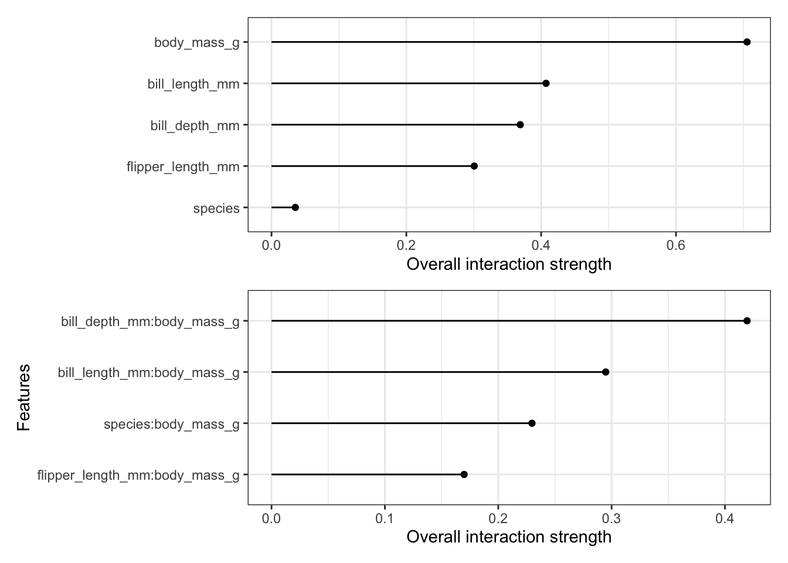
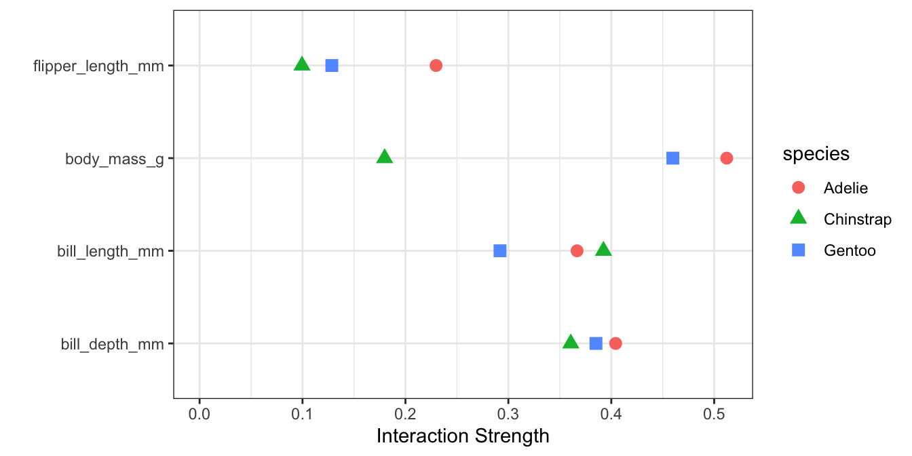

::: {.callout-note}
Bu bölüm, Christoph Molnar'ın *Interpretable Machine Learning* kitabından
(CC BY-NC-SA 4.0) Türkçeye çevrilmiştir.
Orijinal: https://christophm.github.io/interpretable-ml-book/
:::

# Özellik Etkileşimi {#interaction}

<!--  -->

Bir tahmin modelinde özellikler birbirleriyle etkileşime girdiğinde, bir özelliğin etkisi diğer özelliğin değerine bağlı olduğundan, tahmin özellik etkilerinin toplamı olarak ifade edilemez.
Aristoteles'in "Bütün, parçalarının toplamından büyüktür" önermesi, etkileşimlerin varlığında geçerlidir.

## Özellik etkileşimleri nedir?

Bir makine öğrenmesi modeli iki özelliğe dayanarak bir tahmin yapıyorsa, tahmini dört terime ayrıştırabiliriz:
bir sabit terim, birinci özellik için bir terim, ikinci özellik için bir terim ve iki özellik arasındaki etkileşim için bir terim.
İki özellik arasındaki etkileşim, bireysel özellik etkileri dikkate alındıktan sonra özelliklerin değiştirilmesiyle tahminde meydana gelen değişimdir.

Örneğin bir model, özellik olarak ev büyüklüğünü (büyük veya küçük) ve konumu (iyi veya kötü) kullanarak bir evin değerini tahmin etsin; bu durum @tbl-house-price içinde görüldüğü gibi dört olası tahmin üretir.

| Konum | Büyüklük | Tahmin |
|---------:|------:|----------------:|
| iyi      | büyük | 300,000         | 
| iyi      | küçük | 200,000         |
| kötü     | büyük | 250,000         | 
| kötü     | küçük | 150,000         |

: Etkileşim olmadan ev fiyatları için örnek tahminler {#tbl-house-price}

Model tahminini aşağıdaki parçalara ayrıştırırız:
Bir sabit terim (150,000), büyüklük özelliği için bir etki (büyükse +100,000; küçükse +0) ve konum için bir etki (iyiyse +50,000; kötüyse +0).
Bu ayrıştırma, model tahminlerini tamamen açıklar.
Model tahmini, büyüklük ve konuma ait tekil özellik etkilerinin bir toplamı olduğu için herhangi bir etkileşim etkisi yoktur.
Küçük bir evi büyük yaptığınızda, konumdan bağımsız olarak tahmin her zaman 100,000 artar.
Ayrıca, iyi ve kötü bir konum arasındaki tahmin farkı büyüklükten bağımsız olarak 50,000'dir.

Şimdi @tbl-house-price-interaction içindeki etkileşimli bir örneğe bakalım.

| Konum | Büyüklük | Tahmin |
|---------:|------:|----------------:|
| iyi      | büyük | 400,000         | 
| iyi      | küçük | 200,000         |
| kötü     | büyük | 250,000         | 
| kötü     | küçük | 150,000         |


: Etkileşimli ev fiyatları için örnek tahminler {#tbl-house-price-interaction}


Tahmin tablosunu aşağıdaki parçalara ayrıştırırız:
Bir sabit terim (150,000), büyüklük özelliği için bir etki (büyükse +100,000; küçükse +0) ve konum için bir etki (iyiyse +50,000; kötüyse +0).
Bu tablo için etkileşime yönelik ek bir terime ihtiyacımız vardır: ev büyükse ve iyi bir konumdaysa +100,000.
Dolayısıyla iyi bir konumdaki büyük bir ev için şunu elde ederiz: 150,000 (taban) + 50,000 (iyi konum) + 100,000 (büyük) + 100,000 (etkileşim) = 400,000.
Bu durumda büyük ve küçük bir ev arasındaki tahmin farkı konuma bağlı olduğundan, bu durum büyüklük ve konum arasında bir etkileşimdir.

Etkileşim gücünü tahmin etmenin bir yolu, tahmin varyasyonunun ne kadarının özelliklerin etkileşimine bağlı olduğunu ölçmektir.
Bu ölçüm H-istatistiği olarak adlandırılır ve @friedman2008predictive tarafından tanıtılmıştır.


## Friedman'ın H-istatistiği

İki durumu ele alacağız:
Birincisi, modeldeki iki özelliğin birbirleriyle etkileşime girip girmediğini ve ne ölçüde etkileşime girdiğini bize söyleyen ikili etkileşim ölçüsü;
ikincisi ise modeldeki bir özelliğin diğer tüm özelliklerle etkileşime girip girmediğini ve ne ölçüde etkileşime girdiğini bize söyleyen toplam etkileşim ölçüsüdür.
Teorik olarak, herhangi sayıda özellik arasındaki keyfi etkileşimler ölçülebilir, ancak en ilgi çekici durumlar bu ikisidir.

İki özellik etkileşime girmiyorsa, [kısmi bağımlılık fonksiyonunu](#pdp) aşağıdaki gibi ayrıştırabiliriz (kısmi bağımlılık fonksiyonlarının sıfır etrafında merkezlendiğini varsayarak):

$$PD_{jk}(\mathbf{x}_j, \mathbf{x}_k) = PD_j(\mathbf{x}_j) + PD_k(\mathbf{x}_k)$$

burada $PD_{jk}(\mathbf{x}_j, \mathbf{x}_k)$ her iki özelliğin 2 yönlü (ikili) kısmi bağımlılık fonksiyonunu, $PD_j(\mathbf{x}_j)$ ve $PD_k(\mathbf{x}_k)$ ise tekil özelliklerin kısmi bağımlılık fonksiyonlarını temsil eder.

Benzer şekilde, bir özelliğin diğer özelliklerin hiçbiriyle etkileşimi yoksa, $\hat{f}(\mathbf{x})$ tahmin fonksiyonunu kısmi bağımlılık fonksiyonlarının bir toplamı olarak ifade edebiliriz; burada birinci toplanan yalnızca $j$'ye, ikincisi ise $j$ hariç diğer tüm özelliklere bağlıdır:

$$\hat{f}(\mathbf{x}) = PD_j(x_j) + PD_{-j}(\mathbf{x}_{-j})$$

burada $PD_{-j}(\mathbf{x}_{-j})$, $j$'inci özellik dışındaki tüm özelliklere bağlı olan kısmi bağımlılık fonksiyonudur.

Bu ayrıştırma, ($j$ ve $k$ özellikleri arasında veya sırasıyla $j$ ile diğer tüm özellikler arasında) etkileşim olmaksızın kısmi bağımlılık (veya tam tahmin) fonksiyonunu ifade eder.
Bir sonraki adımda, gözlemlenen kısmi bağımlılık fonksiyonu ile etkileşimsiz ayrıştırılmış fonksiyon arasındaki farkı ölçeriz.
Kısmi bağımlılığın çıktısının (iki özellik arasındaki etkileşimi ölçmek için) veya tüm fonksiyonun (bir özellik ile diğer tüm özellikler arasındaki etkileşimi ölçmek için) varyansını hesaplarız.
Etkileşim tarafından açıklanan varyans miktarı (gözlemlenen ve etkileşimsiz PD arasındaki fark), etkileşim gücü istatistiği olarak kullanılır.
Hiç etkileşim yoksa istatistik 0'dır ve $PD_{jk}$ veya $\hat{f}$ varyansının tamamı kısmi bağımlılık fonksiyonlarının toplamı tarafından açıklanıyorsa 1'dir.
İki özellik arasındaki etkileşim istatistiğinin 1 olması, her bir tekil PD fonksiyonunun sabit olduğu ve tahmin üzerindeki etkinin yalnızca etkileşim yoluyla geldiği anlamına gelir.
H-istatistiği 1'den büyük de olabilir ki bunu yorumlamak daha zordur.
Bu durum, 2 yönlü etkileşimin varyansı 2 boyutlu kısmi bağımlılık grafiğinin varyansından daha büyük olduğunda gerçekleşebilir.

Matematiksel olarak, $j$ ve $k$ özellikleri arasındaki etkileşim için Friedman ve Popescu tarafından önerilen H-istatistiği şöyledir:

$$H^2_{jk} = \frac{\sum_{i=1}^n\left[PD_{jk}(x_{j}^{(i)},x_k^{(i)})-PD_j(x_j^{(i)}) - PD_k(x_{k}^{(i)})\right]^2}{\sum_{i=1}^n\left({PD}_{jk}(x_j^{(i)},x_k^{(i)})\right)^2}$$


Aynı durum, bir j özelliğinin başka herhangi bir özellikle etkileşime girip girmediğini ölçmek için de geçerlidir:

$$H^2_{j} = \frac{\sum_{i=1}^n\left[\hat{f}(\mathbf{x}^{(i)}) - PD_j(x^{(i)}_j) - PD_{-j}(\mathbf{x}_{-j}^{(i)})\right]^2}{\sum_{i=1}^n \left(\hat{f}(\mathbf{x}^{(i)})\right)^2}$$

H-istatistiğinin hesaplanması maliyetlidir çünkü tüm veri noktaları üzerinde döngü kurar ve her noktada kısmi bağımlılığın hesaplanması gerekir ki bu da sırasıyla tüm n veri noktasıyla yapılır.
En kötü durumda, ikili H-istatistiğini (j'ye karşı k) hesaplamak için makine öğrenmesi modelinin tahmin (predict) fonksiyonuna $2n^2$ çağrı ve toplam H-istatistiği (j'ye karşı tümü) için $3n^2$ çağrı yapmamız gerekir.
Hesaplamayı hızlandırmak için n veri noktasından örnekleme yapabiliriz.
Bunun dezavantajı, kısmi bağımlılık tahminlerinin varyansını artırması ve dolayısıyla H-istatistiğini kararsız hale getirmesidir.
Bu nedenle, hesaplama yükünü azaltmak için örnekleme kullanıyorsanız yeterince veri noktası örneklediğinizden emin olun.

Friedman ve Popescu ayrıca H-istatistiğinin sıfırdan anlamlı ölçüde farklı olup olmadığını değerlendirmek için bir test istatistiği önermektedir.
Sıfır hipotezi, etkileşimin olmamasıdır.
Sıfır hipotezi altında etkileşim istatistiğini üretmek için, modeli $j$ ve $k$ özellikleri veya diğer tüm özellikler arasında hiçbir etkileşim olmayacak şekilde ayarlayabilmeniz gerekir.
Bu, tüm model türleri için mümkün değildir.
Dolayısıyla bu test modelden bağımsız (model-agnostik) değil, modele özgüdür ve bu nedenle burada ele alınmamıştır.

Etkileşim gücü istatistiği, tahminin bir olasılık olması durumunda sınıflandırma problemlerinde de uygulanabilir.

## Örnekler

Özellik etkileşimlerinin pratikte nasıl göründüğüne bakalım!
Vücut ölçüleri verildiğinde [penguen cinsiyetini](#penguins) tahmin etmek üzere eğitilmiş bir rastgele ormandaki özellikler arası etkileşimleri analiz ediyoruz; üstteki @fig-interaction-penguins grafiğine bakın.
Vücut kütlesi (body mass) en yüksek etkileşim gücüne sahiptir.
Her bir özelliğin diğer tüm özelliklerle olan özellik etkileşimlerine baktıktan sonra, özelliklerden birini seçebilir ve seçilen özellik ile diğer özellikler arasındaki tüm 2 yönlü etkileşimleri daha derinlemesine inceleyebiliriz.
Vücut kütlesi en güçlü etkileşime sahiptir; bu nedenle alttaki @fig-interaction-penguins grafiğinde daha yakından bakalım.
Grafik, vücut kütlesinin en çok gaga derinliği (bill depth) ve tür (species) ile etkileşime girdiğini göstermektedir.

```{r}
#| eval: false
#| fig-cap: "Üstte: P(dişi) tahmini yapan bir rastgele orman için her bir özelliğin diğer tüm özelliklerle olan etkileşim gücü (H-istatistiği). Altta: Vücut kütlesi ile diğer tüm özellikler arasındaki 2 yönlü etkileşim güçleri (H-istatistiği)."
#| out-width: 100%

# Uzun çalışma süresi ve TravisCI üzerindeki zaman aşımları nedeniyle bu kodun yerel olarak çalıştırılması gerekir.
# Ve görselin git deposuna manuel olarak eklenmesi gerekir.
pred.penguins = Predictor$new(pengu_rf, data = penguins, class = "female")
ia1 = Interaction$new(pred.penguins, grid.size = 30) 
p1 = plot(ia1) +
 scale_y_discrete("")
ia2 = Interaction$new(pred.penguins, grid.size = 30, feature = "body_mass_g")
p2 = plot(ia2)
p1 / p2
```

{#fig-interaction-penguins}

Bonus: Türlere göre tüm etkileşimlerle ilgileniyoruz; bunu @fig-interaction-penguins-by-species içinde görselleştiriyorum.
Özellikle vücut kütlesi için etkileşim güçleri türler arasında farklılık göstermektedir.

```{r}
#| eval: false
#| fig-cap: P(dişi) tahmini yapan bir rastgele orman için türlere göre her bir özelliğin diğer tüm özelliklerle olan etkileşim gücü (H-istatistiği).
#| fig-asp: 0.5

# Uzun çalışma süresi ve TravisCI üzerindeki zaman aşımları nedeniyle bu kodun yerel olarak çalıştırılması gerekir.
# Ve görselin git deposuna manuel olarak eklenmesi gerekir.
ias = lapply(c("Adelie", "Chinstrap", "Gentoo"), function(species) {
  pred.penguins = Predictor$new(pengu_rf, data = penguins[penguins$species == species,], class="female")
  dat = Interaction$new(pred.penguins, grid.size = 30)$results
  dat$species = species
  dat
})

ia_data = do.call(rbind, ias)
ia_data = ia_data[ia_data$.feature != "species", ]

ggplot(ia_data) +
  geom_point(aes(x = .interaction, y = .feature, shape=species, color=species), size =3) +
  scale_x_continuous("Interaction Strength", limits = c(0, NA)) + 
  scale_y_discrete("")
```

{#fig-interaction-penguins-by-species}


## Güçlü Yönler

Etkileşim H-istatistiği, kısmi bağımlılık ayrıştırması aracılığıyla **dayandığı bir kuramsal temele** sahiptir.

H-istatistiğinin **anlamlı bir yorumu** vardır:
Etkileşim, varyansın etkileşim tarafından açıklanan payı olarak tanımlanır.

İstatistik **boyutsuz (birimsiz)** olduğundan, özellikler arasında ve hatta modeller arasında karşılaştırılabilir.

İstatistik, özel biçimlerinden bağımsız olarak **her türlü etkileşimi tespit eder**.

H-istatistiği ile 3 veya daha fazla özellik arasındaki etkileşim gücü gibi keyfi **yüksek mertebeden etkileşimleri** analiz etmek de mümkündür.

## Sınırlılıklar

Fark edeceğiniz ilk şey şudur:
Etkileşim H-istatistiği **hesaplama açısından maliyetli** olduğu için hesaplanması uzun zaman alır.

Hesaplama, marjinal dağılımların tahmin edilmesini içerir.
Tüm veri noktalarını kullanmazsak bu **tahminler de belirli bir varyansa sahiptir**.
Bu durum, noktaları örnekledikçe tahminlerin de çalıştırmadan çalıştırmaya değiştiği ve **sonuçların kararsız olabileceği** anlamına gelir.
Kararlı bir sonuç elde etmek için yeterli veriye sahip olup olmadığınızı görmek adına H-istatistiği hesaplamasını birkaç kez tekrarlamanızı öneririm.

Bir etkileşimin 0'dan anlamlı ölçüde büyük olup olmadığı belirsizdir.
İstatistiksel bir test yapmamız gerekir, ancak bu **test (henüz) modelden bağımsız bir versiyonda mevcut değildir**.

Test problemiyle bağlantılı olarak, bir etkileşimi "güçlü" kabul etmemiz için H-istatistiğinin ne zaman yeterince büyük olduğunu söylemek zordur.

Ayrıca, **H-istatistiği 1'den büyük olabilir**, bu da yorumlamayı zorlaştırır.

İki özelliğin toplam etkisi zayıf olduğunda ancak çoğunlukla etkileşimlerden oluştuğunda, H-istatistiği çok büyük olacaktır.
Bu sahte (yanıltıcı) etkileşimler H-istatistiğinin paydasının küçük olmasını gerektirir ve özellikler birbiriyle ilişkili (korelasyonlu) olduğunda durum daha da kötüleşir.
Gerçekte her iki özellik de modelde küçük bir rol oynadığı halde, **sahte bir etkileşim güçlü bir etkileşim etkisi olarak aşırı yorumlanabilir**.
Olası bir çözüm, H-istatistiğinin payının karekökü olan normalize edilmemiş versiyonunu görselleştirmektir [@inglis2022visualizing].
Bu işlem, en azından regresyon için H-istatistiğini yanıt (bağımlı değişken) ile aynı seviyeye ölçeklendirir ve sahte etkileşimlere daha az ağırlık verir.

$$H^{*}_{jk} = \sqrt{\sum_{i=1}^n\left[PD_{jk}(x_{j}^{(i)},x_k^{(i)})-PD_j(x_j^{(i)}) - PD_k(x_{k}^{(i)})\right]^2}$$

H-istatistiği bize etkileşimlerin gücünü söyler, **ancak etkileşimlerin nasıl göründüğünü söylemez**.
[Kısmi bağımlılık grafikleri](#pdp) (PDP) tam da bunun içindir.
Anlamlı bir iş akışı, etkileşim güçlerini ölçmek ve ardından ilgilendiğiniz etkileşimler için 2 boyutlu kısmi bağımlılık grafikleri oluşturmaktır.

Etkileşim istatistiği, özellikleri bağımsız olarak karıştırabileceğimiz varsayımı altında çalışır.
Özellikler güçlü bir şekilde korelasyonluysa varsayım ihlal edilir ve **gerçekte çok olası olmayan özellik kombinasyonları üzerinden integral alırız**.
Bu, kısmi bağımlılık grafiklerinin sahip olduğu problemin aynısıdır.
İlişkili (korelasyonlu) özellikler, H-istatistiğinin büyük değerler almasına yol açabilir.

Bazen sonuçlar tuhaftır ve küçük simülasyonlar için **beklenen sonuçları vermez**.
Ancak bu daha ziyade anekdot niteliğinde bir gözlemdir.

## Yazılımlar ve Alternatifler

Bu kitaptaki örnekler için [CRAN](https://cran.r-project.org/web/packages/iml) üzerinde ve geliştirme sürümü [GitHub](https://github.com/christophM/iml) üzerinde bulunan `iml` R paketini kullandım.
Belirli modellere odaklanan başka uygulamalar da vardır:
[pre](https://cran.r-project.org/web/packages/pre/index.html) R paketi, [RuleFit](#rulefit) yöntemini ve H-istatistiğini uygular.
[gbm](https://github.com/gbm-developers/gbm3) R paketi, gradyan artırma (gradient boosted) modellerini ve H-istatistiğini uygular.
Python'da ise [PiML paketi](https://selfexplainml.github.io/PiML-Toolbox/_build/html/index.html) içinde bir uygulama bulabilirsiniz.

H-istatistiği etkileşimleri ölçmenin tek yolu değildir:

@hooker2004discovering tarafından önerilen Değişken Etkileşim Ağları (Variable Interaction Networks - VIN), tahmin fonksiyonunu ana etkilere ve özellik etkileşimlerine ayrıştıran bir yaklaşımdır.
Özellikler arasındaki etkileşimler daha sonra bir ağ olarak görselleştirilir.
Ne yazık ki henüz hiçbir yazılım mevcut değildir.

@greenwell2018simple tarafından önerilen kısmi bağımlılık tabanlı özellik etkileşimi, iki özellik arasındaki etkileşimi ölçer.
Bu yaklaşım, bir özelliğin (kısmi bağımlılık fonksiyonunun varyansı olarak tanımlanan) özellik önemini, diğer özelliğin farklı ve sabit noktalarına koşullu olarak ölçer.
Varyans yüksekse özellikler birbirleriyle etkileşime giriyor demektir; sıfırsa etkileşime girmiyorlardır.
İlgili `vip` R paketi [GitHub](https://github.com/koalaverse/vip) üzerinde mevcuttur.
Paket ayrıca kısmi bağımlılık grafiklerini ve özellik önemini de kapsar.
