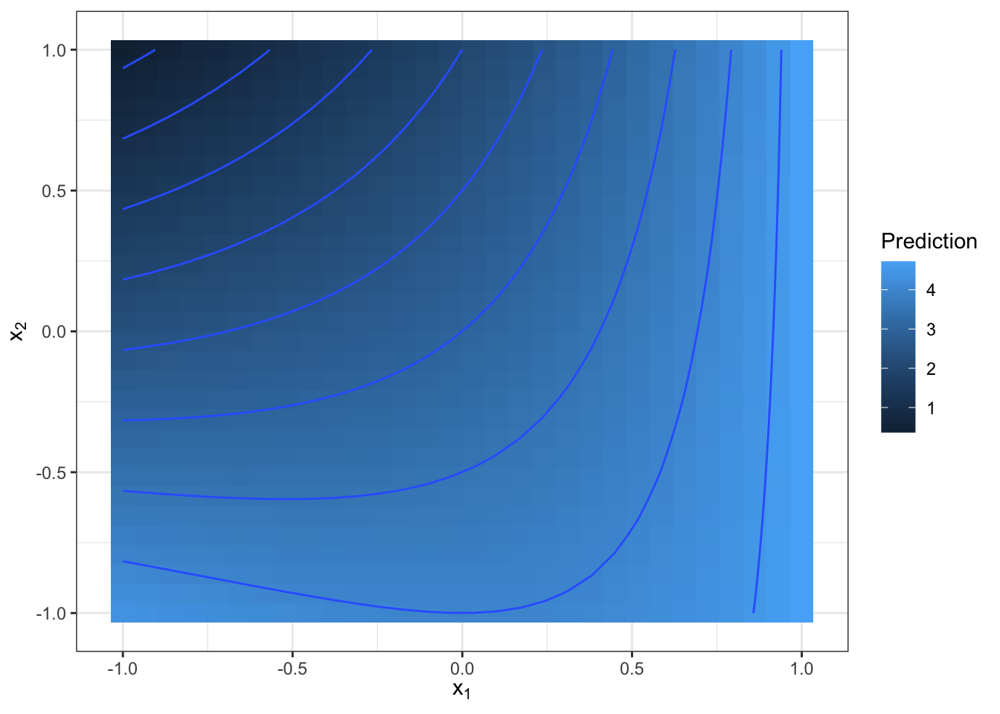
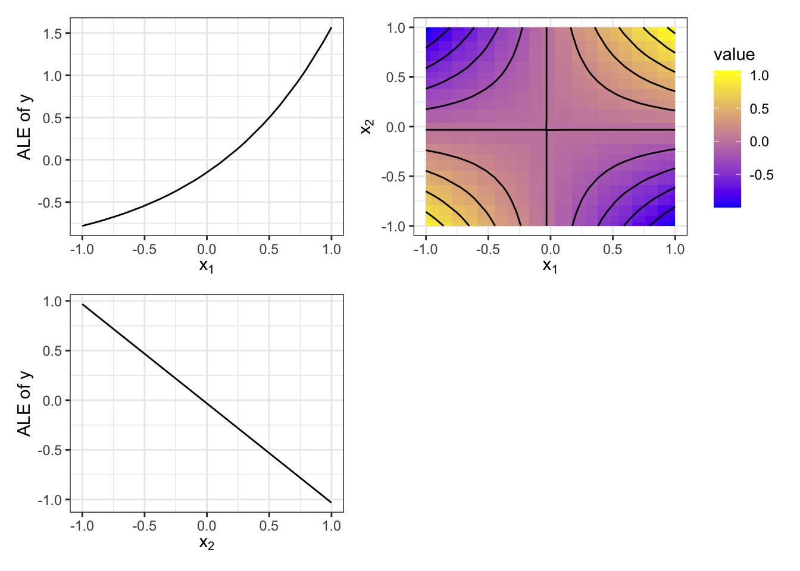

::: {.callout-note}
Bu bölüm, Christoph Molnar'ın *Interpretable Machine Learning* kitabından
(CC BY-NC-SA 4.0) Türkçeye çevrilmiştir.
Orijinal: https://christophm.github.io/interpretable-ml-book/
:::

# Fonksiyonel Ayrıştırma {#decomposition}

<!--  -->

Gözetimli bir makine öğrenmesi modeli, girdi olarak yüksek boyutlu bir özellik vektörü alan ve çıktı olarak bir tahmin veya sınıflandırma skoru üreten bir fonksiyon olarak görülebilir.
Fonksiyonel ayrıştırma, yüksek boyutlu fonksiyonu parçalara ayıran ve onu görselleştirilebilen bireysel özellik etkileri ile etkileşim etkilerinin bir toplamı olarak ifade eden bir yorumlama tekniğidir.
Buna ek olarak, fonksiyonel ayrıştırma birçok yorumlama tekniğinin altında yatan temel bir ilkedir -- diğer yorumlama yöntemlerini daha iyi anlamanıza yardımcı olur.

<!-- Sezgi -->
Hemen konuya girelim ve belirli bir fonksiyona bakalım.
Bu fonksiyon girdi olarak iki özellik alır ve tek boyutlu bir çıktı üretir:

$$\hat{f}(x_1, x_2) = 2 + e^{x_1} - x_2 + x_1 \cdot x_2$$

Bu fonksiyonu bir makine öğrenmesi modeli olarak düşünün.
Fonksiyonu @fig-decomp-example içinde olduğu gibi 3 boyutlu bir grafikle veya eşyükselti (kontur) eğrilerine sahip bir ısı haritasıyla görselleştirebiliriz.

```{r}
#| eval: false
#| fig-cap: $X_1$ ve $X_2$ olmak üzere iki özelliğe sahip bir fonksiyonun tahmin yüzeyi. Renk ne kadar açıksa tahmin o kadar büyüktür.
x1 = seq(from = -1, to = 1, length.out = 30)
x2 = seq(from = -1, to = 1, length.out = 30)
f = function(x1, x2){
   2 + exp(x1) - x2 +  x1 * x2
}

dat = expand.grid(x1 = x1, x2 = x2)
dat$y = f(dat$x1, dat$x2)
# mean(dat$y)
p = ggplot(dat, aes(x = x1, y = x2, fill = y, z = y)) + geom_tile() + geom_contour() +
  scale_x_continuous(latex2exp::TeX(r'($x_1$)')) +
  scale_y_continuous(latex2exp::TeX(r'($x_2$)')) +
  scale_fill_continuous("Prediction")
p
```

{#fig-decomp-example}

<!-- Tahmin fonksiyonunun açıklanması -->
Fonksiyon, $x_1$ büyük ve $x_2$ küçük olduğunda büyük değerler; büyük $x_2$ ve küçük $x_1$ içinse küçük değerler alır.
Tahmin fonksiyonu yalnızca iki özellik arasındaki toplamsal bir etki değil, ikisi arasındaki bir etkileşimdir.
Bir etkileşimin varlığı şekilde görülebilir -- $x_1$ özelliği için değerleri değiştirmenin etkisi, $x_2$ özelliğinin sahip olduğu değere bağlıdır.

<!-- Makine öğrenmesi için fonksiyonel ayrıştırmaya geri dönüş -->
Şimdi işimiz, bu fonksiyonu $X_1$ ve $X_2$ özelliklerinin ana etkilerine ve bir etkileşim terimine ayrıştırmaktır.
Yalnızca iki girdi özelliğine bağlı olan iki boyutlu bir $\hat{f}$ fonksiyonu için ($\hat{f}(x_1, x_2)$), her bir bileşenin bir ana etkiyi ($\hat{f}_1$ ve $\hat{f}_2$), etkileşimi ($\hat{f}_{1,2}$) veya kesişim terimini (sabit terim, $\hat{f}_0$) temsil etmesini isteriz:

$$\hat{f}(x_1, x_2) = \hat{f}_0 + \hat{f}_1(x_1) + \hat{f}_2(x_2) + \hat{f}_{1,2}(x_{1},x_{2})$$

Ana etkiler, her bir özelliğin diğer özelliğin değerlerinden bağımsız olarak tahmini nasıl etkilediğini gösterir.
Etkileşim etkisi ise özelliklerin birleşik etkisini gösterir.
Kesişim terimi (sabit terim), tüm tahminlerin parçası olan sabit bir değerdir.
Tüm özellik değerleri sıfıra ayarlanacak olsaydı, tahmin yalnızca kesişim teriminden oluşurdu.
Bileşenlerin kendilerinin (kesişim terimi hariç) farklı girdi boyutluluğuna sahip fonksiyonlar olduğuna dikkat edin.

Şimdi size doğrudan bileşenleri vereceğim ve nereden geldiklerini daha sonra açıklayacağım.
Kesişim terimi $\hat{f}_0 \approx 3.18$ olarak verilmiştir.
Diğer bileşenler fonksiyon olduğundan, bunları @fig-decomp-example-continued içinde görselleştirebiliriz.


```{r}
#| eval: false
#| fig-cap: "2 boyutlu bir fonksiyonun ana etkilere ve etkileşime ayrıştırılması. Üst satır: $f_1$ (solda) ve $f_2$ ana etkileri. Alt satır: $X_1$ ve $X_2$ arasındaki $f_{12}$ etkileşimi"
# fig-asp: 1
pred.fun = function(model = NULL, newdata){
  f(newdata$x1, newdata$x2)
}
pred = Predictor$new(predict.fun = pred.fun, data = dat, y = "y")
p1 = FeatureEffect$new(pred, feature = "x1",  method = "ale")$plot(rug = FALSE) +
#  ggtitle(expression(paste(f[1], " main effect of ", X[1]))) +
  scale_x_continuous(latex2exp::TeX(r'($x_1$)'))
p2 = FeatureEffect$new(pred, feature = "x2", method = "ale")$plot(rug = FALSE) +
#  ggtitle(expression(paste(f[2], " main effect of ", X[2]))) +
  scale_x_continuous(latex2exp::TeX(r'($x_2$)'))
interact = FeatureEffect$new(pred, feature = c("x1", "x2"), method = "ale")
p12 = interact$plot(rug = FALSE) + geom_contour(aes(z = .ale), color = "black") +
  scale_fill_continuous("value", low = "blue",  high = "yellow") +
#  ggtitle(expression(paste(f[12], " interaction between ", X[1], " and ", X[2]))) +
  scale_x_continuous(latex2exp::TeX(r'($x_1$)')) +
  scale_y_continuous(latex2exp::TeX(r'($x_2$)'))
#(p1 + p2) / p12 + patchwork::plot_layout(heights = c(1,2.5))

p1 + p12 + p2 + plot_layout(ncol = 2)

```

{#fig-decomp-example-continued}


Kesişim terimi değerinin biraz rastgele görünmesini bir kenara bırakırsak, yukarıdaki gerçek formül göz önüne alındığında bileşenlerin mantıklı olduğunu düşünüyor musunuz?
$X_1$ özelliği üstel bir ana etki, $X_2$ ise negatif doğrusal bir etki göstermektedir.
Etkileşim terimi biraz Pringles cipsine benzemektedir.
Daha az çıtır ve daha matematiksel ifadelerle, $x_1 \cdot x_2$ için bekleyeceğimiz gibi bir hiperbolik paraboloiddir.
Sürprizi bozalım (spoiler uyarısı): ayrıştırma, bölümün ilerleyen kısımlarında tartışacağımız birikimli yerel etki (ALE) grafiklerine dayanmaktadır.

<!-- Naif yaklaşım -->
Peki bütün bu heyecan neden?
Formüle şöyle bir bakmak bile bize ayrıştırmanın cevabını zaten veriyor; dolayısıyla süslü yöntemlere gerek yok, değil mi?
$X_1$ özelliği için, yalnızca $x_1$'i içeren tüm toplananları o özelliğin bileşeni olarak alabiliriz.
Bu, $\hat{f}_1(x_1) = e^{x_1}$ ve $X_2$ özelliği için $\hat{f}_2(x_2) = -x_2$ olurdu.
Etkileşim ise bu durumda $\hat{f}_{12}(x_{1},x_{2}) = x_1 \cdot x_2$ olur.
Bu örnek için (sabitler hariç) doğru cevap bu olsa da, bu yaklaşımla ilgili iki problem vardır:
Problem 1): Örnek formülle başlamış olsa da, gerçekte yalnızca yapısal olarak basit makine öğrenmesi modelleri böylesine düzgün bir formülle tanımlanabilir.
Problem 2) çok daha karmaşıktır ve etkileşimin ne olduğuyla ilgilidir.
Her iki özelliğin de sıfırdan büyük değerler aldığı ve birbirinden bağımsız olduğu basit bir $\hat{f}(x_1,x_2) = x_1 \cdot x_2$ fonksiyonu düşünün.
Formüle bakma taktiğimizi kullanarak, $X_1$ ve $X_2$ özellikleri arasında bir etkileşim olduğu ancak bireysel özellik etkilerinin bulunmadığı sonucuna varırdık.
Peki $x_1$ özelliğinin tahmin fonksiyonu üzerinde hiçbir bireysel etkisi olmadığını gerçekten söyleyebilir miyiz?
$x_2$ hangi değeri alırsa alsın, $x_1$'i artırdığımızda tahmin artar.
Örneğin $x_2 = 1$ için $x_1$'in etkisi $\hat{f}(x_1, 1) = x_1$ olur ve $x_2 = 10$ olduğunda etki $\hat{f}(x_1, 10) = 10 \cdot x_1$ olur.
Dolayısıyla, $X_1$ özelliğinin $X_2$'den bağımsız olarak tahmin üzerinde pozitif bir etkiye sahip olduğu ve sıfır olmadığı açıktır.

Düzgün bir formüle erişim eksikliği olan 1) numaralı problemi çözmek için, yalnızca tahmin fonksiyonunu veya sınıflandırma skorunu kullanan bir yönteme ihtiyacımız vardır.
Tanım eksikliği olan 2) numaralı problemi çözmek içinse, bileşenlerin nasıl görünmesi gerektiğini ve birbirleriyle nasıl ilişkili olduklarını bize söyleyen bazı aksiyomlara ihtiyacımız vardır.
Ancak ilk olarak, fonksiyonel ayrıştırmanın ne olduğunu daha kesin bir şekilde tanımlamalıyız.


## Bir fonksiyonun ayrıştırılması

<!-- Formülün açıklanması -->
Bir tahmin fonksiyonu girdi olarak $p$ özellik alır ($\hat{f}: \mathbb{R}^p \mapsto \mathbb{R}$) ve bir çıktı üretir.
Bu bir regresyon fonksiyonu olabilir; ancak aynı zamanda belirli bir sınıf için sınıflandırma olasılığı veya belirli bir küme için skor da (gözetimsiz makine öğrenmesi) olabilir.
Tamamen ayrıştırıldığında, tahmin fonksiyonunu fonksiyonel bileşenlerin toplamı olarak temsil edebiliriz:

::: {.content-hidden when-format="epub"}

\begin{align*}
\hat{f}(\mathbf{x}) = & \hat{f}_0 + \hat{f}_1(x_1) + \ldots + \hat{f}_p(x_p) \\
& + \hat{f}_{1,2}(x_1, x_2) + \ldots + \hat{f}_{1,p}(x_1, x_p) + \ldots + \hat{f}_{p-1,p}(x_{p-1}, x_p) \\
& + \ldots  \\ & +  \hat{f}_{1,\ldots,p}(x_1, \ldots, x_p)
\end{align*}

:::

::: {.content-visible when-format="epub"}

$$
\hat{f}(\mathbf{x}) = \hat{f}_0 + \hat{f}_1(x_1) + \ldots + \hat{f}_p(x_p)
$$

$$
+ \hat{f}_{1,2}(x_1, x_2) + \ldots + \hat{f}_{1,p}(x_1, x_p) + \ldots + \hat{f}_{p-1,p}(x_{p-1}, x_p)
$$

$$
+ \ldots + \hat{f}_{1,\ldots,p}(x_1, \ldots, x_p)
$$


:::

Tüm olası özellik kombinasyonu alt kümelerini indeksleyerek ayrıştırma formülünü biraz daha güzel hale getirebiliriz: $S\subseteq\{1,\ldots,p\}$.
Bu küme; kesişim terimini ($S=\emptyset$), ana etkileri ($|S|=1$) ve tüm etkileşimleri ($|S|\geq{}1$) içerir.
Bu alt küme tanımlandığında, ayrıştırmayı aşağıdaki gibi yazabiliriz:

$$\hat{f}(\mathbf{x}) = \sum_{S\subseteq\{1,\ldots,p\}} \hat{f}_S(\mathbf{x}_S)$$

Formülde $\mathbf{x}_S$, $S$ indeks kümesindeki özelliklerin vektörüdür.
Ve her bir $S$ alt kümesi bir fonksiyonel bileşeni temsil eder; örneğin $S$ yalnızca bir özellik içeriyorsa bir ana etkiyi, $|S| > 1$ ise bir etkileşimi temsil eder.

<!-- Boyutluluk -->
Yukarıdaki formülde kaç bileşen vardır?
Cevap, $1,\ldots, p$ özelliklerinin kaç olası $S$ alt kümesini oluşturabileceğimize dayanır.
Ve bunlar $\sum_{i=0}^p\binom{p}{i}=2^p$ olası alt kümedir!
Örneğin bir fonksiyon 10 özellik kullanıyorsa, fonksiyonu 1,024 bileşene ayrıştırabiliriz: 1 kesişim terimi, 10 ana etki, 90 ikili (2 yönlü) etkileşim terimi, 720 üçlü (3 yönlü) etkileşim terimi, ...
Ve eklenen her bir özellikle birlikte bileşen sayısı iki katına çıkar.
Açıkçası çoğu fonksiyon için tüm bileşenleri hesaplamak uygulanabilir değildir.
Tüm bileşenleri HESAPLAMAMANIN bir diğer nedeni ise $|S|>2$ olan bileşenlerin görselleştirilmesinin ve yorumlanmasının zor olmasıdır.

Şimdiye kadar bileşenlerin nasıl tanımlandığı ve hesaplandığı hakkında konuşmaktan kaçındım.
Üstü kapalı olarak bahsettiğimiz tek kısıtlar, bileşenlerin sayısı ve boyutluluğu ile bileşenlerin toplamının orijinal fonksiyonu vermesi gerektiğiydi.
Ancak bileşenlerin ne olması gerektiğine dair ek kısıtlar olmadan, bu bileşenler benzersiz (tekil) değildir.
Bu durum, etkileri ana etkiler ile etkileşimler arasında veya düşük mertebeden etkileşimler (az sayıda özellik) ile yüksek mertebeden etkileşimler (daha fazla özellik) arasında kaydırabileceğimiz anlamına gelir.
Bölümün başındaki örnekte, her iki ana etkiyi de sıfıra ayarlayabilir ve etkilerini etkileşim etkisine ekleyebilirdik.

İşte bileşenler üzerinde kısıtlara duyulan ihtiyacı gösteren daha da uç bir örnek.
3 boyutlu bir fonksiyonunuz olduğunu varsayın.
Bu fonksiyonun neye benzediği gerçekten önemli değildir, ancak aşağıdaki ayrıştırma **her zaman** çalışacaktır: $\hat{f}_0$ değeri 0.12'dir.
$\hat{f}_1(\mathbf{x})=2\cdot{}x_1 + \text{number of shoes you own}$.
$\hat{f}_2$, $\hat{f}_3$, $\hat{f}_{1,2}$, $\hat{f}_{2,3}$, $\hat{f}_{1,3}$ bileşenlerinin tamamı sıfırdır.
Ve bu numaranın işe yaraması için $\hat{f}_{1,2,3}(x_1,x_2,x_3)=\hat{f}(\mathbf{x})-\sum\limits_{S\subset\{1,\ldots,p\}}\hat{f}_S(\mathbf{x}_S)$ olarak tanımlıyorum.
Böylece tüm özellikleri içeren etkileşim terimi geriye kalan tüm etkileri basitçe içine çeker ki bu da tüm bileşenlerin toplamının bize orijinal tahmin fonksiyonunu vermesi anlamında tanım gereği her zaman çalışır.
Bunu modelinizin yorumu olarak sunacak olsaydınız, bu ayrıştırma pek anlamlı olmaz ve oldukça yanıltıcı olurdu.

<!-- Çözümler -->
Bu belirsizlik, ek kısıtlar veya bileşenleri hesaplamak için belirli yöntemler tanımlanarak önlenebilir.
Bu bölümde fonksiyonel ayrıştırmaya yönelik farklı yaklaşımları tartışacağız:

- (Genelleştirilmiş) fonksiyonel ANOVA
- Birikimli Yerel Etkiler (ALE)
- İstatistiksel regresyon modelleri
- Ağaç topluluklarının ayrıştırılması


## Fonksiyonel ANOVA

Fonksiyonel ANOVA, @hooker2004discovering tarafından önerilmiştir.
Bu yaklaşım için bir gereklilik, model tahmin fonksiyonu $\hat{f}$'nin karesinin integrallenebilir olmasıdır.
Her fonksiyonel ayrıştırmada olduğu gibi, fonksiyonel ANOVA da fonksiyonu bileşenlere ayrıştırır:

$$\hat{f}(\mathbf{x}) = \sum_{S \subseteq \{1, \ldots, p\}} \hat{f}_S(\mathbf{x}_S)$$

@hooker2004discovering her bir bileşeni aşağıdaki formülle tanımlar:

$$\hat{f}_S(\mathbf{x}) = \int_{X_{-S}} \left( \hat{f}(\mathbf{x}) - \sum_{V \subset S} \hat{f}_V(\mathbf{x})\right) d \mathbb{P}(X_{-S})$$

Tamam, şimdi bu ifadeyi parçalarına ayıralım.
Bileşeni şu şekilde yeniden yazabiliriz:

$$\hat{f}_S(\mathbf{x}) = \int_{X_{-S}} \left( \hat{f}(\mathbf{x})\right) d \mathbb{P}(X_{-S}) - \int_{X_{-S}} \left(\sum_{V \subset S} \hat{f}_V(\mathbf{x}) \right) d \mathbb{P}(X_{-S})$$

Sol tarafta, $-S$ ile gösterilen, $S$ kümesinin dışında bırakılan özelliklere göre tahmin fonksiyonu üzerinden alınan integral yer alır.
Örneğin, 2 ve 3 numaralı özellikler için 2 yönlü (ikili) etkileşim bileşenini hesaplıyorsak, 1, 4, 5, ... özellikleri üzerinden integral alırız.
İntegral ayrıca, tüm özelliklerin minimum değerlerinden maksimum değerlerine kadar tekdüze (uniform) bir dağılım izlediği varsayımıyla, tahmin fonksiyonunun $X_{-S}$'ye göre beklenen değeri olarak da görülebilir.
Bu integralden, $S$'nin alt kümelerine sahip tüm bileşenleri çıkarırız.
Bu çıkarma işlemi, tüm düşük mertebeden etkilerin etkisini ortadan kaldırır ve etkiyi merkezler.
$S=\{1,2\}$ için her iki özelliğin ana etkilerini ($\hat{f}_1$ ve $\hat{f}_2$) ve ayrıca kesişim terimini ($\hat{f}_0$) çıkarırız.
Bu düşük mertebeden etkilerin varlığı formülü özyinelemeli (recursive) hale getirir:
Alt kümeler hiyerarşisi boyunca kesişim terimine kadar inmemiz ve tüm bu bileşenleri hesaplamamız gerekir.
$\hat{f}_0$ kesişim bileşeni için alt küme boş kümedir ($S=\{\emptyset\}$) ve dolayısıyla $-S$ tüm özellikleri içerir:

$$\hat{f}_0(\mathbf{x}) = \int_{X} \hat{f}(\mathbf{x}) d \mathbb{P}(X)$$

Bu, basitçe tüm özellikler üzerinden integrali alınmış tahmin fonksiyonudur.
Kesişim terimi, tüm özelliklerin tekdüze dağıldığını varsaydığımızda tahmin fonksiyonunun beklentisi (beklenen değeri) olarak da yorumlanabilir.
Artık $\hat{f}_0$'ı bildiğimize göre, $\hat{f}_1$'i (ve eşdeğer olarak $\hat{f}_2$'yi) hesaplayabiliriz:

$$\hat{f}_1(\mathbf{x}) = \int_{X_{-1}} \left( \hat{f}(\mathbf{x}) - \hat{f}_0\right) d \mathbb{P}(X_{-1})$$

$\hat{f}_{1,2}$ bileşeninin hesaplamasını tamamlamak için her şeyi bir araya getirebiliriz:

::: {.content-hidden when-format="epub"}

\begin{align*}
\hat{f}_{1,2}(\mathbf{x}) &= \int_{X_{3,4}} \left( \hat{f}(\mathbf{x}) - (\hat{f}_0 + \hat{f}_1(\mathbf{x}) - \hat{f}_0 + \hat{f}_2(\mathbf{x}) - \hat{f}_0)\right) d \mathbb{P}(X_{3},X_4) \\
&= \int_{X_{3,4}} \left(\hat{f}(\mathbf{x}) - \hat{f}_1(\mathbf{x}) - \hat{f}_2(\mathbf{x}) + \hat{f}_0\right) d \mathbb{P}(X_{3},X_4)
\end{align*}

:::

::: {.content-visible when-format="epub"}

$$
\hat{f}_{1,2}(\mathbf{x}) = \int_{X_{3,4}} \left( \hat{f}(\mathbf{x}) - (\hat{f}_0 + \hat{f}_1(\mathbf{x}) - \hat{f}_0 + \hat{f}_2(\mathbf{x}) - \hat{f}_0)\right) d \mathbb{P}(X_{3},X_4)
$$
$$
= \int_{X_{3,4}} \left(\hat{f}(\mathbf{x}) - \hat{f}_1(\mathbf{x}) - \hat{f}_2(\mathbf{x}) + \hat{f}_0\right) d \mathbb{P}(X_{3},X_4)
$$


:::

Bu örnek, her bir yüksek mertebeden etkinin diğer tüm özellikler üzerinden integral alınarak, ancak aynı zamanda ilgilendiğimiz özellik kümesinin alt kümeleri olan tüm düşük mertebeden etkiler çıkarılarak nasıl tanımlandığını göstermektedir.

@hooker2004discovering, fonksiyonel bileşenlerin bu tanımının şu arzu edilen aksiyomları sağladığını göstermiştir:

- Sıfır Ortalama (Zero Means): Her $S\neq\emptyset$ için $\int \hat{f}_S(\mathbf{x}_S)d \mathbb{P}(X_S)=0$.
- Diklik (Orthogonality): $S\neq V$ için $\int \hat{f}_S(\mathbf{x}_S)\hat{f}_V(\mathbf{x}_V)d \mathbb{P}(X)=0$.
- Varyans Ayrıştırması (Variance Decomposition):
$\sigma^2_{\hat{f}}=\int \hat{f}(\mathbf{x})^2d \mathbb{P}(X)$ olsun; bu durumda $P=\{1,\ldots,p\}$ olmak üzere $\sigma^2(\hat{f}) = \sum_{S \subseteq P} \sigma^2_S(\hat{f}_S)$ olur.

Sıfır ortalama aksiyomu, tüm etkilerin veya etkileşimlerin sıfır etrafında merkezlendiğini ifade eder.
Bunun bir sonucu olarak, bir $\mathbf{x}$ konumundaki yorumlama mutlak tahmine göre değil, merkezlenmiş tahmine göre yapılır.

Diklik (ortogonallik) aksiyomu, bileşenlerin bilgi paylaşmadığını ifade eder.
Örneğin, $X_1$ özelliğinin birinci mertebeden etkisi ile $X_{1}$ ve $X_2$'nin etkileşim terimi birbiriyle ilişkili (korelasyonlu) değildir.
Diklik sayesinde tüm bileşenler, etkileri birbirine karıştırmamaları anlamında "saftır".
Örneğin $X_4$ özelliğine ait bileşenin, $X_1$ ve $X_2$ özellikleri arasındaki etkileşim teriminden bağımsız olması oldukça mantıklıdır.
Daha ilginç olan sonuç, bir bileşenin diğerinin özelliklerini içerdiği hiyerarşik bileşenlerin dikliği durumunda ortaya çıkar; örneğin $X_1$ ve $X_2$ arasındaki etkileşim ile $X_1$ özelliğinin ana etkisi.
Buna karşılık, $X_1$ ve $X_2$ için iki boyutlu bir kısmi bağımlılık grafiği dört etki içerir: kesişim terimi, $X_1$ ve $X_2$'nin iki ana etkisi ve aralarındaki etkileşim.
$\hat{f}_{1,2}(x_1,x_2)$ için fonksiyonel ANOVA bileşeni ise yalnızca saf etkileşimi içerir.

Varyans ayrıştırması, $\hat{f}$ fonksiyonunun varyansını bileşenler arasında bölüştürmemize olanak tanır ve sonunda fonksiyonun toplam varyansına eşitlenmesini garanti eder.
Varyans ayrıştırması özelliği, yöntemin neden fonksiyonel ANOVA olarak adlandırıldığını da bize açıklayabilir.
İstatistikte ANOVA, Varyans Analizi (*ANalysis Of VAriance*) anlamına gelir.
ANOVA, bir hedef değişkenin ortalamasındaki farklılıkları analiz eden bir yöntemler bütünüdür.
ANOVA, varyansı bölerek ve bunu değişkenlere atfederek çalışır.
Fonksiyonel ANOVA bu nedenle bu kavramın herhangi bir fonksiyona genişletilmesi olarak görülebilir.

Özellikler birbiriyle ilişkili (korelasyonlu) olduğunda fonksiyonel ANOVA ile ilgili problemler ortaya çıkar.
Çözüm olarak @hooker2007generalized, genelleştirilmiş fonksiyonel ANOVA'yı önermiştir.


## Bağımlı özellikler için Genelleştirilmiş Fonksiyonel ANOVA

<!-- Dışdeğerleme (ekstrapolasyon) problemi -->
Veri örneklemeye dayanan çoğu yorumlama tekniğine (PDP gibi) benzer şekilde, fonksiyonel ANOVA da özellikler ilişkili (korelasyonlu) olduğunda yanıltıcı sonuçlar üretebilir.
Gerçekte özellikler bağımlıyken tekdüze (uniform) dağılım üzerinden integral alırsak, birleşik dağılımdan sapan ve olası olmayan özellik değeri kombinasyonlarına dışdeğerleme (ekstrapolasyon) yapan yeni bir veri seti oluşturmuş oluruz.

<!-- Çözüm -->
@hooker2007generalized, bağımlı özellikler için çalışan bir ayrıştırma olan genelleştirilmiş fonksiyonel ANOVA'yı önermiştir.
Bu yöntem, daha önce karşılaştığımız fonksiyonel ANOVA'nın bir genellemesidir; yani fonksiyonel ANOVA, genelleştirilmiş fonksiyonel ANOVA'nın özel bir durumudur.
Bileşenler, $\hat{f}$ fonksiyonunun toplamsal fonksiyonlar uzayı üzerindeki izdüşümleri (projeksiyonları) olarak tanımlanır:

$$\hat{f}_S(\mathbf{x}_S) = \arg\min_{g_S \in L^2(\mathbb{R}^S)_{S \in P}} \int \left(\hat{f}(\mathbf{x}) - \sum_{S \subset P} g_S(\mathbf{x}_S)\right)^2 w(\mathbf{x})\,d\mathbf{x}.$$

Diklik (ortogonallik) yerine, bileşenler hiyerarşik bir diklik koşulunu sağlar:

$$\forall \hat{f}_S(\mathbf{x}_S)| S \subset U: \int \hat{f}_S(\mathbf{x}_S) \hat{f}_U(\mathbf{x}_U) w(\mathbf{x})\,d\mathbf{x} = 0$$

<!-- Hiyerarşik diklik -->
Hiyerarşik diklik, diklikten farklıdır.
Hiçbiri diğerinin alt kümesi olmayan iki $S$ ve $U$ özellik kümesi için (örneğin $S=\{1,2\}$ ve $U=\{2,3\}$), ayrıştırmanın hiyerarşik olarak dik olması için $\hat{f}_S$ ve $\hat{f}_U$ bileşenlerinin birbirine dik olması gerekmez.
Ancak $S$'nin tüm alt kümelerine ait tüm bileşenler $\hat{f}_S$'ye dik olmalıdır.
<!-- İç içe geçme / Karışma -->
Sonuç olarak, yorumlama önemli açılardan farklılık gösterir:
[ALE bölümündeki](#ale) M-Grafiğine (M-Plot) benzer şekilde, genelleştirilmiş fonksiyonel ANOVA bileşenleri ilişkili (korelasyonlu) özelliklerin (marjinal) etkilerini birbirine karıştırabilir.
Bileşenlerin marjinal etkileri birbirine karıştırıp karıştırmadığı, $w(\mathbf{x})$ ağırlık fonksiyonunun seçimine de bağlıdır.
Eğer $w$'yi birim küp üzerindeki tekdüze ölçü olarak seçersek, yukarıdaki bölümde yer alan fonksiyonel ANOVA'yı elde ederiz.
$w$ için doğal bir seçim, birleşik olasılık dağılım fonksiyonudur.
Bununla birlikte, birleşik dağılım genellikle bilinmez ve tahmin edilmesi zordur.
Bir püf noktası, birim küp üzerindeki tekdüze ölçü ile başlayıp veri bulunmayan alanları kesip çıkarmak olabilir.

Tahmin işlemi, özellik uzayındaki bir noktalar ızgarası (grid) üzerinde yapılır ve regresyon teknikleri kullanılarak çözülebilen bir minimizasyon problemi olarak ifade edilir.
Ancak bileşenler ne birbirinden bağımsız olarak ne de hiyerarşik bir şekilde hesaplanabilir; bunun yerine diğer bileşenleri içeren karmaşık bir denklem sisteminin çözülmesi gerekir.
Hesaplama bu nedenle oldukça karmaşık ve hesaplama açısından yoğundur.


## Birikimli Yerel Etkiler

ALE grafikleri [@apley2020visualizingeffects] de bir fonksiyonel ayrıştırma sağlar; yani kesişim teriminden, 1 boyutlu ALE grafiklerinden, 2 boyutlu ALE grafiklerinden ve devamından gelen tüm ALE grafiklerinin toplanması tahmin fonksiyonunu verir.
ALE, bileşenlerin dik (ortogonal) olmaması, bunun yerine yazarların adlandırdığı şekliyle sözde dik (psödo-ortogonal) olması bakımından (genelleştirilmiş) fonksiyonel ANOVA'dan ayrılır.
Sözde dikliği anlamak için, bir $\hat{f}$ fonksiyonunu alıp onu $S$ özellik alt kümesi için ALE grafiğine eşleyen $H_S$ operatörünü tanımlamamız gerekir.
Örneğin, $H_{1,2}$ operatörü girdi olarak bir makine öğrenmesi modelini alır ve 1 ile 2 numaralı özellikler için 2 boyutlu ALE grafiğini üretir: $H_{1,2}(\hat{f}) = \hat{f}_{ALE,12}$.
Aynı operatörü iki kez uygularsak, aynı ALE grafiğini elde ederiz.
$H_{1,2}$ operatörünü $\hat{f}$ fonksiyonuna bir kez uyguladıktan sonra $\hat{f}_{ALE,12}$ 2 boyutlu ALE grafiğini elde ederiz.
Ardından operatörü tekrar, bu kez $\hat{f}$'ye değil, $\hat{f}_{ALE,12}$'ye uygularız.
Bu mümkündür çünkü 2 boyutlu ALE bileşeninin kendisi de bir fonksiyondur.
Sonuç yine $\hat{f}_{ALE,12}$ olur; yani aynı operatörü birkaç kez uygulayabilir ve her zaman aynı ALE grafiğini elde edebiliriz.
Bu, sözde dikliğin birinci kısmıdır.
Peki farklı özellik kümeleri için iki farklı operatör uygularsak sonuç ne olur?
Örneğin $H_{1,2}$ ve $H_{1}$ veya $H_{1,2}$ ve $H_{3,4,5}$?
Cevap sıfırdır.
Bir fonksiyona önce $H_S$ ALE operatörünü uygular ve ardından sonuca ($S \neq U$ olmak üzere) $H_U$ uygularsak, sonuç sıfır olur.
Başka bir deyişle, aynı ALE grafiğini iki kez uygulamadığınız sürece, bir ALE grafiğinin ALE grafiği sıfırdır.
Veya bir diğer ifadeyle, $S$ özellik kümesi için oluşturulan ALE grafiği, içinde başka hiçbir ALE grafiğini barındırmaz.
Ya da matematiksel ifadeyle, ALE operatörü fonksiyonları bir iç çarpım uzayının dik alt uzaylarına eşler.

Apley ve Zhu'nun (2020) belirttiği gibi, özelliklerin marjinal etkilerini birbirine karıştırmadığı için sözde diklik, hiyerarşik diklikten daha arzu edilir olabilir.
Ayrıca ALE, birleşik dağılımın tahmin edilmesini gerektirmez; bileşenler hiyerarşik bir şekilde tahmin edilebilir; bu da 1 ve 2 numaralı özellikler için 2 boyutlu ALE'yi hesaplamanın, ek olarak yalnızca 1 ve 2'nin bireysel ALE bileşenlerinin ve kesişim teriminin hesaplanmasını gerektirdiği anlamına gelir.

[Kısmi Bağımlılık Grafiği](#pdp) (PDP) de bir fonksiyonel ayrıştırma sağlar mı?
Kısa cevap: Hayır.
Uzun cevap:
Bir $S$ özellik kümesi için kısmi bağımlılık grafiği her zaman hiyerarşinin tüm etkilerini içerir -- $\{1,2\}$ için PDP yalnızca etkileşimi değil, aynı zamanda bireysel özellik etkilerini de içerir.
Bunun bir sonucu olarak, tüm alt kümeler için tüm PDP'lerin toplanması orijinal fonksiyonu vermez ve dolayısıyla geçerli bir ayrıştırma değildir.
Peki PDP'yi, belki de tüm düşük mertebeden etkileri çıkararak uyarlayabilir miydik?
Evet, yapabilirdik; ancak fonksiyonel ANOVA'ya benzer bir şey elde ederdik.
Ancak tekdüze bir dağılım üzerinden integral almak yerine PDP, Monte Carlo örneklemesi kullanılarak tahmin edilen $X_{-S}$ marjinal dağılımı üzerinden integral alır.

## Ağaç topluluklarının ayrıştırılması

@yang2024inherently, örneğin XGBoost ile eğitilmiş ağaç topluluklarının fonksiyonel bir ayrıştırmasını önermiştir.
Önerileri iki bölümden oluşur: bir ayrıştırma prosedürü ve ayrıştırmayı daha yorumlanabilir kılmak için bir dizi eğitim kısıtı.

Bir ağaç topluluğundan fonksiyonel bileşime ulaşma stratejisi; toplulaştırma (aggregation), saflaştırma (purification) ve atıf (attribution) adımlarını içerir.
İlk olarak, her bir yaprak düğüm bir karar kuralı haline gelecek şekilde her ağaç karar kurallarına ayrıştırılır.
Bu kurallar daha sonra kullandıkları özelliklere göre sıralanır.
Örneğin, yalnızca $X_1$ özelliğini kullanan tüm kurallar toplanır ve $\hat{f}_1$ ana etkisini tahmin etmek için kullanılır.
Aynı işlem diğer tüm ana etkiler ve etkileşimler için de yapılır.
Ancak, örneğin $X_1$'in ana etkisini $X_1$ ve $X_2$'nin etkileşim terimine dahil edebileceğinizden, bu ayrıştırma benzersiz (tekil) olmayacaktır.
Yazarlar, sıfır ortalama ve diklik kısıtlarını zorunlu kılmak için bileşenleri "saflaştırırlar" (artık tanıdık gelmeli).
Atıf adımında, her bir veri noktası için özellik katkıları hesaplanır ve her bir özellik için genel (global) önem değerlerini elde etmek üzere veri genelinde toplulaştırılır.
Bireysel katkılar [Shapley değerleri](#shapley) ile aynıdır.

Makaledeki diğer öneri, fonksiyonel ayrıştırmanın daha iyi yorumlanabilmesi için eğitime kısıtlar eklemektir.
Bu, etkileşime girebilecek maksimum özellik sayısını kontrol edebilmeniz için maksimum ağaç derinliğini düşük tutmak gibi basit şeyleri içerir.
Örneğin, maksimum derinliği ikiye ayarlamak, modelin yalnızca ana etkilere ve ikili etkileşimlere sahip olmasını, ancak yüksek mertebeden etkileşimlere sahip olmamasını sağlar.
Diğer öneriler arasında monotonluk kısıtları, azaltılmış aralık (kutu) sayısı ve etkileşim kısıtları yer alır.
Yazarlar ayrıca fonksiyonel ayrıştırmadan etkileri budamak (pruning) için bir son işleme (post-processing) adımı da tanıtmaktadır.

## İstatistiksel regresyon modelleri

Bu yaklaşım, yorumlanabilir modellerle, özellikle de [genelleştirilmiş toplamsal modellerle](#extend-lm) (GAM) bağlantılıdır.
Karmaşık bir fonksiyonu ayrıştırmak yerine, bireysel bileşenleri kolayca okuyabileceğimiz şekilde modelleme sürecine kısıtlar yerleştirebiliriz.
Ayrıştırma, yüksek boyutlu bir fonksiyonla başlayıp onu ayrıştırdığımız yukarıdan aşağıya (top-down) bir yaklaşımla ele alınabilirken, genelleştirilmiş toplamsal modeller modeli basit bileşenlerden inşa ettiğimiz aşağıdan yukarıya (bottom-up) bir yaklaşım sunar.
Her iki yaklaşımın ortak noktası, amaçlarının bireysel ve yorumlanabilir bileşenler sağlamak olmasıdır.
İstatistiksel modellerde, $2^p$ bileşenin tamamının uydurulması (fit edilmesi) gerekmemesi için bileşen sayısını sınırlandırırız.
En basit versiyon doğrusal regresyondur:

$$\hat{f}(\mathbf{x}) = \beta_0 + \beta_1 x_1 + \ldots + \beta_p x_p$$

Formül, fonksiyonel ayrıştırmaya çok benzer görünür, ancak iki büyük değişiklik vardır.
Değişiklik 1: Tüm etkileşim etkileri hariç tutulur ve yalnızca kesişim terimi ile ana etkiler tutulur.
Değişiklik 2: Ana etkiler özellikler açısından yalnızca doğrusal olabilir: $\hat{f}_j(x_j) = \beta_j x_j$.
Doğrusal regresyon modeline fonksiyonel ayrıştırma merceğinden baktığımızda, modelin kendisinin özelliklerden hedefe eşleme yapan gerçek fonksiyonun bir fonksiyonel ayrıştırmasını temsil ettiğini, ancak bunu etkilerin doğrusal etkiler olduğu ve hiçbir etkileşimin bulunmadığı yönündeki güçlü varsayımlar altında yaptığını görürüz.

Genelleştirilmiş toplamsal model (GAM), spline fonksiyonlarının kullanımı yoluyla daha esnek $\hat{f}_j$ fonksiyonlarına izin vererek ikinci varsayımı esnetir.
Etkileşimler de eklenebilir, ancak bu süreç oldukça manueldir.
GA2M gibi yaklaşımlar, bir GAM modeline 2 yönlü etkileşimleri otomatik olarak eklemeye çalışır [@caruana2015intelligible].

Bir doğrusal regresyon modelini veya bir GAM'ı fonksiyonel ayrıştırma olarak düşünmek kafa karışıklığına da yol açabilir.
Bölümün önceki kısımlarında yer alan ayrıştırma yaklaşımlarını (genelleştirilmiş fonksiyonel ANOVA ve birikimli yerel etkiler) uygularsanız, doğrudan GAM'dan okunan bileşenlerden farklı bileşenler elde edebilirsiniz.
Bu durum, ilişkili (korelasyonlu) özelliklerin etkileşim etkileri GAM içinde modellendiğinde ortaya çıkabilir.
Bu uyuşmazlık, diğer fonksiyonel ayrıştırma yaklaşımlarının etkileri etkileşimler ve ana etkiler arasında farklı şekilde bölüştürmesi nedeniyle meydana gelir.

Peki karmaşık bir model + ayrıştırma yerine ne zaman GAM kullanmalısınız?
Çoğu etkileşim sıfır olduğunda, özellikle de üç veya daha fazla özelliğin dahil olduğu etkileşimler bulunmadığında GAM'lara bağlı kalmalısınız.
Etkileşimlere dahil olan maksimum özellik sayısının iki olduğunu ($|S| \leq 2$) biliyorsak, MARS veya GA2M gibi yaklaşımları kullanabiliriz.
Sonuç olarak, test verileri üzerindeki model performansı, bir GAM'ın yeterli olup olmadığını veya daha karmaşık bir modelin çok daha iyi performans gösterip göstermediğini ortaya koyabilir.

## Güçlü Yönler

Fonksiyonel ayrıştırmayı, diğer birçok yöntemi daha iyi anlamaya yardımcı olan **makine öğrenmesi yorumlanabilirliğinin temel bir kavramı** olarak görüyorum.

Fonksiyonel ayrıştırma, yüksek boyutlu ve karmaşık makine öğrenmesi modellerini bireysel etkilere ve etkileşimlere ayrıştırmak için bize **kuramsal bir gerekçe** sunar -- ki bu, bireysel etkileri yorumlamamıza olanak tanıyan gerekli bir adımdır.
Fonksiyonel ayrıştırma; istatistiksel regresyon modelleri, ALE, (genelleştirilmiş) fonksiyonel ANOVA, PDP, H-istatistiği ve ICE eğrileri gibi tekniklerin temel fikridir.

Fonksiyonel ayrıştırma ayrıca **diğer yöntemlerin daha iyi anlaşılmasını** sağlar.
Örneğin, [permütasyon özellik önemi](#feature-importance) bir özellik ile hedef arasındaki ilişkiyi bozar.
Fonksiyonel ayrıştırma merceğinden bakıldığında, permütasyonun özelliğin dahil olduğu tüm bileşenlerin etkisini "yok ettiğini" görebiliriz.
Bu durum özelliğin ana etkisini, ama aynı zamanda diğer özelliklerle olan tüm etkileşimlerini de etkiler.
Başka bir örnek olarak, Shapley değerleri bir tahmini bireysel özelliklerin toplamsal etkilerine ayrıştırır.
Ancak fonksiyonel ayrıştırma bize ayrıştırmada etkileşim etkilerinin de olması gerektiğini söyler; peki bunlar nerededir?
Shapley değerleri, etkilerin bireysel özelliklere adil bir şekilde atfedilmesini (paylaştırılmasını) sağlar; bu da tüm etkileşimlerin de özelliklere adil bir şekilde atfedildiği ve dolayısıyla Shapley değerleri arasında bölüştürüldüğü anlamına gelir.

Fonksiyonel ayrıştırmayı bir araç olarak ele aldığımızda, **ALE grafiklerinin kullanımı birçok avantaj sunar**.
ALE grafikleri, hesaplanması hızlı olan, yazılım uygulamaları bulunan (bkz. ALE bölümü) ve arzu edilen sözde diklik (psödo-ortogonallik) özelliklerine sahip olan bir fonksiyonel ayrıştırma sağlar.

## Sınırlılıklar

Fonksiyonel ayrıştırma kavramı, iki özellik arasındaki etkileşimlerin ötesindeki **yüksek boyutlu bileşenler için sınırlarına** hızla ulaşır.
Özellik sayısındaki bu üstel patlama, yüksek mertebeden etkileşimleri kolayca görselleştiremediğimiz için yalnızca uygulanabilirliği sınırlamakla kalmaz, aynı zamanda tüm etkileşimleri hesaplayacak olsaydık hesaplama süresi de akıl almaz boyutlara ulaşırdı.

Her bir fonksiyonel ayrıştırma yönteminin **kendine özgü dezavantajları** vardır.
Aşağıdan yukarıya yaklaşım -- regresyon modelleri oluşturmak -- oldukça manuel bir süreçtir ve model üzerinde tahmin performansını etkileyebilecek birçok kısıt dayatır.
Fonksiyonel ANOVA, bağımsız özellikler gerektirir.
Genelleştirilmiş fonksiyonel ANOVA'nın tahmin edilmesi çok zordur.
Birikimli yerel etki (ALE) grafikleri ise bir varyans ayrıştırması sağlamaz.

Fonksiyonel ayrıştırma yaklaşımı, **metin veya görüntülerden ziyade tablosal verileri analiz etmek için daha uygundur**.
