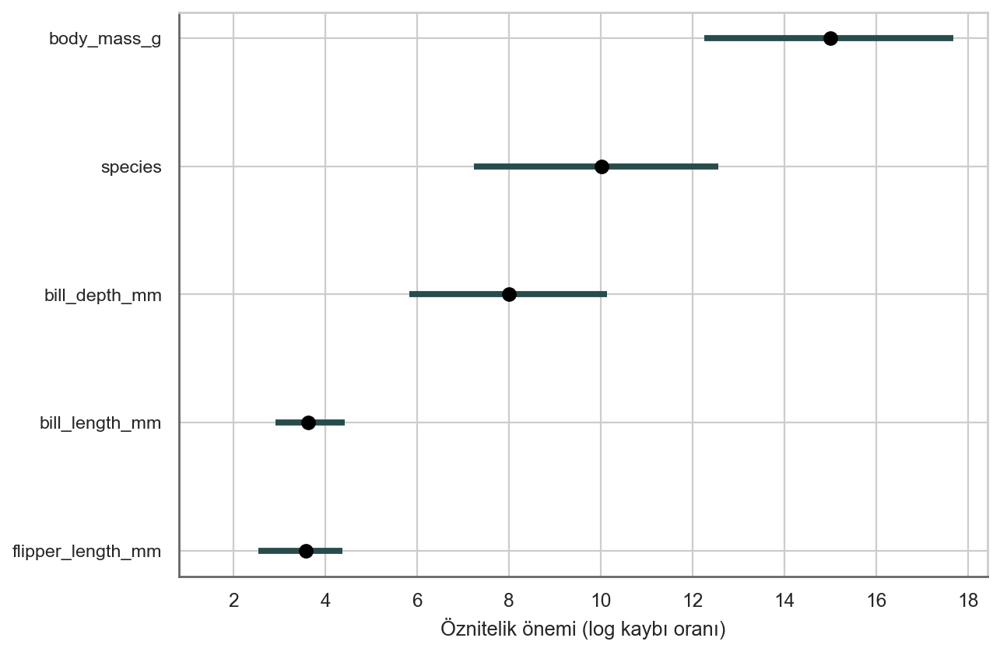
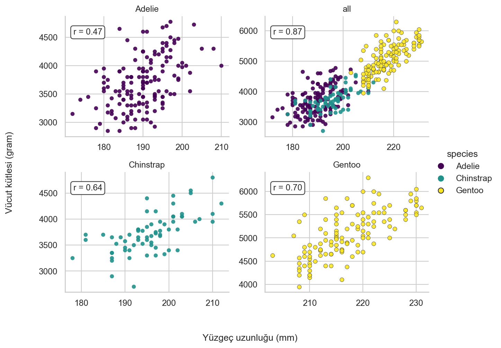
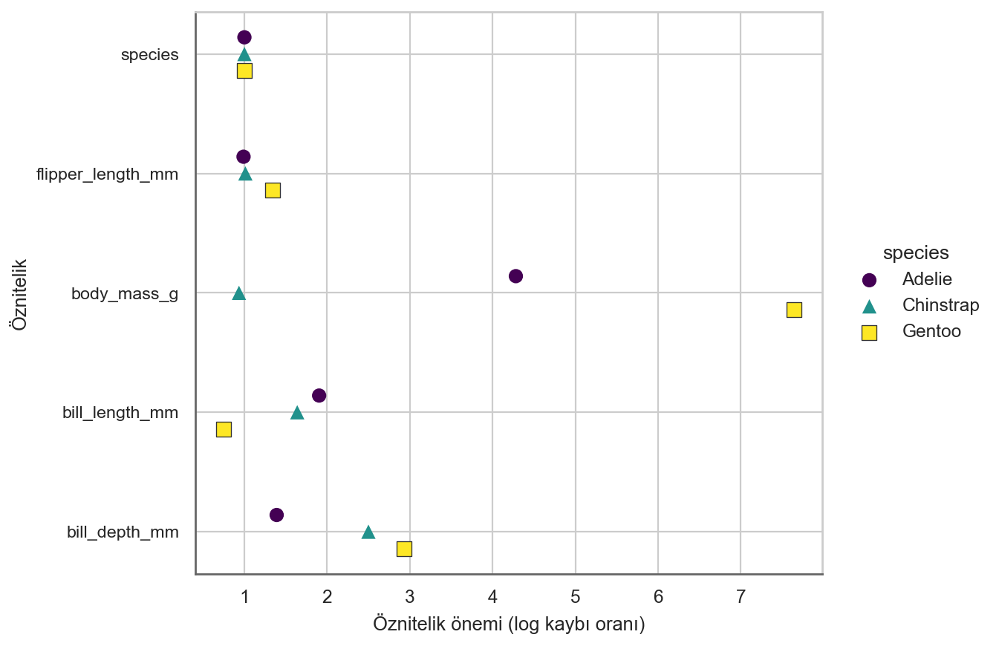

# Permütasyon Öznitelik Önemi {#feature-importance}

Permütasyon öznitelik önemi (PFI), özniteliğin değerlerini permüte ettikten sonra modelin tahmin hatasındaki artışı ölçer; bu işlem öznitelik ile gerçek sonuç arasındaki ilişkiyi koparır.

Kavram oldukça basittir:
Bir özniteliğin değerlerini karıştırmak model hatasını artırıyorsa o öznitelik "önemlidir", çünkü bu durumda model tahmin için bu özniteliğe dayanmıştır.
Bir özniteliğin değerlerini karıştırmak model hatasını değiştirmiyorsa o öznitelik "önemsizdir", çünkü bu durumda model tahmin için bu özniteliği göz ardı etmiştir.

## Teori

Permütasyon öznitelik önemi ölçümü, rastgele ormanlar için [Breiman (2001)](#ref-breiman2001random) tarafından tanıtılmıştır.
Bu fikre dayanarak, [Fisher, Rudin, and Dominici (2019)](#ref-fisher2019all) öznitelik öneminin modelden bağımsız bir versiyonunu önermiş ve bunu model dayanımı olarak adlandırmıştır.
Ayrıca öznitelik önemi hakkında daha ileri düzey fikirler de tanıtmışlardır; örneğin, birçok tahmin modelinin veriyi iyi tahmin edebileceğini hesaba katan (modele özgü) bir versiyon.
Makaleleri okunmaya değerdir.

**[Fisher, Rudin, and Dominici (2019)](#ref-fisher2019all) çalışmasına dayanan permütasyon öznitelik önemi algoritması:**

Girdi: Eğitilmiş model $\hat{f}$, öznitelik matrisi $\mathbf{X}$, hedef vektörü $\mathbf{y}$, hata ölçütü $L$.

1. Orijinal model hatasını tahmin edin: $e_{orig} = \frac{1}{n_{test}} \sum_{i=1}^{n_{test}} L(y^{(i)}, \hat{f}(\mathbf{x}^{(i)}))$ (örneğin, ortalama karesel hata).
2. Her bir $j \in \{1,...,p\}$ özniteliği için şunları yapın:
    - $\mathbf{X}$ verisindeki j özniteliğini permüte ederek $\mathbf{X}_{perm,j}$ öznitelik matrisini oluşturun. Bu işlem, j özniteliği ile gerçek sonuç y arasındaki ilişkiyi koparır.
    - Permüte edilmiş verinin tahminlerine dayanarak $e_{perm,j} = \frac{1}{n_{test}} \sum_{i=1}^{n_{test}} L(y^{(i)},\hat{f}(\mathbf{x}_{perm,j}))$ hatasını tahmin edin.
    - Permütasyon öznitelik önemini bölüm $FI_j= e_{perm}/e_{orig}$ veya fark $FI_j = e_{perm,j}- e_{orig}$ olarak hesaplayın.
3. Öznitelikleri azalan FI değerine göre sıralayın.

::: {.callout-tip}

# Pozitif metrikleri tersine çevirin

PFI'yi doğruluk veya AUC gibi daha büyük değerin daha iyi olduğu metriklerle de kullanabilirsiniz.
Yalnızca oran/fark hesabında $e_{\text{perm}}$ ve $e_{\text{orig}}$ rollerini değiştirdiğinizden emin olun.

:::

Fisher, Rudin, and Dominici (2018) makalelerinde, j özniteliğini permüte etmek yerine veri setini ikiye bölmeyi ve iki yarının j özniteliği değerlerini birbiriyle değiştirmeyi önermektedir. Üzerinde düşünürseniz bu, j özniteliğini permüte etmekle tamamen aynıdır.
Daha doğru bir tahmin istiyorsanız, her bir örneği diğer her bir örneğin j özniteliği değeriyle (kendisi hariç) eşleştirerek j özniteliğini permüte etme hatasını tahmin edebilirsiniz.
Bu size permütasyon hatasını tahmin etmek için `n(n-1)` boyutunda bir veri seti verir ve büyük miktarda hesaplama süresi alır.
`n(n-1)` yöntemini kullanmayı yalnızca son derece doğru tahminler elde etme konusunda ciddiyseniz önerebilirim.

::: {.callout-caution}

## PFI için görülmemiş veri kullanın

Özellikle aşırı öğrenen modellerde aşırı iyimser sonuçlardan kaçınmak için PFI'yi model eğitiminde kullanılmayan veriler üzerinde tahmin edin.
Eğitim verisi üzerindeki PFI, modelin aşırı öğrenmesi nedeniyle ilgisiz öznitelikleri yanlış bir şekilde önemli olarak öne çıkarabilir.

Modelin **gerçekte** hangi öznitelikleri kullandığını anlamak için hata ölçütlerine dayanmayan [SHAP önemi](#shap) veya [PDP önemi](#pdp) gibi alternatifleri değerlendirin.

:::

Örneklerde, permütasyon öznitelik önemini hesaplamak için test verisini kullandım.

## Örnek ve yorumlama

İlk örnek için, hava durumu koşulları ve takvim bilgileri verildiğinde [kiralanan bisiklet sayısını](#bike-data) tahmin etmek üzere eğitilen destek vektör makinesi modelini açıklıyoruz.
Hata ölçümü olarak ortalama mutlak hatayı kullanıyoruz.
@fig-importance-bike, permütasyon öznitelik önemi sonuçlarını göstermektedir.
En önemli öznitelik `cnt_2d_bfr`, en az önemli olan ise `holiday` olmuştur.

{#fig-importance-bike width=85%}

Sırada penguenlere bakalım.
Verinin 2/3'ünü eğitim, 1/3'ünü ise önemi hesaplamak için kullanarak [penguen cinsiyetini](#penguins) tahmin etmek üzere 3 lojistik regresyon modeli eğittim.
Hatayı log kaybı olarak ölçüyorum.
@fig-importance-penguins üzerinde gösterildiği gibi, model hatasında 1 katlık bir artışla (= değişim yok) ilişkili öznitelikler, penguenin erkek mi yoksa dişi mi olduğunu tahmin etmek için önemli değildi.

{#fig-importance-penguins width=85%}

Lojistik regresyon modelleriyle penguen cinsiyetini tahmin etmede özniteliklerin her birinin önemi.
En önemli öznitelik `body_mass_g` olmuştur.
`body_mass_g` özniteliğini permüte etmek, sınıflandırma hatasında 15.0 katlık bir artışla sonuçlanmıştır.
Ama bir dakika, aslında 3 modeli ayrı ayrı eğittiğim halde `species` nasıl önemli bir öznitelik olabilir?
Burada 3 modeli tek bir kara kutu model olarak ele aldım.
Bu genel fonksiyona göre `species` yalnızca bir başka öznitelik olarak görünür.
Dahili olarak bu öznitelik veriyi böler ve üç lojistik regresyon modeline yönlendirir.

## Koşullu öznitelik önemi

Modelden bağımsız tüm yöntemler gibi, permütasyon öznitelik öneminin de öznitelikler bağımlı olduğunda bir sorunu vardır.
Karıştırma işlemi, gerçekçi olmayan veya en azından olası olmayan veri noktaları üretir ve bunlar daha sonra öznitelik önemini hesaplamak için kullanılır -- bu ideal değildir.
Sorun, PFI'nin *marjinal* versiyonunun bağımlılıkları göz ardı etmesidir.
Ancak bir de *koşullu* önem kavramı vardır.
Koşullu versiyon, $\mathbb{P}(X_j)$ marjinal dağılımı yerine $\mathbb{P}(X_j | X_{-j})$ koşullu dağılımından örnekleme yapar (karıştırma, marjinal dağılımdan örnekleme yapmanın bir yoludur).
Koşullu örnekleme yoluyla daha gerçekçi veri noktaları örnekleriz.

Ancak koşullu dağılımdan örnekleme yapmak zordur.
Bu, orijinal makine öğrenmesi görevimizden bile daha zor bir görevdir.
Fakat bir özniteliğin diğer özniteliklerle yalnızca doğrusal olarak korelasyonlu olduğunu varsaymak gibi varsayımlar yapılarak basitleştirilebilir.
Koşullu örnekleme için bazı seçenekler şunlardır:

- PFI'yi verinin alt gruplarında hesaplayın ve bunları birleştirin. Alt gruplar, korelasyonlu özniteliklere göre bölünmeye dayanır ([Molnar et al. 2023](#ref-molnar2023modelagnostic)).
- Koşullu dağılımdan örnekler üretmek için eşleştirme ve değer atama tekniklerini kullanın ([Fisher, Rudin, and Dominici 2019](#ref-fisher2019all)).
- Knockoff'ları kullanın ([Watson and Wright 2021](#ref-watson2021testing)).
- Rastgele ormanlar için, orijinal rastgele orman önemine ([Breiman 2001](#ref-breiman2001random)) dayanan modele özgü bir uygulama ([Strobl et al. 2008](#ref-strobl2008conditional); [Debeer and Strobl 2020](#ref-debeer2020conditional)) mevcuttur.

Koşullu öznitelik önemi, marjinal PFI'den farklı bir yoruma sahiptir:

- PFI, öznitelik bilgisinin kaybedilmesinden kaynaklanan kayıp artışını ölçer.
- Koşullu önem, o özniteliğe *özgü* olan ve diğer özniteliklerde kodlanmamış bilginin kaybedilmesinden kaynaklanan kayıp artışını ölçer.

Özniteliklerin birbirine nasıl bağımlı olduğunu da anlamanız gerektiğinden, koşullu önemi yorumlamak biraz daha zor olabilir.
Bu nedenle alt gruplar yaklaşımının büyük bir hayranıyım (ve bunun hakkında bir makale yazdım): PFI'yi gruba göre hesaplamak, marjinal yorumu korumanıza olanak tanır.

::: {.callout-warning}

# Korelasyonlu öznitelikler daha düşük koşullu öneme sahiptir

Güçlü bir şekilde bağımlı olan öznitelikler, model tarafından kullanılsalar bile genellikle çok düşük koşullu öneme sahiptir.

:::

## Grup bazında PFI örneği

Penguenlere geri dönelim.
Örneğin vücut kütlesinin PFI değeri tüm veri genelinde permütasyon yapılarak hesaplandığından, farklı penguen türlerinden gelen vücut kütlelerini birbirine karıştırırız.
Ancak verimizi türe göre bölerek ve her bir alt küme için ayrı ayrı permütasyon yaparak PFI'yi kolayca uyarlayabiliriz; böylece her bir öznitelik VE tür başına bir PFI elde ederiz.
@fig-cor-by-species, türe göre alt kümelere ayırarak korelasyonu azaltabileceğimizi göstermektedir.

{#fig-cor-by-species}

Bu nedenle permütasyon öznitelik önemini türe göre yeniden hesaplıyoruz.
Yani öznitelikleri türe göre permüte ediyoruz; böylece örneğin ağır bir Gentoo pengueninin vücut kütlesinin hafif bir Adelie penguenine atanması gibi bir durum gerçekleşemez.
@fig-cor-by-species üzerinde görebileceğimiz gibi, gruplama korelasyon sorununu azaltsa da sorun çözülmemiştir.
Örneğin, vücut kütlesi 4000 gram olan bir Gentoo penguenine 230 mm'lik bir yüzgeç uzunluğunun "atanması" hala mümkündür ve bu da gerçekçi olmayan bir veri noktası üretir.
Dolayısıyla yorumlama hala çekinceler barındırmaktadır.
Sonuçlar @fig-importance-penguins-by-species üzerinde gösterilmektedir.
Farklı bir tablo ortaya çıkmaktadır:
Vücut kütlesi, Gentoo için cinsiyet sınıflandırmasında oldukça önemliyken, Adelie için daha az, Chinstrap için ise çok daha az önemlidir.
Üç lojistik regresyon modeli için bunu ayrı PFI değerleri hesaplayabileceğimiz üç tahmin modeli olarak görmenin doğal olduğuna dikkat edin.
Bununla birlikte, PFI modelden bağımsız olduğundan, türü yalnızca bir öznitelik olarak kullanan bir rastgele orman için de aynısını yapabilirdik.
Veya başka herhangi bir değişkene göre, teoride model tarafından kullanılmamış değişkenlere göre bile alt gruplara ayırabilirdik.

{#fig-importance-penguins-by-species}

## Güçlü Yönler

**Güzel yorumlanabilirlik**: Öznitelik önemi, özniteliğin bilgisi yok edildiğinde model hatasındaki artıştır.

Öznitelik önemi, modelin davranışına ilişkin **oldukça sıkıştırılmış, genel bir içgörü** sağlar.

**PFI veri içgörüleri için kullanışlıdır.**
Amacınız veri hakkında bilgi edinmekse ve model yalnızca veri hakkında bilgi edinmek için bir araçsa, tahmin performansına (kayıp aracılığıyla) dayandığı için PFI harikadır.
Bir öznitelik veriyi tahmin etmek için ilgisizse ancak modeliniz yine de onu kullanıyorsa, PFI beklenti olarak o öznitelik için yine de sıfır civarında bir önem gösterecektir.
SHAP önemi gibi tahmin hatalarına dayanmayan diğer önem ölçütleri, aşırı öğrenme için kullanılan özniteliklerde bir etki gösterecektir.

Hata farkı yerine hata oranını kullanmanın olumlu bir yönü, öznitelik önemi ölçümlerinin **farklı problemler arasında karşılaştırılabilir** olmasıdır.

Önem ölçütü, diğer özniteliklerle olan **tüm etkileşimleri otomatik olarak hesaba katar**.
Özniteliği permüte ederek, diğer özniteliklerle olan etkileşim etkilerini de yok edersiniz.
Bu, permütasyon öznitelik öneminin model performansı üzerinde hem ana öznitelik etkisini hem de etkileşim etkilerini hesaba kattığı anlamına gelir.
Bu aynı zamanda bir dezavantajdır çünkü iki öznitelik arasındaki etkileşimin önemi her iki özniteliğin önem ölçümlerine de dahil edilir.
Bu durum, öznitelik önemlerinin toplamının performanstaki toplam düşüşe eşit olmadığı, toplamın daha büyük olduğu anlamına gelir.
Yalnızca doğrusal bir modelde olduğu gibi öznitelikler arasında hiçbir etkileşim yoksa önemler yaklaşık olarak toplanabilir.

Permütasyon öznitelik önemi **modelin yeniden eğitilmesini gerektirmez**.
Diğer bazı yöntemler bir özniteliğin silinmesini, modelin yeniden eğitilmesini ve ardından model hatasının karşılaştırılmasını önerir.
Bir makine öğrenmesi modelinin yeniden eğitilmesi uzun zaman alabildiğinden, bir özniteliği "yalnızca" permüte etmek çok fazla zaman kazandırabilir.

## Sınırlılıklar

Permütasyon öznitelik önemi **modelin hatasına bağlıdır**.
Bu doğası gereği kötü bir şey değildir, ancak bazı durumlarda ihtiyacınız olan şey bu değildir.
Bazı durumlarda, performans açısından ne anlama geldiğini dikkate almaksızın modelin çıktısının bir öznitelik için ne kadar değiştiğini bilmeyi tercih edebilirsiniz.
Örneğin, birisi öznitelikleri manipüle ettiğinde modelinizin çıktısının ne kadar dayanıklı olduğunu öğrenmek istiyorsunuzdur.
Bu durumda, bir öznitelik permüte edildiğinde model performansının ne kadar düştüğüyle değil, modelin çıktı varyansının ne kadarının her bir öznitelik tarafından açıklandığıyla ilgilenirsiniz.
Model iyi genelleme yaptığında (yani aşırı öğrenmediğinde), (öznitelikler tarafından açıklanan) model varyansı ve öznitelik önemi güçlü bir korelasyon gösterir.

Öznitelik önemi **size özniteliğin tahmini nasıl etkilediğini söylemez**, yalnızca kaybı ne kadar etkilediğini söyler.
Bir özniteliğin önemini bilseniz bile şunları bilmezsiniz:
Özniteliği artırmak tahmini artırır mı?
Diğer özniteliklerle etkileşimler var mı?
Öznitelik önemi yalnızca bir sıralamadır.

**Gerçek sonuca erişiminizin olması gerekir**.
Birisi size yalnızca modeli ve etiketsiz veriyi sağlar -- ancak gerçek sonucu sağlamazsa -- permütasyon öznitelik önemini hesaplayamazsınız.

Permütasyon öznitelik önemi, özniteliğin karıştırılmasına dayanır ve bu da ölçüme rastgelelik katar.
Permütasyon tekrarlandığında, **sonuçlar büyük ölçüde değişebilir**.
Permütasyonu tekrarlamak ve önem ölçümlerinin tekrarlar üzerinden ortalamasını almak ölçütü kararlı hale getirir, ancak hesaplama süresini artırır.

Öznitelikler korelasyonluysa, permütasyon öznitelik önemi **gerçekçi olmayan veri örnekleri nedeniyle yanlı olabilir**.
Sorun, [kısmi bağımlılık grafikleri](#pdp) ile aynıdır:
İki veya daha fazla öznitelik korelasyonlu olduğunda, özniteliklerin permütasyonu olası olmayan veri örnekleri üretir.
Bunlar pozitif korelasyonlu olduğunda (bir kişinin boyu ve kilosu gibi) ve ben özniteliklerden birini karıştırdığımda, olası olmayan hatta fiziksel olarak imkansız yeni örnekler (örneğin 30 kg ağırlığında 2 metrelik bir kişi) oluştururum, ancak yine de önemi ölçmek için bu yeni örnekleri kullanırım.
Başka bir deyişle, korelasyonlu bir özniteliğin permütasyon öznitelik önemi için, özniteliği gerçekte asla gözlemlemeyeceğimiz değerlerle değiştirdiğimizde model performansının ne kadar düştüğünü değerlendiririz.
Özniteliklerin güçlü bir şekilde korelasyonlu olup olmadığını kontrol edin ve öyleyse öznitelik öneminin yorumlanması konusunda dikkatli olun.
Bununla birlikte, ikili korelasyonlar sorunu ortaya çıkarmak için yeterli olmayabilir.

Bir diğer çetrefilli durum:
**Korelasyonlu bir öznitelik eklemek, önemi her iki öznitelik arasında bölüştürerek ilişkili özniteliğin önemini azaltabilir**.
Öznitelik önemini "bölüştürmek" ile ne demek istediğime dair size bir örnek vereyim:
Yağmur olasılığını tahmin etmek istiyoruz ve korelasyonsuz diğer özniteliklerle birlikte bir önceki günün sabah 08:00'deki sıcaklığını bir öznitelik olarak kullanıyoruz.
Bir rastgele orman eğitiyorum ve sıcaklığın en önemli öznitelik olduğu ortaya çıkıyor; her şey yolunda ve ertesi gece rahat uyuyorum.
Şimdi sabah 08:00'deki sıcaklıkla güçlü bir korelasyona sahip olan sabah 09:00'daki sıcaklığı da ek bir öznitelik olarak dahil ettiğim başka bir senaryo hayal edin.
Sabah 08:00'deki sıcaklığı zaten biliyorsam, sabah 09:00'daki sıcaklık bana çok fazla ek bilgi vermez.
Ama daha fazla özniteliğe sahip olmak her zaman iyidir, değil mi?
İki sıcaklık özniteliği ve korelasyonsuz özniteliklerle bir rastgele orman eğitiyorum.
Rastgele ormandaki ağaçların bazıları sabah 08:00'deki sıcaklığı, diğerleri sabah 09:00'daki sıcaklığı, yine diğerleri her ikisini ve bazıları da hiçbirini seçiyor.
İki sıcaklık özniteliği birlikte, önceki tek sıcaklık özniteliğinden biraz daha fazla öneme sahip oluyor, ancak önemli öznitelikler listesinin en üstünde yer almak yerine, her bir sıcaklık artık ortalarda bir yerde bulunuyor.
Korelasyonlu bir öznitelik dahil ederek, en önemli özniteliği önem basamağının zirvesinden sıradanlığa itmiş oldum.
Bir yandan bu sorun değildir, çünkü yalnızca altta yatan makine öğrenmesi modelinin —burada rastgele ormanın— davranışını yansıtır.
Model artık sabah 09:00'daki sıcaklık ölçümüne de dayanabildiği için sabah 08:00'deki sıcaklık daha az önemli hale gelmiştir.
Öte yandan bu durum, öznitelik öneminin yorumlanmasını önemli ölçüde zorlaştırır.
Öznitelikleri ölçüm hataları açısından kontrol etmek istediğinizi hayal edin.
Kontrol işlemi maliyetlidir ve yalnızca en önemli ilk 3 özniteliği kontrol etmeye karar verirsiniz.
İlk durumda sıcaklığı kontrol ederdiniz; ikinci durumda ise sırf artık önemi paylaştıkları için hiçbir sıcaklık özniteliğini dahil etmezdiniz.
Önem değerleri model davranışı düzeyinde mantıklı gelse bile, korelasyonlu öznitelikleriniz varsa bu durum kafa karıştırıcıdır.

## Yazılım ve alternatifler

Örnekler için `iml` R paketi kullanılmıştır.
`DALEX` ve `vip` R paketlerinin yanı sıra `alibi`, `eli5`, `scikit-learn` ve `rfpimp` Python kütüphaneleri de modelden bağımsız permütasyon öznitelik önemini uygular.

[PIMP](https://academic.oup.com/bioinformatics/article/26/10/1340/193348) adlı bir algoritma, önem değerleri için p-değerleri sağlamak üzere permütasyon öznitelik önemi algoritmasını uyarlar.
Kayıp tabanlı bir diğer alternatif ise özniteliği eğitim verisinden çıkaran, modeli yeniden eğiten ve kayıptaki artışı ölçen [LOFO](#lofo) yöntemidir.
Bir özniteliği permüte etmek ve kayıptaki artışı ölçmek, bir özniteliğin önemini ölçmenin tek yolu değildir.
Farklı önem ölçütleri, modele özgü ve modelden bağımsız yöntemler olarak ikiye ayrılabilir.
Rastgele ormanlar için Gini önemi veya regresyon modelleri için standartlaştırılmış regresyon katsayıları, modele özgü önem ölçütlerine örnektir.

Permütasyon öznitelik önemine modelden bağımsız bir alternatif, varyans tabanlı ölçütlerdir.
Sobol indeksleri veya [fonksiyonel ANOVA](#decomposition) gibi varyans tabanlı öznitelik önemi ölçütleri, tahmin fonksiyonunda yüksek varyansa neden olan özniteliklere daha yüksek önem verir.
Ayrıca, [SHAP önemi](#shap) de varyans tabanlı bir önem ölçütüyle benzerlikler taşır.
Bir özniteliği değiştirmek çıktıyı büyük ölçüde değiştiriyorsa, o öznitelik önemlidir.
Bu önem tanımı, permütasyon öznitelik önemi durumundaki kayıp tabanlı tanımdan farklıdır.
Bu durum, bir modelin aşırı öğrendiği durumlarda açıkça görülür.
Bir model aşırı öğrenir ve çıktıyla ilgisiz bir özniteliği kullanırsa, bu öznitelik doğru tahminler üretmeye katkıda bulunmadığı için permütasyon öznitelik önemi sıfır önem atayacaktır.
Öte yandan varyans tabanlı bir önem ölçütü, öznitelik değiştirildiğinde tahmin çok değişebileceği için bu özniteliğe yüksek önem atayabilir.

Çeşitli önem tekniklerine ilişkin iyi bir genel bakış, [Wei, Lu, and Song (2015)](#ref-wei2015variable) tarafından yazılan makalede sunulmaktadır.

## Kaynaklar {#references .unnumbered}

::: {#refs .references .csl-bib-body .hanging-indent}

::: {#ref-breiman2001random .csl-entry}
Breiman, Leo. 2001. “Random Forests.” *Machine Learning* 45 (1): 5–32. <https://doi.org/10.1023/A:1010933404324>.
:::

::: {#ref-debeer2020conditional .csl-entry}
Debeer, Dries, and Carolin Strobl. 2020. “Conditional Permutation Importance Revisited.” *BMC Bioinformatics* 21 (1): 307. <https://doi.org/10.1186/s12859-020-03622-2>.
:::

::: {#ref-fisher2019all .csl-entry}
Fisher, Aaron, Cynthia Rudin, and Francesca Dominici. 2019. “All Models Are Wrong, but Many Are Useful: Learning a Variable’s Importance by Studying an Entire Class of Prediction Models Simultaneously.” *Journal of Machine Learning Research : JMLR* 20: 177.
:::

::: {#ref-molnar2023modelagnostic .csl-entry}
Molnar, Christoph, Gunnar König, Bernd Bischl, and Giuseppe Casalicchio. 2023. “Model-Agnostic Feature Importance and Effects with Dependent Features – A Conditional Subgroup Approach.” *Data Mining and Knowledge Discovery* 38 (5): 2903–2941. <https://doi.org/10.1007/s10618-022-00901-9>.
:::

::: {#ref-strobl2008conditional .csl-entry}
Strobl, Carolin, Anne-Laure Boulesteix, Thomas Kneib, Thomas Augustin, and Achim Zeileis. 2008. “Conditional Variable Importance for Random Forests.” *BMC Bioinformatics* 9 (1): 307. <https://doi.org/10.1186/1471-2105-9-307>.
:::

::: {#ref-watson2021testing .csl-entry}
Watson, David S., and Marvin N. Wright. 2021. “Testing Conditional Independence in Supervised Learning Algorithms.” *Machine Learning* 110 (8): 2107–29. <https://doi.org/10.1007/s10994-021-06030-6>.
:::

::: {#ref-wei2015variable .csl-entry}
Wei, Pengfei, Zhenzhou Lu, and Jingwen Song. 2015. “Variable Importance Analysis: A Comprehensive Review.” *Reliability Engineering & System Safety* 142 (October): 399–432. <https://doi.org/10.1016/j.ress.2015.05.018>.
:::

:::
