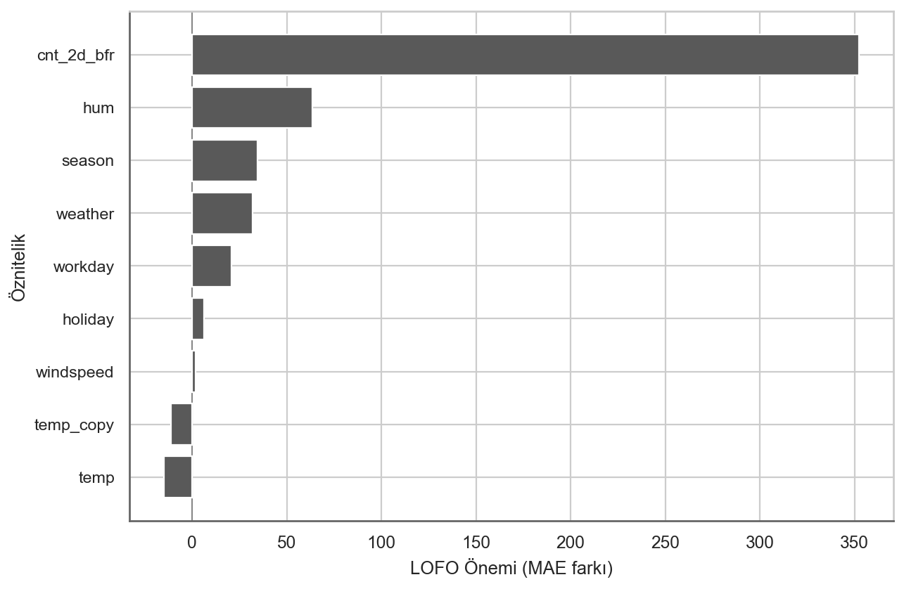
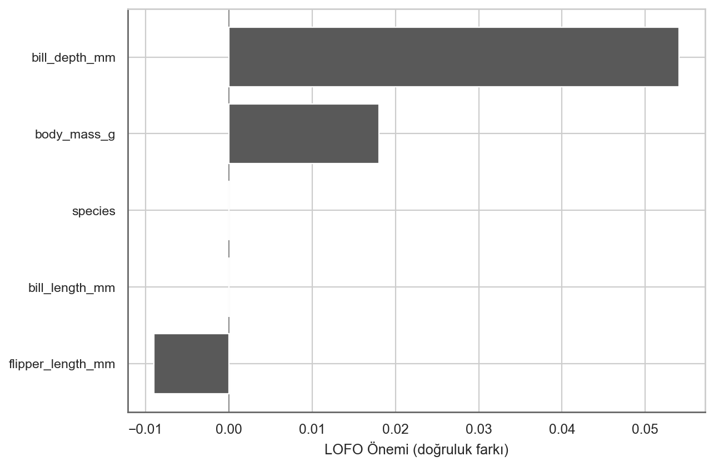

# Bir Özniteliği Dışarıda Bırakma (LOFO) Önemi {#lofo}

Bir Özniteliği Dışarıda Bırakma (LOFO) Önemi, modeli söz konusu öznitelik olmadan yeniden eğiterek ve tahmin performanslarını karşılaştırarak bir özniteliğin önemini ölçer.[^loco]

LOFO Öneminin arkasındaki sezgi şudur: Bir özniteliği çıkarmak tahmin performansını kötüleştiriyorsa, o önemli bir öznitelikti.
Özniteliği çıkarmak performansı değiştirmiyorsa, önemli değildi.
Özniteliği kaldırmak model performansını *iyileştirdiğinde* LOFO önemi negatif bile olabilir.
Algoritma yeni bir model eğittiği için, örneklerde göreceğimiz üzere performanstaki düşüş modelde kalan diğer özniteliklere koşulludur.

Tüm $p$ öznitelik için LOCO önemini elde etmek amacıyla, her seferinde eğitim verisinden farklı bir özniteliği çıkararak modeli $p$ kez yeniden eğitmemiz ve ortaya çıkan modelin performansını test verisi üzerinde ölçmemiz gerekir.
Bu durum LOFO'yu oldukça basit bir algoritma haline getirir.
Algoritmayı biçimselleştirelim:

**Girdi:** Eğitilmiş model $\hat{f}$, eğitim verisi $(\mathbf{X}_{\text{train}}, \mathbf{y}_{\text{train}})$, test verisi $(\mathbf{X}_{\text{test}}, \mathbf{y}_{\text{test}})$ ve hata ölçütü $L$.  
**Prosedür:**  

1. **Orijinal model hatasını ölçün:**  
   $$
   e_{\text{orig}} = \frac{1}{n_{\text{test}}} \sum_{i=1}^{n_{\text{test}}} L\big(y_{\text{test}}^{(i)}, \hat{f}(\mathbf{x}_{\text{test}}^{(i)})\big)
   $$  

2. **Her bir $j \in \{1, \ldots, p\}$ özniteliği için:**
   - Veri setinden $j$ özniteliğini kaldırarak yeni $\mathbf{X}_{\text{train},-j}$ ve $\mathbf{X}_{\text{test},-j}$ veri setlerini oluşturun.  
   - $\left(\mathbf{X}_{\text{train},-j}, \mathbf{y}_{\text{train}}\right)$ üzerinde yeni bir $\hat{f}_{-j}$ modeli eğitin.  
   - Değiştirilmiş test seti üzerinde yeni hatayı ölçün:  
     $$
     e_{-j} = \frac{1}{n_{\text{test}}} \sum_{i=1}^{n_{\text{test}}} L\big(y_{\text{test}}^{(i)}, \hat{f}_{-j}(\mathbf{x}_{\text{test},-j}^{(i)})\big)
     $$  

3. **Her bir öznitelik için LOFO önemini hesaplayın.**  
   - Bölüm olarak:  
     $$
     LOFO_j = \frac{e_{-j}}{e_{\text{orig}}}
     $$  
   - Veya fark olarak:  
     $$
     LOFO_j = e_{-j} - e_{\text{orig}}
     $$  

4. Öznitelikleri azalan $LOFO_j$ önemine göre **sıralayın ve görselleştirin**.

$L$ için hata ölçütleri yerine doğruluk gibi daha büyük değerin daha iyi olduğu performans ölçütleri kullanırken, farkı -1 ile çarptığınızdan veya bölümün sırasını değiştirdiğinizden emin olun.
Modeli eğitmek ve yeniden eğitmek için eğitim verisini, performansı ölçmek için ise test verisini kullanın.

## Örnekler

Verinin 2/3'ü üzerinde eğitilmiş bir rastgele orman kullanarak hava durumu ve takvim bilgilerine dayalı olarak bisiklet kiralamalarını tahmin ediyoruz.
@fig-lofo-bike, LOFO'ya göre sıcaklık ve önceki bisiklet kiralama sayısının en önemli öznitelikler olduğunu göstermektedir.
`holiday` özniteliği negatif bir öneme sahiptir ve bunun öznitelik seçimi açısından sonuçları vardır:
LOFO'nun algoritmik olarak çalışma şekli sayesinde, artık `holiday` özniteliğini kaldırmanın modelin performansını artırdığını biliyoruz.

{#fig-lofo-bike}

Bir şey deneyelim.
Korelasyonlu özniteliklerin uç bir versiyonunu simüle etmek için iki sıcaklık sütununa sahip yeni bir bisiklet veri seti oluşturdum: `temp` ve `temp_copy`.
Ve tahmin ettiğiniz gibi, `temp_copy` sütunu `temp` ile birebir aynı değerlere sahiptir, bu da %100 korelasyon anlamına gelir.
Yine, bu yeni veri seti üzerinde bir rastgele orman eğittim.
LOFO önemlerine ne olduğuna bakalım.

{#fig-lofo-bike-correlated}

@fig-lofo-bike-correlated ilginç bir olguyu göstermektedir:
Her iki sıcaklık özniteliğinin LOFO önemleri artık neredeyse sıfırdır.[^not-same-lofo]
Ancak örneğin `temp_copy` özniteliğini kaldırırsak, `temp` özniteliğinin en önemli öznitelik olduğunu bildiğimiz orijinal modeli elde ederiz.
Açıkça görüldüğü üzere, bu yeni modelin sıcaklığa hiç dayanmadığı sonucuna varmak yanlış olur.
Hem `temp` hem de `temp_copy` düşük bir önem alır çünkü LOFO öneminin tanımı gereği önemli değildirler.
`temp` özniteliğini kaldırdığımızda hiçbir bilgi kaybetmeyiz.
Bunun nedeni LOFO'nun koşullu bir yoruma sahip olmasıdır: Diğer öznitelikler verildiğinde, bir özniteliği kaldırmak modelin tahmin performansını ne kadar kötüleştirir?
Sonuçlar:

- Güçlü bir şekilde korelasyonlu olan özniteliklerin LOFO Önemi her zaman düşüktür, hatta potansiyel olarak negatiftir[^learner-ability]; çünkü LOFO önemi diğer öznitelikler tarafından sağlanan bilgiye koşullu olarak yorumlanmalıdır. Ve veride zaten bir sıcaklık özniteliğiniz varsa, aynı özniteliğin birebir kopyası önemli bir ek bilgi değildir.
- LOFO Önemini öznitelik seçimi için bilgi olarak kullandığınızda yorumlamaya dikkat edin: LOFO yalnızca model performansının özniteliklerin *tek tek* kaldırılmasına nasıl tepki verdiğini gösterir. @fig-lofo-bike-correlated ile gösterildiği gibi LOFO, aynı anda 2 veya daha fazla öznitelik kaldırıldığında performansın nasıl değiştiğine dair bize bilgi vermez.

Bu bilgiyle, vücut ölçümlerinden penguen cinsiyetini tahmin eden bir rastgele orman için LOFO'yu deneyelim.
Bunun için verinin 1/3'ünü hata tahmini için ayırarak verinin 2/3'ü üzerinde bir rastgele orman eğittim.
@fig-lofo-penguins, LOFO'ya göre gaga derinliğinin en önemli öznitelik olduğunu göstermektedir.

{#fig-lofo-penguins}

Burada daha büyük değerin daha iyi olduğu doğruluk ölçütünü kullandığım için önemi eksi bir ile çarptığıma dikkat edin.
LOFO ayrıca `species` ve `flipper_length` özniteliklerini güvenle kaldırabileceğimizi de söylemektedir.
Ancak modelin türler arasında ayrım yapabilmesi gerektiği için `species` özniteliğini tutmak isteriz.

## LOFO ve PFI karşılaştırması

Diğer yöntemlerin çoğu modelin yeniden eğitilmesini gerektirmediğinden, LOFO bu kitapta sunulan diğer yöntemlerden farklılık gösterir.
LOFO, herhangi bir modele uygulanabildiği ve modeli yeniden eğitmek yorumlamak istediğimiz orijinal modeli etkilemediği için savunulabilir biçimde post-hoc, modelden bağımsız bir yöntemdir.
Bununla birlikte, modelin yeniden eğitilmesi nedeniyle yorumlama, yalnızca o tek modeli yorumlamaktan öğreniciyi ve model eğitiminin özniteliklerdeki değişikliklere nasıl tepki verdiğini yorumlamaya doğru kayar.

Bana göre en büyük soru şudur: LOFO, [PFI](#feature-importance) ile karşılaştırıldığında nasıldır ve hangi önemi ne zaman kullanmalısınız?
Benzerliklerle başlayalım: Hem PFI hem de LOFO performansa dayalı önem ölçütleridir; her ikisi de farklı şekillerde yapsalar bile bir özniteliğin bilgisini "kaldırarak" önemi hesaplar; her ikisi de en azından en basit versiyonlarında her seferinde tek bir öznitelik üzerinde çalışır.
Ancak LOFO ve PFI diğer yönlerden farklılık gösterir.
@fig-lofo-bike-correlated örneğinde zaten gördüğümüz gibi, LOFO koşullu bir önem yorumuna sahiptir.
Yalnızca bir özniteliğin *ek* tahmin değeriyle ilgilidir.
Bu durum LOFO'yu *marjinal* permütasyon öznitelik öneminden ayırır.
LOFO, koşullu PFI'ye daha çok benzer ve her ikisi de diğer özniteliklere koşullu yorumlara sahiptir.

Ancak koşullu PFI ve LOFO farklı çalıştıkları için yorumları da farklıdır.
Koşullu PFI, yalnızca eldeki modeli içeren bir yorumdur.
LOFO önemi ise modelin yeniden eğitilmesini içerdiğinden makine öğrenmesi algoritmasına daha fazla odaklanır ve yorumlama artık farklı şekillerde eğitilmiş birden fazla modeli kapsar.
Bu aynı zamanda LOFO öneminin, makine öğrenmesi algoritmasının bir sütun daha az olan veri setlerini nasıl ele aldığından etkilendiği anlamına gelir.
Bir karar ağacı algoritması tamamen farklı bir ağaç üretebilir.
Dolayısıyla LOFO'nun yorumu hem eldeki modelle hem de makine öğrenmesi algoritması ve bir özniteliğin kaldırılmasına nasıl tepki verdiğiyle ilgilidir.

## Güçlü Yönler

**LOFO'yu uygulamak basittir**.
Buradaki örnekler için tam olarak bunu yaptım.
Bunu kendiniz yapabilirsiniz, bunun için aslında herhangi bir pakete ihtiyacınız yoktur.

LOFO **öznitelik seçimi için kullanışlıdır**: LOFO önemi sıfırın altında olan bir öznitelik, model performansını iyileştirmek için kaldırılabilir; önemi sıfır olan bir öznitelik de performansı etkilemeden güvenle kaldırılabilir.
Ancak LOFO'nun eğitim sürecinin rastgeleliğine tabi olduğunu ve aynı zamanda veri örneklemine bağlı olduğunu unutmayın.
LOFO önemi sonuçlarına dayanarak her seferinde yalnızca bir özniteliği kaldırdığınızdan emin olun.
İki özniteliği kaldırmak istiyorsanız bunu ardışık olarak yapmanız gerekir; yani LOFO önemini hesaplayın, önemsiz özniteliği kaldırın, LOFO'yu tekrar hesaplayın ve yine en az önemli olanı kaldırın.
Paylaşılan önemi hesaplamak için LOFO'yu LTFO'ya (iki özniteliği dışarıda bırakma) da uyarlayabilirsiniz.
PFI veya SHAP önemi gibi diğer önem yöntemleri, doğrudan eyleme dönüştürülebilir öznitelik seçimi bilgisi sağlamaz.

LOFO, öznitelikleri kaldırdığı ve modeli yeni örneklenmiş verilerle yoklamadığı için marjinal PFI gibi diğer yöntemlerin aksine **gerçekçi olmayan veriler oluşturmaz**.

LOFO, öznitelik seçimine yönelik eyleme dönüştürülebilir içgörüleri sayesinde **modelleme aşaması için kullanışlıdır**.
Ayrıca odak noktası modelin kendisinden ziyade **altta yatan olguyu anlamak** olduğunda da kullanışlıdır.
Bununla birlikte, belirli öğrenicinin özniteliklerin kaldırılmasına nasıl tepki verdiğinin de LOFO önem değerlerini etkileyeceğine dikkat edin.

Yorumlama amacınız (modelin kendisinden ziyade) olgu veya öğrenici hakkında olduğunda LOFO mantıklıdır.

## Sınırlılıklar

**LOFO maliyetlidir:** Tüm öznitelikler için LOFO önemini hesaplarsanız, modeli $p$ kez yeniden eğitmeniz gerekir.
Bu durum, özellikle Permütasyon Öznitelik Önemi ile karşılaştırıldığında maliyetli olabilir.

LOFO, **belirli bir modeli anlamak için en iyi yöntem değildir**.
Örneğin, daha ziyade bir model denetimi ortamı için LOFO uygun değildir; çünkü yorumlama yeni modellerin eğitilmesine dayanır, yani yorumlama yalnızca incelenen modele değil, aynı zamanda makine öğrenmesi algoritması tarafından üretilen diğer modellere de dayanır ve bu nedenle sonuçların makine öğrenmesi algoritması açısından yorumlanması gerekir.

Ayrıca **hiperparametre ayarlamasının nasıl ele alınacağı da biraz belirsizdir.** Tam olarak aynı hiperparametrelerle mi eğitmelisiniz, yoksa hiperparametre optimizasyonunu yeniden mi çalıştırmalısınız?
Hiperparametreleri sabit tutmak hesaplama açısından daha ucuzdur ve yeni eğitilen modeller potansiyel olarak o modele daha çok benzeyeceği için LOFO'nun odağını o modele daha fazla kaydırır.
$p$ modelin her biri için hiperparametre optimizasyonu çalıştırmak maliyetlidir, ancak model hatalarından kaynaklanan belirsizliği azalttığınız için LOFO sonuçlarını öznitelik seçimi ve öznitelikler ile hedef arasındaki ilişkilere dair içgörüler açısından daha bilgilendirici hale getirir.

**Yüksek korelasyonlu öznitelikler düşük LOFO önemi alır.** Bu, LOFO'nun çalışma şekli gereği beklenen bir durumdur, ancak bir tuzaktır ve önem grafiklerine bakarken kolayca unutulur.
Bu aynı zamanda LOFO önemlerini yorumlayabilmenizden önce verinizin korelasyonlarını incelemenin bir zorunluluk olduğu anlamına gelir.
Yorumunuzun koşulludan ziyade daha marjinal hale gelmesi için yüksek korelasyonlu öznitelikleri gruplandırabilir ve yalnızca birlikte kaldırabilirsiniz.

## Yazılım ve alternatifler

LOFO'nun bir [Python uygulaması](https://github.com/aerdem4/lofo-importance) mevcuttur.
Ancak aynı zamanda kendinizin de kolayca uygulayabileceği bir algoritmadır.

LOFO'ya bir alternatif [koşullu PFI](#feature-importance) yöntemidir.
Değişkeni çıkarmak yerine permüte edilmiş bir versiyonunu eklemek ve ardından modeli yeniden öğrenmek de mümkündür.
Bunun aynı sayıda özniteliğe sahip iki modeli karşılaştırma avantajı vardır, ancak başka bir belirsizlik kaynağı ortaya çıkarır (permütasyonun kendisi rastgeledir).

"Geriye doğru ardışık öznitelik seçimi" adlı öznitelik seçimi yöntemi, temel olarak LOFO + öznitelik kaldırma işleminin ardışık olarak uygulanmasıdır.

[^loco]: Bildiğim kadarıyla LOFO'nun ilk biçimsel tanımı [Lei et al. (2018)](#ref-lei2018distributionfree) tarafından yapılmıştır. Onlar bunu Bir Eşdeğişkeni Dışarıda Bırakma (LOCO) olarak adlandırmaktadır ve makale çoğunlukla dağılımdan bağımsız testler hakkındadır.

[^learner-ability]: Burada öğrenicinin, diğer özniteliklere daha fazla dayanarak bir özniteliğin kaldırılmasını telafi edebildiğini varsaymamız gerekir. Ancak bunu yapamayan herhangi bir makine öğrenmesi algoritması bilmiyorum.

[^not-same-lofo]: `temp` ve `temp_copy` öznitelikleri, model eğitimindeki rastgelelik nedeniyle benzer ancak eşit olmayan LOFO önemlerine sahiptir.

## Kaynaklar {#references .unnumbered}

::: {#refs .references .csl-bib-body .hanging-indent}

::: {#ref-lei2018distributionfree .csl-entry}
Lei, Jing, Max G’Sell, Alessandro Rinaldo, Ryan J. Tibshirani, and Larry Wasserman. 2018. “Distribution-Free Predictive Inference for Regression.” *Journal of the American Statistical Association* 113 (523): 1094–1111. <https://doi.org/10.1080/01621459.2017.1307116>.
:::

:::
