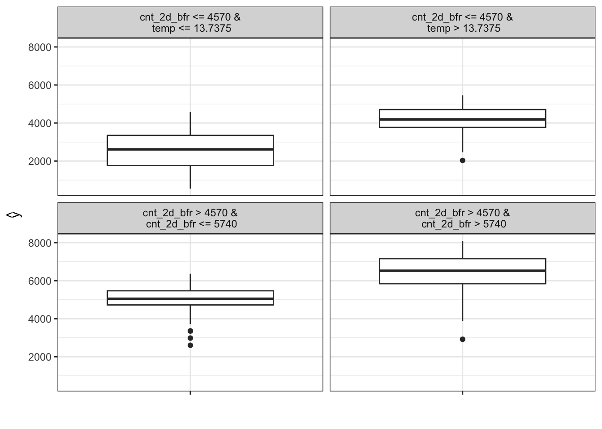
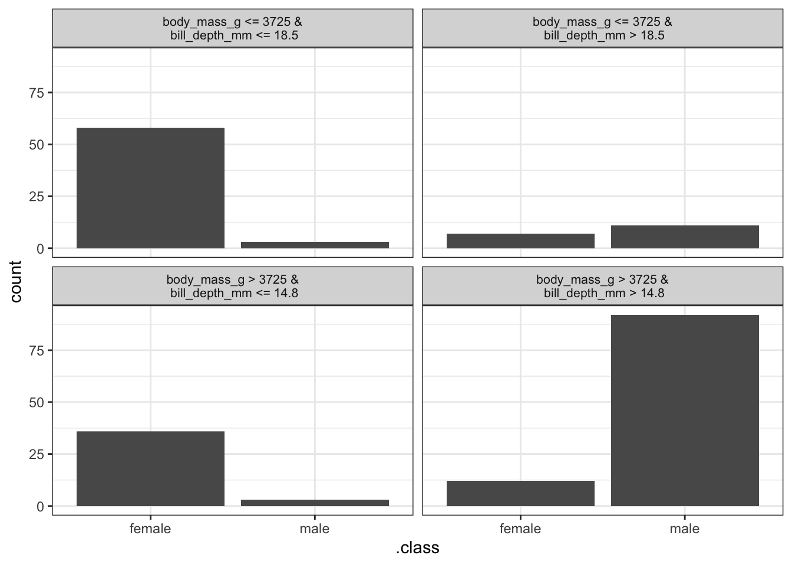

::: {.callout-note}
Bu metin, Christoph Molnar'ın *Interpretable Machine Learning* kitabının "Surrogate Models" bölümünün Türkçe çevirisidir. Kaynak: <https://christophm.github.io/interpretable-ml-book/global.html>. Kitap CC BY-NC-SA lisansı altındadır; çeviri de aynı lisans koşullarına tabidir. Orijinal metindeki matematiksel ifadeler çıkarılmış olduğundan, aşağıdaki formüller bağlama göre yeniden yazılmıştır.
:::

# Vekil Modeller {#sec-surrogate}

**Global vekil model**, bir kara kutu modelin tahminlerine yaklaşmak üzere eğitilmiş yorumlanabilir bir modeldir. Vekil modeli yorumlayarak kara kutu model hakkında sonuçlar çıkarabiliriz. Yani makine öğrenmesinin yorumlanabilirliğini, daha fazla makine öğrenmesi kullanarak çözüyoruz!

## Teori

Vekil modeller mühendislikte de kullanılır: İlgilenilen bir çıktının ölçülmesi pahalıysa, zaman alıyorsa veya başka bir nedenle zorsa (örneğin karmaşık bir bilgisayar simülasyonundan geliyorsa), bunun yerine çıktının ucuz ve hızlı bir vekil modeli kullanılabilir. Mühendislikte kullanılan vekil modellerle yorumlanabilir makine öğrenmesinde kullanılanlar arasındaki fark şudur: Temeldeki model bir simülasyon değil, bir makine öğrenmesi modelidir ve vekil modelin yorumlanabilir olması gerekir. (Yorumlanabilir) vekil modellerin amacı, temeldeki modelin tahminlerine olabildiğince doğru biçimde yaklaşmak ve aynı zamanda yorumlanabilir olmaktır. Vekil model fikri farklı adlarla da karşımıza çıkar: yaklaşım modeli, metamodel, yanıt yüzeyi modeli, emülatör vb.

Teori hakkında: Vekil modelleri anlamak için aslında fazla teoriye gerek yoktur. Kara kutu tahmin fonksiyonumuz $\hat{f}$'ye, vekil model tahmin fonksiyonu $g$ ile mümkün olduğunca yakın bir yaklaşım yapmak istiyoruz; şartımız $g$'nin yorumlanabilir olmasıdır. $g$ fonksiyonu için herhangi bir yorumlanabilir model kullanılabilir.

Örneğin bir doğrusal model:

$$g(x) = \beta_0 + \beta_1 x_1 + \ldots + \beta_p x_p$$

Veya bir karar ağacı:

$$g(x) = \sum_{m=1}^{M} c_m \, I\{x \in R_m\}$$

Vekil model eğitmek **modelden bağımsız (model-agnostic)** bir yöntemdir; çünkü kara kutu modelin iç işleyişi hakkında hiçbir bilgi gerektirmez, yalnızca veriye ve tahmin fonksiyonuna erişim yeterlidir. Temeldeki makine öğrenmesi modeli başka bir modelle değiştirilse bile vekil yöntemini kullanmaya devam edebilirsiniz. Kara kutu model türünün seçimi ile vekil model türünün seçimi birbirinden bağımsızdır.

Bir vekil model elde etmek için şu adımları izleyin:

1. Bir veri kümesi $X$ seçin. Bu, kara kutu modeli eğitmek için kullanılan veri kümesi olabileceği gibi aynı dağılımdan gelen yeni bir veri kümesi de olabilir. Uygulamanıza bağlı olarak verinin bir alt kümesini ya da bir nokta ızgarasını bile seçebilirsiniz.
2. Seçilen $X$ veri kümesi için kara kutu modelin tahminlerini alın.
3. Yorumlanabilir bir model türü seçin (doğrusal model, karar ağacı, …).
4. Yorumlanabilir modeli $X$ veri kümesi ve bu veri kümesine ait tahminler üzerinde eğitin.
5. Tebrikler! Artık bir vekil modeliniz var.
6. Vekil modelin kara kutu modelin tahminlerini ne kadar iyi yeniden ürettiğini ölçün.
7. Vekil modeli yorumlayın.

Vekil modeller için bazı ek adımlar içeren ya da biraz farklılaşan yaklaşımlar bulabilirsiniz, ancak genel fikir genellikle burada anlatıldığı gibidir.

Vekilin kara kutu modeli ne kadar iyi taklit ettiğini ölçmenin bir yolu R-kare ölçüsüdür:

$$R^2 = 1 - \frac{SSE}{SST} = 1 - \frac{\sum_{i=1}^{n} \left(\hat{y}_*^{(i)} - \hat{y}^{(i)}\right)^2}{\sum_{i=1}^{n} \left(\hat{y}^{(i)} - \overline{\hat{y}}\right)^2}$$

Burada $\hat{y}_*^{(i)}$ vekil modelin $i$-inci örnek için tahmini, $\hat{y}^{(i)}$ kara kutu modelin tahmini ve $\overline{\hat{y}}$ kara kutu model tahminlerinin ortalamasıdır. SSE hata kareleri toplamını (sum of squares error), SST ise toplam kareler toplamını (sum of squares total) ifade eder. R-kare ölçüsü, vekil model tarafından yakalanan varyans yüzdesi olarak yorumlanabilir. R-kare 1'e yakınsa (= düşük SSE), yorumlanabilir model kara kutu modelin davranışına çok iyi yaklaşıyor demektir. Yorumlanabilir model çok yakınsa, karmaşık modeli yorumlanabilir modelle değiştirmek isteyebilirsiniz. R-kare 0'a yakınsa (= yüksek SSE), yorumlanabilir model kara kutu modeli açıklamakta başarısız olur.

Temeldeki kara kutu modelin model performansından, yani gerçek sonucu tahmin etmede ne kadar iyi ya da kötü olduğundan henüz söz etmediğimize dikkat edin. Kara kutu modelin performansı, vekil modelin eğitiminde rol oynamaz. Vekil modelin yorumu yine de geçerlidir; çünkü gerçek dünya hakkında değil, model hakkında ifadeler içerir. Ancak elbette kara kutu model kötüyse, vekil modelin yorumu da anlamsız hale gelir; çünkü kara kutu modelin kendisi ilgisizdir.

Ayrıca orijinal verinin bir alt kümesine dayanarak vekil model kurabilir veya örneklerin ağırlıklarını yeniden düzenleyebiliriz. Bu şekilde vekil modelin girdi dağılımını değiştirmiş oluruz, bu da yorumun odağını değiştirir (artık gerçekten global değildir). Veriyi belirli bir örneğe göre yerel olarak ağırlıklandırırsak (örnekler seçilen örneğe ne kadar yakınsa ağırlıkları o kadar yüksek olur), o örneğin bireysel tahminini açıklayabilen bir **yerel vekil model** elde ederiz.

## Örnek

Vekil modelleri göstermek için bir regresyon ve bir sınıflandırma örneği ele alıyoruz.

Önce hava durumu ve takvim bilgisi verildiğinde günlük kiralanan bisiklet sayısını tahmin etmek için bir destek vektör makinesi (SVM) eğitiyoruz. Destek vektör makinesi pek yorumlanabilir değildir; bu nedenle SVM'nin davranışına yaklaşmak üzere, orijinal eğitim verisini kullanarak yorumlanabilir model olarak bir CART karar ağacından oluşan bir vekil eğitiyoruz. Şekil 25.1'de gösterilen vekil modelin test verisi üzerinde R-karesi (açıklanan varyans) 0,76'dır; bu, modelin altta yatan kara kutu davranışına oldukça iyi, ancak mükemmel olmayan bir biçimde yaklaştığı anlamına gelir. Uyum mükemmel olsaydı, destek vektör makinesini atıp yerine ağacı kullanabilirdik. Düğümlerdeki dağılımlar, vekil ağacın sıcaklık 13 °C'nin üzerindeyken ve iki gün önceki kiralama sayısı daha yüksekken daha fazla kiralanan bisiklet tahmin ettiğini göstermektedir.

{#fig-surrogate-bike}

İkinci örneğimizde, bir penguenin dişi mi erkek mi olduğunu rastgele orman (random forest) ile sınıflandırıyoruz; yine orijinal veri kümesi üzerinde bir karar ağacı eğitiyoruz, ancak sonuç olarak verideki gerçek sınıfları (erkek/dişi) değil, rastgele ormanın tahminlerini kullanıyoruz. Şekil 25.2'de gösterilen vekil modelin R-karesi (açıklanan varyans) 0,71'dir; bu da rastgele ormana belli ölçüde yaklaştığı, ancak mükemmel olmadığı anlamına gelir.

{#fig-surrogate-penguins}

## Güçlü Yönler

Vekil model yöntemi **esnektir**: Herhangi bir yorumlanabilir model kullanılabilir. Bu, yalnızca yorumlanabilir modeli değil, temeldeki kara kutu modeli de değiştirebileceğiniz anlamına gelir. Karmaşık bir model oluşturduğunuzu ve bunu şirketinizdeki farklı ekiplere açıkladığınızı varsayın. Bir ekip doğrusal modellere aşina, diğer ekip ise karar ağaçlarını anlayabiliyor. Orijinal kara kutu model için iki vekil model (doğrusal model ve karar ağacı) eğitip iki tür açıklama sunabilirsiniz. Daha iyi performans gösteren bir kara kutu model bulursanız, aynı vekil model sınıfını kullanabileceğiniz için yorumlama yönteminizi değiştirmeniz gerekmez.

Bu yaklaşımın **çok sezgisel ve basit** olduğunu savunurum. Bu, uygulamasının kolay olduğu, aynı zamanda veri bilimi veya makine öğrenmesine aşina olmayan kişilere açıklamasının da kolay olduğu anlamına gelir.

R-kare ölçüsüyle, vekil modellerimizin kara kutu tahminlerine ne kadar iyi yaklaştığını **kolayca ölçebiliriz**.

## Sınırlamalar

Vekil model gerçek sonucu hiç görmediği için, **veri hakkında değil, model hakkında** sonuçlar çıkardığınızın farkında olmalısınız.

Vekil modelin kara kutu modele yeterince yakın olduğundan emin olmak için en iyi R-kare eşiğinin ne olduğu **belirsizdir**. %80 açıklanan varyans mı? %50 mi? %99 mu?

Vekil modelin kara kutu modele ne kadar yakın olduğunu ölçebiliriz. Çok yakın olmadığımızı, ama yeterince yakın olduğumuzu varsayalım. Yorumlanabilir modelin veri kümesinin bir alt kümesi için çok yakın, başka bir alt kümesi için ise ciddi biçimde farklı olması mümkündür. Bu durumda basit modelin yorumu tüm veri noktaları için aynı derecede iyi olmaz.

Vekil olarak seçtiğiniz yorumlanabilir model, **tüm avantaj ve dezavantajlarıyla birlikte** gelir.

Bazı kişiler, genel olarak içsel olarak yorumlanabilir model diye bir şey olmadığını (doğrusal modeller ve karar ağaçları dahil) ve bir yorumlanabilirlik yanılsamasına sahip olmanın tehlikeli bile olabileceğini savunur. Bu görüşü paylaşıyorsanız, elbette bu yöntem sizin için değildir.

## Yazılım

Örnekler için `iml` R paketini kullandım. Bir makine öğrenmesi modeli eğitebiliyorsanız, vekil modelleri kendiniz de uygulayabilmelisiniz. Yapmanız gereken, yorumlanabilir bir modeli kara kutu modelin tahminlerini tahmin edecek şekilde eğitmektir.
