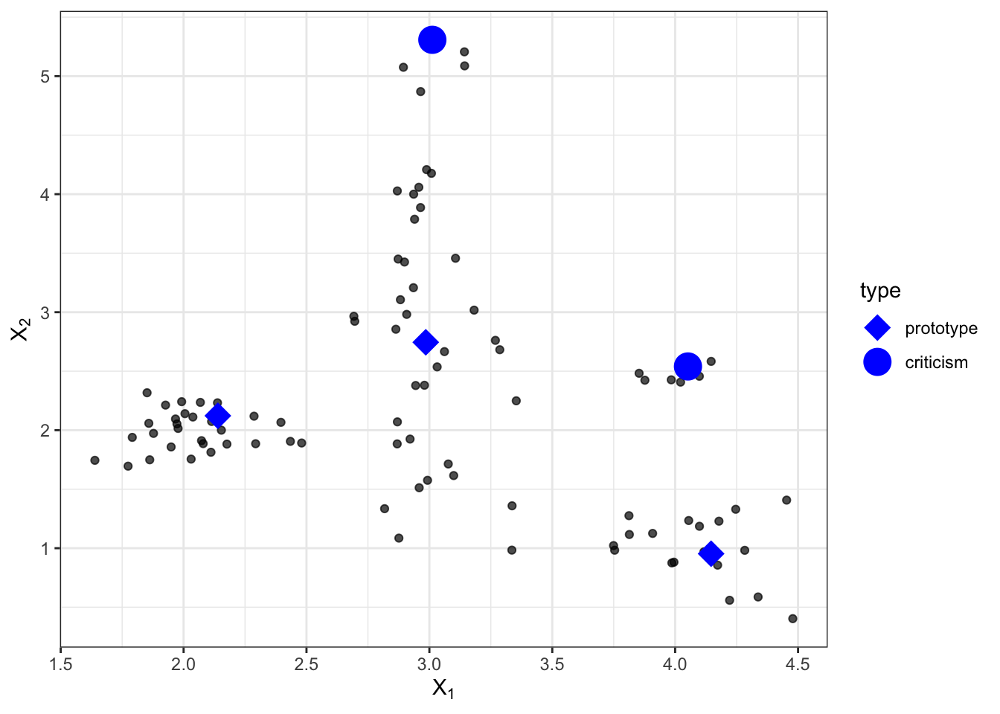
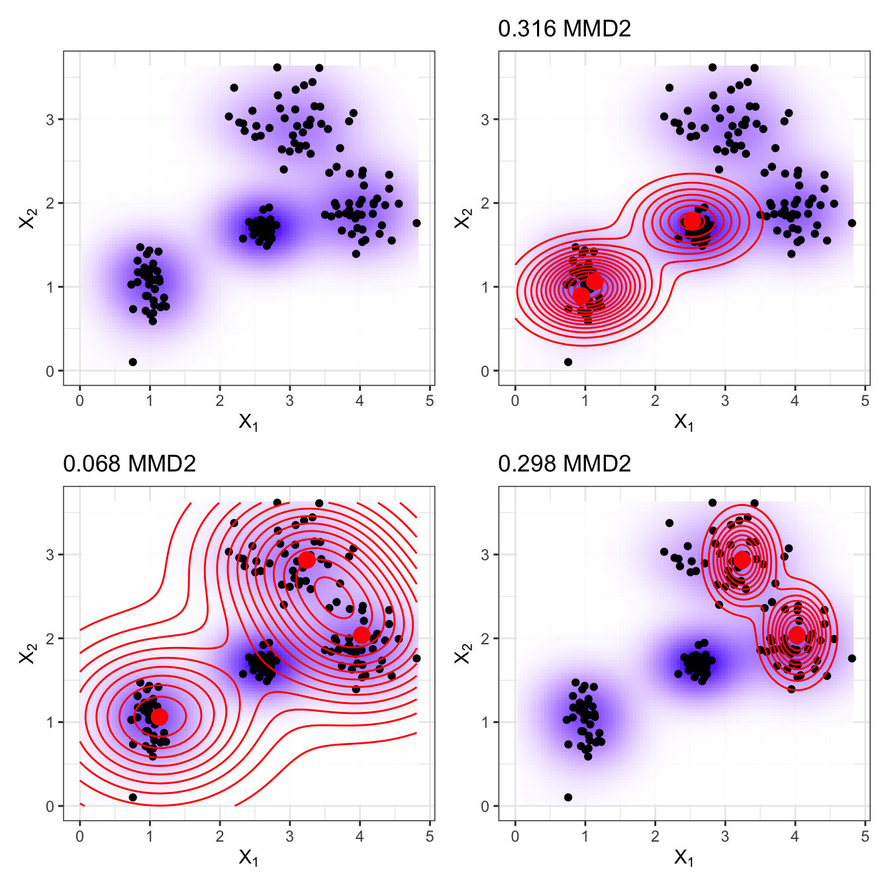
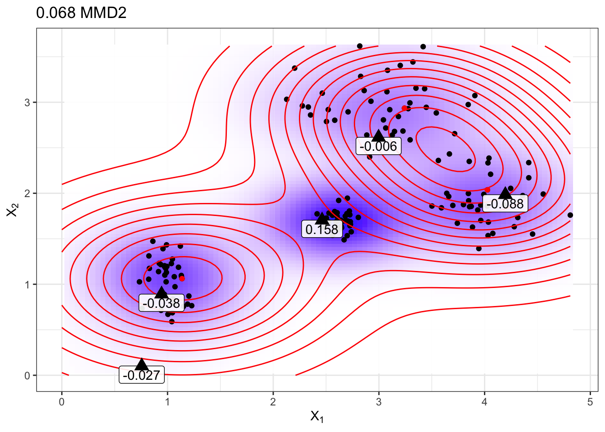
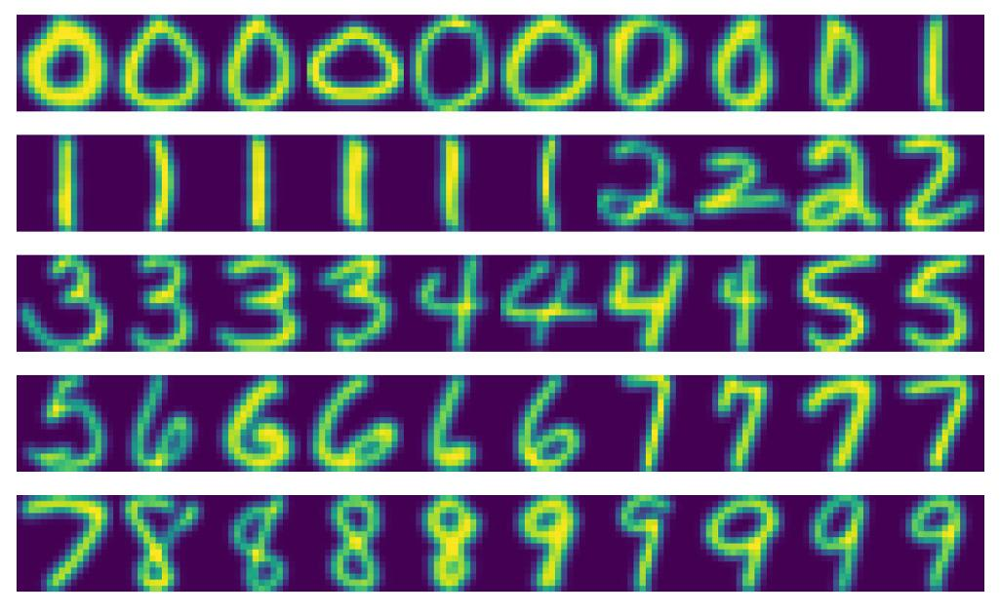

::: {.callout-note}
Bu metin, Christoph Molnar'ın *Interpretable Machine Learning* kitabının "Prototypes and Criticisms" bölümünün Türkçe çevirisidir. Kaynak: <https://christophm.github.io/interpretable-ml-book/proto.html>. Kitap CC BY-NC-SA lisansı altındadır; çeviri de aynı lisans koşullarına tabidir. Orijinal metindeki matematiksel ifadeler çıkarılmış olduğundan, aşağıdaki formüller bağlama göre yeniden yazılmıştır.
:::

# Prototipler ve Eleştiriler {#sec-proto}

**Prototip**, tüm verinin temsilcisi olan bir veri örneğidir. **Eleştiri (criticism)** ise prototip kümesi tarafından iyi temsil edilmeyen bir veri örneğidir. Eleştirilerin amacı, özellikle prototiplerin iyi temsil etmediği veri noktaları için prototiplerle birlikte içgörü sağlamaktır. Prototipler ve eleştiriler, veriyi betimlemek için bir makine öğrenmesi modelinden bağımsız olarak kullanılabilir; ayrıca yorumlanabilir bir model oluşturmak veya bir kara kutu modeli yorumlanabilir hale getirmek için de kullanılabilir.

Bu bölümde, bir örneğin aynı zamanda her özelliğin bir boyut olduğu bir koordinat sisteminde bir nokta olduğu yorumunu vurgulamak için "veri noktası" ifadesini kullanıyorum. Şekil 26.1, bazı örneklerin prototip, bazılarının eleştiri olarak seçildiği simüle edilmiş bir veri dağılımını göstermektedir. Küçük noktalar veriyi, büyük noktalar eleştirileri, büyük kareler ise prototipleri temsil eder. Bu durumda prototipler, veri dağılımının merkezlerini kapsayacak şekilde (elle) seçilmiştir; eleştiriler ise prototipi olmayan bir kümedeki noktalardır. Prototipler ve eleştiriler her zaman verideki gerçek örneklerdir.

{#fig-proto-intro}

Prototipleri elle seçtim; bu yöntem iyi ölçeklenmez ve muhtemelen kötü sonuçlara yol açar. Veride prototip bulmak için birçok yaklaşım vardır. Bunlardan biri, k-ortalamalar (k-means) algoritmasıyla ilişkili bir kümeleme algoritması olan **k-medoids**'tir. Küme merkezleri olarak gerçek veri noktalarını döndüren herhangi bir kümeleme algoritması prototip seçimi için uygundur. Ancak bu yöntemlerin çoğu yalnızca prototip bulur, eleştiri bulmaz. Bu bölüm, Kim, Khanna ve Koyejo (2016) tarafından geliştirilen ve prototipleri ile eleştirileri tek bir çerçevede birleştiren **MMD-critic** yaklaşımını sunmaktadır.

MMD-critic, verinin dağılımı ile seçilen prototiplerin dağılımını karşılaştırır. Bu, MMD-critic yöntemini anlamak için temel kavramdır. MMD-critic, iki dağılım arasındaki farkı en aza indiren prototipleri seçer. Yoğunluğun yüksek olduğu bölgelerdeki veri noktaları, özellikle farklı "veri kümelerinden" seçildiklerinde, iyi prototiplerdir. Prototipler tarafından iyi açıklanmayan bölgelerdeki veri noktaları ise eleştiri olarak seçilir.

## Teori

MMD-critic prosedürü üst düzeyde kısaca şöyle özetlenebilir:

1. Bulmak istediğiniz prototip ve eleştiri sayısını seçin.
2. Açgözlü (greedy) aramayla prototipleri bulun. Prototipler, prototiplerin dağılımı veri dağılımına yakın olacak şekilde seçilir.
3. Açgözlü aramayla eleştirileri bulun. Prototiplerin dağılımının verinin dağılımından farklı olduğu noktalar eleştiri olarak seçilir.

MMD-critic ile bir veri kümesi için prototip ve eleştiri bulmak üzere birkaç bileşene ihtiyacımız var. En temel bileşen olarak, veri yoğunluklarını tahmin etmek için bir **çekirdek fonksiyonuna (kernel)** ihtiyacımız var. Çekirdek, iki veri noktasını birbirlerine yakınlığına göre ağırlıklandıran bir fonksiyondur. Yoğunluk tahminlerine dayanarak, iki dağılımın birbirinden ne kadar farklı olduğunu söyleyen bir ölçüye de ihtiyacımız var; böylece seçtiğimiz prototiplerin dağılımının veri dağılımına yakın olup olmadığını belirleyebiliriz. Bu, **maksimum ortalama sapma (maximum mean discrepancy, MMD)** ölçülerek çözülür. Ayrıca çekirdek fonksiyonuna dayanarak, iki dağılımın belirli bir veri noktasında ne kadar farklı olduğunu söyleyen **tanık fonksiyonuna (witness function)** ihtiyacımız var. Tanık fonksiyonuyla eleştirileri, yani prototiplerin ve verinin dağılımlarının birbirinden ayrıştığı ve tanık fonksiyonunun mutlak değerce büyük değerler aldığı veri noktalarını seçebiliriz. Son bileşen, iyi prototipler ve eleştiriler için bir arama stratejisidir; bu da basit bir açgözlü aramayla çözülür.

İki dağılım arasındaki sapmayı ölçen maksimum ortalama sapma (MMD) ile başlayalım. Prototiplerin seçimi, prototiplerin bir yoğunluk dağılımını oluşturur. Prototip dağılımının veri dağılımından farklı olup olmadığını değerlendirmek istiyoruz. İkisini de çekirdek yoğunluk fonksiyonlarıyla tahmin ederiz. Maksimum ortalama sapma, iki dağılım arasındaki farkı ölçer; bu, bir fonksiyon uzayı üzerinde, iki dağılıma göre alınan beklentiler arasındaki farkların supremumudur. Her şey net mi? Şahsen bu kavramları, bir şeyin veriyle nasıl hesaplandığını gördüğümde çok daha iyi anlıyorum. Aşağıdaki formül, kare MMD ölçüsünün ($MMD^2$) nasıl hesaplanacağını gösterir:

$$MMD^2 = \frac{1}{m^2} \sum_{i,j=1}^{m} k(z_i, z_j) - \frac{2}{mn} \sum_{i=1}^{m} \sum_{j=1}^{n} k(z_i, x_j) + \frac{1}{n^2} \sum_{i,j=1}^{n} k(x_i, x_j)$$

$k$, iki noktanın benzerliğini ölçen bir çekirdek fonksiyonudur; bunun ayrıntılarına biraz sonra değineceğiz. $m$ prototip sayısı, $n$ ise orijinal veri kümemizdeki $x$ veri noktalarının sayısıdır. $z$ prototipleri, $x$ veri noktalarından yapılan bir seçimdir. Her nokta çok boyutludur, yani birden fazla özelliğe sahip olabilir. MMD-critic'in amacı $MMD^2$'yi en aza indirmektir. $MMD^2$ sıfıra ne kadar yakınsa, prototiplerin dağılımı veriye o kadar iyi uyar. $MMD^2$'yi sıfıra indirmenin anahtarı, ortadaki terimdir; bu terim prototipler ile diğer tüm veri noktaları arasındaki ortalama yakınlığı (2 ile çarpılmış olarak) hesaplar. Bu terim, birinci terim (prototiplerin birbirlerine ortalama yakınlığı) ile son terimin (veri noktalarının birbirlerine ortalama yakınlığı) toplamına eşit olursa, prototipler veriyi mükemmel biçimde açıklar. Tüm $n$ veri noktasını prototip olarak kullansaydınız formüle ne olacağını deneyin.

Şekil 26.2, $MMD^2$ ölçüsünü göstermektedir. İlk grafik, iki özelliğe sahip veri noktalarını gösterir; veri yoğunluğunun tahmini gölgeli bir arka planla görüntülenir. Diğer grafiklerin her biri farklı prototip seçimlerini gösterir ve ölçü grafik başlıklarında yer alır. Prototipler büyük noktalardır ve dağılımları eş eğri çizgileriyle gösterilir. Bu senaryolarda veriyi en iyi kapsayan prototip seçimi (sol altta) en düşük sapma değerine sahiptir.

{#fig-proto-mmd}

Çekirdek için bir seçenek, **radyal tabanlı fonksiyon (RBF) çekirdeğidir**:

$$k(x, x') = \exp\left(-\gamma \, \lVert x - x' \rVert^2\right)$$

Burada $\lVert x - x' \rVert$ iki nokta arasındaki Öklid uzaklığı, $\gamma$ ise bir ölçekleme parametresidir. Çekirdeğin değeri iki nokta arasındaki uzaklıkla azalır ve sıfır ile bir arasında değişir: İki nokta sonsuz uzaklıktaysa sıfır, iki nokta eşitse bir.

$MMD^2$ ölçüsünü, çekirdeği ve açgözlü aramayı prototip bulmak için bir algoritmada birleştiriyoruz:

1. Boş bir prototip listesiyle başlayın.
2. Prototip sayısı seçilen $m$ sayısının altında olduğu sürece:
    - Veri kümesindeki her nokta için, o nokta prototip listesine eklendiğinde $MMD^2$'nin ne kadar azaldığını kontrol edin. $MMD^2$'yi en çok azaltan veri noktasını listeye ekleyin.
3. Prototip listesini döndürün.

Eleştirileri bulmak için kalan bileşen, iki yoğunluk tahmininin belirli bir noktada ne kadar farklı olduğunu söyleyen tanık fonksiyonudur. Şu şekilde tahmin edilebilir:

$$\text{witness}(x) = \frac{1}{n} \sum_{i=1}^{n} k(x, x_i) - \frac{1}{m} \sum_{j=1}^{m} k(x, z_j)$$

Tanık fonksiyonu, (aynı özelliklere sahip) iki veri kümesi için, $x$ noktasının hangi ampirik dağılıma daha iyi uyduğunu değerlendirme olanağı verir. Eleştirileri bulmak için tanık fonksiyonunun hem negatif hem de pozitif yöndeki uç değerlerini ararız. Tanık fonksiyonundaki ilk terim, $x$ noktası ile veri arasındaki ortalama yakınlıktır; ikinci terim ise sırasıyla $x$ noktası ile prototipler arasındaki ortalama yakınlıktır. Bir $x$ noktası için tanık fonksiyonu sıfıra yakınsa, verinin ve prototiplerin yoğunluk fonksiyonları birbirine yakındır; yani $x$ noktasında prototiplerin dağılımı verinin dağılımına benzer. $x$ noktasında negatif bir tanık fonksiyonu, prototip dağılımının veri dağılımını olduğundan fazla tahmin ettiği anlamına gelir (örneğin bir prototip seçtik ama yakında yalnızca birkaç veri noktası var); $x$ noktasında pozitif bir tanık fonksiyonu ise prototip dağılımının veri dağılımını olduğundan az tahmin ettiği anlamına gelir (örneğin $x$ çevresinde çok sayıda veri noktası var ama yakınında hiç prototip seçmedik).

Daha fazla sezgi kazandırmak için, daha önceki grafikten en düşük $MMD^2$ değerine sahip prototipleri yeniden kullanalım ve tanık fonksiyonunu elle seçilmiş birkaç nokta için gösterelim. Şekil 26.3'teki etiketler, üçgenlerle işaretlenmiş çeşitli noktalar için tanık fonksiyonunun değerini gösterir. Yalnızca ortadaki nokta yüksek mutlak değere sahiptir ve dolayısıyla eleştiri için iyi bir adaydır.

{#fig-proto-witness}

Tanık fonksiyonu, prototipler tarafından iyi temsil edilmeyen veri örneklerini açıkça aramamıza olanak tanır. Eleştiriler, tanık fonksiyonunda yüksek mutlak değere sahip noktalardır. Prototipler gibi eleştiriler de açgözlü aramayla bulunur. Ancak toplam $MMD^2$'yi azaltmak yerine, tanık fonksiyonunu ve bir düzenleyici (regularizer) terimi içeren bir maliyet fonksiyonunu maksimize eden noktaları ararız. Optimizasyon fonksiyonundaki ek terim, noktaların çeşitliliğini zorunlu kılar; bu, noktaların farklı kümelerden gelmesi için gereklidir.

Bu ikinci adım, prototiplerin nasıl bulunduğundan bağımsızdır. Bazı prototipleri elle seçip burada anlatılan prosedürle eleştirileri öğrenebilirdim. Ya da prototipler k-medoids gibi herhangi bir kümeleme prosedüründen gelebilirdi.

MMD-critic teorisinin önemli kısımları bu kadar. Bir soru kalıyor: MMD-critic yorumlanabilir makine öğrenmesi için nasıl kullanılabilir?

MMD-critic yorumlanabilirliği üç yolla artırabilir: Veri dağılımını daha iyi anlamaya yardımcı olarak; yorumlanabilir bir model oluşturarak; bir kara kutu modeli yorumlanabilir hale getirerek.

Prototip ve eleştiri bulmak için MMD-critic'i verinize uygularsanız, özellikle uç durumlar içeren karmaşık bir veri dağılımına sahipseniz, veriyi anlamanız gelişecektir. Ama MMD-critic ile daha fazlasını başarabilirsiniz!

Örneğin yorumlanabilir bir tahmin modeli oluşturabilirsiniz: "en yakın prototip modeli" olarak adlandırılan model. Tahmin fonksiyonu şöyle tanımlanır:

$$\hat{f}(x) = \arg\max_{i \in S} \, k(x, x_i)$$

Bu, $S$ prototip kümesinden, çekirdek fonksiyonunun en yüksek değerini vermesi anlamında yeni veri noktasına en yakın olan $i$ prototipini seçtiğimiz anlamına gelir. Tahmin için açıklama olarak prototipin kendisi döndürülür. Bu prosedürün üç ayar parametresi vardır: Çekirdeğin türü, çekirdek ölçekleme parametresi ve prototip sayısı. Tüm parametreler bir çapraz doğrulama döngüsü içinde optimize edilebilir. Bu yaklaşımda eleştiriler kullanılmaz.

Üçüncü seçenek olarak, MMD-critic'i herhangi bir makine öğrenmesi modelini, prototiplere ve eleştirilere model tahminleriyle birlikte bakarak global olarak açıklanabilir kılmak için kullanabiliriz. Prosedür şöyledir:

1. MMD-critic ile prototipleri ve eleştirileri bulun.
2. Bir makine öğrenmesi modelini her zamanki gibi eğitin.
3. Makine öğrenmesi modeliyle prototipler ve eleştiriler için sonuçları tahmin edin.
4. Tahminleri analiz edin: Algoritma hangi durumlarda yanlıştı? Artık veriyi iyi temsil eden ve makine öğrenmesi modelinin zayıflıklarını bulmanıza yardımcı olan bir dizi örneğiniz var.

Bu nasıl yardımcı olur? Google'ın görüntü sınıflandırıcısının siyahi insanları goril olarak tanımladığı zamanı hatırlayın. Belki görüntü tanıma modellerini kullanıma sunmadan önce burada anlatılan prosedürü uygulamalıydılar. Yalnızca modelin performansını kontrol etmek yeterli değildir; çünkü model %99 doğru olsa bile bu sorun kalan %1'in içinde olabilir. Etiketler de yanlış olabilir! Tüm eğitim verisini gözden geçirip tahminin sorunlu olup olmadığını kontrol etmek sorunu ortaya çıkarabilirdi, ancak bu uygulanabilir olmazdı. Fakat — diyelim ki birkaç bin — prototip ve eleştiri seçmek uygulanabilirdir ve veriyle ilgili bir sorunu ortaya çıkarabilirdi: Koyu tenli insanların görüntülerinin eksik olduğunu gösterebilirdi; bu da veri kümesinin çeşitliliğinde bir sorun olduğuna işaret eder. Ya da koyu tenli bir veya daha fazla kişinin görüntüsünü, kötü şöhretli "goril" sınıflandırmasıyla birlikte bir prototip ya da (büyük olasılıkla) eleştiri olarak gösterebilirdi. MMD-critic'in bu tür hataları kesinlikle yakalayacağına dair söz vermiyorum, ama iyi bir sağlık kontrolüdür.

## Örnekler

MMD-critic'in aşağıdaki örneği, el yazısı rakamlardan oluşan bir veri kümesi kullanır. Şekil 26.4'teki gerçek prototiplere baktığınızda, rakam başına düşen görüntü sayısının farklı olduğunu fark edebilirsiniz. Bunun nedeni, sınıf başına sabit bir sayı yerine tüm veri kümesi genelinde sabit sayıda prototip aranmış olmasıdır. Beklendiği gibi prototipler, rakamların farklı yazılış biçimlerini gösterir.

{#fig-proto-digits}

## Güçlü Yönler

Bir kullanıcı çalışmasında MMD-critic'in yazarları, katılımcılara görüntüler verdi ve katılımcıların bunları iki sınıftan birini (örneğin iki köpek ırkı) temsil eden iki görüntü kümesinden biriyle görsel olarak eşleştirmeleri gerekiyordu. Katılımcılar, kümeler bir sınıfın rastgele görüntüleri yerine prototipleri ve eleştirileri gösterdiğinde en iyi performansı sergiledi.

Prototip ve eleştiri sayısını seçmekte özgürsünüz.

MMD-critic, verinin yoğunluk tahminleriyle çalışır. Bu, her tür veri ve her tür makine öğrenmesi modeliyle çalışır.

Algoritmanın uygulanması kolaydır.

MMD-critic, yorumlanabilirliği artırmak için kullanılma biçiminde esnektir. Karmaşık veri dağılımlarını anlamak için kullanılabilir. Yorumlanabilir bir makine öğrenmesi modeli oluşturmak için kullanılabilir. Ya da bir kara kutu makine öğrenmesi modelinin karar vermesine ışık tutabilir.

Eleştirilerin bulunması, prototiplerin seçim sürecinden bağımsızdır. Ancak prototipleri MMD-critic'e göre seçmek mantıklıdır; çünkü böylece hem prototipler hem de eleştiriler, prototipleri ve veri yoğunluklarını karşılaştırmanın aynı yöntemi kullanılarak oluşturulur.

## Sınırlamalar

Matematiksel olarak prototipler ve eleştiriler farklı tanımlansa da, aralarındaki ayrım bir kesme değerine (prototip sayısına) dayanır. Veri dağılımını kapsamak için çok düşük sayıda prototip seçtiğinizi varsayın. Eleştiriler, pek iyi açıklanmayan bölgelerde yer alırdı. Ancak daha fazla prototip ekleseydiniz, onlar da aynı bölgelerde yer alırdı. Her yorum, eleştirilerin mevcut prototiplere ve prototip sayısı için belirlenen (keyfi) kesme değerine güçlü biçimde bağlı olduğunu hesaba katmalıdır.

Prototip ve eleştiri sayısını sizin seçmeniz gerekir. Bu ne kadar güzel bir olanak olsa da bir dezavantajdır. Gerçekte kaç prototip ve eleştiriye ihtiyacımız var? Ne kadar çoksa o kadar iyi mi? Ne kadar azsa o kadar iyi mi? Bir çözüm, insanların görüntülere bakma görevi için ne kadar zamanları olduğunu ölçerek prototip ve eleştiri sayısını seçmektir; bu, ilgili uygulamaya bağlıdır. Yalnızca MMD-critic'i bir sınıflandırıcı oluşturmak için kullandığımızda onu doğrudan optimize etme olanağımız vardır. Bir çözüm, x ekseninde prototip sayısını, y ekseninde $MMD^2$ ölçüsünü gösteren bir **scree grafiği** olabilir. $MMD^2$ eğrisinin düzleştiği yerdeki prototip sayısını seçerdik.

Diğer parametreler çekirdeğin seçimi ve çekirdek ölçekleme parametresidir. Prototip ve eleştiri sayısında olduğu gibi aynı sorunla karşı karşıyayız: Bir çekirdeği ve ölçekleme parametresini nasıl seçeriz? Yine, MMD-critic'i en yakın prototip sınıflandırıcısı olarak kullandığımızda çekirdek parametrelerini ayarlayabiliriz. Ancak MMD-critic'in gözetimsiz kullanım durumları için bu belirsizdir. (Belki burada biraz sert davranıyorum, çünkü tüm gözetimsiz yöntemlerde bu sorun vardır.)

Bazı özelliklerin ilgilenilen sonucu tahmin etmek için ilgisiz olabileceği gerçeğini göz ardı ederek tüm özellikleri girdi olarak alır. Bir çözüm, yalnızca ilgili özellikleri kullanmaktır; örneğin ham pikseller yerine görüntü gömmeleri (embeddings). Bu, orijinal örneği yalnızca ilgili bilgiyi içeren bir temsile projekte etmenin bir yoluna sahip olduğumuz sürece işe yarar.

Kullanılabilir bir miktar kod var, ancak henüz düzgün paketlenmiş ve belgelenmiş bir yazılım olarak uygulanmış değil.

## Yazılım ve Alternatifler

MMD-critic'in bir uygulaması yazarların GitHub deposunda bulunabilir. Bir başka Python uygulaması `mmd-critic`'tir ve bu `pip` ile kurulabilir.

Yakın zamanda MMD-critic'in bir uzantısı geliştirildi: **Protodash**. Yazarlar, yayınlarında MMD-critic'e göre avantajları olduğunu iddia etmektedir. Protodash uygulaması IBM AIX360 aracında mevcuttur.

Prototip bulmanın en basit alternatifi, Rdusseeun ve Kaufman (1987) tarafından geliştirilen k-medoids'tir.
