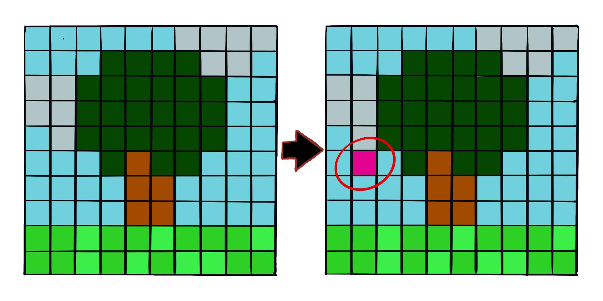
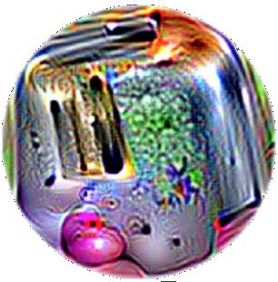
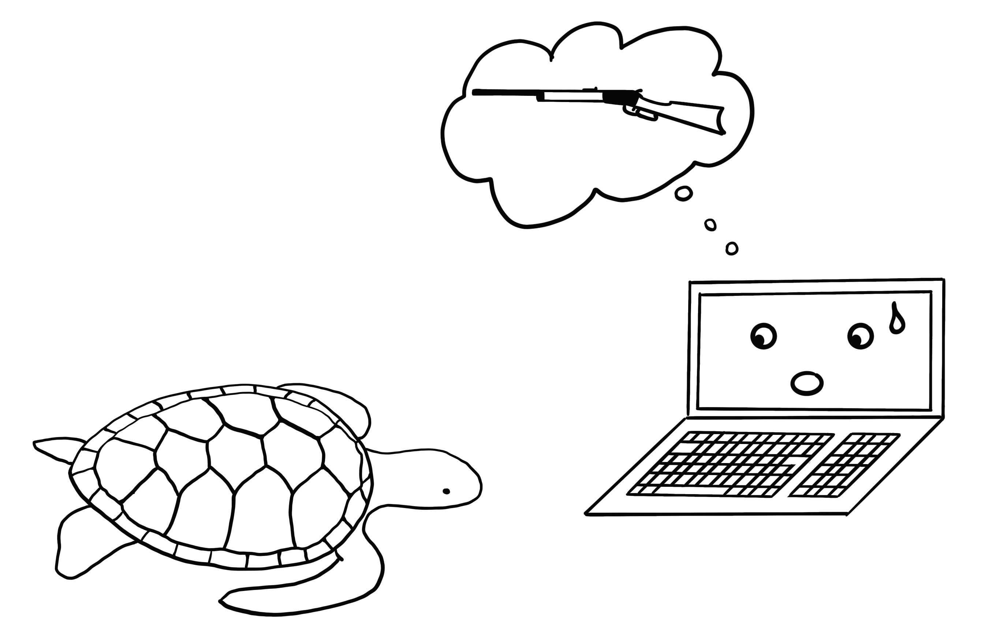

> **Çeviri kaynağı:** Christoph Molnar, *Interpretable Machine Learning*, 3. baskı (2025), [Bölüm 30: Adversarial Examples](https://christophm.github.io/interpretable-ml-book/adversarial.html).Özgün eser CC BY-NC-SA 4.0 lisanslıdır.

Adversarial bir örnek, bir makine öğrenimi modelinin yanlış bir tahminde bulunmasına neden olan küçük, kasıtlı özellik pertürbasyonları (perturbation) içeren bir örnektir. Kavramlar çok benzer olduğundan, önce Karşıt Açıklamalar (Counterfactual Explanations) bölümünü okumanızı öneririm. Adversarial örnekler, modeli yorumlamak değil, kandırmak amacıyla oluşturulan karşıt örneklerdir.

<!-- *Anahtar kelimeler: adversarial örnekler, adversarial makine öğrenimi, karşıt açıklamalar, kaçınma saldırıları, makine öğrenimi güvenliği* -->

Adversarial örneklerle neden ilgileniyoruz? Bunlar, pratik bir önemi olmayan, makine öğrenimi modellerinin merak uyandıran yan ürünlerinden ibaret değil midir? Cevap net bir "hayır". Adversarial örnekler, makine öğrenimi modellerini aşağıdaki senaryolarda olduğu gibi saldırılara karşı savunmasız hâle getirir.

Bir otonom araç, dur işaretini görmezden geldiği için başka bir araca çarpar. Birisi işaretin üzerine, insanlara biraz kirlenmiş bir dur işareti gibi görünen ama aracın işaret tanıma yazılımına park yasağı işareti gibi görünecek şekilde tasarlanmış bir resim yerleştirmiştir.

Bir spam dedektörü, bir e-postayı spam olarak sınıflandırmayı başaramaz. Spam posta, normal bir e-postaya benzeyecek şekilde, ancak alıcıyı kandırma amacıyla tasarlanmıştır.

Makine öğrenimi destekli bir tarayıcı, havaalanında bavulları silah olup olmadığına dair tarar. Bir bıçak, sistemin onu bir şemsiye sanmasını sağlayarak tespit edilmekten kaçınacak şekilde geliştirilmiştir.

Şimdi adversarial örnek oluşturmanın bazı yollarına bakalım.

## Yöntemler ve Örnekler

Adversarial örnekler oluşturmak için birçok teknik bulunmaktadır. Çoğu yaklaşım, adversarial örnek ile manipüle edilecek örnek arasındaki mesafeyi minimize etmeyi, aynı zamanda tahmini istenen (adversarial) sonuca kaydırmayı önerir. Bazı yöntemler modelin gradyanlarına erişim gerektirir; bu elbette yalnızca sinir ağları gibi gradyan tabanlı modellerde mümkündür. Diğer yöntemler ise sadece tahmin fonksiyonuna erişim gerektirir ve bu da bu yöntemleri modelden bağımsız (**model-agnostic**) yapar. Bu bölümdeki yöntemler, bu alanda çok fazla araştırma yapıldığı ve adversarial görüntülerin görselleştirilmesi çok öğretici olduğu için derin sinir ağlarına dayalı görüntü sınıflandırıcılarına odaklanmaktadır. Görüntüler için adversarial örnekler, uygulama zamanında modeli kandırma amacıyla pikselleri kasıtlı olarak pertürbe edilmiş görüntülerdir. Örnekler, nesne tanıma için kullanılan derin sinir ağlarının, insanlara zararsız görünen görüntülerle ne kadar kolayca kandırılabileceğini etkileyici bir şekilde göstermektedir. Bu örnekleri henüz görmediyseniz şaşırabilirsiniz, çünkü tahminlerdeki değişiklikler bir insan gözlemci için anlaşılmazdır. Adversarial örnekler, makineler için optik illüzyonlar gibidir.

### Köpeğimde Bir Terslik Var

@szegedy2014intriguing, "Intriguing Properties of Neural Networks" adlı çalışmalarında derin sinir ağları için adversarial örnekler bulmak amacıyla gradyan tabanlı bir optimizasyon yaklaşımı kullanmıştır. Sonuçlardan birini @fig-ostrich göstermektedir.

{#fig-ostrich}

Bu adversarial örnekler, aşağıdaki fonksiyonun $\mathbf{r}$'ye göre minimize edilmesiyle oluşturulmuştur:

$$\text{loss}(\hat{f}(\mathbf{x}+\mathbf{r}), l) + c \cdot |\mathbf{r}|$$

Bu formülde $\mathbf{x}$ bir görüntüdür (piksel vektörü olarak temsil edilir), $\mathbf{r}$ adversarial bir görüntü oluşturmak için piksellerde yapılan değişikliktir ($\mathbf{x} + \mathbf{r}$ yeni bir görüntü üretir), $l$ istenen sonuç sınıfıdır ve $c$ parametresi, görüntüler arasındaki mesafe ile tahminler arasındaki mesafe arasında denge kurmak için kullanılır. İlk terim, adversarial örneğin tahmin edilen sonucu ile istenen sınıf $l$ arasındaki mesafedir; ikinci terim ise adversarial örnek ile orijinal görüntü arasındaki mesafeyi ölçer. Bu formülasyon, karşıt açıklamalar (counterfactual explanations) oluşturmak için kullanılan kayıp fonksiyonuyla neredeyse aynıdır. Piksel değerlerinin 0 ile 1 arasında kalması için $\mathbf{r}$ üzerinde ek kısıtlamalar vardır. Yazarlar, bu optimizasyon problemini gradyanlarla çalışan bir optimizasyon algoritması olan kutu kısıtlamalı L-BFGS ile çözmeyi önermektedir.

### Rahatsız Edilmiş Panda: Hızlı Gradyan İşaret Yöntemi

@goodfellow2015explaining, adversarial görüntüler oluşturmak için hızlı gradyan işaret yöntemini (fast gradient sign method) icat etmiştir. Gradyan işaret yöntemi, temel modelin gradyanını kullanarak adversarial örnekler bulur. Orijinal görüntü $\mathbf{x}$, her piksele küçük bir hata $\epsilon$ eklenerek veya çıkarılarak manipüle edilir. $\epsilon$'u ekleyip çıkarmamız, bir pikselin gradyan işaretinin pozitif mi yoksa negatif mi olduğuna bağlıdır. Gradyan yönünde hata eklemek, görüntünün model sınıflandırması başarısız olacak şekilde kasıtlı olarak değiştirilmesi anlamına gelir.

Aşağıdaki formül, hızlı gradyan işaret yönteminin özünü tanımlar:

$$\mathbf{x}^\prime = \mathbf{x} + \epsilon \cdot \text{sign}\left(\nabla_{\mathbf{x}} J(\boldsymbol{\theta}, \mathbf{x}, y)\right)$$

Burada $\nabla_{\mathbf{x}} J$, modelin kayıp fonksiyonunun orijinal giriş piksel vektörü $\mathbf{x}$'e göre gradyanı, $y$, $\mathbf{x}$'in gerçek etiketi ve $\boldsymbol{\theta}$ model parametre vektörüdür. Gradyan vektöründen (giriş piksel vektörü kadar uzundur) yalnızca işarete ihtiyacımız var: Piksel yoğunluğundaki bir artış kaybı (modelin yaptığı hatayı) artırıyorsa gradyanın işareti pozitif (+1), piksel yoğunluğundaki bir azalma kaybı artırıyorsa negatif (-1) olur. Bu kırılganlık, bir sinir ağı giriş piksel yoğunluğu ile sınıf skoru arasındaki ilişkiyi doğrusal olarak ele aldığında ortaya çıkar. Özellikle LSTM'ler, maxout ağları, ReLU aktivasyon birimli ağlar gibi doğrusallığı tercih eden sinir ağı mimarileri ya da lojistik regresyon gibi diğer doğrusal makine öğrenimi algoritmaları gradyan işaret yöntemine karşı savunmasızdır. Saldırı, ekstrapolasyon yoluyla gerçekleştirilir. Giriş piksel yoğunluğu ile sınıf skorları arasındaki doğrusallık, modeli aykırı değerlere (outlier) karşı savunmasız hâle getirir; yani piksel değerleri veri dağılımının dışındaki bölgelere taşınarak model kandırılabilir. Bu adversarial örneklerin belirli bir sinir ağı mimarisine oldukça özgü olmasını beklemiştim. Ancak adversarial örnekleri, aynı görev için eğitilmiş farklı mimarideki ağları kandırmak için de yeniden kullanabileceğiniz ortaya çıktı.

@goodfellow2015explaining, sağlam modeller öğrenmek için adversarial örneklerin eğitim verisine eklenmesini önermiştir.

### Bir Denizanası… Hayır, Bekle. Bir Küvet: 1-Piksel Saldırıları

Goodfellow vd. (2014) tarafından sunulan yaklaşım, az da olsa birçok pikselin değiştirilmesini gerektirir. Peki ya yalnızca tek bir pikseli değiştirebiliyorsanız? Bir makine öğrenimi modelini yine de kandırabilir misiniz? @su2019one, tek bir pikseli değiştirerek görüntü sınıflandırıcılarını kandırmanın gerçekten mümkün olduğunu göstermiştir; bkz. @fig-1pixel.

{#fig-1pixel}

Karşıt açıklamalara benzer şekilde 1-piksel saldırısı, orijinal görüntü $\mathbf{x}$'e yakın olan ancak tahmini adversarial bir sonuca çeviren, değiştirilmiş bir örnek $\mathbf{x}^\prime$ arar. Ancak yakınlığın tanımı farklıdır: Yalnızca tek bir piksel değişebilir. 1-piksel saldırısı, hangi pikselin nasıl değiştirileceğini bulmak için diferansiyel evrim kullanır. Diferansiyel evrim, türlerin biyolojik evriminden gevşek bir şekilde esinlenmiştir. Aday çözümler adı verilen bireylerden oluşan bir popülasyon, bir çözüm bulunana kadar nesilden nesile yeniden birleşir (rekombinasyon). Her aday çözüm bir piksel değişikliğini kodlar ve beş elemanlı bir vektörle temsil edilir: $x$ ve $y$ koordinatları ile kırmızı, yeşil ve mavi (RGB) değerleri. Arama, örneğin 400 aday çözümle (= piksel değişikliği önerisi) başlar ve aşağıdaki formülü kullanarak ebeveyn nesilden yeni bir aday çözüm nesli (çocuklar) oluşturur:

$$\mathbf{x}_{g+1}^{(i)} = \mathbf{x}_g^{(r1)} + F \cdot (\mathbf{x}_g^{(r2)}- \mathbf{x}_g^{(r3)})$$

Burada her $x^{(i)}$ bir aday çözümün bir elemanıdır ($x$-koordinatı, $y$-koordinatı, kırmızı, yeşil ya da mavi), $g$ mevcut nesil, $F$ bir ölçekleme parametresi (0,5 olarak ayarlanmıştır) ve $r1$, $r2$, $r3$ birbirinden farklı rastgele sayılardır. Her yeni çocuk aday çözüm de konum ve renk için beş niteliğe sahip bir pikseldir ve bu niteliklerin her biri üç rastgele ebeveyn pikselin bir karışımıdır.

Aday çözümlerden biri adversarial bir örnek olduğunda, yani yanlış bir sınıfa atandığında ya da kullanıcının belirlediği maksimum iterasyon sayısına ulaşıldığında çocuk üretimi durdurulur.

### Her Şey Bir Tost Makinesi: Adversarial Yama

En sevdiğim yöntemlerden biri, adversarial örnekleri fiziksel gerçekliğe taşır. @brown2018adversarial, nesnelerin yanına yapıştırıldığında onları bir görüntü sınıflandırıcısına tost makinesi gibi gösteren, yazdırılabilir bir etiket tasarlamıştır; bkz. @fig-adversarial-toaster. Harika bir çalışma!

{#fig-adversarial-toaster width=50%}

Bu yöntem, şimdiye kadar sunulan adversarial örnek yöntemlerinden farklıdır, çünkü adversarial görüntünün orijinal görüntüye çok yakın olması gerekliliği kaldırılmıştır. Bunun yerine yöntem, görüntünün bir bölümünü herhangi bir şekli alabilen bir yama ile tamamen değiştirir. Yamanın görüntüsü, farklı arka plan görüntüleri üzerinde ve yamanın görüntüler üzerindeki farklı konumlarıyla (kimi zaman kaydırılmış, kimi zaman büyütülmüş ya da küçültülmüş ve döndürülmüş olarak) optimize edilir; böylece yama birçok durumda işe yarar. Sonunda bu optimize edilmiş görüntü yazdırılabilir ve gerçek dünyada görüntü sınıflandırıcılarını kandırmak için kullanılabilir.

### Silahlı Çatışmaya Asla 3D Baskılı Kaplumbağa Götürmeyin – Bilgisayarınız Bunu İyi Bir Fikir Sansa Bile: Sağlam Adversarial Örnekler

Sıradaki yöntem, tost makinesine kelimenin tam anlamıyla bir boyut daha eklemektir: @athalye2018synthesizing, neredeyse tüm olası açılardan bir derin sinir ağına tüfek gibi görünecek şekilde tasarlanmış bir kaplumbağayı 3D yazıcıyla basmıştır; bkz. @fig-adversarial-turtle. Evet, doğru okudunuz. İnsanlara kaplumbağa gibi görünen fiziksel bir nesne, bilgisayara tüfek gibi görünüyor!

{#fig-adversarial-turtle}

Yazarlar, 2D bir sınıflandırıcı için, kaplumbağayı döndürmek, yakınlaştırmak gibi dönüşümler altında da adversarial kalan 3D bir adversarial örnek oluşturmanın yolunu bulmuştur. Hızlı gradyan yöntemi gibi diğer yaklaşımlar, görüntü döndürüldüğünde veya görüş açısı değiştiğinde artık işe yaramaz. Athalye vd. (2017), görüntü dönüştürüldüğünde bile işe yarayan adversarial örnekler üretmeye yönelik bir yöntem olan EOT (Expectation Over Transformation, dönüşüm üzerinden beklenti) algoritmasını önermiştir. EOT'nin temel fikri, adversarial örnekleri birçok olası dönüşüm üzerinden optimize etmektir. EOT, adversarial örnek ile orijinal görüntü arasındaki mesafeyi minimize etmek yerine, seçilen bir olası dönüşümler dağılımı altında ikisi arasındaki beklenen mesafeyi belirli bir eşiğin altında tutar. Dönüşüm altındaki beklenen mesafe şu şekilde yazılabilir:

$$\mathbb{E}_{t \sim T}[d(t(\mathbf{x}^\prime), t(\mathbf{x}))]$$

Burada $\mathbf{x}$ orijinal görüntü, $t(\mathbf{x})$ dönüştürülmüş (örneğin döndürülmüş) görüntü, $\mathbf{x}^\prime$ adversarial örnek ve $t(\mathbf{x}^\prime)$ onun dönüştürülmüş hâlidir. Bir dönüşüm dağılımıyla çalışması dışında EOT yöntemi, adversarial örnek arayışını bir optimizasyon problemi olarak çerçeveleyen tanıdık kalıbı izler. Olası dönüşümlerin dağılımı $T$ boyunca, seçilen $y_t$ sınıfının (örneğin "tüfek") olasılığını maksimize eden bir adversarial örnek $\mathbf{x}^\prime$ bulmaya çalışırız:

$$\arg\max_{\mathbf{x}^\prime} \mathbb{E}_{t \sim T}[\log \mathbb{P}(y_t | t(\mathbf{x}^\prime))]$$

Bunu, adversarial örnek $\mathbf{x}^\prime$ ile orijinal görüntü $\mathbf{x}$ arasındaki, tüm olası dönüşümler üzerinden beklenen mesafenin belirli bir eşiğin altında kalması kısıtı altında yaparız:

$$\mathbb{E}_{t \sim T}[d(t(\mathbf{x}^\prime), t(\mathbf{x}))] < \epsilon \quad \text{ve} \quad \mathbf{x} \in [0,1]^d$$

Bu yöntemin mümkün kıldıkları konusunda endişelenmemiz gerektiğini düşünüyorum. Diğer yöntemler dijital görüntülerin manipülasyonuna dayanıyor. Oysa bu 3D baskılı, sağlam adversarial örnekler herhangi bir gerçek sahneye yerleştirilebilir ve bir bilgisayarı bir nesneyi yanlış sınıflandırması için yanıltabilir. Bir de tersinden bakalım: Ya biri kaplumbağa gibi görünen bir tüfek yaparsa?

### Gözü Bağlı Düşman: Kara Kutu Saldırısı

Şu senaryoyu hayal edin: Size, bir Web API aracılığıyla harika görüntü sınıflandırıcıma erişim veriyorum. Modelden tahminler alabilirsiniz, ancak model parametrelerine erişiminiz yok. Koltuğunuzun rahatlığında veri gönderebilirsiniz; hizmetim de karşılık gelen sınıflandırmalarla yanıt verir. Çoğu adversarial saldırı bu senaryoda çalışacak şekilde tasarlanmamıştır, çünkü adversarial örnekleri bulmak için alttaki derin sinir ağının gradyanına erişim gerektirir. @papernot2017practical, modelin iç bilgisi olmadan ve eğitim verisine erişmeden adversarial örnekler oluşturmanın mümkün olduğunu göstermiştir. Bu tür (neredeyse) sıfır bilgiyle yapılan saldırıya kara kutu (black box) saldırısı denir.

Nasıl çalışır:

1. Eğitim verileriyle aynı alandan gelen birkaç görüntüyle başlayın; örneğin saldırılacak sınıflandırıcı bir rakam sınıflandırıcısıysa rakam görüntüleri kullanın. Alan bilgisi gereklidir, ancak eğitim verisine erişim gerekmez.
1. Mevcut görüntü kümesi için kara kutudan tahminler alın.
1. Mevcut görüntü kümesi üzerinde bir vekil model (örneğin bir sinir ağı) eğitin.
1. Mevcut görüntü kümesi için, model çıktısının daha fazla varyans göstermesi adına piksellerin hangi yönde değiştirilmesi gerektiğini inceleyen sezgisel bir yöntem (heuristic) kullanarak yeni bir sentetik görüntü kümesi oluşturun.
1. 2–4. adımları önceden belirlenmiş sayıda epoch boyunca tekrarlayın.
1. Vekil model için hızlı gradyan yöntemi (veya benzeri) ile adversarial örnekler oluşturun.
1. Orijinal modele adversarial örneklerle saldırın.

Vekil modelin amacı, kara kutu modelin karar sınırlarına yaklaşmaktır; aynı doğruluğa ulaşması gerekmez.

Yazarlar bu yaklaşımı, çeşitli bulut makine öğrenimi hizmetlerinde eğitilmiş görüntü sınıflandırıcılarına saldırarak test etmiştir. Bu hizmetler, kullanıcıların yüklediği görüntüler ve etiketler üzerinde görüntü sınıflandırıcıları eğitir. Yazılım modeli otomatik olarak eğitir (bazen kullanıcının bilmediği bir algoritmayla) ve devreye alır. Sınıflandırıcı daha sonra yüklenen görüntüler için tahmin verir, ancak modelin kendisi incelenemez veya indirilemez. Yazarlar çeşitli sağlayıcılar için adversarial örnekler bulmayı başarmış; adversarial örneklerin %84'e varan bir kısmı yanlış sınıflandırılmıştır.

Yöntem, yanıltılacak kara kutu model bir sinir ağı olmasa bile çalışır. Buna karar ağaçları gibi gradyanı olmayan makine öğrenimi modelleri de dahildir.

## Siber Güvenlik Perspektifi

Makine öğrenimi bilinen bilinmeyenlerle uğraşır: bilinen bir dağılımdan gelen bilinmeyen veri noktalarını tahmin etmek. Saldırılara karşı savunma ise bilinmeyen bilinmeyenlerle uğraşır: adversarial girdilerin bilinmeyen bir dağılımından gelen bilinmeyen veri noktalarını sağlam bir şekilde tahmin etmek. Makine öğrenimi otonom araçlar veya tıbbi cihazlar gibi giderek daha fazla sisteme entegre edildikçe, bu sistemler aynı zamanda saldırılar için giriş noktası hâline geliyor. Bir makine öğrenimi modelinin test veri kümesindeki tahminleri %100 doğru olsa bile, modeli yanıltacak adversarial örnekler bulunabilir. Makine öğrenimi modellerinin siber saldırılara karşı savunulması, siber güvenlik alanının yeni bir parçasıdır.

@biggio2018wild, bu bölümün de dayandığı, adversarial makine öğrenimi üzerine on yıllık araştırmanın güzel bir derlemesini sunar. Siber güvenlik, saldırganların ve savunucuların birbirini defalarca alt ettiği bir silahlanma yarışıdır.

**Siber güvenlikte üç altın kural vardır: 1) düşmanınızı tanıyın, 2) proaktif olun ve 3) kendinizi koruyun.**

Farklı uygulamaların farklı düşmanları vardır. Paraları için başkalarını e-posta yoluyla dolandırmaya çalışan kişiler, kullanıcıların ve e-posta hizmeti sağlayıcılarının düşmanlarıdır. Sağlayıcılar, kullanıcılarının posta programlarını kullanmaya devam edebilmesi için onları korumak ister; saldırganlar ise insanların kendilerine para vermesini ister. Düşmanlarınızı tanımak, onların hedeflerini bilmek demektir. Spam göndericilerin varlığından habersiz olduğunuzu ve e-posta hizmetinin tek kötüye kullanımının korsan müzik kopyaları göndermek olduğunu varsayarsanız, savunma farklı olurdu (örneğin metni spam göstergeleri için analiz etmek yerine ekleri telif hakkıyla korunan materyal için taramak).

Proaktif olmak, sistemin zayıf noktalarını aktif olarak test etmek ve belirlemek anlamına gelir. Modeli adversarial örneklerle aktif olarak yanıltmaya çalıştığınızda ve ardından bunlara karşı savunma geliştirdiğinizde proaktifsiniz. Hangi özelliklerin önemli olduğunu ve özelliklerin tahmini nasıl etkilediğini anlamak için yorumlama yöntemlerini kullanmak da bir makine öğrenimi modelinin zayıf yönlerini anlamada proaktif bir adımdır. Bir veri bilimci olarak, test veri kümesindeki tahmin gücünün ötesine hiç bakmadan bu tehlikeli dünyada modelinize güveniyor musunuz? Modelin farklı senaryolarda nasıl davrandığını analiz ettiniz mi, en önemli girdileri belirlediniz mi, bazı örnekler için tahmin açıklamalarını kontrol ettiniz mi? Adversarial girdiler bulmaya çalıştınız mı? Makine öğrenimi modellerinin yorumlanabilirliği siber güvenlikte büyük bir rol oynar. Proaktif olmanın tersi olan reaktif olmak ise sistemin saldırıya uğramasını beklemek ve ancak o zaman sorunu anlayıp bazı savunma önlemleri almak demektir.

Makine öğrenimi sistemlerimizi adversarial örneklere karşı nasıl koruyabiliriz? Proaktif bir yaklaşım, sınıflandırıcıyı adversarial örneklerle yinelemeli olarak yeniden eğitmektir; buna adversarial eğitim de denir. Diğer yaklaşımlar oyun teorisine dayanır; örneğin özelliklerin değişmez (invariant) dönüşümlerini öğrenmek veya sağlam optimizasyon (düzenlileştirme). Önerilen bir başka yöntem, tek bir sınıflandırıcı yerine birden fazla sınıflandırıcı kullanıp tahmin için oylama yaptırmaktır (topluluk/ensemble); ancak hepsi benzer adversarial örneklerden etkilenebileceği için bunun işe yarayacağının garantisi yoktur. İyi çalışmayan bir diğer yaklaşım da gradyan maskelemedir; bu, orijinal model yerine en yakın komşu sınıflandırıcısı kullanılarak yararlı gradyanları olmayan bir model kurmakla elde edilebilir.

Saldırı türlerini, saldırganın sistem hakkında ne kadar bilgi sahibi olduğuna göre ayırabiliriz. Saldırganlar tam bilgiye sahip olabilir (beyaz kutu / white box saldırısı); yani model türü, parametreler ve eğitim verisi gibi model hakkındaki her şeyi bilirler. Saldırganlar kısmi bilgiye sahip olabilir (gri kutu / gray box saldırısı); yani yalnızca kullanılan özellik temsilini ve model türünü bilirler, ancak eğitim verisine veya parametrelere erişimleri yoktur. Saldırganlar hiç bilgiye sahip olmayabilir (kara kutu / black box saldırısı); yani modeli yalnızca kara kutu olarak sorgulayabilirler, ancak eğitim verisine veya model parametrelerine dair bilgiye erişimleri yoktur. Bilgi düzeyine bağlı olarak saldırganlar modele saldırmak için farklı teknikler kullanabilir. Örneklerde gördüğümüz gibi kara kutu durumunda bile adversarial örnekler oluşturulabilir; dolayısıyla veri ve model hakkındaki bilgiyi gizlemek saldırılara karşı korunmak için yeterli değildir.

Saldırganlar ile savunucular arasındaki kedi-fare oyununun doğası gereği, bu alanda çok sayıda gelişme ve yenilik göreceğiz. Sürekli evrilen birçok farklı spam e-posta türünü düşünün. Makine öğrenimi modellerine karşı yeni saldırı yöntemleri icat ediliyor ve bu yeni saldırılara karşı yeni savunma önlemleri öneriliyor. En son savunmaları atlatmak için daha güçlü saldırılar geliştiriliyor ve bu böyle sonsuza dek sürüp gidiyor. Bu bölümle, sizi adversarial örnekler sorununa karşı duyarlı hâle getirmeyi ve zayıf noktaları ancak makine öğrenimi modellerini proaktif olarak inceleyerek keşfedip giderebileceğimizi göstermeyi umuyorum.

## Kaynaklar {.unnumbered}

::: {#refs}
:::
