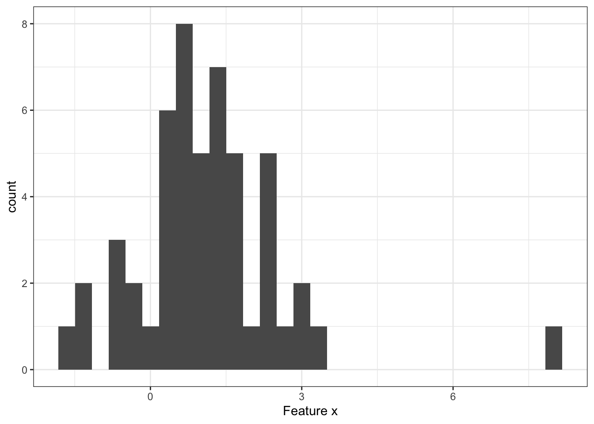
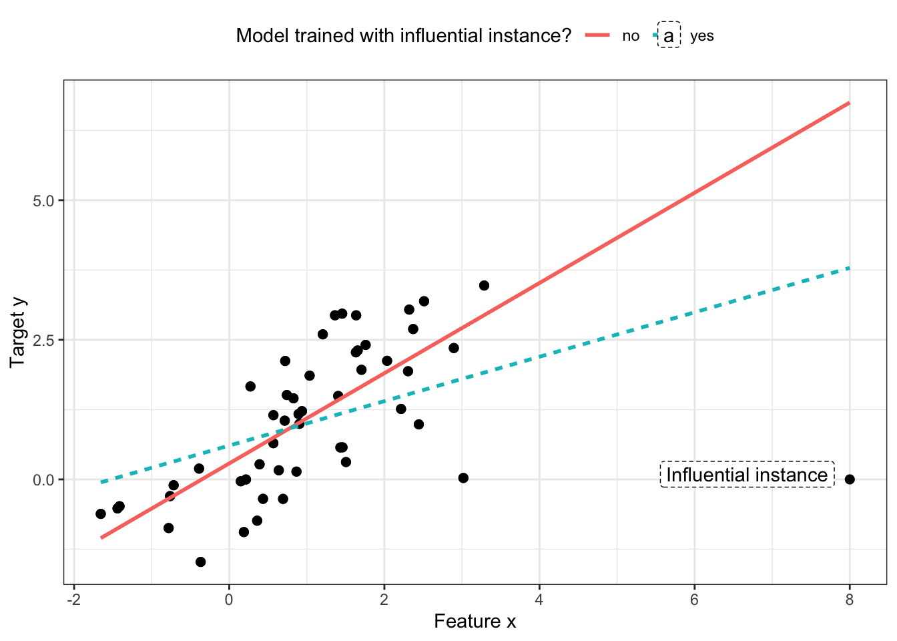
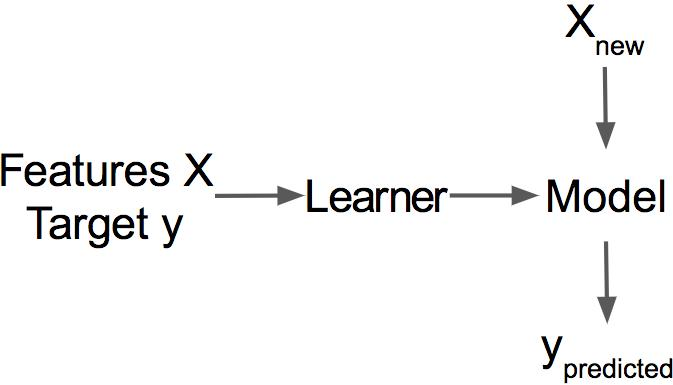
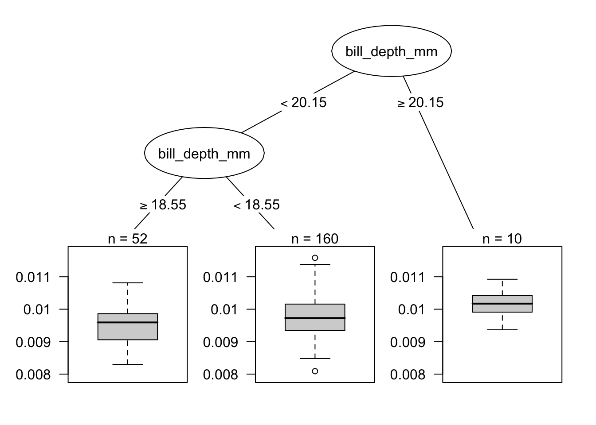
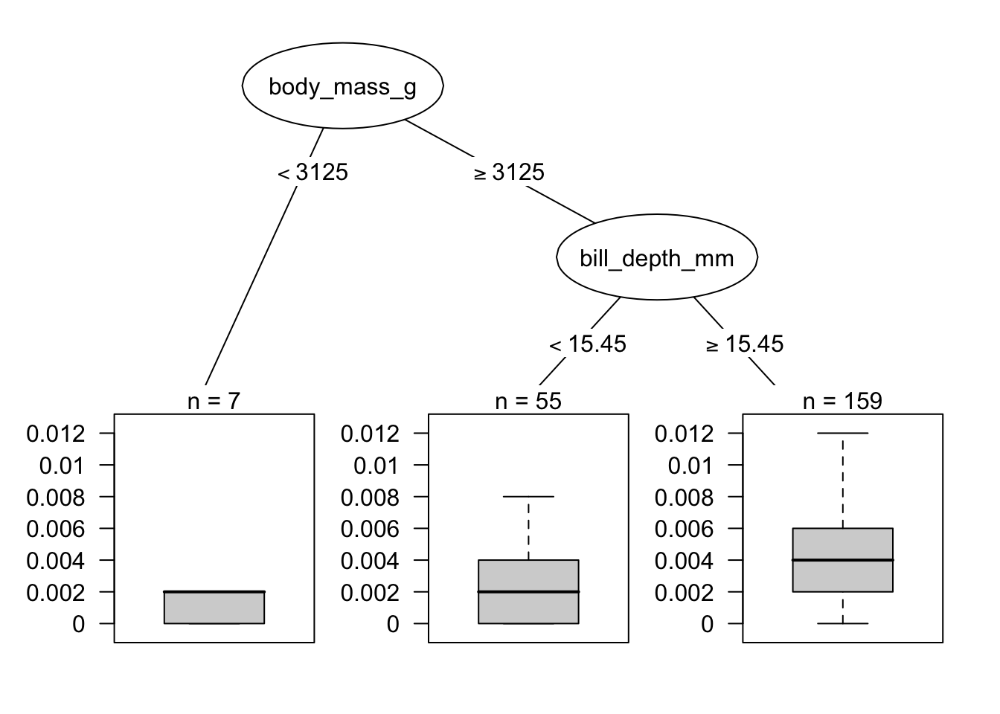

> **Çeviri kaynağı:** Christoph Molnar, *Interpretable Machine Learning*, 3. baskı (2025), [Bölüm 31: Influential Instances](https://christophm.github.io/interpretable-ml-book/influential.html). Özgün bölümdeki R kodlarının ürettiği şekiller ve sayısal değerler, kitabın yayımlanmış sürümünden alınmıştır. Özgün eser CC BY-NC-SA 4.0 lisanslıdır.

Makine öğrenimi modelleri nihayetinde eğitim verilerinin bir ürünüdür ve eğitim örneklerinden birini silmek, ortaya çıkan modeli etkileyebilir. Bir eğitim örneği, eğitim verilerinden silindiğinde modelin parametrelerini veya tahminlerini önemli ölçüde değiştiriyorsa ona "etkili" (influential) diyoruz. Etkili eğitim örneklerini belirleyerek makine öğrenimi modellerinde "hata ayıklayabilir" ve modellerin davranışlarını ve tahminlerini daha iyi açıklayabiliriz.

<!-- *Anahtar kelimeler: etkili örnekler, etki fonksiyonu, birini-dışarıda-bırak analizi, Cook'un mesafesi, silme diagnostikleri, sağlam istatistik* -->

Bu bölüm, etkili örnekleri belirlemek için iki yaklaşımı gösterir: silme diagnostikleri (deletion diagnostics) ve etki fonksiyonları (influence functions). Her iki yaklaşım da aykırı değerlerden veya model varsayımlarının ihlallerinden daha az etkilenen istatistiksel yöntemler sunan sağlam istatistiğe (robust statistics) dayanır. Sağlam istatistik ayrıca verilerden elde edilen tahminlerin (örneğin bir ortalama tahmininin veya bir tahmin modelinin ağırlıklarının) ne kadar sağlam olduğunu ölçmek için de yöntemler sağlar.

Şehrinizdeki insanların ortalama gelirini tahmin etmek istediğinizi ve sokakta rastgele on kişiye ne kadar kazandıklarını sorduğunuzu hayal edin. Örnekleminizin muhtemelen çok kötü olmasını bir kenara bırakırsak, ortalama gelir tahmininiz tek bir kişiden ne kadar etkilenebilir? Bu soruyu yanıtlamak için, yanıtları tek tek dışarıda bırakarak ortalama değeri yeniden hesaplayabilir ya da ortalama değerin nasıl etkilenebileceğini "etki fonksiyonları" aracılığıyla matematiksel olarak türetebilirsiniz. Silme yaklaşımıyla ortalama değeri her seferinde gelir beyanlarından birini dışarıda bırakarak on kez yeniden hesaplar ve ortalama tahmininin ne kadar değiştiğini ölçeriz. Büyük bir değişiklik, bir örneğin çok etkili olduğu anlamına gelir. İkinci yaklaşım, kişilerden birinin ağırlığını sonsuz küçük bir miktar artırır; bu da bir istatistiğin veya modelin birinci türevinin hesaplanmasına karşılık gelir. Bu yaklaşım "sonsuz küçükler yaklaşımı" veya "etki fonksiyonu" olarak da bilinir. Bu arada cevap şudur: Ortalama, tek tek değerlerle doğrusal olarak ölçeklendiği için ortalama tahmininiz tek bir yanıttan çok güçlü bir şekilde etkilenebilir. Daha sağlam bir seçenek medyandır (insanların yarısının daha fazla, diğer yarısının daha az kazandığı değer), çünkü örneklemdeki en yüksek gelirli kişi on kat daha fazla kazansa bile ortaya çıkan medyan değişmez.

Silme diagnostikleri ve etki fonksiyonları, makine öğrenimi modellerinin parametrelerine veya tahminlerine de uygulanabilir; böylece modellerin davranışını daha iyi anlayabilir ya da bireysel tahminleri açıklayabiliriz. Etkili örnekleri bulmaya yönelik bu iki yaklaşıma geçmeden önce, aykırı değer ile etkili örnek arasındaki farkı inceleyeceğiz.

**Aykırı değer**

Aykırı değer (outlier), veri setindeki diğer örneklerden uzakta olan bir örnektir. "Uzak" olmak, diğer tüm örneklere olan mesafenin (örneğin Öklid mesafesinin) çok büyük olması anlamına gelir. Yenidoğanlardan oluşan bir veri setinde 5 kg ağırlığındaki bir yenidoğan aykırı değer olarak kabul edilir. Çoğunlukla vadesiz hesaplardan oluşan bir banka hesapları veri setinde, özel bir kredi hesabı (büyük negatif bakiye, az sayıda işlem) aykırı değer olarak kabul edilir. @fig-outlier, 1 boyutlu bir dağılım için bir aykırı değeri göstermektedir.

{#fig-outlier}

Aykırı değerler ilginç veri noktaları olabilir (örneğin Prototipler ve Eleştiriler bölümündeki eleştiriler). Bir aykırı değer modeli etkiliyorsa, aynı zamanda etkili bir örnektir.

**Etkili örnek**

Etkili örnek, çıkarılması eğitilmiş model üzerinde güçlü bir etki yaratan bir veri örneğidir. Model, belirli bir örnek eğitim verilerinden çıkarılarak yeniden eğitildiğinde model parametreleri veya tahminleri ne kadar çok değişiyorsa, o örnek o kadar etkilidir. Bir örneğin eğitilmiş bir model için etkili olup olmadığı, o örneğin hedef y için aldığı değere de bağlıdır. @fig-influential-point, bir doğrusal regresyon modeli için etkili bir örneği göstermektedir.

{#fig-influential-point}

**Etkili örnekler modeli anlamamıza neden yardımcı olur?**

Yorumlanabilirlik açısından etkili örneklerin arkasındaki temel fikir, model parametrelerini ve tahminlerini her şeyin başladığı yere, yani eğitim verilerine kadar geri izlemektir. Öğrenici (learner), yani makine öğrenimi modelini üreten algoritma, $\mathbf{X}$ özelliklerinden ve $\mathbf{y}$ hedef vektöründen oluşan eğitim verisini alıp bir makine öğrenimi modeli üreten bir fonksiyondur; bkz. @fig-learner. Örneğin bir karar ağacının öğrenicisi, bölünme özelliklerini ve bölünme değerlerini seçen bir algoritmadır. Bir sinir ağının öğrenicisi ise en iyi ağırlıkları bulmak için geri yayılım (backpropagation) kullanır.

{#fig-learner width=50%}

Eğitim sürecinde eğitim verilerinden örnekler çıkarsaydık model parametrelerinin veya tahminlerin nasıl değişeceğini soruyoruz. Bu, kısmi bağımlılık grafikleri (partial dependence plots) veya özellik önemi (feature importance) gibi, tahmin edilecek örneklerin özelliklerini değiştirdiğimizde tahminin nasıl değiştiğini analiz eden diğer yorumlanabilirlik yaklaşımlarından farklıdır. Etkili örneklerde modeli sabit bir şey olarak değil, eğitim verisinin bir fonksiyonu olarak ele alırız. Etkili örnekler, küresel model davranışı ve bireysel tahminler hakkındaki soruları yanıtlamamıza yardımcı olur. Model parametreleri veya tahminler için genel olarak en etkili örnekler hangileriydi? Belirli bir tahmin için en etkili örnekler hangileriydi? Etkili örnekler, modelin hangi örneklerde sorun yaşayabileceğini ve hangi eğitim örneklerinin hatalara karşı kontrol edilmesi gerektiğini söyler, ayrıca modelin sağlamlığı hakkında bir fikir verir. Tek bir örnek model tahminleri ve parametreleri üzerinde güçlü bir etkiye sahipse modele güvenmeyebiliriz. En azından bu durum bizi daha fazla araştırma yapmaya yöneltir.

Etkili örnekleri nasıl bulabiliriz? Etkiyi ölçmenin iki yolu var: Birinci seçenek, örneği eğitim verilerinden silmek, modeli küçültülmüş eğitim veri seti üzerinde yeniden eğitmek ve model parametrelerindeki veya tahminlerdeki farkı (tek tek ya da tüm veri seti üzerinden) gözlemlemektir. İkinci seçenek, model parametrelerinin gradyanlarına dayanarak parametre değişikliklerine yaklaşıp bir veri örneğinin ağırlığını artırmaktır (upweighting). Silme yaklaşımı daha kolay anlaşılır ve ağırlık artırma yaklaşımına zemin hazırlar; bu yüzden ilkiyle başlıyoruz.

## Silme Diagnostikleri

İstatistikçiler, özellikle (genelleştirilmiş) doğrusal regresyon modelleri için, etkili örnekler alanında şimdiden çok sayıda araştırma yapmıştır. "Etkili gözlemler" (influential observations) diye arama yaptığınızda, ilk sonuçlar DFBETA ve Cook'un mesafesi gibi ölçütlerle ilgilidir. **DFBETA**, bir örneğin silinmesinin model parametreleri üzerindeki etkisini ölçer. **Cook'un mesafesi** [@cook1977detection] ise bir örneğin silinmesinin model tahminleri üzerindeki etkisini ölçer. Her iki ölçüt için de modeli her seferinde tek bir örneği dışarıda bırakarak tekrar tekrar yeniden eğitmemiz gerekir. Tüm örneklerle eğitilmiş modelin parametreleri veya tahminleri, eğitim verilerinden örneklerden biri silinmiş modelin parametreleri veya tahminleriyle karşılaştırılır.

DFBETA şu şekilde tanımlanır:

$$DFBETA_{i}=\boldsymbol{\beta}-\boldsymbol{\beta}^{(-i)}$$

Burada $\boldsymbol{\beta}$ model tüm veri örnekleri üzerinde eğitildiğindeki ağırlık vektörü, $\boldsymbol{\beta^{(-i)}}$ ise model $i$ örneği olmadan eğitildiğindeki ağırlık vektörüdür. Oldukça sezgisel, diyebilirim. DFBETA yalnızca lojistik regresyon veya sinir ağları gibi ağırlık parametrelerine sahip modellerde çalışır; karar ağaçları, ağaç toplulukları (tree ensembles), bazı destek vektör makineleri gibi modellerde çalışmaz.

Cook'un mesafesi doğrusal regresyon modelleri için geliştirilmiştir ve genelleştirilmiş doğrusal regresyon modelleri için yaklaşık biçimleri mevcuttur. Bir eğitim örneği için Cook'un mesafesi, $i$'inci örnek model eğitiminden çıkarıldığında tahmin edilen sonuçtaki kare farkların (ölçeklendirilmiş) toplamı olarak tanımlanır.

$$D_i=\frac{\sum_{j=1}^n(\hat{y}_j-\hat{y}_{j}^{(-i)})^2}{p\cdot{}MSE}$$

Burada pay, modelin $i$'inci örnekle ve bu örnek olmadan yaptığı tahminler arasındaki kare farkın veri seti üzerinden toplamıdır. Payda ise özellik sayısı $p$ ile ortalama kare hatanın (MSE) çarpımıdır. Payda, hangi $i$ örneği çıkarılırsa çıkarılsın tüm örnekler için aynıdır. Cook'un mesafesi, $i$'inci örneği eğitimden çıkardığımızda bir doğrusal modelin tahmin edilen çıktısının ne kadar değiştiğini söyler.

Cook'un mesafesini ve DFBETA'yı herhangi bir makine öğrenimi modeli için kullanabilir miyiz? DFBETA model parametreleri gerektirir; bu yüzden bu ölçüt yalnızca parametrik modellerde çalışır. Cook'un mesafesi ise herhangi bir model parametresi gerektirmez. İlginçtir ki Cook'un mesafesine genellikle doğrusal modeller ve genelleştirilmiş doğrusal modeller bağlamı dışında rastlanmaz; oysa belirli bir örneğin çıkarılmasından önceki ve sonraki model tahminleri arasındaki farkı alma fikri son derece geneldir. Cook'un mesafesinin tanımındaki bir sorun MSE'dir; MSE her tür tahmin modeli (örneğin sınıflandırma) için anlamlı değildir.

Model tahminleri üzerindeki etki için en basit ölçüt şu şekilde yazılabilir:

$$\text{Influence}^{(-i)}=\frac{1}{n}\sum_{k=1}^{n}\left|\hat{y}_k-\hat{y}_{k}^{(-i)}\right|$$

Bu ifade temelde Cook'un mesafesinin payıdır; tek fark, kare farklar yerine mutlak farkların toplanmasıdır. Bu, sonraki örnekler için mantıklı olduğu için benim yaptığım bir tercihtir. Silme diagnostiği ölçütlerinin genel biçimi, bir ölçüt (örneğin tahmin edilen sonuç) seçmekten ve bu ölçütün tüm örneklerle eğitilmiş model ile örnek silinmiş model arasındaki farkını hesaplamaktan oluşur.

Etkiyi kolayca parçalara ayırarak, $k$ örneğinin tahmini için $i$'inci eğitim örneğinin etkisinin ne olduğunu açıklayabiliriz:

$$\text{Influence}_{k}^{(-i)}=\left|\hat{y}_k - \hat{y}_{k}^{(-i)}\right|$$

Bu, model parametrelerindeki fark veya kayıptaki fark için de işe yarar. Aşağıdaki örnekte bu basit etki ölçütlerini kullanacağız.

**Silme diagnostikleri örneği**

Aşağıdaki örnekte, vücut ölçümlerinden bir penguenin cinsiyetini tahmin etmek için bir rastgele orman (random forest) eğitiyor ve hangi eğitim örneklerinin genel olarak ve belirli bir tahmin için en etkili olduğunu ölçüyoruz. Bu bir sınıflandırma problemi olduğu için etkiyi, dişi olma tahmin olasılığındaki fark olarak ölçüyoruz. Bir örnek, model eğitiminden çıkarıldığında tahmin edilen olasılık veri seti genelinde ortalama olarak güçlü bir şekilde artıyor veya azalıyorsa etkilidir. 222 eğitim örneğinin tamamı için etkiyi ölçmek, modelin bir kez tüm veriyle eğitilmesini ve her seferinde örneklerden biri çıkarılarak 222 kez (= eğitim verisinin boyutu) yeniden eğitilmesini gerektirir.

En etkili örneğin etki ölçüsü yaklaşık 0,012'dir. 0,012'lik bir etki, 12. örneği çıkarırsak tahmin edilen olasılığın ortalama olarak 1,2 yüzde puan değiştiği anlamına gelir. Bu çok fazla gibi görünmeyebilir, ancak yalnızca 1 veri noktasının çıkarılmasından kaynaklanan, tüm veri üzerinden alınmış bir ortalamadır. Artık model için en etkili veri örneklerinin hangileri olduğunu biliyoruz. Bunu bilmek, verideki hataları ayıklamak için zaten faydalıdır. Sorunlu bir örnek var mı? Ölçüm hataları var mı? Etkili örnekler, hatalara karşı ilk kontrol edilmesi gereken örneklerdir, çünkü bunlardaki her hata model tahminlerini güçlü bir şekilde etkiler.

::: {.callout-tip}

## En etkili verileri inceleyin

Hata ayıklarken önce en etkili örnekleri inceleyin; böylece zamanınızı tahminler için en çok önem taşıyan verilere verimli bir şekilde ayırırsınız.

:::

Model hata ayıklamanın ötesinde, modeli daha iyi anlamak için bir şey öğrenebilir miyiz? Yalnızca en etkili 10 örneği yazdırmak pek faydalı değildir, çünkü bu, çok sayıda özelliği olan örneklerden oluşan bir tablodan ibarettir. Çıktı olarak örnek döndüren tüm yöntemler, ancak bu örnekleri iyi bir şekilde temsil etmenin bir yolu varsa anlamlıdır. Ancak şu soruyu sorduğumuzda ne tür örneklerin etkili olduğunu daha iyi anlayabiliriz: Etkili bir örneği etkisiz bir örnekten ayıran nedir? Bu soruyu bir regresyon problemine dönüştürebilir ve bir örneğin etkisini özellik değerlerinin bir fonksiyonu olarak modelleyebiliriz. İstediğimiz herhangi bir yorumlanabilir modeli seçmekte özgürüz. Bu örnek için, destek vektör makinesi için en etkili verilerin derin gagalı (bill depth değeri yüksek) penguenlere ait olduğunu gösteren bir karar ağacı (@fig-cooks) seçtim.[^svm-notu]

[^svm-notu]: Çevirmen notu: Bu örnekte kullanılan model rastgele ormandır; özgün metindeki "destek vektör makinesi" ifadesi, kitabın aynı örneği destek vektör makinesiyle yapan 2. baskısından kalmış görünmektedir.

{#fig-cooks}

Bu ilk etki analizi, *genel olarak* en etkili örneği ortaya çıkardı. Şimdi örneklerden birini, yani 8. örneği seçiyor ve bu örneğin tahminini en etkili eğitim verisi örneklerini bularak açıklamak istiyoruz. Bu, karşıt olgusal (counterfactual) bir soruya benzer: $i$ örneğini eğitim sürecinden çıkarsaydık 8. örneğin tahmini nasıl değişirdi? Bu çıkarma işlemini tüm örnekler için tekrarlarız. Ardından, eğitimden çıkarıldıklarında 8. örneğin tahmininde en büyük değişikliğe yol açan eğitim örneklerini seçer ve bunları modelin o örnek için yaptığı tahmini açıklamak için kullanırız. Örneğin 8. örneğin tahmini için en etkili ilk 10 örneği bir tablo olarak döndürebilirdik. Bu pek kullanışlı olmazdı, çünkü fazla bir şey göremezdik. Yine, özelliklerini analiz ederek etkili örnekleri etkisiz örneklerden neyin ayırdığını bulmak daha anlamlıdır. Özelliklere bakarak etkiyi tahmin etmek üzere eğitilmiş bir karar ağacı kullanıyoruz; ama gerçekte onu bir şey tahmin etmek için değil, yalnızca bir yapı bulmak için (amacı dışında) kullanıyoruz. @fig-influence-single, 8. örneğin tahmininde ne tür eğitim örneklerinin en etkili olduğunu bir karar ağacıyla gösteriyor. Vücut kütlesi yüksek ve gagası derin penguenlere ait veriler, 8. örneğin tahmini üzerinde daha büyük bir etkiye sahipti.

{#fig-influence-single}

Bu örnekler, modelin sağlamlığını kontrol etmek için etkili örnekleri belirlemenin ne kadar faydalı olduğunu gösterdi. Önerilen yaklaşımın bir sorunu, modelin her eğitim örneği için yeniden eğitilmesi gerekmesidir. Tüm bu yeniden eğitim süreci oldukça yavaş olabilir, çünkü binlerce eğitim örneğiniz varsa modelinizi binlerce kez yeniden eğitmeniz gerekir. Modelin eğitiminin bir gün sürdüğünü ve 1.000 eğitim örneğiniz olduğunu varsayarsak, etkili örneklerin hesaplanması (paralelleştirme olmadan) neredeyse 3 yıl sürer. Buna kimsenin vakti yok. Bu bölümün geri kalanında, modelin yeniden eğitilmesini gerektirmeyen bir yöntem göstereceğim.

## Etki Fonksiyonları

*Sen*: Bir eğitim örneğinin belirli bir tahmin üzerindeki etkisini bilmek istiyorum.\
*Araştırma*: Eğitim örneğini silebilir, modeli yeniden eğitebilir ve tahmindeki farkı ölçebilirsin.\
*Sen*: Harika! Ama yeniden eğitme gerektirmeyen bir yöntemin var mı? Çok zaman alıyor.\
*Araştırma*: Parametrelerine göre iki kez türevlenebilir bir kayıp fonksiyonuna sahip bir modelin var mı?\
*Sen*: Lojistik kayıpla bir sinir ağı eğittim. Yani evet.\
*Araştırma*: O zaman örneğin model parametreleri ve tahmin üzerindeki etkisine **etki fonksiyonlarıyla** yaklaşabilirsin. Etki fonksiyonu, model parametrelerinin veya tahminlerin bir eğitim örneğine ne kadar güçlü bağlı olduğunun bir ölçüsüdür. Yöntem, örneği silmek yerine kayıp içindeki ağırlığını çok küçük bir adımla artırır. Bu yöntem, gradyan ve Hessian matrisini kullanarak kaybı mevcut model parametreleri civarında yaklaşık olarak ifade etmeyi içerir. Kayıpta ağırlık artırma, örneği silmeye benzer.\
*Sen*: Harika, tam aradığım şey!

@koh2017understanding, bir örneğin model parametrelerini veya tahminleri nasıl etkilediğini ölçmek için sağlam istatistiğin bir yöntemi olan etki fonksiyonlarının kullanılmasını önermiştir. Silme diagnostiklerinde olduğu gibi, etki fonksiyonları da model parametrelerini ve tahminleri sorumlu eğitim örneğine kadar geri izler. Ancak bu yöntem, eğitim örneklerini silmek yerine, örneğin ampirik riskteki (eğitim verisi üzerindeki kaybın toplamı) ağırlığı artırıldığında modelin ne kadar değiştiğine yaklaşır.

Etki fonksiyonları yöntemi, model parametrelerine (veya tahminlere) göre kayıp gradyanına erişim gerektirir; bu da yalnızca makine öğrenimi modellerinin bir alt kümesi için mümkündür. Lojistik regresyon, sinir ağları ve destek vektör makineleri bu koşulu sağlar; rastgele ormanlar gibi ağaç tabanlı yöntemler ise sağlamaz. Etki fonksiyonları model davranışını anlamaya, modelde hata ayıklamaya ve veri setindeki hataları tespit etmeye yardımcı olur.

Aşağıdaki bölüm, etki fonksiyonlarının arkasındaki sezgiyi ve matematiği açıklar.

**Etki fonksiyonlarının arkasındaki matematik**

Etki fonksiyonlarının temel fikri, bir eğitim örneğinin kaybının ağırlığını sonsuz küçük bir adım $\epsilon$ kadar artırmaktır; bu da yeni model parametreleriyle sonuçlanır:

$$\hat{\boldsymbol{\theta}}_{\epsilon, \mathbf{z}} = \arg\min_{\boldsymbol{\theta} \in \Theta} \left(\frac{1}{n}\sum_{i=1}^n L(\mathbf{z}^{(i)}, \boldsymbol{\theta}) + \epsilon L(\mathbf{z}, \boldsymbol{\theta}) \right)$$

Burada $\theta$ model parametre vektörü, $\hat{\boldsymbol{\theta}}_{\epsilon, \mathbf{z}}$ ise $\mathbf{z}$'nin ağırlığı çok küçük bir $\epsilon$ sayısı kadar artırıldıktan sonraki parametre vektörüdür. $L$ modelin eğitildiği kayıp fonksiyonu, $\mathbf{z}^{(i)}$ eğitim verisi, $\mathbf{z}$ ise çıkarılmasını simüle etmek için ağırlığını artırmak istediğimiz eğitim örneğidir. Bu formülün arkasındaki sezgi şudur: Eğitim verisindeki belirli bir $\mathbf{z}^{(i)}$ örneğinin ağırlığını biraz ($\epsilon$) artırır ve diğer veri örneklerinin ağırlığını buna göre azaltırsak kayıp ne kadar değişir? Bu yeni birleşik kaybı optimize eden parametre vektörü nasıl görünürdü? Parametrelerin etki fonksiyonu, yani $\mathbf{z}$ eğitim örneğinin ağırlığını artırmanın parametreler üzerindeki etkisi, şu şekilde hesaplanabilir:

$$I_{\text{up,params}}(\mathbf{z}) = \left.\frac{d \hat{\boldsymbol{\theta}}_{\epsilon, \mathbf{z}}}{d\epsilon}\right|_{\epsilon=0} = -H_{\hat{\boldsymbol{\theta}}}^{-1} \nabla_{\boldsymbol{\theta}} L(\mathbf{z}, \hat{\boldsymbol{\theta}})$$

Son ifade $\nabla_{\boldsymbol{\theta}}L(\mathbf{z}, \hat{\boldsymbol{\theta}})$, ağırlığı artırılan eğitim örneği için parametrelere göre kayıp gradyanıdır. Gradyan, eğitim örneğinin kaybının değişim hızıdır. Model parametrelerini $\hat{\boldsymbol{\theta}}$ biraz değiştirdiğimizde kaybın ne kadar değiştiğini söyler. Gradyan vektöründeki pozitif bir eleman, ilgili model parametresindeki küçük bir artışın kaybı artırdığı; negatif bir eleman ise parametredeki artışın kaybı azalttığı anlamına gelir. İlk kısım $H^{-1}_{\hat{\boldsymbol{\theta}}}$, ters Hessian matrisidir (kaybın model parametrelerine göre ikinci türevi). Hessian matrisi gradyanın değişim hızıdır; kayıp cinsinden ifade edersek, kaybın değişim hızının değişim hızıdır. Şu formülle tahmin edilebilir:

$$H_{\boldsymbol{\theta}} = \frac{1}{n}\sum_{i=1}^n \nabla^2_{\hat{\boldsymbol{\theta}}}L(\mathbf{z}^{(i)}, \hat{\boldsymbol{\theta}})$$

Daha gayriresmî bir ifadeyle: Hessian matrisi, kaybın belirli bir noktada ne kadar eğri olduğunu kaydeder. Hessian yalnızca bir vektör değil bir matristir, çünkü kaybın eğriliğini tanımlar ve eğrilik baktığımız yöne bağlıdır. Çok sayıda parametreniz varsa Hessian matrisinin fiilen hesaplanması zaman alır. Koh ve Liang, bunu verimli bir şekilde hesaplamak için bazı yöntemler önermiştir; bu yöntemler bu bölümün kapsamı dışındadır. Model parametrelerini yukarıdaki formülde tanımlandığı gibi güncellemek, tahmin edilen model parametreleri etrafında ikinci dereceden bir açılım (quadratic expansion) oluşturduktan sonra tek bir Newton adımı atmaya eşdeğerdir.

Bu etki fonksiyonu formülünün arkasında nasıl bir sezgi var? Formül, $\hat{\boldsymbol{\theta}}$ parametreleri etrafında ikinci dereceden bir açılım oluşturmaktan gelir. Bu, $\mathbf{z}$ örneği çıkarıldığında veya ağırlığı artırıldığında kaybının tam olarak nasıl değişeceğini aslında bilmediğimiz ya da bunu hesaplamanın çok karmaşık olduğu anlamına gelir. Fonksiyona, mevcut model parametresi ayarındaki diklik (= gradyan) ve eğrilik (= Hessian matrisi) bilgisini kullanarak yerel olarak yaklaşırız. Bu kayıp yaklaşımıyla, $\mathbf{z}$ örneğinin ağırlığını artırsaydık yeni parametrelerin yaklaşık olarak nasıl görüneceğini hesaplayabiliriz:

$$\hat{\boldsymbol{\theta}}_{-\mathbf{z}} \approx \hat{\boldsymbol{\theta}} - \frac{1}{n} I_{\text{up,params}}(\mathbf{z})$$

Yaklaşık parametre vektörü, temelde orijinal parametreden, eğrilikle ölçeklenmiş (= ters Hessian matrisiyle çarpılmış) ve $\frac{1}{n}$ ile ölçeklenmiş $\mathbf{z}$ kaybının gradyanının çıkarılmasıyla elde edilir; gradyanı çıkarırız çünkü kaybı azaltmak istiyoruz, $\frac{1}{n}$ ile ölçekleriz çünkü bu tek bir eğitim örneğinin ağırlığıdır.

@fig-quadratic-expansion, ağırlık artırmanın nasıl çalıştığını göstermektedir. x ekseni $\boldsymbol{\theta}$ parametresinin değerini, y ekseni ise ağırlığı artırılmış $\mathbf{z}$ örneğiyle birlikte kaybın karşılık gelen değerini gösterir. Buradaki model parametresi gösterim amacıyla 1 boyutludur, ancak gerçekte genellikle yüksek boyutludur. $\mathbf{z}$ örneği için kaybın iyileştiği yönde yalnızca $\frac{1}{n}$ kadar ilerleriz. $\mathbf{z}$'yi sildiğimizde kaybın gerçekte nasıl değişeceğini bilmiyoruz; ancak kaybın birinci ve ikinci türevleriyle mevcut model parametremiz etrafında bu ikinci dereceden yaklaşımı oluşturur ve gerçek kaybın böyle davranacağını varsayarız.

{#fig-quadratic-expansion}

Yeni parametreleri fiilen hesaplamamıza gerek yoktur; etki fonksiyonunu doğrudan $\mathbf{z}$'nin parametreler üzerindeki etkisinin bir ölçüsü olarak kullanabiliriz.

$\mathbf{z}$ eğitim örneğinin ağırlığını artırdığımızda *tahminler* nasıl değişir? Ya yeni parametreleri hesaplayıp yeni parametrelerle elde edilen modelle tahmin yapabiliriz ya da etkiyi zincir kuralıyla hesaplayabildiğimiz için $\mathbf{z}$ örneğinin tahminler üzerindeki etkisini doğrudan hesaplayabiliriz:

$$
\begin{aligned}
I_{up,loss}(\mathbf{z}, \mathbf{z}_{test}) & = \left.\frac{d L(\mathbf{z}_{test},\hat{\boldsymbol{\theta}}_{\epsilon, \mathbf{z}})}{d\epsilon}\right|_{\epsilon=0} \\
& = \left.\nabla_{\boldsymbol{\theta}}L(\mathbf{z}_{test},\hat{\boldsymbol{\theta}})^T \frac{d\hat{\boldsymbol{\theta}}_{\epsilon,\mathbf{z}}}{d \epsilon}\right|_{\epsilon=0} \\
& = -\nabla_{\boldsymbol{\theta}}L(\mathbf{z}_{test}, \hat{\boldsymbol{\theta}})^T H^{-1}_{\boldsymbol{\theta}} \nabla_{\boldsymbol{\theta}} L(\mathbf{z},\hat{\boldsymbol{\theta}})
\end{aligned}
$$

Bu denklemin ilk satırı, bir eğitim örneğinin belirli bir tahmin $\mathbf{z}_{test}$ üzerindeki etkisini, $\mathbf{z}$ örneğinin ağırlığını artırıp yeni parametreler $\hat{\theta}_{\epsilon,z}$ elde ettiğimizde test örneğinin kaybındaki değişim olarak ölçtüğümüz anlamına gelir. Denklemin ikinci satırında türevlerde zincir kuralını uyguladık ve test örneğinin kaybının parametrelere göre türevi ile $z$'nin parametreler üzerindeki etkisinin çarpımını elde ettik. Üçüncü satırda ifadeyi parametreler için etki fonksiyonuyla değiştirdik. Üçüncü satırdaki ilk terim $\nabla_{\boldsymbol{\theta}} L(\mathbf{z}_{test},\hat{\boldsymbol{\theta}})^T$, test örneğinin model parametrelerine göre gradyanıdır.

Bir formüle sahip olmak harikadır ve bir şeyi göstermenin bilimsel ve kesin yoludur. Ama bence formülün ne anlama geldiğine dair biraz sezgi edinmek çok önemlidir. $I_{\text{up,loss}}$ formülü, $\mathbf{z}$ eğitim örneğinin bir $\mathbf{z}_{test}$ örneğinin tahmini üzerindeki etki fonksiyonunun, "örneğin model parametrelerindeki bir değişikliğe ne kadar güçlü tepki verdiği" ile "$\mathbf{z}$ örneğinin ağırlığını artırdığımızda parametrelerin ne kadar değiştiğinin" çarpımı olduğunu söyler. Formülü okumanın bir başka yolu: Etki, eğitim ve test kaybının gradyanlarının ne kadar büyük olduğuyla orantılıdır. Eğitim kaybının gradyanı ne kadar yüksekse parametreler üzerindeki etkisi ve dolayısıyla test tahmini üzerindeki etkisi de o kadar yüksek olur. Test tahmininin gradyanı ne kadar yüksekse test örneği o kadar etkilenebilir hâle gelir. Tüm yapı, eğitim örneği ile test örneği arasındaki (modelin öğrendiği şekliyle) benzerliğin bir ölçüsü olarak da görülebilir.

Teori ve sezgi bu kadar. Sonraki bölüm, etki fonksiyonlarının nasıl uygulanabileceğini açıklar.

**Etki fonksiyonlarının uygulamaları**

Etki fonksiyonlarının pek çok uygulaması vardır; bunların bazıları bu bölümde zaten sunuldu.

**Model davranışını anlamak**

Farklı makine öğrenimi modelleri tahminlerini farklı şekillerde yapar. İki model aynı performansa sahip olsa bile, özelliklerden tahmin üretme biçimleri çok farklı olabilir ve bu nedenle farklı senaryolarda başarısız olabilirler. Etkili örnekleri belirleyerek bir modelin kendine özgü zayıflıklarını anlamak, makine öğrenimi modelinin davranışına dair zihninizde bir "zihinsel model" oluşturmanıza yardımcı olur.

**Alan uyumsuzluklarıyla başa çıkmak / Model hatalarını ayıklamak**

Alan uyumsuzluğuyla (domain mismatch) başa çıkmak, model davranışını daha iyi anlamakla yakından ilişkilidir. Alan uyumsuzluğu, eğitim ve test verilerinin dağılımlarının farklı olması anlamına gelir; bu da modelin test verisinde kötü performans göstermesine yol açabilir. Etki fonksiyonları, hataya neden olan eğitim örneklerini belirleyebilir. Ameliyat olmuş hastaların sonuçlarını tahmin eden bir model eğittiğinizi varsayalım. Bu hastaların hepsi aynı hastaneden geliyor. Şimdi modeli başka bir hastanede kullanıyorsunuz ve birçok hasta için iyi çalışmadığını görüyorsunuz. Elbette iki hastanenin farklı hastalara sahip olduğunu varsayarsınız; verilerine baktığınızda da birçok özellikte farklılık olduğunu görebilirsiniz. Peki modeli "bozan" özellikler veya örnekler hangileri? Burada da etkili örnekler bu soruyu yanıtlamanın iyi bir yoludur. Modelin yanlış tahmin yaptığı yeni hastalardan birini alır, en etkili örnekleri bulur ve analiz edersiniz. Bu, örneğin ikinci hastanenin ortalamada daha yaşlı hastalara sahip olduğunu, eğitim verisindeki en etkili örneklerin ilk hastanedeki az sayıdaki yaşlı hasta olduğunu ve modelin bu alt grubu iyi tahmin etmeyi öğrenecek kadar veriye sahip olmadığını gösterebilir. Varılacak sonuç, modelin ikinci hastanede iyi çalışması için daha fazla yaşlı hasta üzerinde eğitilmesi gerektiği olurdu.

**Eğitim verilerini düzeltmek**

Doğruluğunu kontrol edebileceğiniz eğitim örneği sayısı sınırlıysa, verimli bir seçimi nasıl yaparsınız? En iyi yol en etkili örnekleri seçmektir, çünkü tanımları gereği model üzerinde en fazla etkiye onlar sahiptir. Açıkça yanlış değerler içeren bir örneğiniz olsa bile, bu örnek etkili değilse ve veriye yalnızca tahmin modeli için ihtiyacınız varsa, etkili örnekleri kontrol etmek daha iyi bir seçimdir. Örneğin bir hastanın hastanede kalması mı yoksa erken taburcu edilmesi mi gerektiğini tahmin eden bir model eğitiyorsunuz. Modelin sağlam olduğundan ve doğru tahminler yaptığından gerçekten emin olmak istiyorsunuz, çünkü bir hastanın yanlışlıkla taburcu edilmesi kötü sonuçlar doğurabilir. Hasta kayıtları çok dağınık olabilir; bu yüzden verinin kalitesine tam olarak güvenmezsiniz. Ancak hasta bilgilerini kontrol edip düzeltmek çok zaman alıcı olabilir, çünkü hangi hastaları kontrol etmeniz gerektiğini bildirdiğinizde hastanenin, seçilen hastaların el yazısıyla tutulmuş ve bir arşivde duruyor olabilecek kayıtlarını daha yakından incelemesi için gerçekten birini göndermesi gerekir. Bir hastanın verisini kontrol etmek bir saat veya daha uzun sürebilir. Bu maliyetler göz önüne alındığında yalnızca birkaç önemli veri örneğini kontrol etmek mantıklıdır. En iyi yol, tahmin modeli üzerinde yüksek etkiye sahip hastaları seçmektir. Koh ve Liang (2017), bu tür bir seçimin rastgele seçimden ya da en yüksek kayba veya yanlış sınıflandırmaya sahip olanları seçmekten çok daha iyi sonuç verdiğini göstermiştir.

## Güçlü Yönler

Silme diagnostikleri ve etki fonksiyonları yaklaşımları, SHAP gibi özellik pertürbasyonuna dayalı yaklaşımlardan çok farklıdır. Etkili örneklere bakmak, öğrenme sürecinde eğitim verisinin rolünü öne çıkarır. Bu da etki fonksiyonlarını ve silme diagnostiklerini **makine öğrenimi modelleri için en iyi hata ayıklama araçlarından biri** yapar. Bu kitapta sunulan teknikler arasında, hatalara karşı kontrol edilmesi gereken örnekleri doğrudan belirlemeye yardımcı olan yegâne yöntemler bunlardır.

**Silme diagnostikleri modelden bağımsızdır (model-agnostic)**; yani bu yaklaşım herhangi bir modele uygulanabilir. Ayrıca türevlere dayalı etki fonksiyonları da geniş bir model sınıfına uygulanabilir.

Bu yöntemleri, yalnızca tahmin performanslarını karşılaştırmanın ötesine geçerek **farklı makine öğrenimi modellerini karşılaştırmak** ve farklı davranışlarını daha iyi anlamak için kullanabiliriz.

Bu bölümde bu konuya değinmedik, ancak **türevler aracılığıyla etki fonksiyonları, adversarial eğitim verisi oluşturmak için de kullanılabilir**. Bunlar, model bu manipüle edilmiş örnekler üzerinde eğitildiğinde belirli test örneklerini doğru tahmin edemeyecek şekilde manipüle edilmiş örneklerdir. Kötü Amaçlı Örnekler (Adversarial Examples) bölümündeki yöntemlerden farkı, saldırının eğitim sırasında gerçekleşmesidir; bu saldırılar zehirleme saldırıları (poisoning attacks) olarak da bilinir. İlgileniyorsanız Koh ve Liang'ın (2017) makalesini okuyabilirsiniz.

Silme diagnostikleri ve etki fonksiyonları için tahmindeki farkı, etki fonksiyonu için de kayıptaki artışı ele aldık. Ama aslında **yaklaşım genellenebilir** ve şu biçimdeki herhangi bir soruya uygulanabilir: "$\mathbf{z}$ örneğini sildiğimizde veya ağırlığını artırdığımızda … ne olur?" Burada "…" kısmını modelinizin istediğiniz herhangi bir fonksiyonuyla doldurabilirsiniz. Bir eğitim örneğinin modelin genel kaybını ne kadar etkilediğini analiz edebilirsiniz. Bir eğitim örneğinin özellik önemini ne kadar etkilediğini analiz edebilirsiniz. Bir karar ağacı eğitilirken ilk bölünme için hangi özelliğin seçileceğini bir eğitim örneğinin ne kadar etkilediğini analiz edebilirsiniz.

**Etkili örnek gruplarını belirlemek** de mümkündür [@koh2019accuracy].

## Sınırlılıklar

Silme diagnostiklerinin **hesaplanması çok maliyetlidir**, çünkü yeniden eğitim gerektirir. Ancak tarih, bilgisayar kaynaklarının sürekli arttığını göstermiştir. 20 yıl önce kaynaklar açısından düşünülemeyecek bir hesaplama, bugün akıllı telefonunuzla kolayca yapılabilir. Binlerce eğitim örneği ve yüzlerce parametresi olan modelleri bir dizüstü bilgisayarda saniyeler/dakikalar içinde eğitebilirsiniz. Bu nedenle, silme diagnostiklerinin 10 yıl içinde büyük sinir ağlarıyla bile sorunsuz çalışacağını varsaymak büyük bir sıçrama değildir.

**Etki fonksiyonları silme diagnostiklerine iyi bir alternatiftir, ancak yalnızca sinir ağları gibi kayıp fonksiyonu parametrelerine göre iki kez türevlenebilen modeller için.** Rastgele ormanlar, gradyan artırmalı ağaçlar (boosted trees) veya karar ağaçları gibi ağaç tabanlı yöntemlerde çalışmazlar. Parametreleri ve bir kayıp fonksiyonu olan modelleriniz olsa bile kayıp türevlenebilir olmayabilir. Ancak bu son sorun için bir hile var: Örneğin alttaki model türevlenebilir bir kayıp yerine Hinge kaybını kullanıyorsa, etkiyi hesaplamak için onun yerine türevlenebilir bir kayıp kullanın. Etki fonksiyonları için sorunlu kayıp, onun düzleştirilmiş (smoothed) bir versiyonuyla değiştirilir; ancak model yine de düzgün olmayan kayıpla eğitilebilir.

**Etki fonksiyonları yalnızca yaklaşıktır**, çünkü yaklaşım parametreler etrafında ikinci dereceden bir açılım oluşturur. Yaklaşım yanlış olabilir ve bir örnek çıkarıldığında etkisi aslında daha yüksek veya daha düşük olabilir. Koh ve Liang (2017), bazı örnekler için etki fonksiyonuyla hesaplanan etkinin, örnek silindikten sonra model gerçekten yeniden eğitildiğinde elde edilen etki ölçüsüne yakın olduğunu göstermiştir. Ancak yaklaşımın her zaman bu kadar yakın olacağının garantisi yoktur.

**Bir örneği etkili veya etkisiz olarak nitelendirmek için etki ölçüsünde net bir eşik değeri yoktur.** Örnekleri etkiye göre sıralamak faydalıdır, ancak örnekleri yalnızca sıralamakla kalmayıp etkili ve etkisiz olanları gerçekten ayırt edebilecek araçlara sahip olmak harika olurdu. Örneğin bir test örneği için en etkili 10 eğitim örneğini belirlediğinizde, bunların bazıları aslında etkili olmayabilir; çünkü örneğin yalnızca ilk 3'ü gerçekten etkili olabilir.

## Yazılım ve Alternatifler

Silme diagnostiklerini uygulamak çok basittir.

Doğrusal modeller ve genelleştirilmiş doğrusal modeller için Cook'un mesafesi gibi birçok etki ölçüsü R'de `stats` paketinde uygulanmıştır.

Koh ve Liang, makalelerindeki etki fonksiyonlarına ait Python kodunu [bir depoda](https://github.com/kohpangwei/influence-release) yayımladı. Bu harika! Ne yazık ki bu "yalnızca" makalenin kodudur; bakımı yapılan ve belgelenmiş bir Python modülü değildir. Kod TensorFlow kütüphanesine odaklanmıştır; bu nedenle `scikit-learn` gibi başka çerçeveler kullanan kara kutu modeller için doğrudan kullanamazsınız.

## Kaynaklar {.unnumbered}

::: {#refs}
:::
