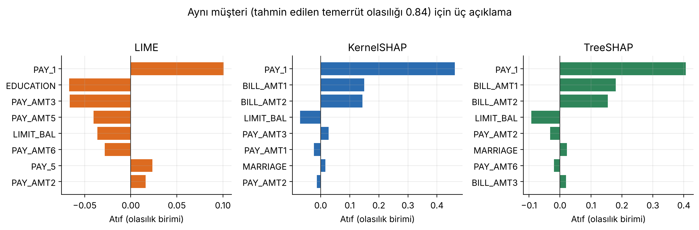
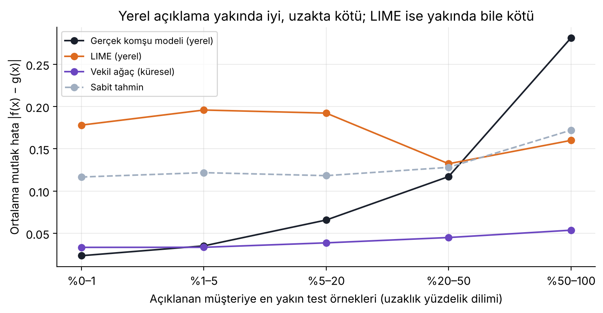

# Bölüm 32 Uygulaması: Açıklamaları Değerlendirmek

**Öğrenci:** Berkay Çongar (20269258007)
**Bölüm:** 32 — Yorumlanabilirlik Yöntemlerinin Değerlendirilmesi (*Evaluation of Interpretability Methods*)
**Veri:** Taiwan kredi kartı temerrüdü (30.000 müşteri, 23 öznitelik)

Bölüm 32'ye göre gerçek veride bir açıklamanın "doğru cevabı", yani temel gerçekliği yoktur. Bu yüzden açıklamaları, bölümün
saydığı özellikler üzerinden dolaylı ölçütlerle değerlendiririz. Bu uygulama, Doshi-Velez ve Kim'in **işlev düzeyinde
değerlendirme** fikrini koda döküyor. Bölümdeki özelliklerin her birini ölçülebilir bir metriğe çeviriyor ve bunları zorlu bir
gerçek veri setinde dört açıklama yöntemine uyguluyor: LIME, KernelSHAP, TreeSHAP ve küresel vekil karar ağacı.

## Dosyalar

| Dosya | İçerik |
|---|---|
| `uygulama.ipynb` | Canlı gösterim defteri; çıktıları tam modda (`HIZLI = False`) üretildi |
| `main.py` | Defterin aynısı, düz Python betiği olarak ([jupytext](https://jupytext.readthedocs.io) "percent" biçimi; VS Code'da hücre hücre çalışır) |
| `veri/default_of_credit_card_clients.csv` | UCI'deki özgün `.xls` dosyasının değiştirilmemiş CSV hâli |
| `sekiller/` | Defterdeki grafiklerin 200 dpi kopyaları (sunumda kullanıldı) |
| `etkilesimli/veri.json` | Sayfanın kullandığı sonuçlar; defterin son bölümü üretir |
| `requirements.txt` | Gerekli paketler ve test edilen sürümler |

## Çalıştırma

```bash
pip install -r requirements.txt
jupyter notebook uygulama.ipynb      # ya da: python main.py
```

* **Ders içi canlı gösterim:** İlk kod hücresinde `HIZLI = True` yapın. Aynı analiz daha az örnekle yaklaşık 1 dakikada çalışır.
* **Tam sonuçlar:** `HIZLI = False` (varsayılan). İki çekirdekli bir makinede yaklaşık 7 dakika sürer.
* **Google Colab:** [Colab'da aç](https://colab.research.google.com/github/mesutpolatgil/xai-dersi-2026/blob/main/2026-guz/32_evaluation-of-interpretability-methods/uygulama/berkaycongar-20269258007/uygulama.ipynb) (bağlantı, çalışma ders deposuna eklendikten sonra açılır). İlk kod hücresi
  eksik kütüphaneleri kendisi kurar. `veri/` klasörü yoksa kod veriyi ders deposundan, o da yoksa UCI dosyasının GitHub'daki
  kopyasından indirir.

## Veri

* **Kaynak:** Yeh, I.-C. (2009). *Default of Credit Card Clients* [Veri seti]. UCI Machine Learning Repository.
  https://doi.org/10.24432/C55S3H · Lisans: CC BY 4.0.
* **Dosyanın doğrulanması:** UCI'deki özgün `.xls` dosyası (SHA-256 `97aa2b7138a437cc…`) CSV'ye çevrildi; içeriğe dokunulmadı.
  Satır sayısı (30.000), temerrüt sayısı (6.636, %22,12), `LIMIT_BAL` ortalaması (167.484,32) ve standart sapması (129.747,66)
  UCI'nin yayımladığı değerlerle birebir aynıdır.
* **Kodda yapılan temizlik:** Belgelenmemiş `EDUCATION` kodları (0, 5, 6) ve `MARRIAGE` kodu (0) "diğer" sınıfına alındı.
  Veri setindeki tutarsız `PAY_0` adı `PAY_1` yapıldı.
* **Neden zorlu?** Sınıflar dengesiz (%22 temerrüt). Altı aylık fatura tutarları arasındaki ortalama korelasyon r = 0,89,
  ödeme durumları arasındaki r = 0,66. Bu çoklu bağlantı, açıklamaların kararlılığını ve tutarlılığını zorlar.
* Veri setinde cinsiyet (`SEX`) özniteliği var. Gerçek kredi kararlarında bu özniteliğin kullanımı yasal olarak sınırlıdır;
  burada veri setinin özgün hâli korunmuştur.

## Bölümdeki özellikler ve ölçütler

| Bölümdeki özellik | Ölçüt |
|---|---|
| Algoritmik karmaşıklık | Açıklama başına süre |
| Doğruluk | Vekil ağacın gerçek etiketlere göre test AUC'si |
| Sadakat | Vekil ağacın kara kutuya R²'si; LIME'ın yerel R²'si ve açıklanan örnekteki hatası; SHAP toplamsallığı |
| Anlaşılabilirlik | Açıklama boyutu (yaprak ya da öznitelik sayısı) ile sadakat arasındaki ödünleşim |
| Kararlılık | Farklı tohumlarla tekrarda ve çok az değiştirilmiş komşu müşterilerde ilk 5 özniteliğin korunması (Jaccard@5) |
| Tutarlılık | Benzer başarımlı modellerin açıklamaları arasındaki Spearman sıra korelasyonu; kitabın örneği olarak SVM ile lojistik regresyon (Rashomon etkisi) |
| Belirlilik | Bootstrap ile ölçülen model belirsizliği ile açıklama belirsizliği arasındaki ilişki; kitabın %4 örneği olarak aynı olasılığı alan iki müşteri |
| Önem derecesi | Toplam atfın en önemli 3 öznitelikte toplanan payı; vekil ağaç kuralının koşullarını tek tek kaldırma |
| Yenilik | Isolation Forest'a göre "yeni" müşterilerde model belirsizliği ve LIME'ın kalite göstergeleri |
| Temsil edicilik | Yerel açıklamanın, müşteriden uzaklaştıkça kara kutudan sapması |

## Bulgular (tam mod)

Kara kutu GBM'dir (test AUC 0,779). Tutarlılık deneyindeki diğer modellerin AUC'leri: rastgele orman 0,777, sinir ağı 0,770,
lojistik regresyon 0,715.

| | LIME | KernelSHAP | TreeSHAP | Vekil ağaç (derinlik 3) |
|---|---|---|---|---|
| Süre (ms/açıklama, iki çekirdekli makinede) | ≈16 | ≈66 | ≈1 | bir kez eğitilir |
| Sadakat | yerel R² 0,39; açıklanan müşteride medyan hata 0,17 | toplamsal (hata ≈ 0) | toplamsal (hata ≈ 0) | küresel R² 0,85 |
| Tekrar kararlılığı (Jaccard@5) | 0,84 | 1,00 | 1,00 | 1,00 |
| Girdi kararlılığı (Jaccard@5) | 0,97 | 0,72 | 0,76 | — |
| İlk 3 özniteliğin payı | %42 | %53 | %46 | — |
| Yarı saydamlık / taşınabilirlik | yok / her model | yok / her model | yüksek / ağaçlar | yok / her model |



1. **Temel gerçeklik yok.** Temerrüt olasılığı 0,84 olan aynı müşteri için üç yöntem de en önemli etken olarak son ayın ödeme
   durumunu (`PAY_1`) gösteriyor, ama sonrası ayrışıyor: LIME ikinci ve üçüncü sıraya riski azaltan `EDUCATION` ve `PAY_AMT3`'ü,
   iki SHAP yöntemi ise riski artıran fatura tutarlarını (`BILL_AMT1`, `BILL_AMT2`) koyuyor. Hangisinin doğru olduğunu söyleyecek
   bir ölçüt yok. (Atıfların büyüklükleri de farklı: LIME eğimi, SHAP katkıyı ölçüyor; bkz. makale yeniden üretimi.)
2. **Sadakat ile anlaşılabilirlik arasında ödünleşim var.** 8 yapraklı bir vekil ağaç kara kutunun davranışının büyük kısmını
   (R² 0,85) okunabilir kurallarla yakalıyor. Model büyük ölçüde `PAY_1`'e dayandığı için bu mümkün oluyor.
3. **LIME, varsayılan ayarlarla bu veride "yerel" değil.** LIME'ın yerel modeli, açıklanan müşterinin *kendisi* için bile kara
   kutudan medyan 0,17 sapıyor. En yakın gerçek komşularda sabit bir tahminden daha kötü. Nedeni boyut sayısı: LIME her
   öznitelikte bir standart sapmalık gürültüyle örnek üretir ve 23 boyutta bu örnekler müşteriden ortalama √23 ≈ 4,8 standart
   sapma uzağa düşer.
4. **İki tür kararlılık farklı şeyler ölçüyor.** LIME tohuma karşı kararsız ama girdideki küçük değişikliklere karşı çok
   kararlı (0,97). SHAP yöntemleri ise tam tersi. LIME'ın bu girdi kararlılığı, geniş bir bölgeyi ortalamasının sonucu; yani
   düşük sadakatin öbür yüzü.
5. **Rashomon etkisi.** Modellerin tahminleri arasındaki korelasyon 0,83–0,97 iken, aynı yöntemle (KernelSHAP) hesaplanan
   açıklamaları arasındaki sıra korelasyonu 0,50–0,74. Çoklu bağlantılı öznitelikler, aynı bilginin modeller arasında farklı
   özniteliklere dağıtılmasına izin veriyor. Kitabın örneğini birebir kurduğumuzda da sonuç aynı: SVM ile lojistik regresyonun
   tahminleri arasında r = 0,80 iken açıklamaları arasındaki medyan Spearman ρ = 0,34.
6. **Belirsiz tahminin açıklaması da belirsiz** (Spearman ρ = 0,87). Ama tek bir SHAP grafiği bu belirsizliği göstermiyor.
   Kitabın %4 örneğinin karşılığı: Ana model iki müşteriye neredeyse aynı olasılığı veriyor (0,072 ve 0,081); bootstrap
   modelleri birinde hemfikir (standart sapma 0,006), ötekinde dağınık (0,047).
7. **Açıklamalar yeniliği kendiliğinden bildirmiyor.** Eğitim dağılımından uzak müşterilerde modelin belirsizliği yaklaşık iki
   katına çıkıyor, ama LIME'ın yerel R²'si düşmüyor.
8. **Temsil edicilik.** Gerçek komşularla kurulmuş yerel bir doğrusal model, müşterinin en yakın %1'lik komşularında en iyi
   yaklaşımı veriyor (hata ≈ 0,02); uzaklaştıkça bozuluyor. Küresel ağaç her yerde aynı orta düzey hatayı veriyor.



9. **Kuralın koşulları eşit değil.** Derinliği 3 olan vekil ağacın en riskli kuralı üç koşulu yan yana koyuyor. Koşulları tek tek
   kaldırınca `PAY_1` koşulunun işin çoğunu yaptığı görülüyor (kaldırılınca ortalama tahmin 0,76'dan 0,58'e düşüyor);
   `PAY_3` koşulu ise neredeyse hiçbir şey eklemiyor (kurala yalnızca 5 müşteri daha giriyor). Önem derecesi, açıklamanın
   biçimine bağlı: Atıf yöntemleri öznitelikleri sıralar, kural sıralamaz.


## Sınırlılıklar

* Tüm ölçütler **işlev düzeyindedir**. Hiçbiri, açıklamanın bir kredi uzmanı ya da müşteri tarafından doğru anlaşılıp
  anlaşılmadığını ölçmez. Bunun için insan düzeyinde ya da uygulama düzeyinde değerlendirme gerekir.
* LIME varsayılan çekirdek genişliğiyle ve sürekli (ayrıklaştırılmamış) özniteliklerle kullanıldı. Daha dar bir çekirdek LIME'ı
  daha yerel yapar, ama 23 boyutta etkili örnek sayısını çok azaltır.
* Kararlılık ve yenilik deneyleri 40 müşteri üzerinde yapıldı; sayılar bu örnekleme bağlıdır.

## Kaynaklar

* Molnar, C. (2025). *Interpretable Machine Learning* (3. baskı), Bölüm 32. https://christophm.github.io/interpretable-ml-book/evaluation.html
* Doshi-Velez, F. ve Kim, B. (2017). Towards a rigorous science of interpretable machine learning. arXiv:1702.08608.
* Robnik-Šikonja, M. ve Bohanec, M. (2018). Perturbation-based explanations of prediction models. *Human and Machine Learning*, 159–175.
* Ribeiro, M. T., Singh, S. ve Guestrin, C. (2016). "Why should I trust you?" Explaining the predictions of any classifier. *KDD*.
* Lundberg, S. M. ve Lee, S.-I. (2017). A unified approach to interpreting model predictions. *NeurIPS*.
* Yeh, I.-C. ve Lien, C.-H. (2009). The comparisons of data mining techniques for the predictive accuracy of probability of default of credit card clients. *Expert Systems with Applications*, 36(2), 2473–2480.
