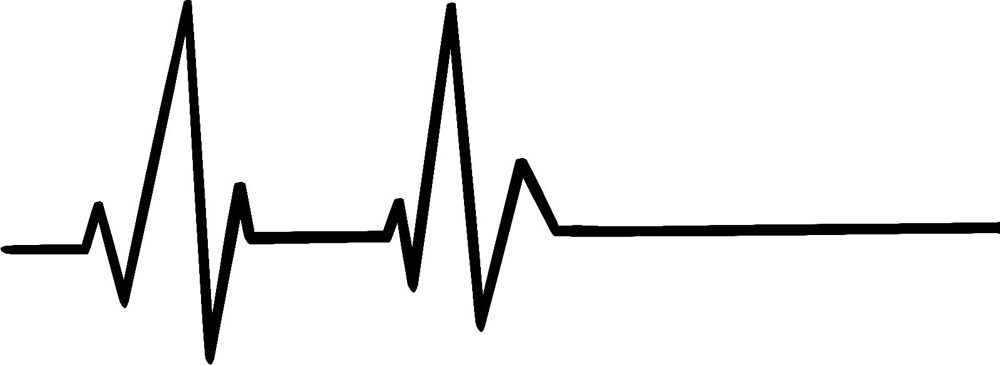
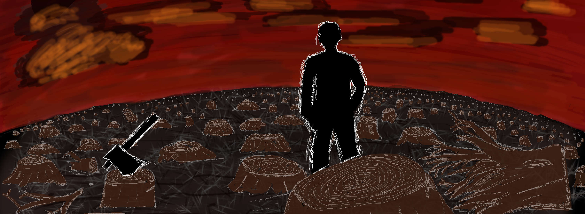

**Özgün eser:** Christoph Molnar, *Interpretable Machine Learning*, [storytime](https://christophm.github.io/interpretable-ml-book/storytime.html).

**Türkçe çeviriyi sunanlar:** Yalçın Kavaklı (20269256026) ve Murat Şahin (20169258034).

**Çeviri bilgisi:** Eğitim amacıyla hazırlanmıştır. Kaynak metin Türkçeye çevrilmiş, bölüm içeriği özetlenmemiştir. Kaynak sürümü: [8f470c85e5ed4ebd69de74425cb9832f1bdc25eb](https://github.com/christophM/interpretable-ml-book/blob/8f470c85e5ed4ebd69de74425cb9832f1bdc25eb/manuscript/storytime.qmd). Lisans: [CC BY-NC-SA 4.0](https://creativecommons.org/licenses/by-nc-sa/4.0/). Bu çeviri de aynı lisansla paylaşılır. Kaynaktaki görüşler ve öngörüler özgün yazara aittir.

# Hikâye Zamanı {#storytime}

Aşağıdaki kısa hikâyelerin her biri, yorumlanabilir makine öğrenmesine yönelik abartılı bir çağrıdır.
Bu anlatım biçimi, Jack Clark'ın [Import AI bültenindeki](https://jack-clark.net/) Tech Tales hikâyelerinden esinlenmiştir.
Bu tür hikâyeleri seviyorsanız veya yapay zekâya ilgi duyuyorsanız bültene abone olmanızı öneririm.

## Yıldırım Aynı Yere İki Kez Düşmez

**2030 İsviçre'de bir tıp laboratuvarı**

{width=75% fig-align="center"}

“Kesinlikle ölmenin en kötü yolu değil!” diye bir sonuca vardı Tom, trajedide olumlu bir şey bulmaya çalışarak. Pompayı serum askısından çıkardı.  
“Sadece yanlış nedenlerle öldü,” diye ekledi Lena.  
“Hem de kesinlikle yanlış morfin pompasıyla! Bize iş çıkarmaktan başka bir şey değil!” diye söylendi Tom, pompanın arka kapağının vidalarını sökerken. Bütün vidaları çıkardıktan sonra kapağı kaldırıp bir kenara koydu. Tanılama bağlantı noktasına bir kablo taktı.  
“Az önce bir işin olduğundan yakınmıyordun, değil mi?” Lena ona alaycı bir gülümsemeyle baktı.  
“Elbette hayır. Asla!” diye karşılık verdi Tom, sesine alaycı bir ton katarak.

Pompanın bilgisayarını başlattı.  
Lena kablonun diğer ucunu tabletine taktı. “Tamam, tanılama çalışıyor,” diye bildirdi. “Neyin ters gittiğini gerçekten merak ediyorum.”  
“Şu morfin denen şeyin o yüksek konsantrasyonuyla bizim kimliği belirsiz hastayı kesinlikle Nirvana'ya yollamış. Vay be. Yani… bu bir ilk, değil mi? Normalde bozuk bir pompa o tatlı şeyden ya çok az verir ya da hiç vermez. Ama asla, bilirsin, böyle çılgınca bir doz vermez,” diye açıkladı Tom.  
“Biliyorum. Beni ikna etmene gerek yok… Hey, şuna bak.” Lena tabletini kaldırdı. “Şuradaki tepeyi görüyor musun? Bu, ağrı kesici karışımının gücünü gösteriyor. Bak! Bu çizgi referans düzeyi. Zavallı adamın kan dolaşımında, onu 17 kez öldürmeye yetecek bir ağrı kesici karışımı varmış. Şu önümüzdeki pompanın enjekte ettiği karışım. Ve burada…” Ekranı kaydırdı. “Burada hastanın öldüğü anı görebilirsin.”  
“Peki, ne olduğuna dair bir fikrin var mı şef?” diye sordu Tom amirine.  
“Hmm… Sensörler düzgün görünüyor. Kalp hızı, oksijen düzeyleri, glikoz… Veriler beklendiği gibi toplanmış. Kandaki oksijen verilerinde bazı eksik değerler var ama bu olağandışı değil. Şuraya bak. Sensörler, morfin türevinin ve diğer ağrı engelleyici maddelerin neden olduğu yavaşlayan kalp hızını ve son derece düşük kortizol düzeylerini de algılamış.” Tanılama raporunu kaydırmayı sürdürdü.  
Tom gözlerini ekrandan alamıyordu. Gerçek bir cihaz arızasını ilk kez inceliyordu.

“Tamam, işte bulmacanın ilk parçası. Sistem, hastanenin iletişim kanalına uyarı gönderememiş. Uyarı tetiklenmiş ama protokol düzeyinde reddedilmiş. Hata bizde de olabilir, hastanede de. Lütfen günlük kayıtlarını bilişim ekibine gönder,” dedi Lena, Tom'a.  
Tom, gözlerini ekrandan ayırmadan başını salladı.  
Lena devam etti: “Tuhaf. Uyarının pompayı da kapatması gerekirdi. Ama belli ki bunu yapamamış. Bu bir yazılım hatası olmalı. Kalite ekibinin gözünden kaçan bir şey. Gerçekten kötü bir şey. Belki protokol sorunuyla bağlantılıdır.”  
“Yani pompanın acil durum sistemi bir şekilde bozulmuş, ama pompa neden tamamen kontrolden çıkıp kimliği belirsiz hastaya bu kadar çok ağrı kesici enjekte etmiş?” diye merak etti Tom.  
“Güzel soru. Haklısın. Acil durum protokolündeki arızayı bir kenara bıraksak bile pompanın bu miktarda ilacı hiç vermemesi gerekirdi. Düşük kortizol düzeyini ve diğer uyarı işaretlerini dikkate aldığında algoritmanın çok daha önce kendiliğinden durması gerekirdi,” diye açıkladı Lena.  
“Belki de kötü şanstır; milyonda bir görülen bir şey, yıldırım çarpması gibi?” diye sordu Tom.  
“Hayır Tom. Sana gönderdiğim belgeleri okusaydın, pompanın sensör girdilerine göre en uygun miktarda ağrı kesiciyi enjekte etmeyi öğrenmesi için önce hayvan deneylerinde, sonra insanlarda eğitildiğini bilirdin. Pompanın algoritması kapalı ve karmaşık olabilir ama rastgele değildir. Bu da aynı durumda pompanın yine tamamen aynı biçimde davranacağı anlamına gelir. Hastamız yine ölürdü. Sensör girdilerinin bir birleşimi ya da istenmeyen bir etkileşimi pompanın hatalı davranışını tetiklemiş olmalı. Bu yüzden daha derine inip burada ne olduğunu bulmamız gerekiyor,” diye açıkladı Lena.

“Anlıyorum…” diye karşılık verdi Tom, düşüncelere dalarak. “Hasta zaten yakında ölmeyecek miydi? Kanserden falan?”  
Lena analiz raporunu okurken başını salladı.  
Tom kalkıp pencereye gitti. Gözlerini uzaktaki bir noktaya dikerek dışarı baktı. “Belki makine, bilirsin, onu acıdan kurtararak ona iyilik etmiştir. Artık acı çekmeyecek. Belki de doğru olanı yapmıştır. Bir yıldırım gibi ama iyi olanından. Yani piyango gibi ama rastgele değil. Bir nedeni var. Pompanın yerinde olsam ben de aynısını yapardım.”  
Lena sonunda başını kaldırıp ona baktı.  
Tom dışarıdaki bir şeye bakmayı sürdürdü.  
İkisi de birkaç saniye sessiz kaldı.  
Lena başını yeniden eğip analize devam etti. “Hayır Tom. Bu bir hata… Sadece lanet olası bir hata.”

## Güven Düşüşü

**2050 Almanya'da bir metro istasyonu**

{width=75% fig-align="center"}

Metro istasyonuna aceleyle gidiyordu. Aklı çoktan işteydi. Yeni sinir ağı mimarisinin testleri şimdiye kadar tamamlanmış olmalıydı. Hükûmetin, bir kişinin vergi dairesinden para saklayıp saklamayacağını tahmin eden “Bireyler İçin Vergi Eğilimi Tahmin Sistemi”nin yeniden tasarımını yönetiyordu. Ekibi zarif bir mühendislik çözümü geliştirmişti. Başarılı olursa sistem yalnızca vergi dairesine hizmet etmekle kalmayacak, terörle mücadele alarm sistemi ve ticaret sicili gibi diğer sistemlere de veri sağlayacaktı. Bir gün hükûmet tahminleri Yurttaş Güven Puanı'na bile dâhil edebilirdi. Yurttaş Güven Puanı, bir kişinin ne kadar güvenilir olduğunu tahmin ediyordu. Bu tahmin, kredi almaktan yeni bir pasaport için ne kadar beklemek gerektiğine kadar günlük yaşamın her alanını etkiliyordu. Yürüyen merdivenden inerken ekibinin sisteminin Yurttaş Güven Puanı Sistemi'ne nasıl entegre edilebileceğini hayal ediyordu.

Yürüme hızını azaltmadan, alışkanlıkla elini RFID okuyucunun üzerinden geçirdi. Aklı başka yerdeydi ama duyusal beklentileriyle gerçeklik arasındaki uyumsuzluk beyninde alarm zillerini çaldırdı.

Çok geçti.

Burnu önde, metronun giriş kapısına çarptı ve kalçasının üzerine yere düştü. Kapının açılması gerekiyordu… ama açılmamıştı. Şaşkınlıkla ayağa kalkıp kapının yanındaki ekrana baktı. Ekrandaki dostça görünen gülen yüz, “Lütfen başka bir zaman tekrar deneyin,” diye öneriyordu. Yanından geçen biri onu görmezden gelerek elini okuyucunun üzerinden geçirdi. Kapı açıldı ve adam geçti. Kapı yeniden kapandı. Burnunu sildi. Canı acıyordu ama en azından kanamıyordu. Kapıyı açmayı yeniden denedi ama yine reddedildi. Tuhaf bir durumdu. Belki toplu taşıma hesabında yeterli jeton yoktu. Hesap bakiyesini kontrol etmek için akıllı saatine baktı.

“Giriş reddedildi. Lütfen Yurttaş Danışma Büronuza başvurun!” diye bildirdi saati.

Midesine yumruk yemiş gibi bulandı. Ne olduğundan şüpheleniyordu. Düşüncesini doğrulamak için birinci şahıs nişancı türündeki “Sniper Guild” adlı mobil oyunu açtı. Uygulama hemen otomatik olarak kapandı ve bu da düşüncesini doğruladı. Başı döndü, yeniden yere oturdu.

Tek bir olası açıklama vardı: Yurttaş Güven Puanı düşmüştü. Hem de çok. Küçük bir düşüş, birinci sınıf uçuşlardan yararlanamamak veya resmî belgeler için biraz daha uzun beklemek gibi küçük rahatsızlıklar demekti. Düşük bir güven puanı nadirdi ve toplum için tehdit olarak sınıflandırıldığınız anlamına gelirdi. Bu kişilere yönelik önlemlerden biri, onları metro gibi kamusal alanlardan uzak tutmaktı. Hükûmet, Yurttaş Güven Puanı düşük kişilerin finansal işlemlerini kısıtlıyordu. Sosyal medyadaki davranışlarınızı etkin biçimde izlemeye başlıyor, hatta şiddet içeren oyunlar gibi belirli içerikleri kısıtlamaya kadar gidiyordu. Yurttaş Güven Puanınız ne kadar düşükse onu yükseltmek de üstel olarak o kadar zorlaşıyordu. Puanı çok düşük olan kişiler genellikle bir daha toparlanamıyordu.

Puanının düşmesi için hiçbir neden düşünemiyordu. Puan, makine öğrenmesine dayanıyordu. Yurttaş Güven Puanı Sistemi, toplumu yöneten, iyi yağlanmış bir motor gibi işliyordu. Güven Puanı Sistemi'nin performansı her zaman yakından izleniyordu. Makine öğrenmesi, yüzyılın başından bu yana çok gelişmişti. Öylesine etkili hâle gelmişti ki Güven Puanı Sistemi'nin kararlarına artık itiraz edilemiyordu. Yanılmaz bir sistem.

Çaresizlik içinde güldü. Yanılmaz bir sistem. Keşke. Sistem nadiren hata yapıyordu. Ama yapıyordu. Kendisi de o özel durumlardan biri olmalıydı; sistemin bir hatası; bundan böyle toplumdan dışlanmış biri. Kimse sistemi sorgulamaya cesaret edemiyordu. Sistem, sorgulanamayacak kadar hükûmetle, toplumun kendisiyle bütünleşmişti. Geriye kalan az sayıdaki demokratik ülkede demokrasi karşıtı hareketler oluşturmak yasaktı; bu hareketler özünde kötü oldukları için değil, mevcut sistemi istikrarsızlaştıracakları için. Aynı mantık, artık daha yaygın olan algokrasiler için de geçerliydi. Mevcut düzene oluşturduğu tehlike nedeniyle algoritmaları eleştirmek yasaktı.

Algoritmik güven, toplumsal düzenin dokusuydu. Ortak yarar adına, nadiren görülen hatalı güven puanları sessizce kabulleniliyordu. Yüzlerce başka tahmin sistemi ve veri tabanı puanı beslediği için, puanındaki düşüşün nedenini bilmek olanaksızdı. İçinde ve altında büyük, karanlık bir boşluk açılıyormuş gibi hissetti. Dehşet içinde boşluğa baktı.

## Fermi'nin Ataçları

**Mars'a yerleşimden sonraki 612 yılı Mars'ta bir müze**

{width=75% fig-align="center"}

“Tarih sıkıcı,” diye fısıldadı Xola arkadaşına. Mavi saçlı bir kız olan Xola, odada vızıldayan projektör dronlarından birini sol eliyle isteksizce kovalıyordu. “Tarih önemlidir,” dedi öğretmen, kızlara bakıp rahatsızlığını belli eden bir sesle. Xola kızardı. Öğretmeninin onu duymasını beklemiyordu.

“Xola, az önce ne öğrendin?” diye sordu öğretmen.  
“Eskiden yaşayan insanların Yerdünya Gezegeni'nin bütün kaynaklarını tüketip sonra öldüklerini mi?” diye temkinli bir biçimde sordu.  
“Hayır. İklimi ısıttılar ve bunu yapan insanlar değil, bilgisayarlar ve makinelerdi. Ayrıca adı Yerdünya Gezegeni değil, Dünya Gezegeni,” diye ekledi Lin adındaki diğer kız.  
Xola onu onaylayarak başını salladı. Öğretmen hafif bir gururla gülümsedi ve başını salladı. “İkiniz de haklısınız. Bunun neden olduğunu biliyor musunuz?”  
“İnsanlar dar görüşlü ve açgözlü oldukları için mi?” diye sordu Xola.  
“İnsanlar makinelerini durduramadı!” diye atıldı Lin.

“Yine ikiniz de haklısınız,” diye karar verdi öğretmen. “Ama bu çok daha karmaşık. O dönemde çoğu insan neler olduğunun farkında değildi. Bazıları köklü değişimleri gördü ama onları tersine çeviremedi. Bu dönemin en ünlü eseri, yazarı bilinmeyen bir şiirdir. O dönemde yaşananları en iyi o anlatır. Dikkatle dinleyin!”

Öğretmen şiiri başlattı. Küçük dronlardan bir düzinesi çocukların önünde yeniden konumlandı ve videoyu doğrudan gözlerine yansıtmaya başladı. Videoda, yalnızca ağaç kütüklerinin kaldığı bir ormanda takım elbiseli bir kişi duruyordu. Konuşmaya başladı:

*Makineler hesaplar; makineler tahmin eder.*

*Biz de bir parçası olduğumuzdan yürüyüş sürer.*

*Eğitildiğimiz gibi bir optimumun peşindeyiz.*

*Optimum tek boyutlu, yerel ve kısıtsız.*

*Silisyum ve et, üstel artışın peşinde.*

*Büyümektir zihniyetimiz.*

*Bütün ödüller toplandığında,*

*Yan etkiler göz ardı edildiğinde;*

*Bütün paralar madencilikle çıkarıldığında,*

*Doğa geride bırakıldığında;*

*Başımız belaya girecek,*

*Ne de olsa üstel büyüme bir balondur.*

*Müştereklerin trajedisi yaşanıyor,*

*Patlıyor,*

*Gözlerimizin önünde.*

*Soğuk hesaplar ve buz gibi açgözlülük,*

*Yeryüzünü sıcağa boğuyor.*

*Her şey ölüyor,*

*Bizse boyun eğiyoruz.*

*At gözlüğü takmış atlar gibi kendi yarattığımız yarışta koşuyoruz,*

*Uygarlığın Büyük Filtresi'ne doğru.*

*Ve böylece amansızca yürümeyi sürdürüyoruz.*

*Çünkü makinenin bir parçasıyız.*

*Entropiyi kucaklıyoruz.*

“Karanlık bir anı,” dedi öğretmen, odadaki sessizliği bozarak. “Kütüphanenize yüklenecek. Ödeviniz gelecek haftaya kadar ezberlemek.” Xola iç çekti. Küçük dronlardan birini yakalamayı başarmıştı. Dron, işlemcisi ve motorları nedeniyle sıcaktı. Xola ellerini ısıtmasını sevdi.
