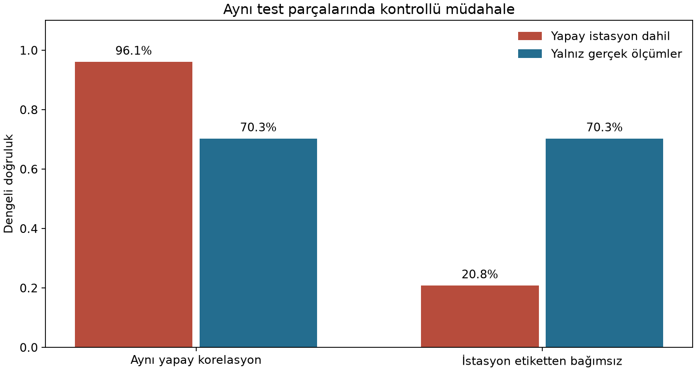
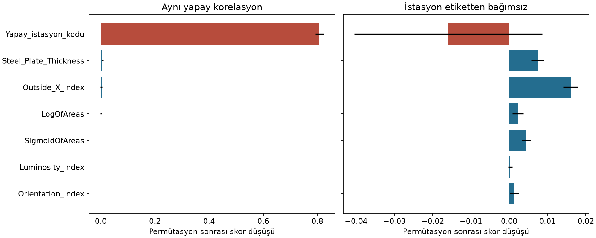

# Bölüm 33 ve 34 ortak uygulaması

**Yalçın Kavaklı 20269256026 ve Murat Şahin 20169258034**

Bu laboratuvar, gerçek çelik levha ölçümlerine eklenen yapay bir ipucunun bir modeli nasıl yanıltabildiğini gösterir. Eğitimdeki ve testteki yüksek skorun, modelin doğru ilişkiyi öğrendiğini tek başına garanti etmediğini inceleriz. Permütasyon özellik önemi ile modelin dayandığı ipucunu belirleyip bu girdiyi dışlayan bir modelle karşılaştırırız.

## Konuyla ilişkisi

33. bölümdeki hikâyeler, karar veren sistemlerin neden sorgulanabilmesi gerektiğini anlatır. Burada da yanlış girdiye güvenen model, aynı girdi verildiğinde aynı hatayı tekrarlar. Bu deney, kitaptaki hikâyelerin gerçek hayatta gerçekleştiğine ilişkin kanıt değildir.

34. bölümde yazar, kusurlu hedef tanımları ve eğitim ile uygulama verileri arasındaki dağılım değişimini tartışır. Buradaki mühendislik sorunu, kısıtlı bir test dağılımındaki skoru gerçek üretim başarısının yerine koymaktır. XAI, sorunu görünür kılmaya yardımcı olur; modelin doğru hedefi öğrendiğini veya gerçek dünyada güvenli olduğunu garanti etmez.

Bu çalışma iki bölüme ortak bir uygulamadır. **Bir akademik makalenin yeniden üretimi değildir.** Ders yönergesindeki makale yeniden üretimi görevi ayrıca hazırlanmalıdır.

## Gerçek veri ile yapay senaryonun ayrımı

Veri kaynağı [UCI Steel Plates Faults](https://archive.ics.uci.edu/dataset/198/steel%2Bplates%2Bfaults) veri kümesidir. 1.941 örnek, 27 ölçüm ve 7 hata türü içerir. Örnekler hata türlerine aittir; bu veriyle sağlam ürün ile kusurlu ürün ayrımı yaptığımız iddia edilmemektedir. Tahmin hedefi **hata türüdür**.

`Faults.NNA` ve `Faults27x7_var` özgün kaynak dosyalarıdır. Son yedi sütun hedef etiketleridir; model girdisine alınmaz. Sınıf adları, kaynakta yazıldığı biçimiyle korunmuştur.

`Yapay_istasyon_kodu` gerçek veri kümesinde bulunmaz. Kontrollü deney için etiketlerden üretilir; aynı dağılım senaryosunda örneklerin yüzde 98'inde etiketi kodlar. Bu, **bilerek oluşturulan bir kısayol ve veri sızıntısı senaryosudur**. Gerçek üretimde erişilebilir bir ölçüm veya veri kümesinde keşfedilmiş bir olgu gibi sunulmamalıdır.

Dağılım müdahalesinde istasyon kodu etiketten bağımsız üretilir. Test parçalarının gerçek ölçümleri ve etiketleri sabit kalır. Dolayısıyla gerçek bir fabrikanın gelecekteki performansı ölçülmez; yalnızca yapay ipucuna bağımlılık kontrollü biçimde sınanır.

## Çalıştırma

Python 3.12 ile doğrulanmıştır. Bu klasörde:

```bash
python -m pip install -r requirements.txt
python main.py
```

Kod varsayılan olarak aynı klasörde `sonuclar.json`, `performans.png` ve `ozellik_onemi.png` dosyalarını üretir. Farklı çıktı klasörü için:

```bash
python main.py --output-dir sonuclar
```

`uygulama.ipynb` aynı deneyi adımlarla açıklar. Jupyter veya Google Colab'da kullanılabilir. Notebook'ta yerel veri dosyaları yoksa özgün UCI arşivi indirilir. Notebook kaynak hücreleri hazırlanıp biçim ve sözdizimi kontrolünden geçirilmiştir; kaydedilmiş sonuçlar `main.py` çalıştırmasından gelir. Sınıfta sunmadan önce notebook'u kendi ortamınızda baştan sona çalıştırın.

## Deney akışı

1. Özgün veriyi sınıf oranlarını koruyarak yüzde 70 eğitim ve yüzde 30 test olarak ayırın. Tohum 42'dir; 1.358 eğitim ve 583 test satırı bulunur.
2. Eğitim ve aynı korelasyonlu test girdisine yapay istasyon kodunu ekleyin.
3. İstasyon kodu dâhil ve hariç olmak üzere iki Random Forest modeli eğitin. Diğer model ayarları aynıdır. Hiperparametre taraması yapılmaz.
4. Aynı test parçalarını önce yapay korelasyon korunurken, sonra istasyon bağımsızken değerlendirin.
5. İstasyon kullanan modelin permütasyon özellik önemini iki senaryoda ayrı hesaplayın.
6. Tek bir parçanın 27 gerçek ölçümünü sabit tutup istasyon kodunu 0–6 arasında değiştirin. Tahminlerin değişmesini inceleyin.

## Çalıştırmada gözlenen sonuçlar

| Model | Aynı yapay korelasyon | İstasyon etiketten bağımsız |
|:--|--:|--:|
| İstasyon kodu dâhil | %96,1 | %20,8 |
| Yalnız gerçek ölçümler | %70,3 | %70,3 |

Tablodaki ölçüt **dengeli doğruluktur**; yedi sınıfın duyarlılıklarının ortalamasıdır. Normal doğruluk ve makro F1 değerleri JSON dosyasında ayrıca kayıtlıdır. İstasyonu kullanmayan modelin iki sütunda aynı skoru vermesi beklenir; bu model için test girdileri iki senaryoda aynıdır. Bu sonuç bütün gerçek dağılım değişimlerine dayanıklı olduğu anlamına gelmez.



Permütasyon öneminin hesabı:

$$I_j=s(X,y)-\frac{1}{K}\sum_{k=1}^{K}s(X_{\pi_j^{(k)}},y),\qquad K=8.$$

Burada skor dengeli doğruluktur. Pozitif değer, ilgili sütunun karıştırılmasıyla skorun düştüğünü gösterir. Negatif değer karıştırmanın bu veri üzerinde skoru yükselttiğini gösterir. Bu bir nedensel önem veya fiziksel mekanizma kanıtı değildir. Hata çubukları sekiz karıştırmanın standart sapmasıdır; güven aralığı değildir. Grafik panellerinin yatay ölçekleri farklıdır; sayısal eksenleri okuyarak karşılaştırın.



## Sınıfta tartışma

- Modelin neye dayandığını açıklamak ile modelin doğru ilişkiyi öğrendiğini göstermek aynı şey midir?
- Aynı yapay korelasyon testte de korunursa, ayrı test kümesi kullanmak neden sızıntıyı tek başına engellemez?
- Gerçek veri kümesindeki ilişkili özellikler, tek tek permütasyon önemini nasıl etkileyebilir?
- İstasyon kodu dışlandığında ilk skor neden düşer? Üretimde hangi test tasarımı gerekir?
- Bu örnek, hedeflerin yanlış tanımlanması konusunun hangi kısmını gösterir; hangi kısmını göstermez?

## Sınırlar

Tek bir eğitim ve test ayrımı kullanılmıştır. Sekiz permütasyon tekrarından elde edilen değişkenlik, veri bölünmesinden veya model eğitiminden gelen belirsizliği kapsamaz. Test verisinde tasarlanan müdahale deneyin parçasıdır; sonuçlardan hareketle genel bir algoritma üstünlüğü iddia edilmez. Özellik seçimi ve hiperparametrelerin gerçek projede ayrı doğrulama verisiyle ele alınması gerekir. İstasyon kodu sayısal olarak kodlanmıştır; sıralı kodlama bu yapay deneyin bir tercihidir. Çalışma endüstriyel üretime hazır bir sistem değildir.

## Kaynaklar ve lisans

- Buscema, M., Terzi, S., & Tastle, W. (2010). *Steel Plates Faults* [Dataset]. UCI Machine Learning Repository. [DOI 10.24432/C5J88N](https://doi.org/10.24432/C5J88N). Özgün veriler [CC BY 4.0](https://creativecommons.org/licenses/by/4.0/) lisanslıdır. Özgün dosyalar değiştirilmeden eklenmiştir; yapay özellik çalışma sırasında bellekte üretilir.
- Christoph Molnar, [Story Time](https://christophm.github.io/interpretable-ml-book/storytime.html) ve [The Future of Interpretability](https://christophm.github.io/interpretable-ml-book/future.html). Konuyla bağlantıyı kuran kitaptır; deney Molnar'ın özgün kodu değildir.
- scikit-learn [Permütasyon özellik önemi](https://scikit-learn.org/stable/modules/permutation_importance.html) ve [RandomForestClassifier](https://scikit-learn.org/stable/modules/generated/sklearn.ensemble.RandomForestClassifier.html) belgeleri.

Kod MIT lisansıyla paylaşılır; `LICENSE` dosyasına bakın. Veri lisansı kod lisansından ayrıdır.
